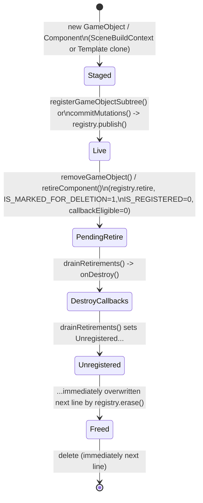

# GameManager, Lifecycle, and Engine Structure Audit

**Date:** 18 November 2026  
**Reviewed baseline:** `66bb9b54` (`branch-without-bvh`, with uncommitted spec 020 raycast working-tree edits present)  
**Hand-written comparison baseline:** `e01526b00f0b3552cccc884887f9281fbaa1a104` (`main`)

This document audits the current C++ engine codebase—centered on `GameManager` and object/component/transform/scene lifecycles—to restore a clear mental model, identify correctness bugs and wasted work, and propose bounded cleanup packages. **No code or existing files were modified during this audit.**

---

## Executive Summary

At `e01526b`, `GameManager` was a straightforward ~650-line coordinator: direct object registration, immediate component dispatch, a simple frame loop, and three small value-stored asset caches. Over 20 subsequent feature specifications (`001`–`020`), `gamemanager.cpp` grew to **1,824 lines** and accumulated **13 `friend class` declarations**, **15 `Phase` enum values**, **6 `ObjectLifecycle` states**, and **14 asset-cache fields**.

Some of that growth solves real, hard problems that are worth **keeping**:
- **Deferred subsystem reconciliation & retirement** keeps iterators stable during script/collision callbacks and guarantees that `onCollisionExit` and `onDestroy` can still read retired objects before `delete`.
- **Generational `ObjectHandle` / `ObjectRegistry`** prevents dangling `ObjectReference` rebinding across destroyed objects, scene reloads, and recreated runtimes.
- **Dirty queues** (`dirtyTransforms`, `reconciliations`, `pendingStartScripts`, `pendingBodyChanges`, `pendingColliderOperations`) avoid global per-frame scans on idle scenes.

However, because features were layered spec-by-spec rather than unified around one lifecycle design, **five root causes** now make `GameManager` genuinely difficult to follow—and introduce real bugs and avoidable work:

1. **Conflated responsibilities in `GameManager` and `commitMutations()`:** `GameManager` is simultaneously the frame scheduler, mutation reconciler, transform hierarchy manager, scene transition coordinator, and a 617-line copy-pasted asset cache/hot-reloader. Worst of all, `commitMutations()` bundles *local mutation flushing* with *whole-scene transitions*, causing idle single-object mutations to hijack queued scene requests and return **dangling pointers** ([B01](#b01-flushifidle-hijacks-pendingscenerequest-causing-dangling-pointers)).
2. **Split-brain lifecycle state:** Whether an object or component is "alive" is tracked simultaneously by `BaseObject::lifecycle` (6 states, 2 unobservable), `ObjectRegistry::Slot::published`, `GameObject::IS_REGISTERED_IN_GAME_MANAGER`, `GameObject::IS_MARKED_FOR_DELETION`, `Component::reconcileQueued`, `Component::systemsRegistered`, `Component::callbackEligible`, and per-subsystem registration booleans/indices. Callers defensively check 2–5 overlapping booleans because no single invariant is trusted.
3. **Hidden sync points and half-applied mid-step states:** Transform sync runs in 5 places; physics body participation updates reach `applyPhysics()` only via an implicit side-channel (`queueReconciliation` → `pendingBodyChanges` → `narrowPhase` → `flushSupportDeltas` → `reconcileChangedBodies`); and `Phase::AfterPhysicsSync` runs *after* `commitMutations()` with neither a mutation guard nor a post-phase flush ([B02](#b02-phaseafterphysicssync-leaves-mutations-uncommitted-before-render-and-idle)).
4. **Over-engineered / redundant hierarchy and teardown work:** The engine maintains global DFS `hierarchyOrder` across all `GameObject`s and triggers full-scene $O(N)$ rebuilds on empty queues, flat scenes, and parent-child destructions—when **top-most dirty ancestor pruning** solves transform ordering in $O(\text{dirty})$ with zero global rebuilds and zero sorting ([W01](#w01-hierarchyorder--rebuildhierarchyorder-does-unnecessary-on-full-scene-rebuilds-and-can-be-removed-entirely)). Whole-scene clears/reloads/shutdowns also run incremental `tbb::parallel_for` broadphase removal and exit-event sorting even when zero survivors exist ([W04](#w04-whole-scene-teardown-runs-full-incremental-broadphase-and-no-op-exit-event-dispatch)).
5. **Spec leftovers and dead code:** ~34% of `gamemanager.cpp` is duplicated asset cache boilerplate including unused 1-argument `reloadTexture`/`reloadAudio`/`reloadAnimationClip`, unused `findTemplate`, and a permanently empty `retiredTemplateCache`; `reconcilePending()` still contains a fossil `refreshSolverPairs()` call from deleted `onCollisionStay` subscriptions ([W05](#w05-vestigial-refreshsolverpairs-in-reconcilepending)); and `simulateAndRenderFrameWithCustomCallback()` has a release-mode `#if` bug on `clearAdvanceFrameRequest()` ([B03](#b03-simulateandrenderframewithcustomcallback-skips-clearadvanceframerequest-in-release-builds)).

---

## Part 1: How the Current Lifecycle & Sync Model Actually Works

Before refactoring anything, here is the exact ground truth of how the engine currently executes.

### 1.1 Frame Execution & Sync Points

In `GameManager::runSimulationStepWithCustomCallback` ([gamemanager.cpp:196-288](file:///home/user/Projects/Platformator/engine/src/gamemanager.cpp#L196-L288)) and `loop` ([gamemanager.cpp:290-338](file:///home/user/Projects/Platformator/engine/src/gamemanager.cpp#L290-L338)):

```mermaid
flowchart TD
    A["Phase::Idle (owner thread)"] --> B["Phase::Starting\nstartPendingScripts()\n(resolveReferences + start)"]
    B --> C["Phase::StepHook\nprePhysicsStepHook(dt)"]
    C --> D["Phase::FixedUpdate\nfixedUpdateScriptComponents(dt)"]
    D --> E["Phase::Physics\n1. synchronizeTransforms()\n2. checkForCollisions():\n   - broadPhase: grid.flushPendingCellUpdates()\n   - narrowPhase: narrow pairs + flushSupportDeltas()\n     -> HIDDEN: reconcileChangedBodies()\n3. applyPhysics(dt) [parallel]\n4. resolveCollisions(dt)\n   - solver + kinematic resolve (eager refreshImmediate)\n   - reconcileChangedBodies()\n   - updateSleepingStates(dt) -> reconcileChangedBodies()\n5. applyMovement(dt) [parallel] -> queueTransform(refresh=false)\n6. synchronizeTransforms()"]
    E --> F["Phase::CollisionDispatch\nhandlePendingPhysicsEvents(dt)\n(Enter / Exit from narrowPhase & broadPhase)"]
    F --> G["Phase::Update\nupdateScriptComponents(dt)"]
    G --> H["Phase::Animation\nupdateAnimatorComponents(dt)"]
    H --> I["Phase::LateUpdate\nlateUpdateScriptComponents(dt)"]
    I --> J["Cleanup (runs even if try-block threw)\n1. window->updateAudio()\n2. commitMutations() [Phase::MutationCommit]:\n   a. Prepare SceneBuildContext if pendingSceneRequest has path\n   b. If clearing/prepared: removeGameObject() on entire old scene\n   c. reconcilePending() loop:\n      - apply desired register/unregister to Physics/Window/Runtime\n      - synchronizeTransforms()\n      - physicsManager->flushPendingColliderOperations()\n        (grid flush + flushSupportDeltas -> reconcileChangedBodies)\n      - handlePendingPhysicsEvents(0.0) [Phase::CollisionDispatch]\n      repeat while !reconciliations.empty()\n   d. drainRetirements(): onDestroy() [Phase::DestructionCallbacks], erase handles, delete\n   e. If clearing/prepared: window->releaseRenderingStorage()\n   f. If prepared: swap gameObjects/ids, publish handles, queueTransform all,\n      queueReconciliation all, run reconcilePending() AGAIN"]
    J --> K["++simulationStepNumber\nPhase::AfterPhysicsSync (if no error)\nafterPhysicsSyncScriptComponents(dt)\n(NO commit or transform sync follows!)"]
    K --> L["Back to Phase::Idle\n(host afterSimulationStep, then Phase::Rendering -> window->render())"]
```



### 1.2 Immediate vs. Deferred Effects of Every Structural Mutation

This table is the core mental-model split that makes `GameManager` feel inconsistent. Notice that **the same API behaves differently depending on `phase == Phase::Idle` vs. mid-step vs. `Phase::AfterPhysicsSync`**, and even *within* a single call, some structures mutate immediately while others are deferred:

| Operation | Mutates **Immediately** (always) | Deferred to `commitMutations()` (when mid-step) | Extra behavior when `phase == Phase::Idle` | Behavior in `Phase::AfterPhysicsSync` |
|---|---|---|---|---|
| `createGameObject()` | Allocates `GameObject`, assigns file ID, registers handle (`Live`), inserts into `gameObjects` & `idToObjectMap`, queues transform (`refreshImmediatePositions`) | Transform sync (`worldPosition`) | Calls `flushIfIdle()` → runs full `commitMutations()` (**hijacks `pendingSceneRequest`!**) | `isIdle() == false`; leaves `dirtyTransforms` unflushed! |
| `destroyGameObject()` / `destroy()` | Recursively detaches children (`hierarchyDirty = true`), swap-removes from `gameObjects`, erases from `idToObjectMap`, cancels transform, sets `PendingRetire` + `IS_MARKED_FOR_DELETION`, sets `callbackEligible = false` on components, queues components for reconciliation, pushes to `gameObjectsToDelete` | Subsystem unregistration (Physics/Grid/Window/Scripts/Animators), `onCollisionExit`, `onDestroy()`, handle erase, `delete` | Calls `flushIfIdle()` → runs full `commitMutations()` (**hijacks `pendingSceneRequest`!**) | Leaves sprite registered in `SDLWindow` & `gameObjectsToDelete` unflushed until next step! |
| `addComponent<T>()` | Assigns file ID, registers handle (`Live`), replaces slot `components[type]` (retiring old component if present), updates inertia/response, sets `callbackEligible = false`, queues reconciliation (+ `pendingBodyChanges` if `Rigidbody`) | Subsystem registration (and old component unregistration + `onDestroy()` + `delete`) | Calls `flushIfIdle()` → runs full `commitMutations()` on **every** chained `addComponent`! | Leaves new component unregistered & replaced component alive until next step! |
| `removeComponent()` | Clears `components[type]`, retires handle (`PendingRetire`), erases from `idToObjectMap`, pushes to `retiredComponents`, queues reconciliation | Subsystem unregistration, `onCollisionExit`, `onDestroy()`, `delete` | Calls `flushIfIdle()` → runs full `commitMutations()` | Leaves removed component registered in subsystems & undeleted! |
| `setActive(bool)` | Flips `IS_ACTIVE` bit, sets `callbackEligible = false` and queues reconciliation on all attached components (per-object only; does **not** cascade to children) | Subsystem register/unregister; `callbackEligible` stays `false` for rest of step even if toggled back `true` | Calls `flushIfIdle()` → runs full `commitMutations()` | Leaves subsystems & `callbackEligible` out of sync until next step! |
| `setPosition()` / `setLocalPosition()` | Updates local `position`, walks entire subtree in `refreshImmediatePositions()` (`immediateWorldPosition`), wakes own `Rigidbody`, queues in `dirtyTransforms` | Updates `worldPosition`, notifies `SDLWindow` render culling, wakes descendant rigidbodies, calls `updateCollider()` (runs at next `synchronizeTransforms()`) | Does **not** call `flushIfIdle()` (`worldPosition` stays stale until next sync or `EditorPreviewAccess`) | Leaves `worldPosition` stale for `render()` & `afterSimulationStep`! |
| `setRotation()` / `setScale()` | Updates rotation/scale, notifies `SDLWindow` render culling, wakes `Rigidbody` (and refreshes inertia on scale), calls `updateCollider()` immediately | Broadphase `Grid` update (next flush) | No `flushIfIdle()` | Grid stays stale until next sync |
| `addChild()` / `removeChild()` | Mutates `parent`/`children`, recalculates local `position` preserving world pos, sets `hierarchyDirty = true`, calls `queueTransform()` (eagerly walks subtree) | `synchronizeSubtree()` + `updateCollider()` | No `flushIfIdle()` | Same as `setPosition` |
| `requestLoadScene()` / `requestClearScene()` | Stores `pendingSceneRequest` (last-wins) | Executes in `commitMutations()` | Does **not** call `flushIfIdle()`—**except any subsequent idle mutation's `flushIfIdle()` accidentally triggers it!** | Stays pending until next step or idle mutation |
| `loadScene()` / `clearScene()` | Stores `pendingSceneRequest` | Executes in `commitMutations()` | Calls `flushIfIdle()` → executes immediately | Same as `request*` |

### 1.3 Current Object & Component Lifecycle State Layers

Today a single `GameObject` and its `Component`s pass through **four overlapping state tracking layers**:



Compare all redundant state fields representing the same facts:

| Concept | Redundant representations currently maintained |
|---|---|
| Object is live in runtime | `lifecycle == ObjectLifecycle::Live` **AND** `ObjectRegistry::Slot::published == true` **AND** `GameObject::IS_REGISTERED_IN_GAME_MANAGER` **AND** `gameManagerIteratorIndex != SIZE_MAX` |
| Object is retired / pending delete | `isRetired()` (`lifecycle >= PendingRetire`) **AND** `GameObject::IS_MARKED_FOR_DELETION` **AND** `!getIsRegisteredInGameManager()` (once previously live) |
| Component is registered in subsystems | `Component::systemsRegistered` **AND** per-type flags (`Collider::IS_REGISTERED_IN_PHYSICS_MANAGER`, `Rigidbody::isRegisteredInPhysicsManager`, `Sprite::isRegisteredInWindow`, `Animator::gameManagerIndex != SIZE_MAX`, `ScriptComponent::gameManagerIndex != SIZE_MAX`) |
| Component may receive callbacks | `Component::callbackEligible` **AND** repeated checks of `!isRetired()`, `owner->getActive()`, `!owner->isRetired()`, `owner->getComponent<ScriptComponent>() == this` |
| Object destroyed/freed | `ObjectLifecycle::Unregistered` (never observed) **AND** `ObjectLifecycle::Freed` (never observed) |

### 1.4 Where Every Sync Happens

1. **`GameManager::synchronizeTransforms()`** — 5 call sites:
   - [gamemanager.cpp:233](file:///home/user/Projects/Platformator/engine/src/gamemanager.cpp#L233) — start of `Phase::Physics`, before `checkForCollisions()`
   - [gamemanager.cpp:238](file:///home/user/Projects/Platformator/engine/src/gamemanager.cpp#L238) — end of `Phase::Physics`, after `applyMovement()`
   - [gamemanager.cpp:1442](file:///home/user/Projects/Platformator/engine/src/gamemanager.cpp#L1442) — inside `reconcilePending()` loop (every `commitMutations()` & every `flushIfIdle()`)
   - [collider.cpp:105](file:///home/user/Projects/Platformator/engine/src/collider.cpp#L105) — inside `Collider::prepareSync()` (only called by `regression_tests.cpp`)
   - [editor/src/preview.cpp:2266](file:///home/user/Projects/Platformator/editor/src/preview.cpp#L2266) — `EditorPreviewAccess::publish_proxy_position()`
2. **`PhysicsManager::flushPendingColliderOperations()`** (`grid.flushPendingCellUpdates()` + `flushSupportDeltas()`):
   - [gamemanager.cpp:1445](file:///home/user/Projects/Platformator/engine/src/gamemanager.cpp#L1445) — inside `reconcilePending()` loop
   - Note: `broadPhase()` ([physicsmanager.cpp:192](file:///home/user/Projects/Platformator/engine/src/physicsmanager.cpp#L192)) calls `grid.flushPendingCellUpdates()`, and `narrowPhase()` ([physicsmanager.cpp:236](file:///home/user/Projects/Platformator/engine/src/physicsmanager.cpp#L236)) calls `flushSupportDeltas()`.
3. **`PhysicsManager::reconcileChangedBodies()`** (updates `awakeDynamicBodies`, `movingKinematicBodies`, `sleepCandidates`, and refreshes `solverPairs`):
   - [physicscontacts.cpp:76](file:///home/user/Projects/Platformator/engine/src/physicscontacts.cpp#L76) — at the end of `flushSupportDeltas()` (which is the **hidden path** making `FixedUpdate` wakes/destroys visible before `applyPhysics()`)
   - [physicsmanager.cpp:326](file:///home/user/Projects/Platformator/engine/src/physicsmanager.cpp#L326) — in `resolveCollisions()` before `updateSleepingStates()`
   - [physicsmanager.cpp:636](file:///home/user/Projects/Platformator/engine/src/physicsmanager.cpp#L636) — at the end of `updateSleepingStates()`

---

## Part 2: Confirmed Bugs & Contract Hazards

| ID | Severity | Location | Summary |
|---|---|---|---|
| **B01** | **High (UAF)** | [gamemanager.cpp:581-608](file:///home/user/Projects/Platformator/engine/src/gamemanager.cpp#L581-L608), [1231-1237](file:///home/user/Projects/Platformator/engine/src/gamemanager.cpp#L1231-L1237), [1520-1599](file:///home/user/Projects/Platformator/engine/src/gamemanager.cpp#L1520-L1599); [gameobject.cpp:145](file:///home/user/Projects/Platformator/engine/src/gameobject.cpp#L145), [270](file:///home/user/Projects/Platformator/engine/src/gameobject.cpp#L270), [336](file:///home/user/Projects/Platformator/engine/src/gameobject.cpp#L336); [template.cpp:397](file:///home/user/Projects/Platformator/engine/src/template.cpp#L397) | `flushIfIdle()` executes `pendingSceneRequest`, freeing the object just created/mutated and returning a dangling pointer. |
| **B02** | **High** | [gamemanager.cpp:253-279](file:///home/user/Projects/Platformator/engine/src/gamemanager.cpp#L253-L279), [1183-1194](file:///home/user/Projects/Platformator/engine/src/gamemanager.cpp#L1183-L1194); [sdlwindow.cpp:466](file:///home/user/Projects/Platformator/engine/src/sdlwindow.cpp#L466), [586-608](file:///home/user/Projects/Platformator/engine/src/sdlwindow.cpp#L586-L608) | `Phase::AfterPhysicsSync` allows mutations while `!isIdle()` and runs after `commitMutations()` with no post-flush; leaves dirty queues in `Phase::Idle` and renders retired sprites / stale transforms. |
| **B03** | **Medium** | [gamemanager.cpp:383-385](file:///home/user/Projects/Platformator/engine/src/gamemanager.cpp#L383-L385) vs [gamemanager.cpp:323](file:///home/user/Projects/Platformator/engine/src/gamemanager.cpp#L323) & [sdlwindow.cpp:838-846](file:///home/user/Projects/Platformator/engine/src/sdlwindow.cpp#L838-L846) | `simulateAndRenderFrameWithCustomCallback()` compiles out `clearAdvanceFrameRequest()` when `PLATFORMATOR_ENABLE_DEBUG_TOOLS == 0`, breaking editor single-stepping in release builds. |
| **B04** | **Medium** | [scriptcomponent.cpp:68](file:///home/user/Projects/Platformator/engine/src/scriptcomponent.cpp#L68), [80-81](file:///home/user/Projects/Platformator/engine/src/scriptcomponent.cpp#L80-L81), [97-98](file:///home/user/Projects/Platformator/engine/src/scriptcomponent.cpp#L97-L98); [template.cpp:388-393](file:///home/user/Projects/Platformator/engine/src/template.cpp#L388-L393) | `pendingReferencesResolved` is per-`ScriptComponent` rather than per-pending-behavior; adding a behavior to a freshly instantiated template script causes template behaviors to run `resolveReferences()` twice. |
| **B05** | **Low** | [camera.cpp:50](file:///home/user/Projects/Platformator/engine/src/camera.cpp#L50), [97](file:///home/user/Projects/Platformator/engine/src/camera.cpp#L97) vs [camera.cpp:102-103](file:///home/user/Projects/Platformator/engine/src/camera.cpp#L102-L103), [123](file:///home/user/Projects/Platformator/engine/src/camera.cpp#L123) | `Camera` renders sprites using `worldPosition` (synchronized snapshot) while `worldToScreenPoint` / `DebugDraw` reads `getX()/getY()` (`immediateWorldPosition`), causing overlays to drift from sprites whenever transforms are unsynchronized. |

### Detailed Traces for Confirmed Bugs

#### B01: `flushIfIdle()` hijacks `pendingSceneRequest`, causing dangling pointers
`Runtime::requestLoadScene(path)` and `Runtime::requestClearScene()` intentionally queue a deferred scene transition (`pendingSceneRequest`) without flushing ([runtime.cpp:109-117](file:///home/user/Projects/Platformator/engine/src/runtime.cpp#L109-L117), tested in [scene_transition_contract_test.cpp:116-120](file:///home/user/Projects/Platformator/engine/tests/scene_transition_contract_test.cpp#L116-L120)). However, if any idle mutation is performed before the next `simulateFrame()`:
1. `runtime.requestLoadScene("next.scene")` sets `pendingSceneRequest`.
2. `GameObject *obj = runtime.createGameObject()` registers `obj` in `gameObjects`, releases its `unique_ptr`, and calls `flushIfIdle()` ([gamemanager.cpp:589-592](file:///home/user/Projects/Platformator/engine/src/gamemanager.cpp#L589-L592)).
3. `flushIfIdle()` calls `commitMutations()` ([gamemanager.cpp:1235](file:///home/user/Projects/Platformator/engine/src/gamemanager.cpp#L1235)).
4. `commitMutations()` moves `pendingSceneRequest`, loads `"next.scene"`, removes and **`delete`s all objects in `gameObjects`—including `obj`**.
5. `createGameObject()` returns `result`: a **use-after-free dangling pointer**.

The identical hazard exists on idle `GameObject::setActive()` (returns dangling `this`), `GameObject::addComponent<T>()` (returns dangling `this`), `GameObject::removeComponent()`, `GameManager::destroyGameObject()`, and `Template::instantiate()` (returns dangling `clonedRoot`).

**Fix direction:** Split `commitMutations()` into `commitLocalMutations()` and `commitSceneTransition()`. `flushIfIdle()` must call **only** `commitLocalMutations()`; scene transitions should execute only from explicit `loadScene()`/`clearScene()` (when idle) or at the end-of-step simulation commit boundary.

#### B02: `Phase::AfterPhysicsSync` leaves mutations uncommitted before `render()` and `Idle`
In `runSimulationStepWithCustomCallback()` ([gamemanager.cpp:253-279](file:///home/user/Projects/Platformator/engine/src/gamemanager.cpp#L253-L279)), `commitMutations()` runs *before* `Phase::AfterPhysicsSync`. Meanwhile:
- `assertCanMutate()` ([gamemanager.cpp:1189](file:///home/user/Projects/Platformator/engine/src/gamemanager.cpp#L1189)) does **not** reject `Phase::AfterPhysicsSync` (and [runtime_step_test.cpp:310](file:///home/user/Projects/Platformator/engine/tests/runtime_step_test.cpp#L310) calls `addBehavior` during `afterPhysicsSync`).
- Because `phase == Phase::AfterPhysicsSync` (`!isIdle()`), `flushIfIdle()` does nothing.
- Nothing commits mutations or synchronizes transforms after `Phase::AfterPhysicsSync` returns.

Consequently, if any `afterPhysicsSync` behavior calls `destroy()`, `setActive(false)`, `createGameObject()`, `addComponent()`, or `setPosition()`:
- The runtime returns to `Phase::Idle` with **uncommitted items still in `reconciliations`, `gameObjectsToDelete`, `retiredComponents`, and `dirtyTransforms`**, violating the `Idle` invariant.
- The immediately following `window->render()` draws **retired sprites**: in `SubmitAll` mode `spriteComponent->getGameObject()->getActive()` is still `true` ([sdlwindow.cpp:466](file:///home/user/Projects/Platformator/engine/src/sdlwindow.cpp#L466)); in `CachedLinear` mode either the cached selection hits unchanged or `resolveRecordSprite()` returns `nullptr` → sets `record.boundsValid = false` → `visibleWithResolvedSprite()` returns `true` ([sdlwindow.cpp:586-608](file:///home/user/Projects/Platformator/engine/src/sdlwindow.cpp#L586-L608))!
- Moved cameras or sprites render at their stale `worldPosition`.

Also note a documentation inversion in [runtime.h:77](file:///home/user/Projects/Platformator/engine/include/platformator/runtime.h#L77): it states `(after Behavior::afterPhysicsSync and commitMutations finish)`, reversing the actual execution order.

**Fix direction:** Decide explicitly between two clean models:
1. **Strict read-only `AfterPhysicsSync`** (matches [CPP_API_MIGRATION.md:134](file:///home/user/Projects/Platformator/docs/CPP_API_MIGRATION.md#L134) & [runtime.h:109](file:///home/user/Projects/Platformator/engine/include/platformator/runtime.h#L109)): forbid structural and transform mutations in `assertCanMutate()` during `Phase::AfterPhysicsSync` (deciding whether `addBehavior` is also disallowed or explicitly deferred).
2. **Permissive `AfterPhysicsSync`**: run `commitLocalMutations()` (or at least `synchronizeTransforms()` + local commit) after `Phase::AfterPhysicsSync` if any queues became non-empty (zero overhead when read-only).

#### B03: `simulateAndRenderFrameWithCustomCallback()` skips `clearAdvanceFrameRequest()` in release builds
`GameManager::loop()` clears the single-step request unconditionally ([gamemanager.cpp:323](file:///home/user/Projects/Platformator/engine/src/gamemanager.cpp#L323)), and `SDLWindow::clearAdvanceFrameRequest()` ([sdlwindow.cpp:838-846](file:///home/user/Projects/Platformator/engine/src/sdlwindow.cpp#L838-L846)) specifically has an `#else` branch for `editorSessionControlsEnabled` when `PLATFORMATOR_ENABLE_DEBUG_TOOLS == 0`. Yet `simulateAndRenderFrameWithCustomCallback()` wraps the call in `#if PLATFORMATOR_ENABLE_DEBUG_TOOLS` ([gamemanager.cpp:383-385](file:///home/user/Projects/Platformator/engine/src/gamemanager.cpp#L383-L385)), leaving `advanceFrameRequested == true` forever when stepping a paused editor session in a debug-tools-off build.

**Fix direction:** Remove the `#if PLATFORMATOR_ENABLE_DEBUG_TOOLS` guard around `window->clearAdvanceFrameRequest()` (and around `window->clearDebugObjects()`, which is already guarded internally).

#### B04: `ScriptComponent::pendingReferencesResolved` is component-scoped instead of per-behavior
`Template::instantiateImpl()` resolves internal references for cloned behaviors and calls `script->markPendingReferencesResolved()` ([template.cpp:388-393](file:///home/user/Projects/Platformator/engine/src/template.cpp#L388-L393)). If any behavior is then added via `script->addBehavior(...)` before the next step's `Phase::Starting`, `addBehavior()` resets `pendingReferencesResolved = false` for the entire component ([scriptcomponent.cpp:68](file:///home/user/Projects/Platformator/engine/src/scriptcomponent.cpp#L68)), causing already-resolved template behaviors to run `resolveReferences(ActiveReferenceResolver)` a second time.

**Fix direction:** Store `{Behavior *behavior; bool referencesResolved;}` (or a parallel bit/flag per pending entry) inside `ScriptComponent::pendingBehaviors` instead of one component-wide boolean.

---

## Part 3: Unnecessary & Redundant Work

| ID | Area | Cost / Frequency | Source Evidence |
|---|---|---|---|
| **W01** | Global `hierarchyOrder` & `rebuildHierarchyOrder()` | $O(N)$ full-scene DFS + $O(D \log D)$ sort; triggered on empty queues, flat scene loads, and parent-child destructions | [gamemanager.h:186-188](file:///home/user/Projects/Platformator/engine/src/gamemanager.h#L186-L188), [gamemanager.cpp:1319-1344](file:///home/user/Projects/Platformator/engine/src/gamemanager.cpp#L1319-L1344), [1575](file:///home/user/Projects/Platformator/engine/src/gamemanager.cpp#L1575); [gameobject.cpp:458](file:///home/user/Projects/Platformator/engine/src/gameobject.cpp#L458) |
| **W02** | Quadratic `refreshImmediatePositions()` during scene load & template instantiate | $O(N \cdot \text{depth})$ (up to $O(N^2)$ on deep chains); up to 4 full subtree walks in `Template::instantiate` | [gamemanager.cpp:104-109](file:///home/user/Projects/Platformator/engine/src/gamemanager.cpp#L104-L109), [1576-1591](file:///home/user/Projects/Platformator/engine/src/gamemanager.cpp#L1576-L1591); [template.cpp:345-384](file:///home/user/Projects/Platformator/engine/src/template.cpp#L345-L384) |
| **W03** | Redundant subtree traversals & duplicate world-position math | $2\times$ subtree walk per move (`refreshImmediatePositions` + `synchronizeSubtree`); needless walks on `addChild`/`removeChild` and kinematic penetration resolve | [gamemanager.cpp:1239-1309](file:///home/user/Projects/Platformator/engine/src/gamemanager.cpp#L1239-L1309); [gameobject.cpp:191-200](file:///home/user/Projects/Platformator/engine/src/gameobject.cpp#L191-L200), [354-376](file:///home/user/Projects/Platformator/engine/src/gameobject.cpp#L354-L376); [physicsmanager.cpp:602-603](file:///home/user/Projects/Platformator/engine/src/physicsmanager.cpp#L602-L603) |
| **W04** | Incremental broadphase / exit-event / culling teardown on whole-scene clear, load, and shutdown | $O(N + C \log C)$ + `tbb::parallel_for` work with zero survivors, immediately discarded by `releaseRenderingStorage()` | [gamemanager.cpp:1551-1563](file:///home/user/Projects/Platformator/engine/src/gamemanager.cpp#L1551-L1563), [1610-1627](file:///home/user/Projects/Platformator/engine/src/gamemanager.cpp#L1610-L1627) |
| **W05** | Vestigial `refreshSolverPairs(collider)` in `reconcilePending()` | Wasted hash lookup on every collider add/replace; redundant on deactivate | [gamemanager.cpp:1409-1415](file:///home/user/Projects/Platformator/engine/src/gamemanager.cpp#L1409-L1415) |
| **W06** | Idle chained object setup runs full `commitMutations()` per call | 3–5 full commits + `tbb::parallel_for` grid flushes per `createGameObject()->addComponent<>()->addComponent<>()` | [gamemanager.cpp:591](file:///home/user/Projects/Platformator/engine/src/gamemanager.cpp#L591), [607](file:///home/user/Projects/Platformator/engine/src/gamemanager.cpp#L607); [gameobject.cpp:145](file:///home/user/Projects/Platformator/engine/src/gameobject.cpp#L145), [248](file:///home/user/Projects/Platformator/engine/src/gameobject.cpp#L248), [336](file:///home/user/Projects/Platformator/engine/src/gameobject.cpp#L336) |
| **W07** | Over-reserving `scriptComponents`, `animatorComponents`, and `reconciliations` on scene load | Reserves `candidate->objects.size()` for scripts AND animators even on scenes with 0 scripts/animators; permanently retains peak capacity | [gamemanager.cpp:1536-1540](file:///home/user/Projects/Platformator/engine/src/gamemanager.cpp#L1536-L1540) |
| **W08** | Unconditional `updateCollider()` in `synchronizeSubtree()` | Queues collider sync even when `previous == object->worldPosition` (new scene objects, reparent/detach, move-and-revert) | [gamemanager.cpp:1293-1304](file:///home/user/Projects/Platformator/engine/src/gamemanager.cpp#L1293-L1304); [physicsmanager.cpp:70-78](file:///home/user/Projects/Platformator/engine/src/physicsmanager.cpp#L70-L78) |
| **W09** | Unconditional empty-queue work in `reconcilePending()` & pass-by-value `getGameObject(std::string)` | Extra `PhaseGuard`, `std::sort` on empty events, and string copies on lookup | [gamemanager.cpp:163](file:///home/user/Projects/Platformator/engine/src/gamemanager.cpp#L163), [1442-1457](file:///home/user/Projects/Platformator/engine/src/gamemanager.cpp#L1442-L1457) |

### Deep Dives on the Biggest Algorithmic Wins

#### W01: `hierarchyOrder` / `rebuildHierarchyOrder()` does unnecessary $O(N)$ full-scene rebuilds — and can be removed entirely
Look at [gamemanager.cpp:1319-1344](file:///home/user/Projects/Platformator/engine/src/gamemanager.cpp#L1319-L1344):
```cpp
void GameManager::synchronizeTransforms()
{
    if (hierarchyDirty)
    {
        PLATFORMATOR_WORK_ADD(hierarchyRebuilds, 1);
        nextHierarchyOrder = 0;
        for (auto *object : gameObjects)
            if (!object->parent)
                rebuildHierarchyOrder(object);
        hierarchyDirty = false;
    }
    if (dirtyTransforms.empty()) return;
    if (transformOrderNeeded)
        std::sort(dirtyTransforms.begin(), dirtyTransforms.end(), ...);
```
Four distinct inefficiencies stack here:
1. **`hierarchyDirty` is checked *before* `dirtyTransforms.empty()` and *before* `transformOrderNeeded`:** Even when zero objects moved, or when `dirtyTransforms.size() <= 1`, or when no dirty object has a parent (`!transformOrderNeeded`), `synchronizeTransforms()` still scans all `gameObjects` and performs a full-scene DFS rebuild.
2. **`detachFromParent()` sets `hierarchyDirty = true` needlessly** ([gameobject.cpp:458](file:///home/user/Projects/Platformator/engine/src/gameobject.cpp#L458)): Deleting a parent-child edge cannot violate `order(ancestor) < order(descendant)` for any surviving pair! Because `removeGameObject()` calls `detachFromParent()` on every child ([gamemanager.cpp:126](file:///home/user/Projects/Platformator/engine/src/gamemanager.cpp#L126)), destroying *any* parented object (e.g., an enemy with a hitbox child) triggers an $O(N)$ full-world hierarchy rebuild on the next sync—even if nothing else moved.
3. **Scene load sets `hierarchyDirty = true` unconditionally** ([gamemanager.cpp:1575](file:///home/user/Projects/Platformator/engine/src/gamemanager.cpp#L1575))—even for 100% flat scenes—and `GameManager` initializes `hierarchyDirty = true` on construction ([gamemanager.h:187](file:///home/user/Projects/Platformator/engine/src/gamemanager.h#L187)), rebuilding on an empty scene.
4. **The entire global `hierarchyOrder` mechanism is unnecessary:** Its sole purpose is ensuring that if both an ancestor and a descendant are in `dirtyTransforms`, the ancestor is synchronized before the descendant. Instead of maintaining a global DFS numbering across all $N$ scene objects and running `std::sort` ($O(D \log D)$), `synchronizeTransforms()` can use **top-most dirty ancestor pruning**:
   - Keep `transformQueueIndex != SIZE_MAX` while scanning `dirtyTransforms`.
   - For each `object` in `dirtyTransforms`, check whether any ancestor is also dirty (`ancestor->transformQueueIndex != SIZE_MAX`).
     - For flat objects (`object->parent == nullptr`), this is a single null check ($O(1)$).
     - To stay strictly amortized $O(1)$ even on pathological 10,000-deep chains, stamp verified-clean ancestors with `++transformStamp` and stop the upward walk on either `ancestor->transformQueueIndex != SIZE_MAX` (dirty ancestor found → skip `object`) or `ancestor->transformStamp == transformStamp` (known clean → `object` is a top-most dirty root).
   - Call `synchronizeSubtree(object)` only on top-most dirty roots. Because top-most dirty subtrees are **strictly disjoint**, every affected node is visited **exactly once**, parent strictly before child, with **zero global rebuilds** and **zero sorting**.
   - Clear `transformQueueIndex = SIZE_MAX` for all entries in `dirtyTransforms` and clear the vector.

This eliminates `GameObject::hierarchyOrder`, `GameManager::nextHierarchyOrder`, `GameManager::hierarchyDirty`, `GameManager::transformOrderNeeded`, `rebuildHierarchyOrder()`, all 5 `hierarchyDirty = true` scatter sites, and `std::sort` in `synchronizeTransforms()`, while keeping `runtime_work_test`'s exact visit counts (`hierarchyRebuilds == 0`, `transformVisits == 21` and `20`)!

#### W02: Quadratic `refreshImmediatePositions()` on scene load, subtree registration, and template instantiation
`queueTransform(object, true)` calls `object->refreshImmediatePositions()`, which recursively traverses `object`'s entire subtree ([gameobject.cpp:191-200](file:///home/user/Projects/Platformator/engine/src/gameobject.cpp#L191-L200)).
- In **scene publication** ([gamemanager.cpp:1576-1591](file:///home/user/Projects/Platformator/engine/src/gamemanager.cpp#L1576-L1591)), `commitMutations()` calls `queueTransform(object)` for **every** `object` in `gameObjects` (already ordered parent-before-child). For a hierarchy of depth $D$, a node at depth $d$ has `refreshImmediatePositions()` executed on it $d + 1$ times—$O(N^2)$ on deep chains—even though `SceneBuildContext::buildObjectSubtree()` *already* computed both `immediateWorldPosition` and `worldPosition` while staged!
- In **`registerGameObjectSubtree()`** ([gamemanager.cpp:73-110](file:///home/user/Projects/Platformator/engine/src/gamemanager.cpp#L73-L110)), the exact same pattern occurs: `queueTransform(gameObject)` walks all descendants, then the recursive loop calls `registerGameObjectSubtree(child)` → `queueTransform(child)` which walks them again.
- In **`Template::instantiateImpl()`** ([template.cpp:345-384](file:///home/user/Projects/Platformator/engine/src/template.cpp#L345-L384)):
  1. `cloneSubtree()` sets positions on every node (walk #1).
  2. `registerGameObjectSubtree(clonedRoot)` calls `queueTransform` on every node (quadratic walk #2).
  3. If `parent != nullptr`, `parent->addChild(clonedRoot)` calls `clonedRoot->queueTransform()` (walk #3).
  4. If `!worldPosition.has_value()`, `clonedRoot->setLocalPosition(protoRoot.getLocalPosition())` can trigger walk #4 on floating-point rounding difference.
  5. Then `reconcilePending()` → `synchronizeTransforms()` walks the entire subtree again (walk #5)!

**Fix direction:**
- When registering a subtree (`registerGameObjectSubtree`), only queue the **subtree root** (or compute once top-down without calling `queueTransform` on descendants).
- On scene publication (`commitMutations`), objects built by `SceneBuildContext` already have synchronized `immediateWorldPosition` and `worldPosition` (and colliders are already queued via `grid.queueAddCollider` with `dirty |= Geometry`, and sprites are already dirtied via `renderCullingState->appendRecord`). There is no reason to push all $N$ freshly staged scene objects into `dirtyTransforms` at all!

#### W03: Double transform traversal & unnecessary walks on reparent/detach and kinematic resolve
1. **Duplicate math in `synchronizeSubtree()`** ([gamemanager.cpp:1287-1292](file:///home/user/Projects/Platformator/engine/src/gamemanager.cpp#L1287-L1292)): Every `setPosition()` walks the subtree eagerly via `refreshImmediatePositions()` to update `immediateWorldPosition`, and then `synchronizeSubtree()` walks the exact same subtree again to compute `immediateWorldPosition` (a second time!) and `worldPosition` using the identical expression. (If `refreshImmediate` was already true, `worldPosition = immediateWorldPosition` already matches; only `PhysicsManager::applyMovement` passes `refreshImmediate = false`.)
   - *Design note:* Keeping `immediateWorldPosition` vs `worldPosition` separate is currently asserted by [render_culling_test.cpp:680-701](file:///home/user/Projects/Platformator/engine/tests/render_culling_test.cpp#L680-L701) ("The renderer sees the last synchronized `worldPosition` until the normal transform boundary"). If that two-buffer contract is kept, `GameObject::addChild()` and `GameObject::removeChild()` still do **not** need to call `queueTransform()` when world position is unchanged (they preserve world position via `detachFromParent()` / `world - getPosition()`!).
2. **`PhysicsManager::resolveKinematicBodyAgainstNormal()`** ([physicsmanager.cpp:602-603](file:///home/user/Projects/Platformator/engine/src/physicsmanager.cpp#L602-L603)) calls `gameObject->queueTransform()` (with `refreshImmediate = true`) during `resolveCollisions()`, walking the subtree eagerly right before `applyMovement()` and the unconditional `synchronizeTransforms()` at [gamemanager.cpp:238](file:///home/user/Projects/Platformator/engine/src/gamemanager.cpp#L238). Passing `refreshImmediate = false` (matching `applyMovement()`) avoids the wasted eager subtree walk.
3. **Note on `body->wakeUp()` in `synchronizeSubtree()`** ([gamemanager.cpp:1296-1299](file:///home/user/Projects/Platformator/engine/src/gamemanager.cpp#L1296-L1299)): This is **not** redundant for child objects—`applyLocalPosition()` only wakes the moved ancestor's `Rigidbody`, so `synchronizeSubtree()` is what wakes sleeping dynamic descendants when a parent moves. Preserve this when refactoring.

#### W04: Whole-scene teardown runs incremental broadphase, exit-event sorting, and per-sprite culling removal
In both `commitMutations()` ([gamemanager.cpp:1551-1563](file:///home/user/Projects/Platformator/engine/src/gamemanager.cpp#L1551-L1563)) and `shutdown()` ([gamemanager.cpp:1610-1627](file:///home/user/Projects/Platformator/engine/src/gamemanager.cpp#L1610-L1627)), tearing down an entire scene executes:
1. `while (!gameObjects.empty()) removeGameObject(gameObjects.back())` — detaching every child (`hierarchyDirty = true`), retiring every handle, and queuing every component for reconciliation.
2. `reconcilePending()`:
   - Runs `notifyPhysicsManagerOfComponentRemoved()` for every collider/body.
   - Runs `SDLWindow::removeSpriteComponent()` one by one—performing swap-removals inside `spriteComponents`, `renderCullingState`, and `spriteDrawOrder`—even though `window->releaseRenderingStorage()` wipes all of them 5 lines later!
   - Calls `synchronizeTransforms()` (triggering an $O(N)$ `hierarchyRebuilds` check).
   - Calls `physicsManager->flushPendingColliderOperations()` → runs `tbb::parallel_for` across all colliders and all grid cells to remove every AABB binding, collects pair deltas, sorts all pair deltas, decrements witness counts, and queues a `COLLISION_EXIT` event for **every** active contact pair in the dying scene.
   - Calls `handlePendingPhysicsEvents(0.0)` → sorts all those `COLLISION_EXIT` events ($O(C \log C)$) and calls `triggerCollisionExit()` twice per pair, where **100% of calls are no-ops** because every object in the runtime is already retired (`callbackEligible == false`)!

**Fix direction:** Add bulk teardown helpers (`PhysicsManager::clearAll()`, `SDLWindow::clearAllSpritesAndCamera()`) used exclusively when the entire scene is being cleared/replaced/shut down (still stopping `Audio` components, running all `onDestroy()` callbacks in `drainRetirements()`, erasing handles from `ObjectRegistry`, and deleting objects/components). Note: if an ordinary partial retirement occurred earlier in the same step *before* a scene transition that **fails** to prepare, the existing failure path still runs normal `reconcilePending()` so survivors receive `onCollisionExit` (preserving [scene_transition_contract_test.cpp:194-195](file:///home/user/Projects/Platformator/engine/tests/scene_transition_contract_test.cpp#L194-L195)).

#### W05: Vestigial `refreshSolverPairs()` in `reconcilePending()`
[gamemanager.cpp:1409-1415](file:///home/user/Projects/Platformator/engine/src/gamemanager.cpp#L1409-L1415):
```cpp
if (component->getType() == COLLIDER)
    if (auto *collider = owner->getComponent<Collider>())
        physicsManager->refreshSolverPairs(collider);
```
Git history (`f6d1af73`, "removed stay events") confirms this is a leftover from `onCollisionStay` subscription tracking (`refreshSubscriptions`). Today:
- On collider **add**: collider is not in `Grid` yet → `getTouchingPairs` always returns `nullptr` (wasted hash lookup).
- On collider **remove**: `owner->getComponent<Collider>()` is `nullptr` → never executes.
- On collider **replace**: `component` is the old retired collider, while `owner->getComponent<Collider>()` returns the *new* unregistered collider → wrong collider, always a miss.
- On owner **deactivate**: `removeColliderComponent()` runs 20 lines later and `flushPendingColliderOperations()` removes all pairs from `solverPairs` anyway.
- On coalesced **deactivate+reactivate**: live status did not change, and `Rigidbody` changes already refresh solver pairs via `reconcileChangedBodies()`.

**Fix direction:** Remove lines 1409–1415.

#### W06: Idle fluent setup runs full `commitMutations()` on every call
Creating a typical physics+sprite object while idle (`runtime.createGameObject()->setPosition(...)->addComponent<Rigidbody>()->addComponent<BoxCollider>()->addComponent<Sprite>()`) invokes `flushIfIdle()` → `commitMutations()` **four separate times**—including `tbb::parallel_for` grid flushes and empty event sorts between each component!
- **Design tradeoff:** Existing tests (e.g., [physics_bookkeeping_test.cpp:24](file:///home/user/Projects/Platformator/engine/tests/physics_bookkeeping_test.cpp#L24), [runtime_foundation_test.cpp:499-504](file:///home/user/Projects/Platformator/engine/tests/runtime_foundation_test.cpp#L499-L504), [collider_pair_cleanup_test.cpp:271](file:///home/user/Projects/Platformator/engine/tests/collider_pair_cleanup_test.cpp#L271), [destruction_contract_test.cpp:112](file:///home/user/Projects/Platformator/engine/tests/destruction_contract_test.cpp#L112)) explicitly expect idle `setActive()`, `removeComponent()`, `addComponent()`, and `destroy()` to take effect immediately (e.g., `owner->setActive(true); require(audio->isPlaying());`).
- **Low-risk improvements:**
  1. `createGameObject()` adds an object with **zero components**—it does not need to call `flushIfIdle()` at all if `worldPosition` is initialized to `{0, 0}` on construction (already true!).
  2. Inside `commitLocalMutations()`, short-circuit empty queues (`if (!dirtyTransforms.empty()) synchronizeTransforms();`, skip `handlePendingPhysicsEvents(0.0)` when `pendingPhysicsEvents.empty()`, skip `flushPendingColliderOperations()` when grid & support deltas are empty) so idle `addComponent<Sprite>()` doesn't touch physics and idle `createGameObject()` doesn't enter `Phase::CollisionDispatch`.
  3. Optional future API: an explicit `Runtime::batchMutations([&]{ ... })` scope guard (or deferring grid flush to `broadPhase()` / `raycast()`) for bulk idle spawning without repeated `tbb::parallel_for` launches.

#### W07: Permanent over-reservation during scene loading
[gamemanager.cpp:1536-1540](file:///home/user/Projects/Platformator/engine/src/gamemanager.cpp#L1536-L1540):
```cpp
reconciliations.reserve(reconciliations.size() + gameObjects.size() * COMPONENT_TYPE_COUNT + candidate->ids.size());
gameObjectsToDelete.reserve(gameObjectsToDelete.size() + gameObjects.size());
scriptComponents.reserve(std::max(scriptComponents.size(), candidate->objects.size()));
animatorComponents.reserve(std::max(animatorComponents.size(), candidate->objects.size()));
```
Loading a scene with 50,000 static tiles and 0 scripts/animators permanently reserves 50,000 entries in `scriptComponents`, 50,000 in `animatorComponents`, and `~350,000+` entries in both `reconciliations` and `reconciliationDrain` (never shrunk). `SceneBuildContext` already constructs every component and can count exact `scriptCount`, `animatorCount`, and `componentCount` during `prepare()`, reserving only what is actually needed (and with bulk teardown [W04], old components don't even enter `reconciliations`).

#### W08: Unconditional `updateCollider()` in `synchronizeSubtree()` (and its `applyMovement()` coupling)
In `synchronizeSubtree()` ([gamemanager.cpp:1293-1304](file:///home/user/Projects/Platformator/engine/src/gamemanager.cpp#L1293-L1304)), `object->updateCollider()` sits *outside* `if (previous != object->worldPosition)`, scheduling collider syncs even when world position did not change (e.g., reparent/detach, move-and-revert, or initial registration).
- **Important guardrail:** `PhysicsManager::applyMovement()` ([physicsmanager.cpp:70-78](file:///home/user/Projects/Platformator/engine/src/physicsmanager.cpp#L70-L78)) writes `if (changed.translated) queueTransform(...) else updateCollider()`, skipping `updateCollider()` when a body both translated and rotated—relying on `synchronizeSubtree()` calling `updateCollider()` unconditionally even if `position + v * dt == position` under float precision. If `object->updateCollider()` is moved inside `if (previous != object->worldPosition)`, update `applyMovement()` to call `if (changed.rotated) changed.object->updateCollider();` independently of `changed.translated`.

---

## Part 4: Lifecycle & `GameManager` Structural Cleanup

### L01: Split `commitMutations()` into two focused operations
Right now `commitMutations()` ([gamemanager.cpp:1520-1599](file:///home/user/Projects/Platformator/engine/src/gamemanager.cpp#L1520-L1599)) is 80 lines doing two unrelated jobs that interfere with each other ([B01](#b01-flushifidle-hijacks-pendingscenerequest-causing-dangling-pointers)):
- **`commitLocalMutations()`**: runs `reconcilePending()` + `drainRetirements()`. Called by `flushIfIdle()` and at the end of `runSimulationStep()`. Never touches `pendingSceneRequest`.
- **`commitSceneTransition()`**: consumes `pendingSceneRequest`.
  1. If `path` is present, prepares `SceneBuildContext` (if preparation fails, runs `commitLocalMutations()` to drain any ordinary step retirements, then rethrows—preserving [scene_transition_contract_test.cpp:194-195](file:///home/user/Projects/Platformator/engine/tests/scene_transition_contract_test.cpp#L194-L195)).
  2. Otherwise performs bulk teardown of the old scene ([W04](#w04-whole-scene-teardown-runs-full-incremental-broadphase-and-no-op-exit-event-dispatch)) + `drainRetirements()` + `window->releaseRenderingStorage()`.
  3. If `prepared`, publishes the new scene and runs one `reconcilePending()` pass.
  Called only by explicit `loadScene()`/`clearScene()` (when idle) and by `runSimulationStep()` right after `commitLocalMutations()` (or as the step-end scene check).

### L02: Collapse redundant lifecycle flags and dead enum states
1. **Trim `ObjectLifecycle`** ([baseobject.h:14-22](file:///home/user/Projects/Platformator/engine/include/platformator/baseobject.h#L14-L22)): Remove `Unregistered` and `Freed` (neither can ever be observed: [gamemanager.cpp:1497-1499](file:///home/user/Projects/Platformator/engine/src/gamemanager.cpp#L1497-L1499) writes `Unregistered`, `registry.erase()` immediately overwrites it with `Freed`, and `delete` immediately frees the object). Four clear states remain: `Staged` → `Live` → `PendingRetire` → `DestroyCallbacks`. *(Note: public header change—verify compatibility policy.)*
2. **Eliminate duplicate `GameObject` lifecycle bits** ([gameobject.h:33-39](file:///home/user/Projects/Platformator/engine/include/platformator/gameobject.h#L33-L39)):
   - `IS_REGISTERED_IN_GAME_MANAGER` is always `getLifecycle() == ObjectLifecycle::Live`. Replace the flag bit and setter with a private helper `isLive() const { return getLifecycle() == ObjectLifecycle::Live; }`.
   - `IS_MARKED_FOR_DELETION` is always `isRetired()`. Keep public `GameObject::getIsMarkedForDeletion()` as `return isRetired();` and drop the bit and setter.
   - `GameObject::flags` shrinks to just `bool active = true`!
3. **Eliminate `ObjectRegistry::Slot::published`** ([objectregistry.h:28](file:///home/user/Projects/Platformator/engine/src/objectregistry.h#L28)): Always equals `slot.object && slot.object->lifecycle == ObjectLifecycle::Live`. One source of truth!
4. **Trust `Component::callbackEligible`**: Every mutation that invalidates a component (`setActive`, `removeComponent`, `addComponent` replacement, `destroy`) calls `queueReconciliation()`, which immediately sets `callbackEligible = false`. Replace scattered 3–5-boolean guards in `ScriptComponent::canDispatch()`, `Animator::update()`, `Animator::advanceFrame()`, `GameManager::updateAnimatorComponents()`, and `Collider::triggerCollisionEnter/Exit()` with one clear invariant (`callbackEligible`, plus `assert`s in debug builds verifying `!isRetired() && owner->getActive()`).

### L03: Make `Phase::AfterPhysicsSync` contract explicit and airtight
Resolve [B02](#b02-phaseafterphysicssync-leaves-mutations-uncommitted-before-render-and-idle) by either enforcing read-only in `assertCanMutate()` during `Phase::AfterPhysicsSync` or flushing local mutations afterward, and fix the phase order comment in [runtime.h:77](file:///home/user/Projects/Platformator/engine/include/platformator/runtime.h#L77).

### L04: Make physics body participation reconciliation explicit in `Phase::Physics`
Currently, `FixedUpdate` body wakes/destroys/kinematic-velocity edits only reach `applyPhysics()` because `checkForCollisions()` → `narrowPhase()` unconditionally calls `flushSupportDeltas()` → `reconcileChangedBodies()` ([physicsmanager.cpp:236](file:///home/user/Projects/Platformator/engine/src/physicsmanager.cpp#L236), [physicscontacts.cpp:76](file:///home/user/Projects/Platformator/engine/src/physicscontacts.cpp#L76)), combined with `GameManager::queueReconciliation()` secretly calling `physicsManager->queueBodyParticipationChange()` ([gamemanager.cpp:1208](file:///home/user/Projects/Platformator/engine/src/gamemanager.cpp#L1208)).
- Call `physicsManager->reconcileChangedBodies()` explicitly at the start of `applyPhysics()` (or directly in `Phase::Physics` before `applyPhysics()`) and document clearly why `queueReconciliation()` notifies `PhysicsManager` for `Rigidbody` (so mid-step retirements in `StepHook`/`FixedUpdate` skip `applyPhysics()` without waiting for end-of-step `reconcilePending()`).

### L05: Extract `AssetManager` / `AssetCache<T>` out of `GameManager`
**617 lines (~33.8% of `gamemanager.cpp`)** and **14 member variables** in `GameManager` are purely asset caching, alias tracking, retirement retention, and editor hot-reload:
- Textures: [gamemanager.cpp:389-579](file:///home/user/Projects/Platformator/engine/src/gamemanager.cpp#L389-L579) (191 lines)
- Audio: [gamemanager.cpp:870-964](file:///home/user/Projects/Platformator/engine/src/gamemanager.cpp#L870-L964) (95 lines)
- AnimationClips: [gamemanager.cpp:966-1017](file:///home/user/Projects/Platformator/engine/src/gamemanager.cpp#L966-L1017) & [1635-1793](file:///home/user/Projects/Platformator/engine/src/gamemanager.cpp#L1635-L1793) (211 lines)
- Templates: [gamemanager.cpp:1019-1138](file:///home/user/Projects/Platformator/engine/src/gamemanager.cpp#L1019-L1138) (120 lines)

Because all 4 caches are hand-duplicated in 3 non-contiguous chunks of `gamemanager.cpp`, subtle divergences crept in:
- `freeAllTemplates()` moves `templateCache` and `retiredTemplateCache` to locals before clearing ([gamemanager.cpp:1134-1137](file:///home/user/Projects/Platformator/engine/src/gamemanager.cpp#L1134-L1137)) to prevent re-entrant `freeTemplate()` iterator invalidation during destruction, whereas `freeAllAnimationClips()` clears `animationClipCache` in place.
- `reloadTexture()` and `reloadAnimationClip()` call `aliases.rebind()`, while `reloadAudio()` calls `aliases.add()` ([gamemanager.cpp:932](file:///home/user/Projects/Platformator/engine/src/gamemanager.cpp#L932)).
- `retiredTemplateCache` is maintained and cleared despite templates having no reload method.

Moving all four into a dedicated internal `AssetStore` / `AssetCache<T>` class (owned as `std::unique_ptr<AssetStore>` or value member on `GameManager`) cuts `gamemanager.cpp` by ~500 lines and makes `GameManager` purely about **scene/object/step lifecycle**.

### L06: Collapse the 6 `notify*OfComponentAdded/Removed` methods
[gamemanager.cpp:630-781](file:///home/user/Projects/Platformator/engine/src/gamemanager.cpp#L630-L781) spans **152 lines** across 6 private methods (`notifyPhysicsManagerOfComponentAdded/Removed`, `notifyWindowOfComponentAdded/Removed`, `notifyRuntimeOfComponentAdded/Removed`), all called back-to-back only from `reconcilePending()` ([gamemanager.cpp:1428-1436](file:///home/user/Projects/Platformator/engine/src/gamemanager.cpp#L1428-L1436)). Every component goes through all 3 functions with redundant `nullptr` checks and `if/else if` chains, plus hand-rolled swap-removal for `animatorComponents` and `scriptComponents`.

Replacing all 6 methods with two `switch (component->getType())` helpers (`registerComponentInSystems` / `unregisterComponentFromSystems`) using a shared indexed swap-remove helper (like `physicsmembership.h`) reduces this to ~45 crystal-clear lines where every component type's exact subsystem ownership is visible in one place.

### L07: Untangle `Scene` ↔ `GameManager` ping-pong & fallback camera inconsistency
- **Save ping-pong:** `Runtime::saveScene` → `GameManager::saveScene` (collects roots) → `Scene::saveScene` (reaches back into `RuntimeAccess::gameManager()` to call `assertCanMutate()`, `isIdle()`, and acquire `GameManager::PhaseGuard(Phase::Saving)` — [scene.cpp:37-43](file:///home/user/Projects/Platformator/engine/src/scene.cpp#L37-L43)). Keep phase/mutation guards in `GameManager::saveScene()` and let `Scene::saveScene()` stay a pure serializer/writer.
- **Load ping-pong:** `Scene::loadScene()` ([scene.cpp:25-33](file:///home/user/Projects/Platformator/engine/src/scene.cpp#L25-L33)) calls `Runtime::loadScene(*this)` → `GameManager::loadScene` → `requestScene(scene.filePath)` → `commitMutations()` → constructs a *second* `Scene(*selected->path)` inside `SceneBuildContext::prepare()`. Passing the path directly to `SceneBuildContext::prepare(const std::string &path)` removes the round-trip wrapper.
- **Fallback camera inconsistency:** `GameManager::createMainCameraIfNoMainCameraExists()` ([gamemanager.cpp:70](file:///home/user/Projects/Platformator/engine/src/gamemanager.cpp#L70)) names the fallback camera `"Main Camera"`, whereas `SceneBuildContext::prepare()` ([scenebuilder.cpp:252-266](file:///home/user/Projects/Platformator/engine/src/scenebuilder.cpp#L252-L266)) leaves its name empty `""`.

### L08: Trim `GameManager`'s 13 `friend class` declarations
In [gamemanager.h:49-61](file:///home/user/Projects/Platformator/engine/src/gamemanager.h#L49-L61):
- **Confirmed dead friends (0 private accesses):** `friend class Component;`, `friend class ColliderPair;`, and in [behavior.h:20](file:///home/user/Projects/Platformator/engine/include/platformator/behavior.h#L20) `friend class GameManager;` (only calls public `onDestroy()`).
- **Avoidable friends:** `SDLWindow` ([sdlwindow.cpp:419](file:///home/user/Projects/Platformator/engine/src/sdlwindow.cpp#L419)), `Collider` ([collider.cpp:100,146,161,267](file:///home/user/Projects/Platformator/engine/src/collider.cpp#L100)), and `Rigidbody` ([rigidbody.cpp:468](file:///home/user/Projects/Platformator/engine/src/rigidbody.cpp#L468)) only reach into `GameManager::getPhysicsManager()` when `RuntimeAccess::physicsManager()` already exists. Switching them to `RuntimeAccess::physicsManager()` removes `SDLWindow` and `Rigidbody` from `GameManager`'s friend list immediately.

---

## Part 5: Dead Code & Engine-Wide Cleanup Candidates

| ID | Classification | Location | Finding & Suggested Disposition |
|---|---|---|---|
| **D01** | **Confirmed unused** | [gamemanager.cpp:479-516](file:///home/user/Projects/Platformator/engine/src/gamemanager.cpp#L479-L516), [910-942](file:///home/user/Projects/Platformator/engine/src/gamemanager.cpp#L910-L942), [1089-1115](file:///home/user/Projects/Platformator/engine/src/gamemanager.cpp#L1089-L1115), [1679-1723](file:///home/user/Projects/Platformator/engine/src/gamemanager.cpp#L1679-L1723); [gamemanager.h:209,211](file:///home/user/Projects/Platformator/engine/src/gamemanager.h#L209-L211); [runtimeaccess.cpp:57-96](file:///home/user/Projects/Platformator/engine/src/runtimeaccess.cpp#L57-L96) | **Unused asset reload/find APIs & dead retirement vectors.** The 1-argument `reloadTexture(path)`, `reloadAudio(path)`, `reloadAnimationClip(path)`, and `findTemplate(path)` have **0 callers** anywhere in engine, editor, tests, or examples (the editor only calls the 2-argument prepared overloads `reloadTexture(path, surface)` and `reloadAnimationClip(path, json)`). `retiredTemplateCache` is never pushed to, and `retiredAudioCache` is never pushed to. Remove the unused overloads and dead vectors (or keep only what an explicit hot-reload spec requires). |
| **D02** | **Confirmed unused (public API)** | [rigidbody.cpp:332-371](file:///home/user/Projects/Platformator/engine/src/rigidbody.cpp#L332-L371), [498-511](file:///home/user/Projects/Platformator/engine/src/rigidbody.cpp#L498-L511); [rigidbody.h:29-30,71-72](file:///home/user/Projects/Platformator/engine/include/platformator/rigidbody.h#L29-L30) | **Unused `Rigidbody` methods.** `applyForces()`, `move()`, `addSupportContact()`, and `removeSupportContact()` have **0 callers** anywhere in the repository (`PhysicsManager` calls `integrateForces()`, `integrateLocal()`, and `queueSupportDelta()` directly). Decide public SDK compatibility before removing. |
| **D03** | **Confirmed unused (public API)** | [collider.cpp:90-93](file:///home/user/Projects/Platformator/engine/src/collider.cpp#L90-L93), [199-202](file:///home/user/Projects/Platformator/engine/src/collider.cpp#L199-L202), [258-261](file:///home/user/Projects/Platformator/engine/src/collider.cpp#L258-L261); [collider.h:157,165,173](file:///home/user/Projects/Platformator/engine/include/platformator/collider.h#L157) | **Unused `Collider` internal-state getters.** `getIsQueuedForAdd()`, `getIsQueuedForAnything()`, and `hasValidGridCellRange()` have **0 callers** anywhere (`getIsQueuedForSync()` is used by tests/benchmarks, `getIsQueuedForRemove()` is used by `GridCell`). |
| **D04** | **Simplification** | [sdlwindow.cpp:821](file:///home/user/Projects/Platformator/engine/src/sdlwindow.cpp#L821), [687-745](file:///home/user/Projects/Platformator/engine/src/sdlwindow.cpp#L687-L745), [1009-1074](file:///home/user/Projects/Platformator/engine/src/sdlwindow.cpp#L1009-L1074) | **`SDLWindow` clutter.** (1) Line 821 writes `return paused \|\| (editorSessionControlsEnabled && paused);` which simplifies to `return paused;`. (2) `PLATFORMATOR_ENABLE_BENCHMARK_ORDER_MODES` (`SingleEntryRepair`, `ForcedFullSort`) adds ~100 lines of `#if`-guarded branching inside `SDLWindow` for a spec 019 experiment that proved inconclusive and was not adopted for production—decide whether to keep it for ongoing benchmarks or retire it. |
| **D05** | **Carry-over decisions** | [sdlwindow.cpp:277,363](file:///home/user/Projects/Platformator/engine/src/sdlwindow.cpp#L277); [animator.cpp:58-61](file:///home/user/Projects/Platformator/engine/src/animator.cpp#L58-L61) | **Unresolved items from prior audit ([CODE_CLEANUP_AUDIT.md](file:///home/user/Projects/Platformator/docs/CODE_CLEANUP_AUDIT.md)):** `SDL_ttf` is still linked, initialized, and torn down with zero font rendering; `Animator` still exposes duplicate `getCurrentAnimationClip()` and `getCurrentClip()`. |
| **D06** | **Consistency check** | [gameobject.cpp:233-243](file:///home/user/Projects/Platformator/engine/src/gameobject.cpp#L233-L243) | `GameObject::setName()` and `setTag()` do not call `validateMutation()` (unlike `setPosition`, `setRotation`, `setScale`, `setActive`), meaning retired or off-thread objects can mutate metadata while `onDestroy`/saving. Confirm whether intentional or add `validateMutation()`. |
| **D07** | **Design decision** | [gamemanager.cpp:1442-1458](file:///home/user/Projects/Platformator/engine/src/gamemanager.cpp#L1442-L1458); [contact_events_test.cpp:318-322](file:///home/user/Projects/Platformator/engine/tests/contact_events_test.cpp#L318-L322) | **Cleanup `onCollisionExit` transform edits:** Because `reconcilePending()` only loops `while (!reconciliations.empty())`, if an `onCollisionExit` during cleanup moves a `GameObject` without queuing any component reconciliation, its transform/grid sync is skipped until the *next* step—currently codified as expected in `cleanupCallbackGeometryWriteVisibleNextSync`. Decide whether that delay is desired or whether `synchronizeTransforms()` + `flushPendingColliderOperations()` should settle post-exit transforms before `afterPhysicsSync` / `render()`. |

---

## Part 6: Recommended Cleanup Roadmap

These bounded work packages are ordered from highest safety/clarity payoff to broader structural polish. Each can be implemented and validated independently against the existing test suite.

| Package | Findings | Goal & Key Contract Guardrails |
|---|---|---|
| **1. Mutation & Phase Boundary Fixes** | **B01**, **B02**, **B03**, **B04**, **L01**, **L03**, **L04** | Split `commitMutations()` into `commitLocalMutations()` (used by `flushIfIdle()` and step cleanup) and `commitSceneTransition()` (never triggered by `flushIfIdle()`). Enforce or flush `Phase::AfterPhysicsSync`. Fix `clearAdvanceFrameRequest()` `#if` guard and per-behavior `referencesResolved`. Make `reconcileChangedBodies()` explicit in `Phase::Physics`. **Guardrails:** Preserve `scene_transition_contract_test` (including draining ordinary retirements on failed scene prep and last-wins deferred scene requests), `callback_mutation_test`, `destruction_contract_test`, `runtime_step_test`, and `raycast_test`. |
| **2. Transform System Simplification** | **W01**, **W02**, **W03**, **W08**, **B05** | Replace `hierarchyOrder`/`hierarchyDirty`/`rebuildHierarchyOrder()` + `std::sort` with top-most dirty ancestor pruning (`transformQueueIndex` + clean-ancestor stamp). Stop calling `queueTransform` on descendants during `registerGameObjectSubtree()`, scene publication, and world-position-preserving `addChild()`/`removeChild()`. Use `refreshImmediate = false` in `resolveKinematicBodyAgainstNormal()`. Gate `updateCollider()` on `previous != worldPosition` (with the matching `applyMovement()` rotation fix). **Guardrails:** Preserve `transform_hierarchy_test`, `runtime_work_test` (`hierarchyRebuilds == 0`, exact `transformVisits`), `render_culling_test` (`capturePublishedWorldPositionSequence`), and `runtime_template_test`. |
| **3. Unified Lifecycle State & Whole-Scene Bulk Teardown** | **L02**, **W04**, **W05**, **W06**, **W07**, **W09** | Collapse redundant `GameObject` flags (`IS_REGISTERED_IN_GAME_MANAGER`, `IS_MARKED_FOR_DELETION`), `ObjectRegistry::Slot::published`, and unobservable `ObjectLifecycle` states. Add bulk `PhysicsManager::clearAll()` + `SDLWindow::clearAllSpritesAndCamera()` for whole-scene clear/load/shutdown. Remove vestigial `refreshSolverPairs()` in `reconcilePending()`. Short-circuit empty queues in `commitLocalMutations()` and reserve exact script/animator counts from `SceneBuildContext`. **Guardrails:** Preserve `queued_deletion_safety_test`, `collider_pair_cleanup_test`, `scene_transition_stress_test`, `destruction_contract_test`, and `runtime_foundation_test`. |
| **4. `GameManager` Modularization** | **L05**, **L06**, **L07**, **L08**, **D01** | Extract the 617-line asset cache/alias/reload subsystem into `AssetStore` (and remove unused 1-arg reload methods / `findTemplate` / `retiredTemplateCache`). Collapse the 6 `notify*OfComponentAdded/Removed` methods into two `switch` helpers. Untangle `Scene` ↔ `GameManager` save/load ping-pong. Remove dead and avoidable `friend class` declarations. **Guardrails:** Preserve `asset_runtime_exception_test`, `asset_root_contract_test`, `asset_alias_exception_test`, `scene_io_contract_test`, `editor/tests/preview_test`, and `runtime_template_test`. |
| **5. Engine-Wide Dead Code & Policy Polish** | **D02**, **D03**, **D04**, **D05**, **D06**, **D07** | Explicit public-API decisions on unused `Rigidbody`/`Collider` methods, `Animator` alias, `SDL_ttf`, `BenchmarkSpriteOrderMode`, `setName`/`setTag` mutation guards, and cleanup-exit transform flushing. |
