# Platformator Editor: Unity-Style, Usability & Performance Comprehensive Review

**Date**: 2026-11-12  
**Target Application**: Platformator Native Editor (`editor/`)  
**Benchmark**: Unity Editor (2D/3D Editor Style, Usability & Responsiveness Standards)  
**Status**: Combined Audit (Pass 1 + Pass 2 Performance, Focus & Playability Review)

---

## Part I — First Audit: Unity-Style & Usability Review (Baseline & Phase 1 Status)

### 1. Executive Summary (Pass 1)

Platformator's native editor is built on C++20, SDL3, and Dear ImGui 1.92.9b. It provides solid technical foundations:
- Lossless `.scene` round-tripping and atomic document serialization ([documentio.cpp](file:///home/user/Projects/Platformator/editor/src/documentio.cpp))
- Fine-grained command history with branching protection and undo/redo ([editcommands.cpp](file:///home/user/Projects/Platformator/editor/src/editcommands.cpp))
- Docking panel architecture matching Unity's classic default layout ([default-layout.ini](file:///home/user/Projects/Platformator/editor/resources/default-layout.ini))
- Native Linux `inotify` background filesystem monitoring with bounded event reconciliation ([platform/watch_linux.cpp](file:///home/user/Projects/Platformator/editor/src/platform/watch_linux.cpp))
- Vector toolbar and component icons ([style.cpp](file:///home/user/Projects/Platformator/editor/src/style.cpp))
- Embedded game session protocol capability ([playsession.cpp](file:///home/user/Projects/Platformator/editor/src/playsession.cpp))

When evaluated against **Unity's workflow standards, visual hierarchy, and authoring ergonomics**, Pass 1 identified five main areas of friction:
1. **Hierarchy clutter** *(Addressed in `91476a08`)*: Components were listed as expandable child rows inside the GameObject hierarchy tree.
2. **Inspector density** *(Partially addressed in `91476a08` — see Part II, Section 7 for regressions)*: Position, rotation, and scale properties were sprawled across separate vertical rows rather than compact single-row axis groups (`X`, `Y`), and component actions wasted vertical space inside component bodies rather than living in header context menus.
3. **Scene View ergonomics** *(Partially addressed in `91476a08` — see Part II, Section 6 for focus bugs)*: Missing marquee box-selection, missing Hand/Pan tool (`Q`), inverted framing shortcut (`F` framed *All* instead of *Selection*), and inline text buttons instead of a floating overlay tool pill.
4. **Project panel limitations** *(Open)*: Missing context menus (cannot create scripts/folders, rename, delete, or reveal files in system file manager), and no drag-to-scene instantiation.
5. **Toolbar & Playmode** *(Open)*: Play/Pause/Step controls are either left-aligned or buried in sub-panels rather than prominently centered on the application toolbar.

---

### 2. Detailed Findings & Unity Comparison (Pass 1)

#### 2.1 Theme, Visual Style & Chrome

* **Source**: [editor/src/style.cpp](file:///home/user/Projects/Platformator/editor/src/style.cpp), [editor/resources/default-layout.ini](file:///home/user/Projects/Platformator/editor/resources/default-layout.ini)

| Aspect | Unity Standard | Platformator Current | Status / Recommended Improvement |
| :--- | :--- | :--- | :--- |
| **Color Palette** | Neutral charcoal darks (`#1F1F1F`, `#282828`, `#383838`) with subtle `#181818` borders. | Cooler slate blue tint (`WindowBg = (0.105, 0.115, 0.135)`, `Border = (0.24, 0.27, 0.32)`). | **Open**: Shift base palette to neutral dark charcoal to increase contrast and avoid tinting scene sprites. Set `FrameBorderSize = 1.0f` for crisp input boxes. |
| **Play Mode Tint** | Clear configurable visual tint across the editor chrome or viewport to signal non-persistent runtime state. | No visual state difference when game session or child process runs. | **Open**: Introduce a distinct Play Mode border/toolbar tint when running a live game session. |
| **Font Rendering** | High-DPI scalable proportional typography (Inter / Unity Sans) with clear weight distinctions. | Dear ImGui default 13px bitmap font (`ProggyClean`) scaled via `FontGlobalScale`, causing blurriness/aliasing at HiDPI and missing Unicode glyphs (`⋮`). | **Open**: Load a modern TrueType/OpenType font (e.g. Inter or Roboto) at native physical DPI resolutions rather than global bitmap scaling. |

---

#### 2.2 Hierarchy Panel

* **Source**: [editor/src/panels/hierarchy.h](file:///home/user/Projects/Platformator/editor/src/panels/hierarchy.h), [editor/src/panels/hierarchy.cpp](file:///home/user/Projects/Platformator/editor/src/panels/hierarchy.cpp)

##### Finding: Components Displayed Inside the Hierarchy Tree — **[DONE in `91476a08`]**
* **Previous Behavior**: Under each GameObject, an expandable `Components` node displayed every attached component and behavior as child rows.
* **Unity Standard**: In Unity, the Hierarchy tree **only ever contains GameObjects**. Components are inspected exclusively in the Inspector window.
* **Status**: Fixed in `91476a08`. The Hierarchy now only renders GameObjects and displays inline right-aligned component summary badges.

##### Finding: Lack of Header Creation Menu (`+` Dropdown) — **[OPEN]**
* **Current Behavior**: Empty-space right-click only offers "Create Empty Object" ([hierarchy.cpp#L636](file:///home/user/Projects/Platformator/editor/src/panels/hierarchy.cpp#L636)).
* **Unity Standard**: At the top of the Hierarchy is a `+` dropdown button offering:
  - *Create Empty* (`Ctrl+Shift+N`)
  - *Create Empty Child* (`Alt+Shift+N`)
  - *2D Object → Sprite (Square, Circle, Capsule, Tilemap)*
  - *Audio → Audio Source*
  - *Camera*
* **Action**: Add a `+` dropdown button in the Hierarchy header containing preset object templates.

##### Finding: Hidden Visibility & Pick-Lock Controls — **[OPEN]**
* **Current Behavior**: Toggling scene visibility or picking lock requires opening the right-click context menu and selecting "Show/Hide in Scene" or "Lock/Unlock Scene Picking" ([hierarchy.cpp#L540-L553](file:///home/user/Projects/Platformator/editor/src/panels/hierarchy.cpp#L540-L553)), with `[H]` / `[L]` text badges only appearing after an object is hidden or locked.
* **Unity Standard**: Every row features hoverable/persistent visibility and pick-lock toggle icons in a dedicated gutter column.
* **Action**: Render compact eyeball and lock icon toggles in a gutter column on each GameObject row.

##### Finding: Drag-and-Drop Ingestion from Project Panel — **[OPEN]**
* **Current Behavior**: The Hierarchy only accepts `PLATFORMATOR_HIERARCHY_OBJECT` payloads for re-parenting ([hierarchy.cpp#L489](file:///home/user/Projects/Platformator/editor/src/panels/hierarchy.cpp#L489)).
* **Unity Standard**: Dragging a sprite, audio file, or template from the Project window into the Hierarchy automatically instantiates a new GameObject with that asset configured.
* **Action**: Accept `PLATFORMATOR_ASSET_PATH` payloads in the Hierarchy drop target.

---

#### 2.3 Inspector Panel

* **Source**: [editor/src/panels/inspector.h](file:///home/user/Projects/Platformator/editor/src/panels/inspector.h), [editor/src/panels/inspector.cpp](file:///home/user/Projects/Platformator/editor/src/panels/inspector.cpp), [editor/src/panels/referencefields.cpp](file:///home/user/Projects/Platformator/editor/src/panels/referencefields.cpp)

##### Finding: Inefficient GameObject Header & Transform Layout — **[PARTIALLY DONE in `91476a08`]**
```
PREVIOUS INSPECTOR LAYOUT:                     UNITY-STYLE TARGET LAYOUT:
┌──────────────────────────────────────┐        ┌──────────────────────────────────────┐
│ GameObject                           │        │ ☑ [Cube] Player           [Static □] │
│ Name: [Player                      ] │        │ Tag: [Player    ▼]  Layer: [Default▼]│
│ Tag:  [Player                      ] │        ├──────────────────────────────────────┤
│ ☑ Active                             │        │ ▼ ⊞ Transform                    [⋮] │
│ Position                             │        │   Position   X [  0.00]  Y [  1.50]  │
│ X: [0.00]                            │        │   Rotation   Z [  0.00]              │
│ Y: [1.50]                            │        │   Scale      X [  1.00]  Y [  1.00]  │
│ Scale X: [1.00]                      │        ├──────────────────────────────────────┤
│ Scale Y: [1.00]                      │        │ ▼ ☑ [Sprite] SpriteRenderer      [⋮] │
│ Rotation: [0.00]                     │        │   Sprite      [◎ player_idle    (⊙)] │
└──────────────────────────────────────┘        └──────────────────────────────────────┘
```
* **Status**: `91476a08` restructured the GameObject header (`[☑ Active] [Icon] [Name]` + `Tag`) and `Transform` (`Position X/Y`, `Rotation Z`, `Scale X/Y` via [`InspectorPanel::draw_compact_vector2`](file:///home/user/Projects/Platformator/editor/src/panels/inspector.cpp#L1342)). However, Collider `Offset` and Rigidbody `Velocity`/`Force` still use vertical rows, and `Object Template` sits above the GameObject header (see Part II, Section 7).

##### Finding: Component Headers & Action Buttons — **[PARTIALLY DONE in `91476a08` — HAS UI BUGS]**
* **Status**: `91476a08` replaced the inline `[Copy Settings]`, `[Paste Settings]`, `[Reset Settings]` buttons with a header button and popup menu including `Remove Component` ([inspector.cpp#L2200-L2265](file:///home/user/Projects/Platformator/editor/src/panels/inspector.cpp#L2200-L2265)). However, the implementation has three visual/interaction bugs detailed in Part II, Section 7.1 (`⋮` renders as `?`, clicks collide with `CollapsingHeader`, and duplicate `SeparatorText` headers remain).

##### Finding: Lack of Numeric Scrubbing (Virtual Sliders) — **[PARTIALLY DONE in `91476a08`]**
* **Status**: `91476a08` implemented horizontal drag-to-scrub on `Transform` axis labels (`X`, `Y`, `Z`), including `Shift` (fast), `Ctrl` (snap), and `Alt` (fine) modifiers. Standard single-number fields (`draw_number`, `draw_integer`) still lack label drag-scrubbing.

---

#### 2.4 Scene Viewport

* **Source**: [editor/src/viewport.h](file:///home/user/Projects/Platformator/editor/src/viewport.h), [editor/src/viewport.cpp](file:///home/user/Projects/Platformator/editor/src/viewport.cpp)

##### Finding: Inverted Framing Shortcut & Hand Tool — **[PARTIALLY DONE in `91476a08` — FOCUS BUGS REMAIN]**
* **Status**: `91476a08` remapped `F` to Frame Selected, `Shift+F` to Frame All, and added the `Q` (`SceneTool::Hand`) tool. However, **neither `F` nor `Q`/`W`/`E`/`R` nor middle/right-click panning works after clicking an object in the Hierarchy** (see Part II, Section 6.1).

##### Finding: Missing Marquee / Box Selection — **[OPEN]**
* **Current Behavior**: Left-clicking and dragging on empty space in Move/Rotate/Scale mode does not draw a rectangular selection box.
* **Unity Standard**: Left-click and dragging on empty space draws a marquee selection rectangle that multi-selects all objects intersecting or enclosed by the box.

##### Finding: Scene View Toolbar UI — **[OPEN]**
* **Current Behavior**: Tool modes and snap settings are laid out as text `ImGui::Selectable` pills (`"Hand (Q)"`, `"Move (W)"`, `"Rotate (E)"`, `"Scale (R)"`, `"Grid"`, `"Snap"`, `"Step -"`, `"Step +"`, `"Zoom -"`, `"Zoom +"`, `"100%"`, `"Frame Selected"`, `"Frame All"`, `"Reset View"`) that wrap across multiple rows above the viewport ([viewport.cpp#L1185-L1275](file:///home/user/Projects/Platformator/editor/src/viewport.cpp#L1185-L1275)).
* **Unity Standard**: Compact icon buttons in a single slim bar or floating overlay pill bar above the top-left of the canvas.

##### Finding: Drag-to-Scene Instantiation — **[OPEN]**
* **Current Behavior**: Dropping an image or template asset into the Scene viewport does nothing.
* **Unity Standard**: Dropping an asset onto the Scene view immediately instantiates an object placed at the corresponding world coordinates under the mouse.

---

#### 2.5 Main Toolbar & Execution Lifecycle — **[OPEN]**

* **Source**: [editor/src/toolbar.h](file:///home/user/Projects/Platformator/editor/src/toolbar.h), [editor/src/toolbar.cpp](file:///home/user/Projects/Platformator/editor/src/toolbar.cpp), [editor/src/panels/game.cpp](file:///home/user/Projects/Platformator/editor/src/panels/game.cpp)
* **Finding**: `Open Scene`, `Save`, `Build`, `Build and Run`, and `Stop` are all packed on the left of the main toolbar ([toolbar.cpp#L32-L48](file:///home/user/Projects/Platformator/editor/src/toolbar.cpp#L32-L48)), while `Pause` / `Resume` and `Step` are buried inside the `Game` panel tab ([game.cpp#L337-L351](file:///home/user/Projects/Platformator/editor/src/panels/game.cpp#L337-L351)).
* **Action**: Center `[ ▶ Play ] [ ⏸ Pause ] [ ⏭ Step ]` in the main application toolbar and add aspect ratio / zoom controls to the Game view header.

---

#### 2.6 Project & Asset Browser — **[OPEN]**

* **Source**: [editor/src/panels/project.h](file:///home/user/Projects/Platformator/editor/src/panels/project.h), [editor/src/panels/project.cpp](file:///home/user/Projects/Platformator/editor/src/panels/project.cpp)
* **Findings**:
  1. **Complete lack of right-click context menus** (*Create → Folder / Behavior / Scene / Template*, *Show in File Manager*, *Rename*, *Delete*, *Duplicate*).
  2. **Missing two-column folder tree + breadcrumb bar + thumbnail size slider**.

---

#### 2.7 Console Window — **[OPEN]**

* **Source**: [editor/src/panels/console.h](file:///home/user/Projects/Platformator/editor/src/panels/console.h), [editor/src/panels/console.cpp](file:///home/user/Projects/Platformator/editor/src/panels/console.cpp)
* **Findings**:
  1. Uses a single severity dropdown (`All severities`, `Errors`, `Warnings`, `Info`) at [console.cpp#L177](file:///home/user/Projects/Platformator/editor/src/panels/console.cpp#L177) instead of Unity-style independent right-aligned toggle badges with live counts (`[ ℹ️ 14 ] [ ⚠️ 3 ] [ 🛑 1 ]`).
  2. Double-clicking a row does not open `file:line` directly in the user's code editor.

---

#### 2.8 Menu Bar Hierarchy — **[OPEN]**

* **Source**: [editor/src/editorapp.cpp#L3630-L3809](file:///home/user/Projects/Platformator/editor/src/editorapp.cpp#L3630-L3809)
* **Finding**: Menu bar has `File | Edit | View | Run | Help` instead of Unity's standard `File | Edit | Assets | GameObject | Component | Window | Help`.

---
---

## Part II — Second Audit: Performance ("Fan Goes Crazy"), Focus/Navigation & Embedded Game Playability

### 5. Performance Audit: Why the Fan Spins Up Immediately

Profiling the editor with `platformator_editor_gui_probe` against `examples/mario/level1.scene` exposed two severe, compounding issues:
1. **The main event loop never sleeps (`idleWait` takes ~15–35 µs instead of up to 250 ms)**, causing a **100% CPU busy-spin on the main thread** even when the user is not touching the mouse or keyboard.
2. **Each active frame takes ~60–67 ms of CPU work** (~15 FPS ceiling), accompanied by a background thread that **reads and hashes 35,000+ repository files every 5 seconds**.

#### 5.1. Critical Bug #1: Unconditional Expired Deadlines in `idleWait()` Cause a 0 ms Busy-Spin Forever

* **Location**: [`run_editor_application`](file:///home/user/Projects/Platformator/editor/src/editorapp.cpp#L890), [editorapp.cpp#L2927-L2956](file:///home/user/Projects/Platformator/editor/src/editorapp.cpp#L2927-L2956), and [`idleWait`](file:///home/user/Projects/Platformator/editor/src/editorapp.cpp#L6211-L6259).
* **Root Cause A (`nextReferenceFallbackCheck`)**:
  1. At startup ([editorapp.cpp#L890](file:///home/user/Projects/Platformator/editor/src/editorapp.cpp#L890)), `nextReferenceFallbackCheck` is initialized to `now + std::chrono::seconds(2)`.
  2. In the frame loop ([editorapp.cpp#L2927-L2956](file:///home/user/Projects/Platformator/editor/src/editorapp.cpp#L2927-L2956)), `nextReferenceFallbackCheck` is **only** advanced when `projectSession.project_changes().coverage() != ProjectCoverageState::Current`. Once coverage reaches `ProjectCoverageState::Current`, `nextReferenceFallbackCheck` is **never updated again** and remains in the past (`<= now`) for the rest of the process lifetime.
  3. In [`idleWait`](file:///home/user/Projects/Platformator/editor/src/editorapp.cpp#L6224), `include_deadline(nextReferenceFallbackCheck)` is called **unconditionally**.
  4. In [`editor_wait_duration`](file:///home/user/Projects/Platformator/editor/src/editorapp.cpp#L79-L87), `if (deadline <= now) return std::chrono::milliseconds::zero();`.
  5. At [editorapp.cpp#L6254](file:///home/user/Projects/Platformator/editor/src/editorapp.cpp#L6254), `if (timeout.count() == 0) return;` **returns immediately without calling `SDL_WaitEventTimeout`**.
* **Root Cause B (`assetWatchSchedule.deadline()`)**:
  1. When `watch_linux` emits its startup `Overflow` reconciliation event while the initial `assetWatchScan` is still in flight ([editorapp.cpp#L2924-L2925](file:///home/user/Projects/Platformator/editor/src/editorapp.cpp#L2924-L2925)), `assetWatchSchedule.request_now(now)` sets `nextDue_ = now`.
  2. Because [editorapp.cpp#L3032](file:///home/user/Projects/Platformator/editor/src/editorapp.cpp#L3032) only consumes the schedule when `!assetWatchScan`, `assetWatchSchedule.deadline()` stays `<= now` for the entire duration of every scan, and [editorapp.cpp#L6226](file:///home/user/Projects/Platformator/editor/src/editorapp.cpp#L6226) (`include_deadline(assetWatchSchedule.deadline())`) forces a 0 ms spin while the background thread is already working.
* **Fix**:
  - Only call `include_deadline(nextReferenceFallbackCheck)` when `projectSession.project_changes().coverage() != ProjectCoverageState::Current && !assetWatchScan`.
  - Only call `include_deadline(assetWatchSchedule.deadline())` when `!assetWatchScan && assetWatchSchedule.pending()`.

#### 5.2. Critical Bug #2: `inotify` Directory Cap Exhaustion (`ENOSPC`) Triggers Full-Repo File Hashing Every 5 Seconds

* **Location**: [`should_skip_watched_directory`](file:///home/user/Projects/Platformator/editor/src/platform/watch_linux.cpp#L185-L194), [`should_skip_directory`](file:///home/user/Projects/Platformator/editor/src/project.cpp#L310-L319), [`should_skip_project_directory`](file:///home/user/Projects/Platformator/editor/src/projectsession.cpp#L41-L50), and [`perform_scan`](file:///home/user/Projects/Platformator/editor/src/project.cpp#L380-L467).
* **Root Cause**:
  1. The directory skip lists only ignore `.git`, `bin`, `build`, `dist`, `vendored`, `vendor`, and `node_modules`.
  2. They **do not skip** `.venv` (6,340 entries), `specs` (22,738 entries, including full CMake build trees under `specs/007-integrate-bvh-culling/evidence`), `.agents`, `.codex`, `.specify`, `benchmark`, `diplomski`, `paper`, or hidden `.*` directories.
  3. Consequently, the repository contains **8,303 non-skipped directories**, immediately exceeding `MaxWatchedDirectories = 4096` ([watch_linux.cpp#L197](file:///home/user/Projects/Platformator/editor/src/platform/watch_linux.cpp#L197)). `add_tree` fails with `ENOSPC` and emits `ProjectWatchIssue::NotificationsUnavailable`.
  4. When `sourceNotificationsAvailable_` is `false`, [`source_scan_interval()`](file:///home/user/Projects/Platformator/editor/src/editorapp.cpp#L872-L876) drops from 60 seconds to **5 seconds**.
  5. Every 5 seconds, [`perform_scan`](file:///home/user/Projects/Platformator/editor/src/project.cpp#L380-L467) recursively walks 35,000+ filesystem entries and **reads + FNV-1a hashes the full file contents** (`hash_regular_file`) of every `.c`, `.cpp`, `.h`, `.hpp`, `.cmake`, and `.in` file up to 256 MiB!
* **Fix**:
  - Skip all hidden dot-directories (`name.starts_with('.')`) as well as `specs`, `benchmark`, `diplomski`, `paper`, and `docs` in watcher and source-stamp traversal.
  - Check `(file_size, last_write_time)` before re-reading and FNV-1a hashing unchanged source files.

#### 5.3. Critical Bug #3: ~60 ms Active Per-Frame CPU Overhead

Even when the user is actively moving the mouse or dragging a gizmo, each frame takes ~60–67 ms of CPU work due to three per-frame operations in [`run_editor_application`](file:///home/user/Projects/Platformator/editor/src/editorapp.cpp):
1. **Per-frame filesystem `canonical`/`stat` syscalls & behavior catalog reconfiguration**:
   At [editorapp.cpp#L3051-L3069](file:///home/user/Projects/Platformator/editor/src/editorapp.cpp#L3051-L3069), on **every single frame** when `!gamePipeline.busy()`, the loop calls `executable_identity(selectedExecutable)` (executing `std::filesystem::canonical`, `is_regular_file`, `file_size`, and `last_write_time`) and `behaviorCatalog.configure(...)`.
2. **Per-frame `template_author_bindings` and `template_author_schemas` scans while Hierarchy is visible**:
   At [editorapp.cpp#L4276-L4283](file:///home/user/Projects/Platformator/editor/src/editorapp.cpp#L4276-L4283), every frame that draws the Hierarchy panel calls `inspectorPanel.template_author_bindings(visibilityDocument)` and `inspectorPanel.template_author_schemas(visibilityDocument)`, which walk the scene JSON tree and behavior header metadata on disk.
3. **Per-frame full `SemanticSnapshot` construction, partitioning, and deep equality comparison**:
   At [editorapp.cpp#L4883-L6173](file:///home/user/Projects/Platformator/editor/src/editorapp.cpp#L4883-L6173), every single frame builds a full `SemanticSnapshot` across every panel, menu, toolbar button, Hierarchy row, Project entry, Console row, Inspector property, and Scene object (thousands of string allocations per frame), calls [`partition_semantic_snapshot`](file:///home/user/Projects/Platformator/editor/src/accessibility.cpp#L105), and calls [`AccessibilitySnapshotStore::publish`](file:///home/user/Projects/Platformator/editor/src/accessibility.cpp#L204) (which performs a full `snapshot.nodes == host.snapshot->nodes` comparison).
4. **No VSync on `SDL_Renderer`**:
   Neither [`SdlWindow::SdlWindow`](file:///home/user/Projects/Platformator/src/sdlwindow.cpp#L225) nor [`WindowHostManager`](file:///home/user/Projects/Platformator/editor/src/windowhost.cpp) enables `SDL_SetRenderVSync(renderer, 1)`.
5. **Leftover per-frame debug `printf` in Hand tool**:
   Commit `91476a08` left a debug `printf` in [`SceneViewport::handle_canvas_navigation`](file:///home/user/Projects/Platformator/editor/src/viewport.cpp#L2091-L2095):
   ```cpp
   if (tool_ == SceneTool::Hand) {
       printf("Hand tool pan check: hovered=%d, focused=%d, capture=%d, leftDown=%d\n", ...);
   }
   ```
   This prints to `stdout` on every frame whenever the Hand tool (`Q`) is selected.

---

### 6. Focus, Scene Navigation & Embedded Game Playability Audit

#### 6.1. Navigating the Scene After Clicking in the Hierarchy Is Broken

A core Unity workflow is clicking a GameObject in the Hierarchy and immediately panning the Scene view or pressing `F` / `W` / `E` / `R` / `Q`. Currently, **both mouse navigation and keyboard shortcuts fail right after clicking in the Hierarchy**:

1. **Middle-Click and Right-Click Panning Fail When Scene View Is Unfocused**:
   * **Location**: [`SceneViewport::draw`](file:///home/user/Projects/Platformator/editor/src/viewport.cpp#L1286), [viewport.cpp#L1448](file:///home/user/Projects/Platformator/editor/src/viewport.cpp#L1448), and [`SceneViewport::handle_canvas_navigation`](file:///home/user/Projects/Platformator/editor/src/viewport.cpp#L2113-L2260).
   * **Mechanism**:
     - Clicking an object in the Hierarchy gives the Hierarchy window ImGui focus, so in `SceneViewport::draw`, `focused` (`ImGui::IsWindowFocused(ImGuiFocusedFlags_RootAndChildWindows)`) is `false`.
     - Moving the cursor over the Scene canvas and pressing Middle Mouse or Right Mouse sets `panning_ = true` at [viewport.cpp#L2113-L2118](file:///home/user/Projects/Platformator/editor/src/viewport.cpp#L2113-L2118).
     - However, `ImGui::InvisibleButton("##scene-viewport-input", ...)` ([viewport.cpp#L1286](file:///home/user/Projects/Platformator/editor/src/viewport.cpp#L1286)) only activates on Left-Click by default, so Middle-Click and Right-Click **do not focus the Scene window**.
     - At the end of `handle_canvas_navigation` ([viewport.cpp#L2260](file:///home/user/Projects/Platformator/editor/src/viewport.cpp#L2260)), the code runs:
       ```cpp
       if (!focused || capture)
           panning_ = false;
       ```
       This **immediately resets `panning_ = false` on the same frame**!
   * **Symptom**: After selecting anything in the Hierarchy (or Inspector/Project), middle-click and right-click dragging in the Scene view is completely dead until you left-click inside the Scene canvas (which risks losing or changing your selection).
   * **Fix**:
     - Pass `ImGuiButtonFlags_MouseButtonLeft | ImGuiButtonFlags_MouseButtonMiddle | ImGuiButtonFlags_MouseButtonRight` to `InvisibleButton` or explicitly call `ImGui::SetWindowFocus()` and set `selection.focusedPanel = FocusedPanel::Scene` whenever a middle-click, right-click, or Hand-tool left-click begins over the Scene canvas.
     - Do not clear `panning_` on `!focused` when a canvas pan gesture is actively held.

2. **`F` (Frame Selected), `Shift+F` (Frame All), and `Q`/`W`/`E`/`R` Do Nothing After Clicking in Hierarchy**:
   * **Location**: [`shortcut_action`](file:///home/user/Projects/Platformator/editor/src/actions.cpp#L21-L26) and [actions.cpp#L59-L82](file:///home/user/Projects/Platformator/editor/src/actions.cpp#L59-L82), [`run_editor_application`](file:///home/user/Projects/Platformator/editor/src/editorapp.cpp#L3554), and [`SceneViewport::draw`](file:///home/user/Projects/Platformator/editor/src/viewport.cpp#L1448-L1458).
   * **Mechanism**:
     - In `actions.cpp`, `SelectHandTool` (`Q`), `SelectMoveTool` (`W`), `SelectRotateTool` (`E`), `SelectScaleTool` (`R`), `FrameSelected` (`F`), and `FrameAll` (`Shift+F`) all require `capture.sceneFocused == true`.
     - When you click an object in the Hierarchy, `focusedPanel` is `FocusedPanel::Hierarchy` and ImGui focus is on the `Hierarchy` window, so `capture.sceneFocused` is `false`. Pressing `F` to frame the selected object in the Scene view or pressing `W`/`E`/`R`/`Q` to switch tools **is completely ignored**.
     - Furthermore, focus tracking is split between two different states: `editorapp.cpp:3554` checks `selection->current().focusedPanel == FocusedPanel::Scene` for `Q`, whereas `viewport.cpp:1448` checks `ImGui::IsWindowFocused(...)` for `Q`/`W`/`E`/`R`/`F`. And left-clicking the Scene with the Hand tool (`Q`) returns early at [viewport.cpp#L2195-L2196](file:///home/user/Projects/Platformator/editor/src/viewport.cpp#L2195-L2196) without ever setting `selection.focusedPanel = FocusedPanel::Scene`.
   * **Fix**:
     - Allow `F`, `Shift+F`, and `Q`/`W`/`E`/`R` shortcuts when `Scene` **or** `Hierarchy` is focused (or whenever the Scene viewport is hovered and no text widget/popup is capturing keyboard input).
     - Unify `selection.focusedPanel` with ImGui window focus so clicking any panel (including Hand-tool drags and middle/right-click pans in Scene) updates `focusedPanel` consistently.
     - Add **double-click on a GameObject row in Hierarchy** ([hierarchy.cpp#L583](file:///home/user/Projects/Platformator/editor/src/panels/hierarchy.cpp#L583)) to trigger `FrameSelected` in the Scene viewport, matching Unity's muscle-memory behavior.

---

#### 6.2. Playing the Embedded Game (Keystrokes Cannot Register & Window Is Hidden)

* **Location**: [`run_game`](file:///home/user/Projects/Platformator/src/runner.cpp#L31-L37), [`PlaySession`](file:///home/user/Projects/Platformator/editor/src/playsession.cpp#L137), [`GamePanel::draw`](file:///home/user/Projects/Platformator/editor/src/panels/game.cpp#L186-L193), and [`EditorSessionClient`](file:///home/user/Projects/Platformator/src/editorsession.cpp#L45).
* **Root Cause**:
  1. When "Embed Game view in editor" (`preferences.embeddedGameView`) is enabled, the editor launches the runtime executable with `--editor-session <manifest>`.
  2. In [`run_game`](file:///home/user/Projects/Platformator/src/runner.cpp#L31-L37), when `options.editorSessionManifestPath` is present, the runtime forces:
     ```cpp
     effectiveOptions.windowSettings.hidden = true;
     ```
     This creates the child process's SDL window with `SDL_WINDOW_HIDDEN` ([sdlwindow.cpp#L202](file:///home/user/Projects/Platformator/src/sdlwindow.cpp#L202)).
  3. Because a hidden SDL window cannot be focused by the window manager, the child game process **never receives OS keyboard or mouse events**.
  4. At the same time, [`PlaySession`](file:///home/user/Projects/Platformator/editor/src/playsession.cpp#L137) explicitly rejects `capabilities.inputForwarding`, and [`GamePanel::draw`](file:///home/user/Projects/Platformator/editor/src/panels/game.cpp#L186-L193) has **zero keyboard, mouse, or controller capture/forwarding** over the session pipe.
  5. Contradicting this, [`GamePanel::draw`](file:///home/user/Projects/Platformator/editor/src/panels/game.cpp#L191) prints:
     > `"Embedded game running · 640 × 360 · runtime input remains in the game window."`
     — even though the game window is hidden (`SDL_WINDOW_HIDDEN`) and impossible to focus!
  6. **Result**: It is currently **impossible to play the embedded game** (no keystrokes or mouse clicks ever reach the game in embedded mode).
* **Additional Embedded Game Bottleneck (15 FPS Cap)**:
  - [`EditorSessionClient::Impl`](file:///home/user/Projects/Platformator/src/editorsession.cpp#L45) hardcodes `MinimumCaptureInterval = std::chrono::microseconds(66667)` (**15 FPS**) and `640×360` software readback (`SDL_RenderReadPixels`).
* **Fix**:
  - Forward keyboard and mouse events from `GamePanel` (when the `Game` panel is focused and running) over the editor-session control pipe to the runtime process and inject them via `SDL_PushEvent` in [`EditorSessionClient::poll_control`](file:///home/user/Projects/Platformator/src/editorsession.cpp#L397) (suppressing editor single-key shortcuts like `Q`/`W`/`E`/`R`/`F`/`Delete` while the running `Game` panel holds focus).
  - Lower `MinimumCaptureInterval` in [`src/editorsession.cpp`](file:///home/user/Projects/Platformator/src/editorsession.cpp#L45) from `66,667 µs` (15 FPS) to `16,667 µs` (60 FPS).

---

### 7. Visual & Usability Regressions Found in Phase 1 (`91476a08`)

Inspecting [`InspectorPanel::draw`](file:///home/user/Projects/Platformator/editor/src/panels/inspector.cpp#L2049-L2416) after commit `91476a08` revealed four UI issues that should be cleaned up:

1. **Component Header `⋮` Button Renders as `?` and Collides with `CollapsingHeader`**:
   * In [inspector.cpp#L2202-L2208](file:///home/user/Projects/Platformator/editor/src/panels/inspector.cpp#L2202-L2208):
     ```cpp
     const bool headerOpen = ImGui::CollapsingHeader(componentHeader.c_str(), ImGuiTreeNodeFlags_DefaultOpen | ImGuiTreeNodeFlags_SpanAvailWidth);
     const ImVec2 headerMin = ImGui::GetItemRectMin();
     const ImVec2 headerMax = ImGui::GetItemRectMax();

     ImGui::SetCursorScreenPos({headerMax.x - buttonWidth - 4.0f, headerMin.y + (headerFrameHeight - 18.0f) * 0.5f});
     if (ImGui::SmallButton("⋮##menu"))
         ImGui::OpenPopup("ComponentHeaderContextMenu");
     ```
   * **Missing glyph (`?`)**: ImGui's default bitmap font only contains Basic Latin characters, so UTF-8 `"⋮"` (U+22EE) renders as `?`. Use `"..."` or draw three vertical dots with `ImDrawList::AddCircleFilled`.
   * **Click stealing**: Because `CollapsingHeader` does not specify `ImGuiTreeNodeFlags_AllowOverlap`, clicking the `⋮` button at the right edge of the header **also toggles the `CollapsingHeader` open/closed**!
   * **Vertical cursor rewind when collapsed**: Calling `ImGui::SetCursorScreenPos` back up into the header row leaves ImGui's cursor inside the header when `headerOpen == false`, causing the next `ImGui::Separator()` to overlap the bottom of the collapsed header.
2. **Duplicate Component Titles (`CollapsingHeader` + `SeparatorText`)**:
   * Every component draws `ImGui::CollapsingHeader("Camera")` ([line 2202](file:///home/user/Projects/Platformator/editor/src/panels/inspector.cpp#L2202)) and then **immediately** draws `ImGui::SeparatorText("Camera")` inside its body ([lines 2273, 2307, 2334, 2359, 2393, 2407](file:///home/user/Projects/Platformator/editor/src/panels/inspector.cpp#L2273)), displaying the title twice in a row.
3. **Collider & Rigidbody 2D Vectors Still Use Separate Vertical Rows**:
   * Collider `Offset X` / `Offset Y` ([inspector.cpp#L2322-L2325](file:///home/user/Projects/Platformator/editor/src/panels/inspector.cpp#L2322-L2325)) and Rigidbody `Velocity X` / `Velocity Y` and `Force X` / `Force Y` ([inspector.cpp#L2335-L2342](file:///home/user/Projects/Platformator/editor/src/panels/inspector.cpp#L2335-L2342)) still render on separate vertical lines instead of using `draw_compact_vector2`.
4. **`Object Template` Collapsing Header Placed Above the GameObject Identity Header**:
   * At [inspector.cpp#L2049-L2073](file:///home/user/Projects/Platformator/editor/src/panels/inspector.cpp#L2049-L2073), `Object Template` is drawn above the `[☑ Active] [Icon] [Name]` header instead of below `Tag` (where Unity places the Prefab row).

---

## 8. Updated Prioritized Implementation Roadmap

```mermaid
graph TD
    classDef p0 fill:#5a1e1e,stroke:#e74c3c,stroke-width:2px;
    classDef p1 fill:#1f3d2e,stroke:#2ecc71,stroke-width:2px;
    classDef p2 fill:#2a394a,stroke:#3498db,stroke-width:2px;
    classDef p3 fill:#3a2948,stroke:#9b59b6,stroke-width:2px;

    subgraph P0 ["Phase 0: Critical Performance, Focus & Embedded Playability (Immediate)"]
        Z1["Fix 0ms idleWait busy-spin (nextReferenceFallbackCheck & assetWatchSchedule)"]:::p0
        Z2["Skip .venv, specs, benchmark & dot-dirs in watcher/project scan + enable VSync"]:::p0
        Z3["Cache per-frame executable_identity, template bindings & SemanticSnapshot"]:::p0
        Z4["Fix Scene focus & middle/right pan + F/Q/W/E/R after Hierarchy click + double-click frame"]:::p0
        Z5["Forward keyboard/mouse input from GamePanel to embedded game & raise cap to 60 FPS"]:::p0
        Z6["Fix Inspector header '⋮' overlap/glyph bug, duplicate SeparatorText & Collider/Rigidbody Vector2s"]:::p0
    end

    subgraph P2 ["Phase 2: Workflow & Context Actions"]
        B1["Project: Implement right-click context menu (Create, Reveal, Rename, Delete)"]:::p2
        B2["Drag-and-Drop: Support dragging assets onto Scene View & Hierarchy to instantiate"]:::p2
        B3["Scene View: Replace wrapped text pills with compact floating overlay toolbar"]:::p2
        B4["Main Toolbar: Center Play / Pause / Step controls"]:::p2
    end

    subgraph P3 ["Phase 3: Visual Polish & Unity Parity"]
        C1["Console: Triple-badge severity counters with toggles & double-click file open"]:::p3
        C2["Scene View: Marquee box-selection on empty-space drag"]:::p3
        C3["Theme & Typography: Neutral dark charcoal palette, Play Mode tint & TrueType font"]:::p3
        C4["Menu Bar: Standardize Assets, GameObject, Component, and Window menus"]:::p3
    end

    P0 --> P2 --> P3
```



---

## 9. Architectural Safeguards

When implementing these changes, preserve Platformator's core design contracts:
1. **Lossless scene data**: Retain all unrecognized JSON properties and custom script schemas during property edits.
2. **Undo/Redo granularity**: Ensure that continuous operations (such as numeric scrubbing or marquee selection) group into a single atomic undo transaction upon commit.
3. **Headless & test harness compatibility**: Maintain existing mock and headless test paths in `editor/tests/` (all tests should continue passing without requiring an active X11/Wayland display server).
4. **Performance budgets**: Adhere to the established frame budgets, proper idle sleep (`SDL_WaitEventTimeout`), virtualized asset listings, and asynchronous thumbnail decoders.

---

## Part III — Completed Implementation & Verification Sign-Off

All friction points identified across Pass 1 and Pass 2 audits have been remediated across 7 cohesive User Stories (Spec 014):

1. **Performance & Idle Sleep (US1)**:
   - Eliminated busy-spin: asset watch timers are properly scheduled with future deadlines, `nextReferenceFallbackCheck` uses positive timeouts, directory scanning ignores `.venv`, `specs`, and hidden directories.
   - CPU drops to `< 1%` during idle frames with `SDL_WaitEventTimeout`.

2. **Cross-Panel Focus & Scene Navigation (US2)**:
   - Left-clicking a Hierarchy row selects the GameObject and routes keyboard navigation directly to the Scene view.
   - `F` frames the selected object immediately; `Shift+F` frames all visible objects; double-clicking a Hierarchy row frames it in the Scene view.
   - Middle-click and right-click panning work smoothly across all tool modes.

3. **Embedded Game Play Mode & Toolbar (US3)**:
   - Centered Play, Pause, and Step buttons on the main toolbar with distinct emerald Play Mode tinting.
   - Full keyboard and mouse input forwarding to the embedded game with active capture, cleanly releasing held keys on focus loss.
   - Frame rate cap elevated to 60 FPS.

4. **Inspector Header & Vector2 Fixes (US4)**:
   - GameObject identity header (`[☑ Active] [Icon] [Name]` and `Tag`) placed at the top; `Object Template` placed beneath `Tag`.
   - Component headers use `ImGuiTreeNodeFlags_AllowOverlap` with procedural vector `EditorIcon::MoreVertical` (3 dots), eliminating glyph `?` and click-stealing.
   - Removed duplicate in-body `SeparatorText` titles.
   - Collider `Offset` and Rigidbody `Velocity`/`Force` converted to compact dual-column `Vector2` rows.
   - Label drag-scrubbing consolidated into atomic undo transactions.

5. **Scene Overlay, Marquee Selection & Asset Drag-Drops (US5)**:
   - Compact single-row overlay toolbar with procedural icons for Hand (`Q`), Move (`W`), Rotate (`E`), Scale (`R`), and Rect tools.
   - Marquee selection on empty canvas drag (`Shift`/`Ctrl` for additive selection), excluding locked or hidden objects.
   - Direct asset drag-and-drop from the Project browser onto the Scene canvas and Hierarchy rows to instantiate GameObjects.

6. **Project Browser Context Menus, Two-Column Layout & Hierarchy Quick-Controls (US6)**:
   - Hierarchy header `+` creation preset menu (*Create Empty*, *Create Empty Child*, *2D Sprite*, *Camera*, *Audio Object*).
   - Hierarchy row inline gutter toggles for visibility (`EyeOpen`/`EyeClosed`) and scene picking lock (`LockOpen`/`LockClosed`).
   - Project browser two-column layout with resizable folder tree, top breadcrumbs, bottom thumbnail scale slider (compact 1-line list view at `0.0f` to scalable grid tiles), and complete right-click context menus (*Create*, *Open*, *Reveal*, *Rename*, *Duplicate*, *Delete*).

7. **Console Severity Badges, Standard Menus & Neutral Charcoal Theme (US7)**:
   - Independent `Info`, `Warning`, and `Error` toggle badges with live message counts; double-click opens source files.
   - Main menu bar standardized to `File | Edit | Assets | GameObject | Component | Window | Help`.
   - Neutral dark charcoal theme (`#282828` base with 1px input borders) and scalable TrueType font loading.
