# Platformator Editor: Unity-Style & Usability Comprehensive Review

**Date**: 2026-11-12  
**Target Application**: Platformator Native Editor (`editor/`)  
**Benchmark**: Unity Editor (2D/3D Editor Style & Usability Standards)  
**Status**: Review & Action Plan  

---

## 1. Executive Summary

Platformator's native editor is built on C++20, SDL3, and Dear ImGui 1.92.9b. It provides solid technical foundations:
- Lossless `.scene` round-tripping and atomic document serialization ([documentio.cpp](file:///home/user/Projects/Platformator/editor/src/documentio.cpp))
- Fine-grained command history with branching protection and undo/redo ([editcommands.cpp](file:///home/user/Projects/Platformator/editor/src/editcommands.cpp))
- Docking panel architecture matching Unity's classic default layout ([default-layout.ini](file:///home/user/Projects/Platformator/editor/resources/default-layout.ini))
- Native Linux `inotify` background filesystem monitoring with bounded event reconciliation ([platform/watch_linux.cpp](file:///home/user/Projects/Platformator/editor/src/platform/watch_linux.cpp))
- Vector toolbar and component icons ([style.cpp](file:///home/user/Projects/Platformator/editor/src/style.cpp))
- Embedded game session protocol capability ([playsession.cpp](file:///home/user/Projects/Platformator/editor/src/playsession.cpp))

However, when evaluated against **Unity's workflow standards, visual hierarchy, and authoring ergonomics**, significant friction exists. The editor frequently departs from standard Unity paradigms in ways that impair usability:
1. **Hierarchy clutter**: Components are listed as expandable child rows inside the GameObject hierarchy tree.
2. **Inspector density**: Position, rotation, and scale properties are sprawled across separate vertical rows rather than compact single-row axis groups (`X`, `Y`), and component actions waste vertical space inside component bodies rather than living in header context menus.
3. **Scene View ergonomics**: Missing marquee box-selection, missing Hand/Pan tool (`Q`), inverted framing shortcut (`F` currently frames *All* instead of *Selection*), and inline text buttons instead of a floating overlay tool pill.
4. **Project panel limitations**: Missing all context menus (cannot create scripts/folders, rename, delete, or reveal files in system file manager), and no drag-to-scene instantiation.
5. **Toolbar & Playmode**: Play/Pause/Step controls are either left-aligned or buried in sub-panels rather than prominently centered on the application toolbar.

---

## 2. Detailed Findings & Unity Comparison

### 2.1 Theme, Visual Style & Chrome

* **Source**: [editor/src/style.cpp](file:///home/user/Projects/Platformator/editor/src/style.cpp), [editor/resources/default-layout.ini](file:///home/user/Projects/Platformator/editor/resources/default-layout.ini)

| Aspect | Unity Standard | Platformator Current | Recommended Improvement |
| :--- | :--- | :--- | :--- |
| **Color Palette** | Neutral charcoal darks (`#1F1F1F`, `#282828`, `#383838`) with subtle `#181818` borders. | Cooler slate blue tint (`WindowBg = (0.105, 0.115, 0.135)`, `Border = (0.24, 0.27, 0.32)`). | Shift base palette to neutral dark charcoal to increase contrast and reduce eye fatigue. |
| **Play Mode Tint** | Clear configurable visual tint across the editor chrome or viewport to signal non-persistent runtime state. | No visual state difference when game session or child process runs. | Introduce a distinct Play Mode border tint or status highlight when running a live game session. |
| **Font Rendering** | High-DPI scalable proportional typography (Inter / Unity Sans) with clear weight distinctions. | Dear ImGui default bitmap font scaled via `FontGlobalScale`, resulting in blurriness or aliasing at 150%/200% DPI. | Load a modern TrueType/OpenType font (e.g. Inter or Roboto) at native physical resolutions rather than global bitmap scaling. |

---

### 2.2 Hierarchy Panel

* **Source**: [editor/src/panels/hierarchy.h](file:///home/user/Projects/Platformator/editor/src/panels/hierarchy.h), [editor/src/panels/hierarchy.cpp](file:///home/user/Projects/Platformator/editor/src/panels/hierarchy.cpp)

#### Finding: Components Displayed Inside the Hierarchy Tree
* **Current Behavior**: Under each GameObject, an expandable `Components` node displays every attached component as a child row ([hierarchy.cpp#L1467-L1508](file:///home/user/Projects/Platformator/editor/src/panels/hierarchy.cpp#L1467-L1508)).
* **Unity Standard**: In Unity, the Hierarchy tree **only ever contains GameObjects**. Components are inspected exclusively in the Inspector window. Displaying components in the tree creates severe visual noise, makes deep scenes tedious to navigate, and causes ambiguity when drag-and-drop parenting objects.
* **Action**: Remove the `Components` sub-nodes from the Hierarchy tree (or make them an optional debug toggle). Clicking a GameObject should populate all its components in the Inspector.

#### Finding: Lack of Header Creation Menu (`+` Dropdown)
* **Current Behavior**: Empty-space right-click only offers "Create Empty Object" ([hierarchy.cpp#L1544](file:///home/user/Projects/Platformator/editor/src/panels/hierarchy.cpp#L1544)).
* **Unity Standard**: At the top of the Hierarchy is a `+` dropdown button offering:
  - *Create Empty* (`Ctrl+Shift+N`)
  - *Create Empty Child* (`Alt+Shift+N`)
  - *2D Object → Sprite (Square, Circle, Capsule, Tilemap)*
  - *Audio → Audio Source*
  - *Camera*
* **Action**: Add a `+` dropdown button in the Hierarchy header containing preset object templates.

#### Finding: Hidden Visibility & Pick-Lock Controls
* **Current Behavior**: Toggling scene visibility or picking lock requires opening the right-click context menu and selecting "Show/Hide in Scene" or "Lock/Unlock Scene Picking" ([hierarchy.cpp#L1372-L1382](file:///home/user/Projects/Platformator/editor/src/panels/hierarchy.cpp#L1372-L1382)).
* **Unity Standard**: Every row features hoverable/persistent 👁️ (Visibility) and 🔒 (Pick lock) toggle icons on the right edge.
* **Action**: Render compact eyeball and lock icon toggles on the right side of each GameObject row.

#### Finding: Drag-and-Drop Ingestion from Project Panel
* **Current Behavior**: The Hierarchy only accepts `PLATFORMATOR_HIERARCHY_OBJECT` payloads for re-parenting ([hierarchy.cpp#L1321](file:///home/user/Projects/Platformator/editor/src/panels/hierarchy.cpp#L1321)).
* **Unity Standard**: Dragging a sprite, audio file, or prefab from the Project window into the Hierarchy automatically instantiates a new GameObject with that asset configured.
* **Action**: Accept `PLATFORMATOR_ASSET_PATH` payloads in the Hierarchy drop target.

---

### 2.3 Inspector Panel

* **Source**: [editor/src/panels/inspector.h](file:///home/user/Projects/Platformator/editor/src/panels/inspector.h), [editor/src/panels/inspector.cpp](file:///home/user/Projects/Platformator/editor/src/panels/inspector.cpp), [editor/src/panels/referencefields.cpp](file:///home/user/Projects/Platformator/editor/src/panels/referencefields.cpp)

#### Finding: Inefficient GameObject Header & Transform Layout
```
CURRENT INSPECTOR LAYOUT:                      RECOMMENDED UNITY-STYLE LAYOUT:
┌──────────────────────────────────────┐        ┌──────────────────────────────────────┐
│ GameObject                           │        │ ☑ [Cube] Player           [Static □] │
│ Name: [Player                      ] │        │ Tag: [Player    ▼]  Layer: [Default▼]│
│ Tag:  [Player                      ] │        ├──────────────────────────────────────┤
│ ☑ Active                             │        │ ▼ ⊞ Transform                    [⋮] │
│ Position                             │        │   Position   X [  0.00]  Y [  1.50]  │
│ X: [0.00]                            │        │   Rotation   Z [  0.00]              │
│ Y: [1.50]                            │        │   Scale      X [  1.00]  Y [  1.00]  │
│ Scale X: [1.00]                      │        ├──────────────────────────────────────┤
│ Scale Y: [1.00]                      │        │ ▼ ☑ [Sprite] SpriteRenderer      [⋮] │
│ Rotation: [0.00]                     │        │   Sprite      [◎ player_idle    (⊙)] │
└──────────────────────────────────────┘        └──────────────────────────────────────┘
```
* **Current Behavior**: Name, Tag, Active, Position X, Position Y, Scale X, Scale Y, and Rotation are displayed across 8 individual vertical lines inside a collapsible "GameObject" header ([inspector.cpp#L1428-L1446](file:///home/user/Projects/Platformator/editor/src/panels/inspector.cpp#L1428-L1446)).
* **Unity Standard**:
  1. Top header row: Active checkbox + GameObject icon + Name text box + Static toggle.
  2. Sub-row: Tag dropdown + Layer dropdown.
  3. Transform is a dedicated component with Position, Rotation, and Scale laid out **horizontally** in compact `X` and `Y` column pairs with colored axis labels (Red `X`, Green `Y`).
* **Action**: Restructure the top of the Inspector to match the Unity header, and group 2D vector components (`Position`, `Scale`) into two-column horizontal rows.

#### Finding: Component Headers & Action Buttons
* **Current Behavior**: Under every component header, three wide text buttons are rendered in the body: `[Copy Settings]`, `[Paste Settings]`, `[Reset Settings]` ([inspector.cpp#L1498-L1535](file:///home/user/Projects/Platformator/editor/src/panels/inspector.cpp#L1498-L1535)). Crucially, "Remove Component" is missing from the Inspector.
* **Unity Standard**:
  - Each component header has:
    1. An **enable/disable checkbox** (to temporarily toggle scripts, colliders, or renderers without deleting them).
    2. Component icon + bold title.
    3. A right-aligned context button (`⋮` or gear icon) opening a popup menu with: *Reset, Move Up, Move Down, Copy Component, Paste Component Values, Remove Component*.
* **Action**: Move component actions to a header `⋮` menu, add "Remove Component", and add an enable checkbox to the component header.

#### Finding: Lack of Numeric Scrubbing (Virtual Sliders)
* **Current Behavior**: Numbers require clicking into the input field and typing values.
* **Unity Standard**: Dragging horizontally over property labels (such as "X" or "Y") scrubs the value continuously with sub-pixel sensitivity. In addition, numeric fields evaluate math expressions (e.g. typing `32 * 2` evaluates to `64`).
* **Action**: Implement drag-to-scrub behavior on numeric field labels using `ImGui::IsItemActive()` and mouse drag delta.

---

### 2.4 Scene Viewport

* **Source**: [editor/src/viewport.h](file:///home/user/Projects/Platformator/editor/src/viewport.h), [editor/src/viewport.cpp](file:///home/user/Projects/Platformator/editor/src/viewport.cpp)

#### Finding: Inverted Framing Shortcut
* **Current Behavior**: Pressing **`F`** invokes `Frame All`, while **`Shift+F`** invokes `Frame Selected` ([editorapp.cpp#L3785-L3786](file:///home/user/Projects/Platformator/editor/src/editorapp.cpp#L3785-L3786)).
* **Unity Standard**: In Unity, **`F`** is the universally recognized shortcut to **Frame Selected** (focus on current object).
* **Action**: Remap `F` to Frame Selected, and assign `Shift+F` (or `A`) to Frame All.

#### Finding: Missing Marquee / Box Selection
* **Current Behavior**: Clicking and dragging on empty space either pans the viewport (if middle/right clicked) or cycles pick candidates on left click. There is no rectangular selection box.
* **Unity Standard**: Left-click and dragging on empty space draws a marquee selection rectangle that multi-selects all objects intersecting or enclosed by the box.
* **Action**: Implement marquee box-selection when left-clicking and dragging across empty viewport space.

#### Finding: Scene View Toolbar UI
* **Current Behavior**: Tool modes and snap settings are laid out as wide text buttons (`"Move (W)"`, `"Rotate (E)"`, `"Scale (R)"`, `"Rectangle"`, `"Snap Settings"`) taking up permanent top padding in the window flow ([viewport.cpp#L1150-L1195](file:///home/user/Projects/Platformator/editor/src/viewport.cpp#L1150-L1195)).
* **Unity Standard**: A floating overlay icon pill bar sits transparently above the top edge of the rendered scene:
  - Hand / Pan (`Q`)
  - Move (`W`)
  - Rotate (`E`)
  - Scale (`R`)
  - Rect Tool (`T`)
  - Pivot / Center toggle
  - Global / Local coordinate toggle
  - Grid snap magnet toggle
* **Action**: Convert the top buttons into a floating overlay icon bar using Dear ImGui draw lists or child window overlay.

#### Finding: Drag-to-Scene Instantiation
* **Current Behavior**: Dropping an image or prefab asset into the Scene viewport does nothing.
* **Unity Standard**: Dropping an asset onto the Scene view immediately instantiates an object placed at the corresponding world coordinates under the mouse.
* **Action**: Add a drop target for `PLATFORMATOR_ASSET_PATH` in `SceneViewportPanel::draw` that converts the drop mouse coordinates via `screen_to_world` and creates a new GameObject with a Sprite component.

---

### 2.5 Main Toolbar & Execution Lifecycle

* **Source**: [editor/src/toolbar.h](file:///home/user/Projects/Platformator/editor/src/toolbar.h), [editor/src/toolbar.cpp](file:///home/user/Projects/Platformator/editor/src/toolbar.cpp), [editor/src/panels/game.cpp](file:///home/user/Projects/Platformator/editor/src/panels/game.cpp)

```
CURRENT TOOLBAR:
[Open Scene] [Save] [Build] [Build and Run] [Stop]         ProjectName / SceneName.scene  Status: Saved

RECOMMENDED UNITY TOOLBAR:
[ Q | W | E | R | T ]  [Pivot▼] [Global▼]       ▶  ❚❚  ⏭       [Layers▼] [Layout▼]
```

1. **Promote Play / Pause / Step to Application Toolbar**:
   - Unity places Play `▶`, Pause `❚❚`, and Step `⏭` prominently **in the center of the main toolbar**.
   - In Platformator, Pause/Resume/Step are currently buried inside the Game tab ([panels/game.cpp#L337-L345](file:///home/user/Projects/Platformator/editor/src/panels/game.cpp#L337-L345)), while the main toolbar contains left-aligned file and build buttons ([toolbar.cpp#L32-L48](file:///home/user/Projects/Platformator/editor/src/toolbar.cpp#L32-L48)).
2. **Game View Controls**:
   - Unity's Game view tab bar provides:
     - **Aspect Ratio dropdown**: *Free Aspect*, *16:9*, *4:3*, *Standalone (1920x1080)*.
     - **Scale slider**: Zoom in/out to inspect pixel art at 100%, 200%, 400%.
     - **Maximize On Play**: Automatically maximizes the Game view tab on start.
     - **Stats overlay**: Real-time FPS, draw calls, frame time.
   - Platformator's Game view currently hardcodes a single 640×360 preview without aspect presets or zoom controls.

---

### 2.6 Project & Asset Browser

* **Source**: [editor/src/panels/project.h](file:///home/user/Projects/Platformator/editor/src/panels/project.h), [editor/src/panels/project.cpp](file:///home/user/Projects/Platformator/editor/src/panels/project.cpp)

#### Finding: Complete Lack of Context Menus
* **Current Behavior**: The Project panel currently contains zero context menus (`ImGui::BeginPopupContext...` is not implemented).
* **Unity Standard**: Right-clicking anywhere in the Project panel opens a rich context menu:
  - *Create → Folder, C# Script / Behavior, Scene, Material, Animation Clip...*
  - *Show in Explorer / Open in File Manager (`xdg-open`)*
  - *Open*
  - *Rename (`F2`)*
  - *Delete (`Delete`)*
  - *Duplicate (`Ctrl+D`)*
  - *Reimport*
* **Action**: Implement context menus for both empty space (Create options) and asset items (File management options).

#### Finding: Missing Two-Column Navigation & Thumbnail Resizer
* **Unity Standard**:
  1. Left column shows the full folder tree; right column shows current folder items.
  2. Breadcrumbs at the top allow quick jumping up the directory hierarchy.
  3. A slider in the bottom-right corner smoothly resizes tiles from a single-line detail list view up to large 256px preview cards.
* **Action**: Introduce a folder tree sidebar and a thumbnail size slider in the Project panel footer.

---

### 2.7 Console Window

* **Source**: [editor/src/panels/console.h](file:///home/user/Projects/Platformator/editor/src/panels/console.h), [editor/src/panels/console.cpp](file:///home/user/Projects/Platformator/editor/src/panels/console.cpp)

#### Finding: Severity Toggles & Message Badges
* **Current Behavior**: Severity filtering uses a combo box dropdown (`All severities`, `Errors`, `Warnings`, `Info`) without displaying message counts ([console.cpp#L177](file:///home/user/Projects/Platformator/editor/src/panels/console.cpp#L177)).
* **Unity Standard**: The top right of the Console features three discrete toggle buttons with live count badges:
  `[ ℹ️ 14 ]` `[ ⚠️ 3 ]` `[ 🛑 1 ]`. Clicking each button independently toggles that category.
* **Action**: Replace the combo box with three clickable badge toggles showing active message counts.

#### Finding: Split Detail View & Double-Click Navigation
* **Unity Standard**:
  1. The Console is split into two panes: top is the list of log items, bottom shows the complete multi-line message and call stack for the selected item.
  2. Double-clicking any compiler error or log line with a file path jumps directly to that file and line in the developer's external code editor.
* **Action**: Add a bottom detail pane for selected log messages, and wire double-click to invoke external editors via `code -g file:line` or `xdg-open`.

---

### 2.8 Menu Bar Hierarchy & Keyboard Shortcuts

* **Source**: [editor/src/editorapp.cpp#L3630-L3809](file:///home/user/Projects/Platformator/editor/src/editorapp.cpp#L3630-L3809)

#### Missing Standard Top-Level Menus
Unity uses a standardized top menu hierarchy:
`File | Edit | Assets | GameObject | Component | Window | Help`

Platformator currently only has:
`File | Edit | View | Run | Help`

- **Add `Assets` Menu**: *Create*, *Show in Explorer*, *Open*, *Delete*, *Rename*, *Reimport All*.
- **Add `GameObject` Menu**: *Create Empty (`Ctrl+Shift+N`)*, *Create Empty Child (`Alt+Shift+N`)*, *2D Object → Sprite*, *Camera*, *Align with View (`Ctrl+Shift+F`)*.
- **Add `Component` Menu**: Hierarchical categories (*Physics 2D*, *Rendering*, *Audio*, *Scripts*) to attach components to the active selection.
- **Rename `View` to `Window`**: Standardize on `Window` with submenus for *General* and *Layouts*.

---

## 3. Prioritized Implementation Roadmap

To systematically execute these improvements without regressing stability or test coverage, the work is organized into three distinct phases:

```mermaid
graph TD
    classDef phase1 fill:#1f3d2e,stroke:#2ecc71,stroke-width:2px;
    classDef phase2 fill:#2a394a,stroke:#3498db,stroke-width:2px;
    classDef phase3 fill:#3a2948,stroke:#9b59b6,stroke-width:2px;

    subgraph P1 ["Phase 1: High-Impact Ergonomics & Layout (1-2 days)"]
        A1["Hierarchy: Remove component sub-nodes from tree"]:::phase1
        A2["Inspector: Reorganize Transform into compact horizontal X/Y rows"]:::phase1
        A3["Shortcuts: Remap F to Frame Selected, add Q Hand/Pan tool"]:::phase1
        A4["Inspector: Move Copy/Paste/Reset to header ⋮ menu + add Remove"]:::phase1
    end

    subgraph P2 ["Phase 2: Workflow & Context Actions (2-3 days)"]
        B1["Project: Implement right-click context menu (Create, Reveal, Rename, Delete)"]:::phase2
        B2["Drag-and-Drop: Support dragging assets onto Scene View & Hierarchy to instantiate"]:::phase2
        B3["Scene View: Replace text buttons with floating overlay icon toolbar"]:::phase2
        B4["Main Toolbar: Promote Play / Pause / Step to centered controls"]:::phase2
    end

    subgraph P3 ["Phase 3: Visual Polish & Unity Parity (3-4 days)"]
        C1["Console: Triple-badge severity counters with toggles"]:::phase3
        C2["Scene View: Marquee box-selection on empty-space drag"]:::phase3
        C3["Theme: Add Play Mode visual border tint"]:::phase3
        C4["Menu Bar: Standardize Assets, GameObject, Component, and Window menus"]:::phase3
    end

    P1 --> P2 --> P3
```



---

## 4. Architectural Safeguards

When implementing these changes, preserve Platformator's core design contracts:
1. **Lossless scene data**: Retain all unrecognized JSON properties and custom script schemas during property edits.
2. **Undo/Redo granularity**: Ensure that continuous operations (such as numeric scrubbing or marquee selection) group into a single atomic undo transaction upon commit.
3. **Headless & test harness compatibility**: Maintain existing mock and headless test paths in `editor/tests/` (all tests should continue passing without requiring an active X11/Wayland display server).
4. **Performance budgets**: Adhere to the established frame budgets, virtualized asset listings, and asynchronous thumbnail decoders.
