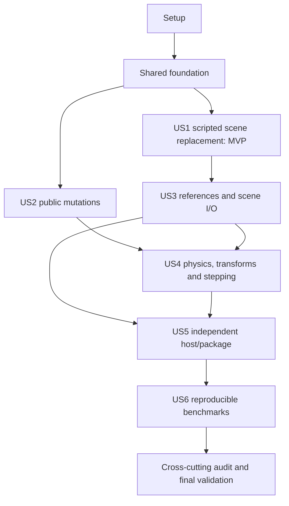

# Tasks: C++ Engine Cleanup

**Feature**: `001-cpp-engine-cleanup`  
**Input**: [plan.md](plan.md), [spec.md](spec.md), [research.md](research.md), [data-model.md](data-model.md), [contracts/](contracts/runtime-lifecycle.md), [quickstart.md](quickstart.md).  
**Tests**: Explicitly required by the specification. Add discriminating contract/oracle tests before the behavior they verify; demonstrate the expected failure or missing contract first, then implement and validate. Retain the existing lightweight harness. Tests may scan/allocate; runtime hot paths should not.  
**Scope**: C++ engine and benchmark orchestration; no broad GUI work, ECS/Flecs migration, additive scene manager, or new runtime dependencies. The constitution is an unfilled template, not adopted governance.

## Format and Execution Rules

Every task uses `- [ ] Tnnn [P?] [USn?] description with file paths`. Paths are repository-relative. Files named by create/add tasks are planned additions, not assumed to exist already. New C++ test targets are wired by a serialized registration/red-check task immediately after each disjoint test-authoring wave; the story’s last integration task then runs final acceptance. Do not edit CMake registration concurrently from test-authoring tasks.

`[P]` identifies disjoint authoring work within the explicit wave examples below **after its prerequisite phase is complete**. It does not mean every marked task across all phases can start together. Shared files such as CMakeLists.txt, GameManager, Runtime, and PhysicsManager have one integration stream; do not concurrently edit them. Independent story testing means acceptance can be exercised without implementing later stories, not that shared prerequisites can be skipped.

For every runtime task: use concrete ownership/indexes and boundary validation; no blanket null checks, whole-scene safety sweeps, active-list snapshots per phase, or per-pair linear membership searches. When an approach looks inefficient, stop and evaluate a better one; implement it if feasible. Otherwise put a local `EFFICIENCY:` comment at the slow path with **cost/frequency, reason retained, efficient alternative, and exact replacement prerequisites**. Do not use comments as substitutes for feasible fixes. This is a per-task requirement, not a final-stage waiver.

Temporary manually unbound references follow the public lifecycle contract: reads are empty until explicit binding; no unpublished or invalid reference is treated as committed valid scene data. Staged handles remain resolver-only until publication. Final numeric boundary policy is finite restitution [0,1], positive finite dynamic mass/scale/dimensions, nonnegative friction, and intentional static/kinematic zero inverse mass; validate once at the setter/load boundary, not repeatedly in solver loops.

The foundation deliberately contains shared lifetime/identity/resource primitives because US1 cannot safely replace a scene using stale references or ambiguous ownership. Story phases finish their own public operations, I/O policy, regressions, and integration. Do not defer a shared prerequisite to a later story merely to make the MVP task count smaller.

## Phase 1: Setup — Trustworthy C++ Baseline

**Goal**: Make failures attributable to engine behavior, without hiding existing sleeping/deletion defects. Do not initialize a new framework or replace the existing repository layout.

**Prerequisites**: None. Preserve all pre-existing staged changes; do not stage/commit unrelated files.

**Independent acceptance / checkpoint**: A fresh project-only baseline and build metadata are recorded; helpers no longer dereference freed objects; ordinary CTest has no unbuilt dependency tests. Engine failures remain visible until their owning story fixes them.

- [X] T001 Capture a fresh normal project-only build/test baseline and the known sleeping/deletion failures, commands, compiler, commit, and environment in `specs/001-cpp-engine-cleanup/validation.md`; use `CODEBASE_REVIEW.md` as evidence, not as a claim that the current run passed.
- [X] T002 Disable vendored dependency tests/examples for ordinary builds in `CMakeLists.txt`; centralize project test registration/labels in `cmake/PlatformatorTests.cmake`, keeping existing `platformator_` targets and internal algorithm-test access where needed.
- [X] T003 Add `PLATFORMATOR_SANITIZER=none|address-undefined|thread` through `cmake/PlatformatorSanitizers.cmake`, `CMakeLists.txt`, and `CMakePresets.json`; instrument engine/tests, configure compatible `TBB_SANITIZE=thread`, reject unsupported combinations, and do not count broad TBB suppressions as successful validation.
- [X] T004 [P] Repair retained-pointer helpers in `tests/queued_deletion_safety_test.cpp` and `tests/regression_tests.cpp` by capturing IDs while alive; correct the expected-exit diagnostic without weakening its assertion, and keep real engine failures enabled.
- [X] T005 [P] Add standalone-public-header compile checks in `cmake/PlatformatorPublicHeaders.cmake` and fix the missing standard includes in `include/platformator/baseobject.h`; wire the module through `CMakeLists.txt` only at the serialized integration point after the independent helper/header edits.

## Phase 2: Foundation — Shared Lifetime and Identity Kernel

**Goal**: Provide the shared owner, phase, handle, resource, and retirement primitives required by scene replacement and every later story. This is the necessary foundation for the MVP, not a claim that all public mutation routes are complete.

**Prerequisites**: Phase 1. Write the kernel contract cases before implementing their behavior; use the existing lightweight C++ harness.

**Independent acceptance / checkpoint**: Focused kernel tests pass in normal and ASan/UBSan builds. Stable dispatch, identity invalidation, resource retention, readable teardown, and common barriers work without active-list snapshots or full-scene safety scans; remaining higher-level defects stay listed.

- [X] T006 Create `tests/runtime_foundation_test.cpp` covering stable dispatch, logical retirement, both parent/child allocation orders, resource acquisition/release, typed slot reuse, and no-runtime access; add reusable trace/fixture helpers in `tests/test_support.h`, register through `CMakeLists.txt` and `cmake/PlatformatorTests.cmake`, and demonstrate expected failures/missing contracts before implementation. Public-API cases use no private headers.
- [X] T007 Define Idle, Starting, StepHook, FixedUpdate, Physics, CollisionDispatch, Update, Animation, LateUpdate, MutationCommit, DestructionCallbacks, Rendering and Shutdown with one scoped guard in `src/gamemanager.h`, `src/gamemanager.cpp`, and `src/runtime.cpp`; enforce "Structural mutation is main-thread-only" at the shared mutation boundary and restore phase state on exceptions rather than adding per-object defensive guards.
- [X] T008 Implement flat single ownership and stable heap addresses in `src/gamemanager.h`, `src/gamemanager.cpp`, `include/platformator/gameobject.h`, and `src/gameobject.cpp`; preserve "Parent/child links are borrowed relationships" and make destructors release storage without recursive deletion of registered neighbors or user callbacks.
- [X] T009 Add reusable typed pending-registration/retirement buffers to `src/gamemanager.h` and `src/gamemanager.cpp`; enforce "Each producer sets one queued bit/index" and "Retirement is terminal and idempotent" with indexed deduplication, stable dispatch vectors, and Staged/Live/PendingRetire/DestroyCallbacks/Unregistered/Freed transitions with staged-failure reclamation and "No resurrection"; do not add a generic command bus or whole-scene compaction pass.
- [X] T010 Create `include/platformator/objecthandle.h`, `src/objectregistry.h`, and `src/objectregistry.cpp`, integrating registration in `src/gamemanager.cpp`: handles contain "a slot index, slot generation, and runtimeSerial" with a "monotonically assigned process-local `runtimeSerial`" and "Invalid is represented explicitly". Use a free list, tagged borrowed-pointer records, staged/live/retiring state and a separate file-ID map; "Slot generation increments on invalidation/reuse; exhausted generation slots are not recycled." Enforce "Concrete kinds distinguish GameObject, Animator, Audio, Camera, BoxCollider, CircleCollider, Rigidbody, ScriptComponent, and Sprite." Collider-base binding accepts either shape.
- [X] T011 Replace cached-pointer identity in `include/platformator/objectreference.h` and `src/referencehelpers.cpp` with direct registry access through `include/platformator/runtime.h` and `src/runtime.cpp`; preserve "Type validation occurs on bind, before a checked cast" and make unbound, retired, no-runtime, reused-slot, and new-runtime access empty without rebinding. Internal invariant-protected loops keep borrowed pointers.
- [X] T012 Fix resource retention/release in `include/platformator/assetreference.h`, `src/animator.cpp`, `src/animationclip.cpp`, `src/sprite.cpp`, `src/audio.cpp`, `src/texturewrapper.cpp`, and `src/audiowrapper.cpp`: "replacing an animator clip releases the old clip after acquiring the new one"; handle same-resource replacement safely, release before SDL backends, and enforce the owning-runtime lifetime precondition without shared_ptr/atomic machinery.
- [X] T013 Introduce the explicit build resolver interface in `include/platformator/referenceresolver.h`, `include/platformator/behavior.h`, and `include/platformator/scriptregistration.h`; migrate `src/behavior.cpp`, handwritten overrides in `tests/scene_script_roundtrip_test.cpp`, and affected `examples/mario/` behaviors together so the tree builds. This establishes the interface; scene preparation implements its staging behavior in US1.
- [X] T014 Implement indexed start eligibility in `include/platformator/behavior.h`, `include/platformator/scriptcomponent.h`, `src/scriptcomponent.cpp`, and `src/gamemanager.cpp`: "Inactive creation does not enqueue start work", inactive pending starts are removed by index, start buffers swap rather than copy, and "Started behaviors do not start again after reactivation". Gate every ordinary behavior dispatch on eligibility, including remaining behaviors after self-retirement.
- [X] T015 Implement the shared retirement drain in `src/gamemanager.cpp`, `src/physicsmanager.cpp`, `src/colliderpair.cpp`, `src/scriptcomponent.cpp`, and `src/gameobject.cpp`; retain allocations through queued physics operations/eligible exits, invoke onDestroy before attached component storage is freed, detach hierarchy links, invalidate handles, and free once. Centralize rejection of structural onDestroy/shutdown requests and finish required cleanup before reporting callback errors.
- [X] T016 Connect the shared dispatch/retirement boundary to every existing simulation/render/custom wrapper in `src/gamemanager.cpp` and `src/runtime.cpp`, and make empty-scene rendering safe in `src/sdlwindow.cpp`; do not call simulateFrame from cleanup. Keep wrappers thin enough for US4 to consolidate the final clock/pipeline without duplicating lifetime logic.
- [X] T017 Verify `tests/runtime_foundation_test.cpp` registration through `CMakeLists.txt` and `cmake/PlatformatorTests.cmake`, run its normal/ASan/UBSan cases plus existing runtime-recreation coverage, and record results/work-queue invariants in `specs/001-cpp-engine-cleanup/validation.md`; distinguish fixed helper errors from still-open engine assertions.

## Phase 3: User Story 1 — Change Scenes from Scripts (P1, MVP)

**Goal**: Deliver safe replacement/clear through the public Runtime API, with selected-path-only staging, readable retirement, and a visible deferred error boundary.

**Prerequisites**: Foundation complete. No later story is required for the small two-scene MVP. The tests below are a disjoint authoring wave; register/merge them serially.

**Independent acceptance / checkpoint**: A public-header host completes at least 1,000 script-triggered replace/clear/reload cycles from start, fixed/update/late, collision, and animation callbacks under sanitizers. Last request wins, a callback returns alive, failed preparation preserves the old scene/path, and no extra simulation step or stale old-scene reference survives.

Contract tests and their serialized registration/red check appear first; the remaining tasks implement and integrate this story.

- [X] T018 [P] [US1] Create the runtime-lifecycle contract cases in `tests/scene_transition_contract_test.cpp`: idle versus deferred loads/clear, explicit request APIs, last-wins selection without opening superseded files, next-step starts, no-camera clear, next-step requests from retirement exits, and observable host-boundary errors.
- [X] T019 [P] [US1] Create `tests/scene_transition_stress_test.cpp` using `tests/test_support.h` and generated two-scene JSON fixtures; cover at least 1,000 transitions from every supported callback family, exactly-once traces, canceled requests, and old references remaining expired. Keep the host public-header-only.
- [X] T020 [US1] Register the US1 contract/oracle test files from the preceding authoring wave in `CMakeLists.txt` and `cmake/PlatformatorTests.cmake` with their story labels; compile/run them serially and record the discriminating expected failures or missing APIs in `specs/001-cpp-engine-cleanup/validation.md` before changing the behavior. Do not disable unrelated existing regressions.
- [X] T021 [US1] Create owned scene staging in `src/scenebuilder.h`, `src/scenebuilder.cpp`, `src/scene.cpp`, and `src/gameobjectserializer.cpp`: prepare complete flat graphs, validate nonnegative unique IDs/schema, reserve private staged handles, and enforce "Any exception destroys staging with the old scene untouched" before touching live registrations.
- [X] T022 [US1] Implement staged reference/resource binding in `src/scenebuilder.cpp`, `src/referencehelpers.cpp`, `include/platformator/assetreference.h`, `src/scriptcomponentserializer.cpp`, and the component serializers; JSON extraction stores IDs/paths, and only the explicit resolver can inspect unpublished staged slots. Reject unknown behaviors and missing required non-null targets; update intentionally changed legacy assertions in `tests/scene_script_roundtrip_test.cpp` in the same change.
- [X] T023 [US1] Add per-build resource acquisition ownership in `src/scenebuilder.h`, `src/scenebuilder.cpp`, and the resource cache paths in `src/gamemanager.cpp`: "newly inserted entries with no remaining users are removed, while preexisting shared entries and their live owners remain intact" on failure. Reclaim by the acquisition ledger, not a cache-wide sweep.
- [X] T024 [US1] Add explicit request methods and preserve existing overloads in `include/platformator/runtime.h`, `src/runtime.cpp`, `src/gamemanager.h`, and `src/gamemanager.cpp`: "There is one pending slot" with Load/Clear, optional path, and diagnostic sequence; latch once, prepare only the final selected path, and defer requests made during commit to the following step.
- [X] T025 [US1] Implement prepare-then-replace and idle synchronous commit in `src/gamemanager.cpp`, `src/runtime.cpp`, and `src/sdlwindow.cpp`: publish ID/system state only on success, create a fallback camera on load only when absent, and enforce "Clearing leaves an empty scene and no current save path" without calling simulation or silently appending loaded objects.
- [X] T026 [US1] Complete deferred preparation-error cleanup in `src/scenebuilder.cpp`, `src/runtime.cpp`, and `src/gamemanager.cpp`; preserve the old ownership/map/path, safely finish already-requested ordinary retirements, restore Idle, and throw at the step/run boundary. Do not promise rollback of arbitrary script state or of exceptions after irreversible commit begins.
- [X] T027 [US1] Verify the scene tests already registered through `CMakeLists.txt` and `cmake/PlatformatorTests.cmake` have lifecycle/scene labels; run them normally and under ASan/UBSan, verify replacement overload compatibility and no recursive step, and record MVP evidence in `specs/001-cpp-engine-cleanup/validation.md`.

## Phase 4: User Story 2 — Mutate Objects and Components Safely (P1)

**Goal**: Route public object/component operations through the shared kernel, preserving borrowed-pointer convenience and exactly-once callback behavior.

**Prerequisites**: Foundation complete. US2 does not require US1 behavior to be implemented, but integration edits overlap in Runtime/GameManager; serialize those edits. Default execution follows US1.

**Independent acceptance / checkpoint**: Focused traces prove grow/self-remove/replace/destroy-another behavior across callback families; survivors dispatch once, inactive scripts start correctly, both allocation orders tear down safely, and off/on requests do not lose membership.

Contract tests and their serialized registration/red check appear first; the remaining tasks implement and integrate this story.

- [X] T028 [P] [US2] Create callback mutation contract tests in `tests/callback_mutation_test.cpp`: 100 script additions, A destroying B while C updates once, self-removing/replacing ScriptComponent, per-behavior suppression within one component, inactive creation/activation, repeated toggles, and the documented immediate component-slot result.
- [X] T029 [P] [US2] Create `tests/destruction_contract_test.cpp` covering readable attached components in onDestroy, removed versus replacement slot visibility, both hierarchy allocation orders, duplicate destroy, callback exceptions, and centralized rejection of structural onDestroy/shutdown attempts without state changes.
- [X] T030 [US2] Register the US2 contract/oracle test files from the preceding authoring wave in `CMakeLists.txt` and `cmake/PlatformatorTests.cmake` with their story labels; compile/run them serially and record the discriminating expected failures or missing APIs in `specs/001-cpp-engine-cleanup/validation.md` before changing the behavior. Do not disable unrelated existing regressions.
- [X] T031 [US2] Route `GameObject::destroy`, Runtime create/destroy, and component attachment through the foundation queues in `src/gameobject.cpp`, `include/platformator/gameobject.h`, `src/runtime.cpp`, and `src/gamemanager.cpp`; callback creation allocates/returns owned borrowed objects but cannot join an active dispatch list. Make duplicate retirement terminal/idempotent, not a pointer-validity scan.
- [X] T032 [US2] Implement immediate slot detachment/replacement with retained old ownership in `src/gameobject.cpp`, `src/scriptcomponent.cpp`, and `src/gamemanager.cpp`; notify systems at the barrier, never free a collider/script while physics or the current callback uses it, and skip remaining behaviors after the executing component retires.
- [X] T033 [US2] Reconcile desired activation/script/animator membership by queued index in `src/gameobject.cpp`, `src/gamemanager.cpp`, and `src/scriptcomponent.cpp`; disable suppresses later callbacks immediately, re-enable becomes eligible at the boundary, and off/on before synchronization does not force contradictory removal/addition. Leave collider-local reconciliation details to US4.
- [X] T034 [US2] Complete subtree retirement and reparent validation in `src/gameobject.cpp` and `src/gamemanager.cpp`; enforce "Reparenting preserves world translation" and reject cycles/mixed-runtime parents at the public mutation boundary, retire each descendant once, and detach before allocation release without walking freed child pointers.
- [X] T035 [US2] Complete retirement-event behavior in `src/colliderpair.cpp`, `src/physicsmanager.cpp`, `src/gamemanager.cpp`, and `tests/queued_deletion_safety_test.cpp`: eligible survivors receive one exit while the retired other collider is still readable; retired/inactive recipients and both-retired pairs receive no ordinary callback. Keep new exit-generated work in the producer buffer and never recursively simulate.
- [X] T036 [US2] Make callback registration/dispatch stable in `src/animator.cpp`, `include/platformator/animator.h`, and `src/scriptcomponent.cpp`, including clip-end callbacks that add callbacks, change clips, or retire their owner; retain executing callback storage and do not protect it with a whole-list snapshot every frame.
- [X] T037 [US2] Verify mutation/destruction registration in `CMakeLists.txt` and `cmake/PlatformatorTests.cmake`, re-run affected queued-deletion/collider-cleanup scenarios normally and under sanitizers, and record exactly-once traces, queue coalescing, and readable teardown results in `specs/001-cpp-engine-cleanup/validation.md`.

## Phase 5: User Story 3 — Stable References and Valid Scene Files (P1)

**Goal**: Finish public identity/serialization policies and failure-safe scene I/O on top of the shared handle/staging implementation.

**Prerequisites**: Foundation and US1 complete. US2 is recommended first for integration stability, but is not a data-format prerequisite.

**Independent acceptance / checkpoint**: Public references remain empty after retirement/reuse/scene/runtime replacement; ID/name lookups stay coherent; malformed graphs/types/behaviors reject before publication; failed deserialize/resource/save operations preserve the previous committed scene/file.

Contract tests and their serialized registration/red check appear first; the remaining tasks implement and integrate this story.

- [X] T038 [P] [US3] Create public reference contract tests in `tests/object_reference_contract_test.cpp` for no active runtime, temporary unbound IDs, explicit resolve, wrong GameObject/component/shape subtype, pending retirement, slot generation reuse, runtime recreation, repeated scene IDs, and expired/same-scene/cross-scene serialization.
- [X] T039 [P] [US3] Create `tests/scene_io_contract_test.cpp` with zero/negative/duplicate object-and-component IDs, nested required-reference errors, unknown behaviors, partial deserialize/resource failure, ID exhaustion, unwritable destinations, and temporary-write/replace failure fixtures; assert the prior committed scene/path/file survives as appropriate.
- [X] T040 [US3] Register the US3 contract/oracle test files from the preceding authoring wave in `CMakeLists.txt` and `cmake/PlatformatorTests.cmake` with their story labels; compile/run them serially and record the discriminating expected failures or missing APIs in `specs/001-cpp-engine-cleanup/validation.md` before changing the behavior. Do not disable unrelated existing regressions.
- [X] T041 [US3] Restrict loaded-ID assignment in `include/platformator/baseobject.h`, `src/gameobjectserializer.cpp`, component serializers, and `src/objectregistry.cpp`; apply "nonnegative IDs, including zero, unique across all objects and components in a scene", advance automatic IDs past reserved loaded IDs, detect exhaustion once at creation/load, and prohibit silent mutation of registered IDs.
- [X] T042 [US3] Complete `getReferencedId`, set/clear/resolve and scene-aware JSON serialization in `include/platformator/objectreference.h`, `src/referencehelpers.cpp`, and `src/scenebuilder.cpp`: "An expired reference serializes as null; a live reference outside the scene being saved is a save error". Temporary manually unbound values remain empty until explicit bind and cannot masquerade as a valid published/save-time reference.
- [X] T043 [US3] Complete graph-level validation/messages in `src/scenebuilder.cpp`, `src/scriptcomponentserializer.cpp`, and `tests/scene_script_roundtrip_test.cpp`: register/validate the entire staged ID/type graph before reference binding, reject wrong subtypes/unknown behaviors with path/field context, preserve valid legacy integer JSON, and rename the invalid-ID tests to match their real assertions.
- [X] T044 [US3] Implement idle-only observable scene saves in `src/scene.cpp` and `src/runtime.cpp`: "Save writes a sibling temporary file, checks write/close success, then replaces the destination"; preserve the previous destination on failure, clean temporary state, and update the current successful save path only after success.
- [X] T045 [US3] Close resource/slot rollback edges in `src/scenebuilder.cpp`, `src/objectregistry.cpp`, and `src/gamemanager.cpp` using the failure fixtures; reserved handles stay invisible to live lookups, newly acquired unreferenced resources release without cache sweeps, shared old resources survive, and cleanup after a throwing handwritten resolver remains safe.
- [X] T046 [US3] Verify reference/I/O tests have scene/reference labels through `CMakeLists.txt` and `cmake/PlatformatorTests.cmake`; migrate handwritten resolver examples in `examples/mario/` as needed, run roundtrip/runtime-recreation/reference/rollback coverage normally and under ASan/UBSan, and record behavior/API migration evidence in `specs/001-cpp-engine-cleanup/validation.md`.

## Phase 6: User Story 4 — Correct Serial and Parallel Physics (P1)

**Goal**: Fix transforms, collider reconciliation, shared-body state, shape contacts, sleeping, and deterministic stepping using affected-item work.

**Prerequisites**: US2 and US3 complete (therefore US1/foundation are available). Write the five disjoint contract/oracle test files first; integrate shared runtime/physics edits serially.

**Independent acceptance / checkpoint**: Automatic hierarchy/cache tests pass without manual repair; repeated one/several-worker snapshots preserve 128 supports and canonical contact/event traces; filter toggles/corners/offsets/sleeping pass; clock partitions, pause/stall/manual-step semantics and complexity counters match the contracts. TSan limitations are reported, never silently suppressed.

Contract tests and their serialized registration/red check appear first; the remaining tasks implement and integrate this story.

- [X] T047 [P] [US4] Create `tests/transform_hierarchy_test.cpp` for parent-only motion with a collider-only child, simultaneous parent/child bodies, dirty reparenting/deep/sibling subtrees, immediate main-thread reads, and both allocation orders; exercise automatic synchronization without manual prepareSync repairs.
- [X] T048 [P] [US4] Create `tests/physics_support_test.cpp` using frozen 128-contact layouts and canonical traces with one and several workers; cover SAT reference/incident swaps, support removal/retirement, off/on and mask-off/on, trigger/body changes, stationary/sleeping stays, and exactly-once eligible survivor exits.
- [X] T049 [P] [US4] Create independent geometry/parameter tests in `tests/physics_geometry_test.cpp` for the (10.95,10.4), radius-1 versus 20x20 outside corner, rotated/inside/face/tie/offset manifolds, stable contact features, and finite supported input boundaries; brute-force/reference geometry is welcome.
- [X] T050 [P] [US4] Create `tests/runtime_step_test.cpp` with deterministic clock input and public wrapper traces covering equivalent elapsed-time partitions, hook placement, pause/unpause, single step, an eight-step catch-up cap/remainder, invalid/NaN dt, and quit stopping rendered work.
- [X] T051 [P] [US4] Create test-only allocation/work probes in `tests/runtime_work_test.cpp` for idle mutation queues, one dirty subtree, stable contacts, and many sleeping/static bodies; use narrow instrumentation hooks in a dedicated `tests/runtime_work_probe.h` initially, and keep expensive test oracles out of normal Release timing.
- [X] T052 [US4] Register the US4 contract/oracle test files from the preceding authoring wave in `CMakeLists.txt` and `cmake/PlatformatorTests.cmake` with their story labels; compile/run them serially and record the discriminating expected failures or missing APIs in `specs/001-cpp-engine-cleanup/validation.md` before changing the behavior. Do not disable unrelated existing regressions.
- [X] T053 [US4] Implement local/world cache and indexed dirty-root propagation in `include/platformator/gameobject.h`, `src/gameobject.cpp`, and `src/gamemanager.cpp`; preserve immediate public translation semantics, use traversal stamps to visit each affected descendant once, and enforce "A flat hierarchy order/depth cache is updated only for hierarchy structural changes" instead of a per-frame global hierarchy pass. Remove the manual prepareSync repair from the matching `tests/regression_tests.cpp` case when the runtime fix lands; connect narrow compiled-out work counters so affected-subtree cost is checked here.
- [X] T054 [US4] Change `src/rigidbody.cpp`, `src/physicsmanager.cpp`, and `src/collider.cpp` so workers integrate only their own local transform and append thread-local changed objects; merge parent-first on the main thread, refresh affected collider/cell state before queries/rendering, and read synchronized caches in pair/solver loops rather than racing live ancestor getters.
- [X] T055 [US4] Replace contradictory ADD/SYNC/REMOVE flags in `include/platformator/collider.h`, `src/collider.cpp`, `src/grid.h`, `src/grid.cpp`, and `src/gridcell.cpp` with current/desired membership and geometry/filter/body/trigger dirty bits, one indexed queue entry, and barrier reconciliation. Preserve pending allocations and make off/on resolve to final membership.
- [X] T056 [US4] Implement filter/body/trigger invalidation in `src/aabb.cpp`, `src/grid.cpp`, `src/gridcell.cpp`, `src/collider.cpp`, and `src/rigidbody.cpp` using only affected cells/adjacency; locally remove/reinsert filter bindings and combine net witness deltas so re-enabled unchanged overlaps return and still-permitted contacts do not manufacture exit/enter.
- [X] T057 [US4] Introduce stable pair/result slots and canonical handle keys in `src/colliderpair.h`, `src/colliderpair.cpp`, `src/grid.cpp`, and `src/physicsmanager.cpp`; parallel tasks write only their pair-owned manifold/flags/result, reserve/reuse scratch, and do not use pointer order or thread completion as solver/event ordering.
- [X] T058 [US4] Remove hidden Rigidbody writes from `src/collision.cpp` lifetime methods and implement serial nonzero support reduction in `src/physicsmanager.cpp` and `src/rigidbody.cpp`; store "old/new pair-local manifold/support flags keyed to canonical A/B collider identity", balance removal/filter/retirement changes, and never substitute shared-body atomics for correct transitions.
- [X] T059 [US4] Maintain indexed persistent active-contact/solver and subscribed-stay lists in `src/physicsmanager.h`, `src/physicsmanager.cpp`, `src/grid.cpp`, `src/colliderpair.h`, `src/scriptcomponent.cpp`, and `src/gamemanager.cpp`; canonicalize only changed membership, emit enter/stay/exit per contract including stationary/sleeping observed contacts, and update subscriptions through affected script/activation adjacency instead of scanning unobserved pairs.
- [X] T060 [US4] Implement exact circle/box closest-point manifolds, deterministic containment/ties, collider-center offset normal orientation, exact circle/circle work, and fixed-size box axes in `src/physicsmanager.cpp`, `src/circlecollider.cpp`, `src/boxcollider.cpp`, and `src/collision.cpp`; retain stable contact feature IDs and remove per-pair temporary normal-vector allocations.
- [X] T061 [US4] Validate shape/body/scale inputs at constructor/setter/load boundaries in `src/boxcollider.cpp`, `src/circlecollider.cpp`, `src/rigidbody.cpp`, `src/gameobject.cpp`, and `src/scenebuilder.cpp`; enforce "positive finite scale", finite positive shape dimensions, nonnegative friction, positive finite dynamic mass, intentional static/kinematic zero inverse mass, and finite restitution in [0,1] rather than invalid solver divisions. Reuse the same boundary validation rules without repeating them in pair loops.
- [X] T062 [US4] Fix residual support persistence, wake thresholds, deterministic solver/contact behavior in `src/physicsmanager.cpp`, `src/collision.cpp`, and `src/rigidbody.cpp` until tall-stack/wide-pile regressions pass; restore last-support-removal wake coverage in `tests/regression_tests.cpp` against the current API without resurrecting obsolete constants or weakening tolerances.
- [X] T063 [US4] Maintain swap-pop awake-dynamic, kinematic, and sleep-eligible indexes in `include/platformator/rigidbody.h`, `src/rigidbody.cpp`, `src/physicsmanager.h`, and `src/physicsmanager.cpp`; enforce "Changes in impulses, support, activation, type, or external motion update only affected entries" and connect narrow compiled-out work probes and compare before/after to remove irrelevant sleeping/static traversals after correctness is established.
- [X] T064 [US4] Consolidate the final explicit step pipeline and rendering/custom wrappers in `src/gamemanager.cpp`, `src/runtime.cpp`, and `src/sdlwindow.cpp`: starts/hook/fixed/physics/events/update/animation/late/commit/cleanup occur once in contract order, rendering follows cleanup, and "Explicit `simulateFrame(dt)` runs exactly one caller-defined finite-positive step" with no wall-time accumulator.
- [X] T065 [US4] Implement the interactive steady-clock accumulator in `src/gamemanager.h`, `src/gamemanager.cpp`, `src/constants.h`, and `src/sdlwindow.cpp` with "fixed dt (default 1/120)" and "maximum catch-up steps (default eight)"; retain fractional remainder, count dropped whole steps, clear paused wall-time accumulation, and make manual advance exactly one fixed step without per-frame warning logs.
- [X] T066 [US4] Verify all five physics/transform/step/work test registrations through `CMakeLists.txt` and `cmake/PlatformatorTests.cmake`, confirm their narrow work hooks compile out of normal Release, and run normal/ASan/UBSan plus properly instrumented TSan worker comparisons. Record exact support counts, contact/state tolerances, allocation/work evidence, and any host limitation in `specs/001-cpp-engine-cleanup/validation.md`.

## Phase 7: User Story 5 — Build and Run an Independent Host (P2)

**Goal**: Make source/installed consumption, asset roots, backend startup, and CLI failure behavior independent of repository cwd and incidental example output.

**Prerequisites**: US3 and US4 complete for the final API/step behavior. Test authoring is independent within the listed wave. CMake integration/export edits remain serialized.

**Independent acceptance / checkpoint**: Core-only and example builds pass; each public header and a public-only consumer compile; clean source/installed/relocated consumers run outside the repository; case-preserving explicit/default roots, intentional fallback assets, physics-only startup and nonzero CLI failure cases match the contract.

Contract tests and their serialized registration/red check appear first; the remaining tasks implement and integrate this story.

- [X] T067 [P] [US5] Create `tests/asset_root_contract_test.cpp` with explicit/relative/default roots, mixed-case filenames, scene-relative legacy paths, root escape, missing optional versus required assets/fallbacks, cwd changes, and an asset tree that contains no demo/default-scene folders.
- [X] T068 [P] [US5] Create clean install/relocation checks in `tests/package_smoke.cmake` and a minimal `tests/consumer/CMakeLists.txt` plus `tests/consumer/main.cpp`; link only `Platformator::platformator`, include public headers only, hide source/build paths, and launch the relocated prefix outside the repository.
- [X] T069 [P] [US5] Create `tests/runner_failure_test.cpp` for invalid SDL initialization, physics-only operation without video/audio devices, missing/malformed scene/behavior/resource, unwritable save, finite smoke exit, and concise nonzero CLI statuses; use process-level fixtures where backend global state requires isolation.
- [X] T070 [US5] Register the US5 contract/oracle test files from the preceding authoring wave in `CMakeLists.txt` and `cmake/PlatformatorTests.cmake` with their story labels; compile/run them serially and record the discriminating expected failures or missing APIs in `specs/001-cpp-engine-cleanup/validation.md` before changing the behavior. Do not disable unrelated existing regressions.
- [X] T071 [US5] Add Runtime-owned `assetRoot`/startup base configuration in `include/platformator/runtimeoptions.h`, `src/runtime.cpp`, `src/pathmanager.h`, and `src/pathmanager.cpp`; "Runtime normalizes one configured root at startup" and "A logical `assets/...` path maps beneath it while preserving disk filename case". Remove mutable singleton/root-search assumptions from active access helpers.
- [X] T072 [US5] Implement the explicit/default root and logical/legacy path policy in `src/pathmanager.cpp`, `src/scene.cpp`, `src/referencehelpers.cpp`, and `src/scenebuilder.cpp`: executable/assets then install-prefix/assets defaults, no upward/demo-directory validity search, root-escape rejection, case preservation, required-resource errors, and one cold diagnostic for documented optional fallback.
- [X] T073 [US5] Fix SDL3 bool checks and exception-safe acquisition/teardown in `src/sdlwindow.cpp`, `src/sdlwindow.h`, and `src/runtime.cpp`; enforce "A physics-only runtime skips video and audio device acquisition", initialize only configured desktop backends, and destroy components/cache resources before SDL without swallowing required startup errors.
- [X] T074 [US5] Package intentional fallback resources in `assets/audio/missing.wav` and `assets/animations/missing.animset` referencing `assets/textures/missing.png`; make their core-only installation explicit in `CMakeLists.txt` so building Mario is never what accidentally makes the engine resource tree usable.
- [X] T075 [US5] Implement `--asset-root` and positive `--smoke-steps N` parsing/configuration in `src/runtimeoptions.cpp`, `include/platformator/runtimeoptions.h`, `src/runner.cpp`, and `src/runtime.cpp`; catch descriptive startup/load/save failures at CLI boundaries with nonzero status, and stop after the requested finite simulation steps without changing normal explicit-step semantics.
- [X] T076 [US5] Replace the handwritten imported-library list with exported relocatable `Platformator::platformator` and represented bundled dependency requirements in `CMakeLists.txt` and `cmake/PlatformatorConfig.cmake.in`; use supported vendor install/exports/find_dependency, retain offline bundled consumption and correct configuration/RPATH behavior, and avoid machine-specific absolute library paths.
- [X] T077 [US5] Remove unused generated `platformator/detail` forwarders from `CMakeLists.txt` and normalize the affected private forwarding shims such as `src/gameobject.h`, `src/behavior.h`, and `src/collider.h` to public includes; remove only unused shims after source/public-header consumer checks, preserving actual private algorithm headers and normal test access.
- [X] T078 [US5] Fix `examples/mario/CMakeLists.txt` and `examples/mario/main.cpp` so the source/installed consumer deliberately packages required engine fallbacks plus its own assets/scene, computes the installed prefix correctly, forwards finite smoke options, and works from an unrelated cwd and relocated package without source-tree fallbacks.
- [X] T079 [US5] Verify package/asset/runner labels through `CMakeLists.txt` and `cmake/PlatformatorTests.cmake`; migrate old heuristic-path expectations in `tests/regression_tests.cpp` to the intentional new policy, run core-only/examples/source/installed/relocated and failure scenarios, and record public-header and backend/resource evidence in `specs/001-cpp-engine-cleanup/validation.md`.

## Phase 8: User Story 6 — Trustworthy Performance Results (P2)

**Goal**: Measure the actual complete step and keep reproducible independent Release runs, with historical/Godot scope comparisons explicitly qualified.

**Prerequisites**: All prior story correctness/package gates complete. Preserve historical results; do not mix sanitizer/work-oracle runs with speed measurements.

**Independent acceptance / checkpoint**: A controlled destructor workload is included in complete_step/cleanup; schema v2 parsers reject incomplete/unknown metrics; each population has at least five raw runs/manifests with fixed workers/seed/dt, validated physical/population state and aggregate spread. Godot ratios require an explicit equivalent-boundary justification.

Contract tests and their serialized registration/red check appear first; the remaining tasks implement and integrate this story.

- [X] T080 [P] [US6] Create `tests/benchmark_contract_test.cpp` for complete-step boundary/cleanup inclusion, distinct render/nested scopes, selected scene-transition work, quit stopping samples, schema metadata and sample-capacity reuse; use controlled trace/work instrumentation rather than flaky absolute timing thresholds.
- [X] T081 [P] [US6] Create standard-library Python tests in `benchmark/tests/test_sweep_scaling.py` covering schema-v2 parsing/rejection, workers/seed propagation, at least five independent repetitions, one raw CSV/manifest per population/run, aggregate run-to-run spread, and failures that cannot silently become zero-valued measurements.
- [X] T082 [US6] Register the US6 contract/oracle test files from the preceding authoring wave in `CMakeLists.txt` and `cmake/PlatformatorTests.cmake` with their story labels; compile/run them serially and record the discriminating expected failures or missing APIs in `specs/001-cpp-engine-cleanup/validation.md` before changing the behavior. Do not disable unrelated existing regressions.
- [X] T083 [US6] Move complete-step measurement through final retirement/transient cleanup in `src/gamemanager.cpp`, `src/runtime.cpp`, `src/benchmark.h`, and `src/benchmark.cpp`; add distinct complete_step/physics/cleanup/scene_transition/render scopes, preserve declared nesting, and do not relabel the old partial frame metric as equivalent.
- [X] T084 [US6] Implement schema-v2 CSV plus once-per-run manifest metadata in `src/benchmark.cpp`, `src/benchmark.h`, and `src/buildconfig.h.in`; record commit/dirty state, compiler/flags, configuration/instrumentation, machine/OS, dependencies, scenario/seed/workers/dt/warmup/steps/repetitions/boundaries/rendering. Reserve sample buffers before measurement instead of growing/reporting metadata per step.
- [X] T085 [US6] Add validated `--workers N` and `--seed N` to `src/benchmark_main.cpp`, set worker control once per benchmark process, preserve workload/--warmup-frames/--measure-frames/--dt compatibility as step counts, and stop rendered warmup/measurement immediately on quit instead of counting attempts that did not execute.
- [X] T086 [US6] Extend `benchmark/sweep_scaling.py` with `--repetitions` default five, `--workers`, `--seed`, and `--raw-output-dir`; preserve raw CSV/manifests, aggregate across independent runs, and update `benchmark/plot_scaling.py` to require known schema/metrics rather than default missing values to zero.
- [X] T087 [US6] Add an explicit correctness-validation mode to scenarios in `src/benchmark_main.cpp` and expose its labeling through `benchmark/sweep_scaling.py`; check expected population/churn, finite transforms and serial/multiworker contact/support invariants, then keep this expensive validation separate from uninstrumented timing as "Expensive invariant checks are explicit validation instrumentation, separate from uninstrumented performance runs".
- [X] T088 [US6] Run corrected invariant checks followed by repeated pinned Release broad/narrow/rigid/churn workloads per `specs/001-cpp-engine-cleanup/quickstart.md`; preserve raw runs/manifests and summary under `benchmark/results/cpp-cleanup/`, record commands/noise in `specs/001-cpp-engine-cleanup/validation.md`, and establish the corrected baseline before claiming any optimization improvement.
- [X] T089 [US6] Document timing boundaries, reproduced workload/build settings, run-to-run spread, historical-result status, and the mapping to `benchmark/godot/benchmark_case.gd` in `benchmark/README.md`; if equivalence cannot be established, present separate scope measurements rather than an unsupported speed ratio, leaving old graphs intact.
- [X] T090 [US6] Verify `tests/benchmark_contract_test.cpp` registration in `CMakeLists.txt` and `cmake/PlatformatorTests.cmake`, run it plus `python3 -m unittest discover -s benchmark/tests`, verify raw manifests/aggregates and complete-step destructor inclusion, and record US6 acceptance in `specs/001-cpp-engine-cleanup/validation.md`.

## Phase 9: Polish and Cross-Cutting Validation

**Goal**: Finish clear public guidance and verify the complete cleanup against the actual contracts and the user’s performance policy.

**Prerequisites**: US1–US6 complete. Only the disjoint documentation/CI authoring wave is parallel; final source audits/verification are serialized.

**Independent acceptance / checkpoint**: Required normal/ASan/UBSan, public API, package, physical invariants and corrected benchmark checks are satisfied and recorded; unsupported TSan/leak/platform coverage remains explicitly qualified. No implementation claim is inferred from planning-document completion.

- [X] T091 [P] Update `README.md`, `.github/copilot-instructions.md`, and a focused `docs/CPP_API_MIGRATION.md` with real configure/build commands, replacement/deferred-error semantics, explicit resolver migration, borrowed/checked reference lifetimes, read-only onDestroy, step cadence, asset roots, supported backends/platforms, and benchmark scope/schema changes.
- [X] T092 [P] Add focused C++ normal/ASan/UBSan/package validation in `.github/workflows/cpp.yml` using `CMakePresets.json` and CTest labels; include correctly instrumented TSan where supported with visible limitations, keep dependency tests off, and do not make unrelated Python GUI work or a new framework a prerequisite.
- [X] T093 Audit changed hot paths including `src/gamemanager.cpp`, `src/gameobject.cpp`, `src/physicsmanager.cpp`, and `include/platformator/objectreference.h` against PR-001–PR-007: remove redundant scans/copies/allocations/guards and fix feasible efficient alternatives; for each necessary retained inefficiency leave a local EFFICIENCY comment stating cost/frequency, why retained, better design and concrete prerequisite. Record work-counter and corrected Release evidence in `specs/001-cpp-engine-cleanup/validation.md`.
- [X] T094 Execute the final applicable normal/ASan/UBSan, TSan, 1,000-cycle, physics/work, core-only/source/installed/relocated and repeated Release matrix from `specs/001-cpp-engine-cleanup/quickstart.md`; record exact commands/results and unresolved host limitations in `specs/001-cpp-engine-cleanup/validation.md`, broadening/repeating checks only when new changes or unresolved failures warrant it.
- [X] T095 Verify FR-001–FR-019, PR-001–PR-007 and SC-001–SC-008 against recorded evidence; refresh actual implemented/verified status and any contract migration notes in `specs/001-cpp-engine-cleanup/spec.md`, `specs/001-cpp-engine-cleanup/plan.md`, and `specs/001-cpp-engine-cleanup/validation.md`. Preserve the unratified constitution and unrelated staged files; do not mark unsupported checks as passed.

## Dependencies and Story Completion Order

Default execution is the checklist’s numbered order. The graph shows the minimum story dependencies: US2 can be implemented after the foundation without US1 semantics, but both modify shared runtime files and their integration must be serialized. US3 requires staging from US1; US4 requires the public lifecycle and final identities; US5 validates the final stepping/resources API; US6 waits for all correctness/package gates.

Within a story: complete its prerequisite phase, author the disjoint test wave, register/run the red checks serially, then execute model/kernel changes before public integration and validation. A missing new API may initially produce a compile-time red check; distinguish that from an unrelated build failure. Do not call a story complete until its acceptance cases pass. Any earlier task range below means every task in that range, including its checkpoint, is a prerequisite.

| Phase / story | Numbered range | Blocking prerequisite |
| --- | --- | --- |
| Setup | T001–T005 | None |
| Foundation | T006–T017 | All Setup tasks |
| US1 | T018–T027 | Foundation checkpoint |
| US2 | T028–T037 | Foundation checkpoint; serialize shared integration with US1 |
| US3 | T038–T046 | US1 checkpoint |
| US4 | T047–T066 | US2 and US3 checkpoints |
| US5 | T067–T079 | US3 and US4 checkpoints |
| US6 | T080–T090 | US5 checkpoint (includes prior stories) |
| Polish | T091–T095 | US6 checkpoint |

## Parallel Execution Examples

These are optional scheduling examples, not instructions to start agents or concurrently mutate the workspace. Complete the named prerequisites first; merge/register new tests serially.

- **Setup**: T004 + T005 after sanitizer/test registration scaffolding; prepare the header module independently and serialize its CMake include; their owned files are disjoint.
- **US1**: T018 + T019 after the foundation checkpoint; their owned files are disjoint.
- **US2**: T028 + T029 after the foundation checkpoint; their owned files are disjoint.
- **US3**: T038 + T039 after US1; their owned files are disjoint.
- **US4**: T047 + T048 + T049 + T050 + T051 after US2 and US3; their owned files are disjoint.
- **US5**: T067 + T068 + T069 after US3 and US4; their owned files are disjoint.
- **US6**: T080 + T081 after US5; their owned files are disjoint.
- **Polish**: T091 + T092 after US6; their owned files are disjoint.

Do not parallelize the foundation’s registry/phase/ownership/refactor tasks or different implementations touching the same manager. Clear runtime contracts do not make overlapping file edits independent.

## Requirements and Design Coverage

| Requirement / decision | Owning tasks |
| --- | --- |
| FR-001, FR-004–006; R2/R4 stable dispatch, ownership, starts and retirement | T007, T008, T009, T014, T015, T016, T031, T032, T033, T034, T035, T036 |
| FR-002–003; R3/R6 selected-path staged scene replacement | T021, T022, T023, T024, T025, T026, T027 |
| FR-007–009; R5/R6 references, typed IDs, rollback and safe save | T010, T011, T013, T012, T041, T042, T043, T044, T045, T046 |
| FR-010–011; R7/R8 hierarchy and parallel body state | T053, T054, T057, T058, T066 |
| FR-012–014; R9/R10/R11 filters/events, geometry/sleeping, step clock | T055, T056, T059, T060, T061, T062, T063, T064, T065 |
| FR-015–016; R12 resources, paths, backends, public/installed package | T012, T071, T072, T073, T074, T075, T076, T077, T078, T079 |
| FR-017; R13 truthful test baseline and sanitizer/tool setup | T001, T002, T003, T004, T005, T006, T051, T092 |
| FR-018; R14 complete-step scopes, metadata, independent repetitions | T080, T081, T083, T084, T085, T086, T087, T088, T089, T090 |
| FR-019; accurate migration/guidance/status | T091, T095 |
| PR-001–PR-007 and SC-008; simple efficient runtime, clear tests | T051, T093, T094 |
| SC-001–SC-007; independent story and final evidence | T017, T027, T037, T046, T066, T079, T090, T094, T095 |

Contract test ownership: runtime lifecycle → foundation plus US1/US2/US3; physics-step → US4; library/benchmark contract → US5/US6. Shared runtime handle, active scene ownership and resource entities live in the foundation; staged scene/request in US1; public mutation in US2; save/ID policy in US3; dirty hierarchy/collider/body/pair clock entities in US4; asset/package entities in US5; sample/manifest entities in US6. Each story has its own acceptance tests and integration task.

## Implementation Strategy

1. **MVP first**: Complete Setup, Foundation and US1 only; validate the two-scene public host and 1,000-cycle sanitizer test. This demonstrates the original scene-loading/destruction fix. It does not claim the entire physics/package cleanup is complete.
2. **Incremental correctness**: Add US2, then US3; validate each public lifecycle/data contract before beginning physics changes. Preserve passing earlier story tests and the remaining real failing cases.
3. **Physics and timing**: Complete US4 with serial correctness and support accounting before indexed optimizations; then compare affected-work/allocation counters and multiple-worker results. Keep existing physical assertions meaningful.
4. **Consumer finish**: Complete US5 through clean core-only/source/installed/relocated runs, explicit asset policy, and observable startup/I/O failures.
5. **Performance evidence**: Complete US6 only after correctness gates. Run invariant validation separately, then corrected uninstrumented repeated Release measurements. Investigate changes outside measured noise; do not invent a universal percentage target.
6. **Completion**: Audit the efficiency policy and run the applicable final matrix. Record TSan/LeakSanitizer/platform limitations as limitations. Update statuses only from execution evidence; preserve unrelated staged work.

Run focused checks per task/change and broaden only when integration or unresolved failures warrant it. A new test framework, whole-scene safety scan, generic command bus or speculative runtime subsystem is not required to complete these tasks. Tests may be intentionally inefficient when that makes the oracle independent and readable.

## Generation Validation

Generated **95 tasks**: US1=10, US2=10, US3=9, US4=20, US5=13, US6=11, shared setup/foundation/polish=22. **20 tasks** are marked [P] in the explicit disjoint waves. All tasks are unchecked; no implementation was performed by task generation.

Validate sequential unique IDs, required story labels, concrete file paths, wave independence, requirement coverage and artifact links before accepting this file. The generator/check output is not a substitute for implementing and running the acceptance tests.
