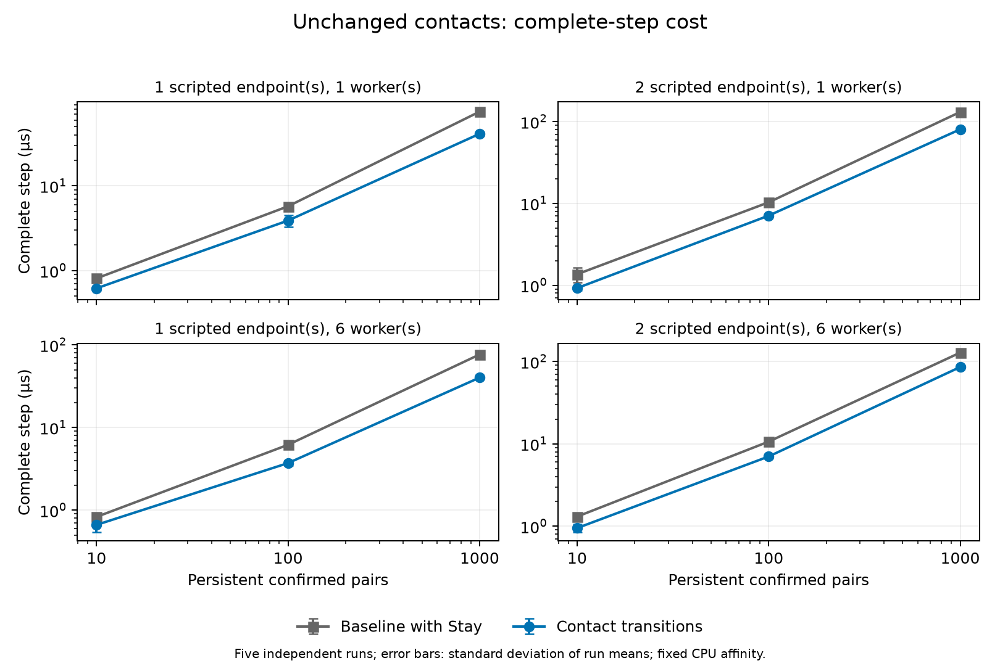

# Performance comparison and regression investigation

All 54 matched timing groups were verified: 270 baseline and 270 candidate independent process runs. Each group has five runs, 120 warmup steps and 600 measured steps. Manifests match hardware, compiler/flags, dependencies, workload, seed, timestep, CPU affinity and timing boundaries. Raw checksums were verified before analysis. Correctness captures are separate; all 54 baseline/candidate and 27 worker comparisons pass. See [candidate results](candidate-results.md), [complete table](performance-table.md), [means/tails/spread CSV](performance-comparison.csv), [nested scopes and individual run means](performance-data.json), and [reproducer](analyze_performance.py).

## Observed benefit

At 1,000 persistent confirmed pairs, complete-step means in microseconds are:

| Scripted endpoints | Workers | Baseline µs | Candidate µs | Change | Baseline p99 µs | Candidate p99 µs |
| --- | --- | ---: | ---: | ---: | ---: | ---: |
| 0 | 1 | 0.341 | 0.289 | -15.46% | 0.471 | 0.299 |
| 0 | 6 | 0.336 | 0.309 | -8.05% | 0.437 | 0.347 |
| 1 | 1 | 75.263 | 41.221 | -45.23% | 109.041 | 66.096 |
| 1 | 6 | 76.549 | 40.166 | -47.53% | 112.410 | 66.340 |
| 2 | 1 | 131.064 | 80.442 | -38.62% | 188.450 | 120.064 |
| 2 | 6 | 128.270 | 85.737 | -33.16% | 196.145 | 136.627 |

The four scripted 1,000-pair groups improve by 33–48%, with disjoint observed run-mean ranges. This supports the benefit of removing repeated Stay processing for this workload on this machine. It does not establish a universal speedup. No-script quiet work is already constant and below one microsecond; its percentage changes are particularly sensitive to timer/instrumentation overhead. These are instrumented benchmark builds, and removing legacy counter scans also removes measurement work. The results do not isolate an algorithm-only gain.

## Every higher complete-step mean

All 15 higher means have overlapping observed run-mean ranges. Overlap is descriptive, not a significance test or proof of equivalence. The table records the scope contributing most of the increase among the retained measured scopes; nested scope times are never added together.

| Capture | Mean change | Increase µs | Largest measured scope increase | p95 change | p99 change |
| --- | ---: | ---: | --- | ---: | ---: |
| add_and_remove-n10-r0-w1 | +2.46% | 0.8909 | cleanup | +2.5% | -1.2% |
| add_and_remove-n10-r0-w6 | +0.02% | 0.0048 | broad_phase | +0.9% | -0.1% |
| add_and_remove-n100-r0-w1 | +2.29% | 7.4352 | cleanup | +4.2% | +5.0% |
| broad_phase-n1000-r0-w6 | +3.27% | 6.3420 | cleanup | +5.3% | +3.5% |
| broad_phase-n500-r0-w6 | +7.23% | 7.7980 | cleanup | +11.0% | +9.3% |
| broad_phase_stress-n150-r0-w1 | +0.47% | 4.1439 | broad_phase | +4.4% | +2.9% |
| broad_phase_stress-n300-r0-w1 | +0.30% | 8.0530 | broad_phase | +3.6% | -4.1% |
| moving_add_and_remove-n100-r0-w1 | +0.35% | 2.4844 | cleanup | -1.2% | +5.8% |
| moving_add_and_remove-n100-r0-w6 | +1.00% | 2.9748 | cleanup | -1.7% | -4.3% |
| narrow_phase-n200-r0-w1 | +0.75% | 248.4315 | narrow_phase | +0.4% | +0.3% |
| persistent_contacts-n10-r0-w6 | +4.32% | 0.0127 | cleanup | +1.2% | +2.5% |
| persistent_contacts-n100-r0-w1 | +5.59% | 0.0163 | cleanup | +2.5% | +4.3% |
| rigid_body_container-n100-r0-w1 | +0.51% | 0.3568 | cleanup | -1.1% | +3.1% |
| rigid_body_container-n1000-r0-w1 | +1.69% | 25.0578 | cleanup | +5.2% | +0.7% |
| rigid_body_container-n500-r0-w6 | +0.27% | 1.2020 | resolve_collisions | -4.8% | -3.6% |

The largest percentage increase is broad_phase n500/w6 (+7.23%, +7.798 µs). Cleanup accounts for 6.543 µs of that difference; measured narrow phase falls from 0.0576 to 0.0436 µs. The n1000/w6 case similarly increases by 6.342 µs, of which cleanup contributes 5.030 µs. This locates the change mainly outside contact evaluation. The original broad-phase/grid algorithms are unchanged. The run ranges overlap and sequential baseline/candidate capture periods permit host drift; no causal attribution or dismissal as mere noise is justified. This remains a measured downside, with uncertain repeatability. No speculative grid rewrite was made.

For stationary add/remove n10/n100 one-worker cases, most excess time is in cleanup; generation now retains required listener-free transitions where applicable. n10/w6 is effectively flat (+0.0048 µs). Moving add/remove n100 changes by +0.35%/+1.00%; w6 tails improve. Stress n150/n300 one-worker increases track the existing broad-phase work, while narrow phase decreases. The dense narrow-phase n200/w1 increase is 0.75% (+248.432 µs), concentrated in narrow phase; p99 there decreases and run ranges overlap. Shape math is token-verified unchanged, and physical oracle captures match. These observations do not prove unchanged runtime cost.

Rigid-body n100/w1 and n500/w6 complete means are +0.51%/+0.27%; physics decreases in each. n1000/w1 is +1.69%: cleanup adds 15.177 µs, solver adds 13.766 µs, while narrow phase falls 8.765 µs. Reading collisions through solver pairs adds one pointer dereference per solver entry in exchange for deleting a duplicate projection and its invalidation/storage. A small solver-local slowdown is plausible; the matrix does not isolate it. Solver p99 changes only +0.24% there, and other solver populations vary in both directions. Retaining the simpler single source is justified by unchanged correctness, reduced state and no established repeatable end-to-end regression attributable to this dereference.

Unobserved persistent n10/w6 and n100/w1 increase by only 0.0127/0.0163 µs. Idle work probes prove zero geometry/transition/event/adjacency work and zero C++ allocations; adding per-pair optimization machinery to chase those differences would lack evidence. Initial listener-free Enter and retirement Exit records do add required work/storage; they are semantic correctness costs rather than an equivalent legacy counter regression. The fixed-peak churn probe stabilizes capacities, and pair layout shrinks 152→136 bytes. RSS samples overlap baseline; no RSS improvement is claimed.

## Ownership, sorting and worker tradeoffs

Event sorting moved from narrow phase to delivery so cleanup-generated and ordinary events share Exit-before-Enter ordering. Therefore narrow-phase scope reductions alone cannot establish saved work; complete-step timings include both locations. The event sort costs O(E log E) only for queued transitions, with O(E) serial delivery; quiet contacts create no events. Canonical pair lists sort only when membership is dirty. No evidence establishes that a more complex ordered-event structure would be faster at the measured transition populations. These required deterministic operations are not retained known inefficiencies.

Pair geometry continues to use oneTBB over independent pairs with the existing small-work threshold. The serial O(P) post-worker reduction owns support/list/event mutation after workers join, preventing shared event writes and preserving deterministic boundaries. No shared-body solver or callbacks were parallelized. On the 1,000 scripted persistent-pair workload, candidate w1/w6 complete means are 41.221/40.166 µs (one endpoint) and 80.442/85.737 µs (two). These stationary workloads have no pending geometry after warmup; they demonstrate no multicore scaling benefit, and the latter is slower with six workers. Do not call the feature a parallel speedup. Worker comparisons for dynamic/skew/churn cases are retained in the complete data; no new scheduling threshold was tuned. Task balance, bandwidth and false sharing were not separately profiled, so the data cannot assign those causes.

Startup extraction preserves the indexed mutable queue, requeue semantics and initialization work. It removes script-driven physical adjacency refresh, proven by work counters; there is no isolated startup timing claim. Retained body/support indexes serve physical invariants. The all-contact projection remains for the independent oracle, while the redundant solver collision projection is removed. No known affected-path inefficiency is deliberately deferred in this change, so no new EFFICIENCY exception comment is warranted.

## Limits and decision

The 54-group matrix covers small/large populations, static contacts, dense/skewed cases, movement, churn and workers one/six; it is one machine and two capture periods, not a randomized interleaved experiment or a significance study. Five process repetitions, all raw samples, p95/p99 and spread are retained. Current baseline executable was rebuilt into the candidate in place, so a fresh alternating experiment would require recreating the documented baseline checkout; the retained evidence is not silently overwritten. Positive deltas above remain reported rather than declared resolved by noise. No evidence warrants a runtime change and full recapture. Accept the contract simplification with its demonstrated persistent-contact benefit and explicitly bounded regression uncertainty.
