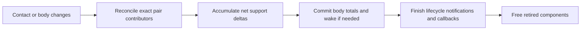

# Maintainer walkthrough — pending actual review

The implementation and review evidence are available; performance acceptance remains separately unverified under T038 (see [profiling disposition](spatial-investigation.md)). Please walk the linked code paths and identify any remaining ownership, validity or control-flow confusion. Prepared answers and passing tests do not mark your comprehension as passed. T043/T045 / SC-001 stays pending until you have reviewed all eight paths and unresolved findings are addressed.

Start with the final link, use the before link where useful, and consult [audit-after.md](audit-after.md) for the rest of each route. The before source tree is intentionally retained under ignored bin/; archive it before cleanup. No need to read every raw benchmark log to assess the code.

| Path | Before | Final starting point | Review question | Maintainer finding |
| --- | --- | --- | --- | --- |
| J1 Motion starts/stops | [setVelocity](../../../bin/physics-bookkeeping-20261025/baseline-source/src/rigidbody.cpp#L148) | [setVelocity](../../../src/rigidbody.cpp#L148) | Can you follow when a velocity change queues participation and which list drives movement? | Pending |
| J2 Body type | [setBodyType](../../../bin/physics-bookkeeping-20261025/baseline-source/src/rigidbody.cpp#L254) | [reconcileBodyParticipation](../../../src/physicsbodyindexes.cpp#L46) | Is the split between body participation and collider response invalidation clear? | Pending |
| J3 Sleep/wake | [applyPhysics](../../../bin/physics-bookkeeping-20261025/baseline-source/src/physicsmanager.cpp#L26) | [resetSleepIsland](../../../src/physicsmanager.h#L85) | Can you distinguish step-local island scratch from the body’s persistent sleep timer? | Pending |
| J4 Support transfer/loss | [reducePairSupport](../../../bin/physics-bookkeeping-20261025/baseline-source/src/physicscontacts.cpp#L62) | [reconcilePairSupport](../../../src/physicscontacts.cpp#L52) | Is the distinction between exact pair credit and committed net body total clear? | Pending |
| J5 Component replacement | [reducePairSupport](../../../bin/physics-bookkeeping-20261025/baseline-source/src/physicscontacts.cpp#L62) | [reconcileSupportContribution](../../../src/physicscontacts.cpp#L66) | Can you identify the old recipient and the flush/free boundary even after component lookup returns its replacement? | Pending |
| J6 Contact queue lifetime | [queuePairForNarrowPhase](../../../bin/physics-bookkeeping-20261025/baseline-source/src/grid.cpp#L130) | [queuePairForNarrowPhase](../../../src/grid.cpp#L129) | Can you follow index-only cancellation and consumed pointers remaining in the fixed batch until reduction? | Pending |
| J7 Filter/activity | [refreshPairLists](../../../bin/physics-bookkeeping-20261025/baseline-source/src/physicscontacts.cpp#L107) | [isLiveContact](../../../src/physicscontacts.cpp#L32) | Is it clear which changes affect contacts/solver eligibility without creating script-driven transitions? | Pending |
| J8 Callback/scene cleanup | [commitMutations](../../../bin/physics-bookkeeping-20261025/baseline-source/src/gamemanager.cpp#L1063) | [commitMutations](../../../src/gamemanager.cpp#L1065) | Can you locate required notification/destruction callbacks and the barrier before old allocations are freed? | Pending |

The key support path is:

Null contributor means no applied-or-queued credit. The old recipient remains allocated through the net flush, even when it is no longer the current component. A zero net change must not cause an interim wake. This is why the per-body delta queue remains after deleting pair flags.

The other concrete reduction is queue membership: one index replaces flag+index. Workers consume only their own indices while the pointer batch remains stable through the join/reduction; structural cancellation/erasure cannot overlap that batch.

The current code removes three pair booleans plus the solver-order dirty flag. The earlier measured ColliderPair layout was136→120 bytes; removing the separate manager flag adds no measured layout claim. Solver ordering was explicitly removed at the maintainer's request; see [current checks](solver-order-removal.md). Runtime effects are mixed; some spatial controls have higher means, with cause/variance limits recorded in [performance analysis](performance-analysis.md). Existing full-suite FluidSynth leaks and SDL/libdbus lock-order warnings remain unresolved as detailed in [sanitizers](sanitizers.md). These are separate from whether the final code is easier for you to follow.

**Requested finding:** Tell me which paths, if any, remain unclear. If all eight read clearly, say so after the walkthrough. I will record your actual findings and address any remaining code issues before marking T043 complete.
