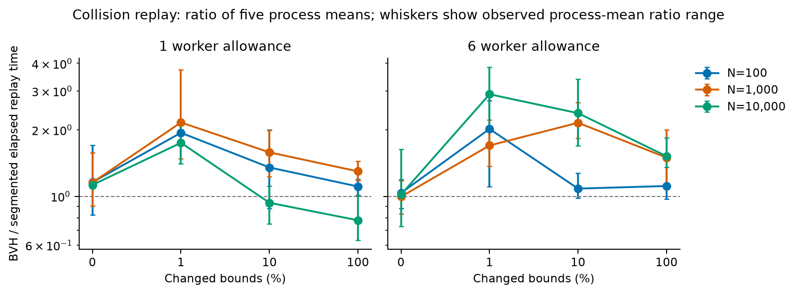
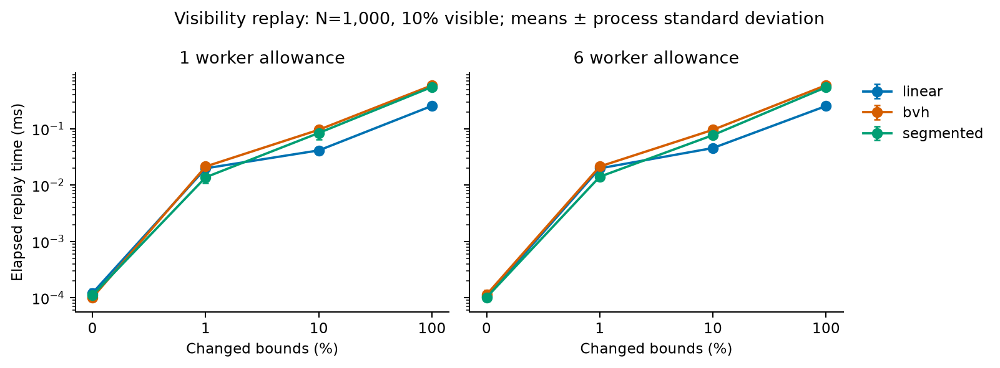
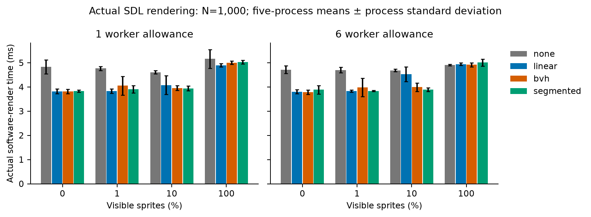

# Corrected spatial-index evaluation

The retained primary matrix has no universal winner. Its results are measurements of the source fingerprint identified below. The ordered linear correction has a separate, final-source report at [linear-correction.md](linear-correction.md); its bounded captures do not replace or relabel the older matrix. BVH helps selected collision workloads, including large migrations and the overlap-heavy, collision-masked engine stress cases. The existing segmented implementation remains competitive and benefits from cell-level parallelism. These findings support explicit selection and further experiments, rather than changing production defaults.

## Evidence and measurement scope

Historical primary source fingerprint: `f1c6298f8b6e7baaa3d4374236a9650e5345a2567f210dbfa3efcb3197b0aba1`. The frozen primary BVH profile is native-partial rebuild, zero padding and serial queries. Separate calibration tested native/full rebuild, padding 0/2, serial/parallel queries and worker allowances 1/6. A single camera supplies one visibility query; the query-execution control does not make that single query parallel. The retained validation/timing/resource bundles are now audited as historical in [qualification-audit.md](qualification-audit.md); they were not rewritten or reused to qualify the final source.

The current bundles are under [`convergence/`](convergence/). Each timing configuration has five fresh processes. Tables use means of process means; p95/p99/max figures are means of per-process statistics, not pooled percentiles. A “win” below means a lower observed mean, not statistical significance. Process spread remains in the summaries and derived tables.

| Bundle | Cases | Validation processes | Timing processes | Resource processes |
|---|---:|---:|---:|---:|
| Separate calibration | 4 | 80 | 400 | — |
| Collision/visibility replay | 41 | 248 | 1,240 | 248 |
| Actual engine | 31 | 176 | 880 | 176 |
| Same-method, seed-0 physics controls | 20 | 40 | 200 | 40 |
| Cold first-frame variants | 31 | 176 | 880 | — |

The historical case-by-case [`coverage.csv`](convergence/coverage.csv) records immutable case hashes and original eligibility alongside derived per-step operation counts and explicit historical-only qualification reasons. [`capture-counts.json`](convergence/capture-counts.json), [`INTEGRITY.json`](convergence/INTEGRITY.json) and each old bundle's checksums retain the verification trail. The machine and limitations are in [`MACHINE.md`](convergence/MACHINE.md). Reproduction uses [`capture.py`](convergence/capture.py); table and figure derivation use [`summarize.py`](convergence/summarize.py) and [`plot_results.py`](convergence/plot_results.py).

## Convergence follow-up: T094–T097

T094 scopes replay counter bindings to their stack-owned publication and drains backend/pair references before endpoint teardown. Initial and mid-step failure regressions pass for both backends. ASan/UBSan replay checks pass with LeakSanitizer disabled under this host's ptrace restriction.

T095 emits invalidated linear visibility results directly from authoritative draw order. The probes-enabled regression verifies zero candidate sorts at sparse and full visibility, exact checks and order for all 1,001 full-visible sprites, and unchanged-frame cache behavior. Fresh final-source evidence includes 64 validation, 320 five-process timing and 64 matched resource captures; see [the corrected comparison report](linear-correction.md) and its compact ledgers. The previous replay/live tables below remain measurements of the historical source.

T096 keys qualification on resolved case/input, complete run boundaries, source/build/toolchain/instrumentation, dependencies, machine, selected profile and renderer identity. Existing manifests still pair internally, but the historical engine bundles lack the recorded runtime scenario and old replay traces predate operation-count metadata. See the [retained-bundle audit](qualification-audit.md).

T097 updates the generator to emit v2 requested-knob labels and derived per-step operation counts. The historical trace hashes remain unchanged; coverage and paired-comparison labels now derive actual operation, churn, filter and coalesced counts from their records.

Replay uses 10 warmup/30 measured steps, excludes parsing and validation oracles, and measures input application, selected index maintenance and consumer publication. Collision replay supplies precomputed AABBs and excludes transform-to-bounds construction. It now enters the actual deferred Grid/TBB path or production PhysicsSpatialIndex, with the same common pair owner. Visibility uses the shared live/replay incremental preparation core. Replay does not draw and its none control does not simulate drawing all sprites; none is not included in indexed-method winner counts.

Actual engine runs use 120 warmup/600 measured frames. Physics-only comparisons disable drawing; sprite-only comparisons fix physics to segmented. Combined correctness covers all eight selections. Complete-step and actual-render samples are independent boundaries; nested scopes must not be added to their parents. The no-render physics families include the three prescribed counts for broad phase, stress, narrow phase and container; static/moving churn at 10/100/1,000 with 1,000 steady objects; and 100 persistent pairs with 0/2 scripted endpoints. Narrow-phase element count N creates 4N colliders; container count is total boxes plus circles.

## Collision results

Ratio is BVH/segmented elapsed time for the same input and worker allowance. Values below 1 favor BVH.

| Boundary | Workers | Paired cases | Lower BVH mean | Median ratio |
|---|---:|---:|---:|---:|
| Replay spatial consumer | 1 | 20 | 4 | 1.324 |
| Replay spatial consumer | 6 | 20 | 2 | 1.609 |
| Actual-engine complete step | 1 | 20 | 12 | 0.959 |
| Actual-engine complete step | 6 | 20 | 5 | 1.570 |

Replay distinguishes coherent local repair from larger relocations. At one worker, BVH/segmented ratios are 0.726 for migration, 0.642 for teleportation, 0.934 for 10,000 proxies/10% changed and 0.778 for 10,000/all changed. The six-worker teleport ratio is 0.984, a close result requiring the recorded process spread. Segmented wins most other replay pairs. Median dynamic-case ratios are 1.551/1.812 at one/six workers; unchanged-case medians are 1.154/1.018. Static near-no-op ratios should not be treated as meaningful algorithmic speedups.

The engine stress fixtures are an important qualified BVH success: their overlapping moving boxes have collision mask zero. BVH's filtering/query and batched-tree path avoids much of the interval-ordering work paid by the retained segmented control. Complete-step BVH/segmented ratios range from about 0.092 to 0.163 across the three stress sizes and two worker allowances. This is evidence for those masked-motion workloads, not a claim that BVH wins every dense contact scene. Other whole-engine results include narrow-phase/solver/cleanup costs and closed-loop state; they are not isolated index timings.

The primary BVH query profile is serial. Six-worker results therefore do not establish an optimal parallel-query strategy for every large or dense batch. Segmented retains its existing independent cell tasks. Query/reduction breakdowns, worker controls and process variability are retained for further tuning; the two-query capability condition is not a measured crossover threshold.

The figure whiskers span min(method)/max(reference) through max(method)/min(reference) across the five process means; they are observed ranges, not confidence intervals.

## Visibility preparation and actual rendering

Replay ratios compare each indexed mode with linear under identical inputs.

| Comparison | Workers | Lower observed mean / cases | Static median ratio | Dynamic median ratio |
|---|---:|---:|---:|---:|
| BVH / linear | 1 | 6 / 21 | 1.008 | 2.135 |
| BVH / linear | 6 | 5 / 21 | 1.063 | 2.119 |
| Segmented / linear | 1 | 6 / 21 | 1.044 | 1.942 |
| Segmented / linear | 6 | 6 / 21 | 1.007 | 1.917 |

There are 13 unchanged visibility cases and eight dynamic companions. BVH has no lower dynamic mean in this set; segmented has one. Cached unchanged frames take an O(1) preparation path for all three modes, so the small static differences do not demonstrate superior tree pruning. The dynamic preparation result concerns these 1,000-sprite traces; it does not establish a moving-10,000-sprite crossover or a universal linear optimum. Bounds updates, required rebuilds, query work, refinement and order restoration are all charged.

Actual software-render means in milliseconds, with 1,000 sprites:

| Visible | Workers | None | Linear | BVH | Segmented |
|---:|---:|---:|---:|---:|---:|
| 0% | 1 | 4.832 | 3.824 | 3.814 | 3.834 |
| 0% | 6 | 4.717 | 3.806 | 3.786 | 3.888 |
| 1% | 1 | 4.767 | 3.835 | 4.056 | 3.904 |
| 1% | 6 | 4.703 | 3.833 | 3.985 | 3.834 |
| 10% | 1 | 4.613 | 4.081 | 3.956 | 3.944 |
| 10% | 6 | 4.688 | 4.524 | 3.991 | 3.892 |
| 100% | 1 | 5.160 | 4.896 | 5.008 | 5.028 |
| 100% | 6 | 4.903 | 4.943 | 4.919 | 5.008 |

None submits 1,000 sprites; the indexed static cases submit 0/10/100/1,000 respectively. Sparse culling reduces actual submissions and observed render cost. At 100% visibility it saves no submissions, so differences in those means cannot be attributed to rejecting sprites.

Do not infer the best preparation algorithm from a small full-render ranking. For example, at six workers/10% visible, culling preparation averages 0.00473 ms linear, 0.00531 ms BVH and 0.00484 ms segmented, while full render means differ by much more. Linear's full-render process standard deviation is 0.304 ms, versus 0.168 ms BVH and 0.076 ms segmented. Most observed render time is outside culling preparation and submit-call scopes; SDL's queued draw/present work and unisolated host/backend effects remain included. The software-render result is not hardware-renderer evidence.

Actual moving, pan, jump, resize, animation, churn and combined results are retained alongside the static fractions. Their visible counts are allowed to change with the fixture. Every rendered validation frame has an exact same-frame submit-all pixel comparison and ordered-submission check with matching backend/output/case/source proof. Timing performs no reference draws or readback. Unsupported/mixed fallback runs are excluded from pure indexed comparisons rather than averaged into them.

## Startup, tails and resources

[`cold-startup.csv`](convergence/cold-startup.csv) separates runtime/fixture setup from first complete-step, first actual render, first spatial update and first culling preparation. It uses the same 31 engine fixtures with zero warmup, one measured first frame and five fresh processes, with separate matching validation. Setup + complete-step + actual render are disjoint and include deferred first-frame index publication. They are not mixed into steady-state samples, and one-frame percentiles are not presented as steady-state tails. Replay initialization covers endpoint preparation, populated-index build and first consumer result; private visibility-context constructor bootstrap precedes that replay scope, so full operational startup claims use the actual-engine cold pass.

[`paired-comparisons.csv`](convergence/paired-comparisons.csv) retains means, process standard deviations, mean-of-process p95/p99/max and initialization for every paired comparison. Raw per-process summaries retain minima/maxima and individual distributions. For the one-worker 1,000-sprite/1%-visible cold case, initial culling preparation averages 0.157 ms linear, 0.606 ms BVH and 1.692 ms segmented. Full first-render means are about 47–50 ms and runtime/fixture setup about 88–90 ms, so backend/startup work and process spread are much larger than those preparation differences. Short-lived scenes must consider startup, not just a cached query result or steady-state mean.

[`resources.csv`](convergence/resources.csv) retains initial/final/max-sampled owner capacity, allocation counts/requested bytes, tracked live peaks and process peak RSS. All 464 resource processes are timing-ineligible and paired to the same source/case/profile/worker/renderer timings. Selected owner estimates include roots, proxy/render records, projections, tree storage, cells/bindings, interval chunks/checkpoints, memberships, retained query-hit/result buffers and common pair/scratch storage. High-water reuse after growth/retirement is tested.

For the one-worker 1,000-sprite/1%-visible engine case, maximum sampled visibility-owner capacity is 0 KiB none, 151.0 KiB linear, 446.5 KiB BVH and 1,125.9 KiB segmented. In collision replay at 1,000 proxies/10% changed, selected-index estimates peak at about 658 KiB BVH versus 1,202 KiB segmented. These footprint differences accompany the timing tradeoffs; they are not a complete process-memory comparison.

These are distinct measurements: do not add owner estimates to allocator-hook totals or RSS. Allocation tags describe call-site scope rather than a complete ownership partition: fixture/setup allocations can share a tag and some record allocations remain unclassified. Use the owner snapshots for selected retained storage and the separate hook/RSS views for their declared coverage. Hash-node bookkeeping uses the declared two-pointer estimate; allocator headers and private container tables beyond that estimate remain excluded. Direct C/SDL/oneTBB allocations may be excluded or unclassified. Owner capacity peaks are maxima of the declared post-initialization/post-step snapshots; allocation hooks separately capture tracked transient peaks. Fixture/component storage and whole-process memory are not all attributable to an index. Resource durations are not performance evidence. Visibility proxy gauges count sprites; the segmented camera endpoint is additional query state charged to work/capacity.

## Same-method controls and integration cost

The separate seed-0 controls repeat all 20 legacy physics workloads at one/six workers, matching resolved parameters, dt, 120/600 frame counts and five fresh processes. [`same-method-controls.csv`](convergence/same-method-controls.csv) aligns the schema-3 T002/T017 records with current schema-4 common complete-step/physics/cleanup/broad/narrow/solve boundaries. Historical files and source identities are unchanged.

Historical f1/T017 complete-step median ratios are 1.051 at one worker and 1.047 at six. The largest observed whole-step differences are persistent 100-pair/zero-script cases, 1.221 and 1.247 respectively. Default selection and gameplay compatibility therefore do not mean zero measured integration cost. The largest relative difference is a near-no-op workload: at one worker the complete step changes from about 319 ns to 389 ns; broad phase from 32 ns to 74 ns and cleanup from 44 ns to 85 ns. The source adds spatial-update instrumentation even around empty flush boundaries, consistent with a fixed clock/bookkeeping cost. No BVH is constructed in this default control. This is not evidence that necessary tree work slows the default path by 22%. Scope breakdowns locate differences across physics and cleanup as well as broad phase; the new common/domain instrumentation and replay-ingress support coexist with the selected segmented path. These observations do not isolate a single cause, and the unpinned historical comparison cannot distinguish every code effect from host drift. Residual differences remain reported rather than being dismissed as parity or attributed to an unselected BVH.

## Why the historical explanation changed

The prior source-42 report attributed about 0.041 ms of unchanged 10,000-proxy BVH replay to required tree maintenance/querying. That explanation was incorrect: routine gauges called an O(N) area-ratio diagnostic. The corrected idle case averages about 146 ns BVH versus 130 ns segmented at one worker, with no required mutation, rebuild or query. Explicit quality scans remain available only when requested. Probe tests verify routine metrics do not perform them.

Other corrections also matter: replay no longer rebuilds full visibility snapshots; live/replay share incremental preparation; BVH queues adjacency once per dirty endpoint; segmented collision replay uses production deferred cell/TBB publication; transitions are exact net changes; and parallel phases use wall time rather than summed worker durations. Therefore before/after differences are implementation corrections across both consumers, not an isolated claim about the abstract BVH algorithm. Old raw captures remain in the original evaluation directories, and old report copies/interim captures are retained under [`historical-reports/`](convergence/historical-reports/) and [`historical-captures/`](convergence/historical-captures/).

## Implications and limits

Keep the selectors explicit. Local incremental segmented repair can exploit coherence; BVH can handle some relocation/filter distributions better. Linear now exact-refines directly in authoritative draw order without sorting or deduplicating unique input. Indexed sparse paths retain candidate sorting/deduplication. Global SAP, bulk/batched endpoint updates, adaptive local/global repair, sharded pair reduction and cheaper indexed-result publication remain separate follow-up experiments. No result establishes an optimal Box2D library choice, automatic backend switching, or a universal method threshold.

The historical replay matrix covers 100/1,000/10,000 populations, required change/visibility fractions and dynamic companions. The refreshed coverage ledger labels requested percentages separately and derives actual per-step churn, filter, geometry-write and coalesced-operation counts from immutable trace operations. The historical 31-case engine matrix is preserved as a record of its own source. The final-source T095 correction matrix is bounded as listed in [linear-correction.md](linear-correction.md); it does not rerun unaffected cases or add a 10,000-object live-engine Cartesian product. Hardware rendering, pinned-core timing and an external contention monitor remain unverified/unavailable. Five-process spread is retained, but these are observations of this build/host, not cross-machine confidence bounds.
