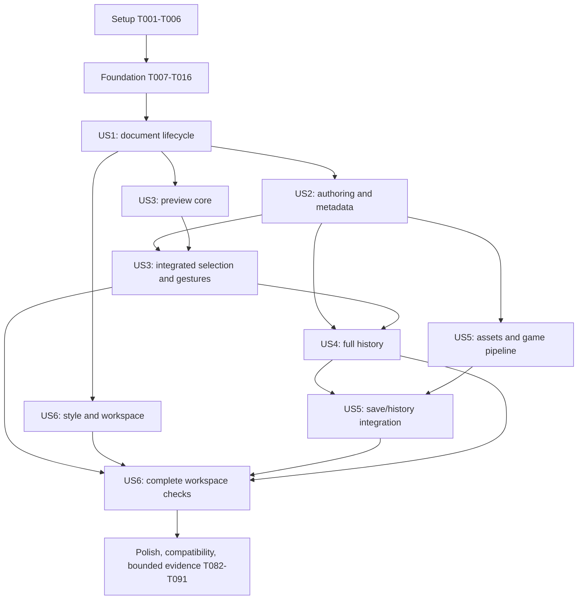

# Tasks: Dear ImGui Game Engine Editor

**Input**: [plan.md](plan.md), [spec.md](spec.md), [research.md](research.md), [data-model.md](data-model.md), [contracts/](contracts/), [parity.md](parity.md), and [quickstart.md](quickstart.md).

**Feature**: `specs/011-add-imgui-editor` on the existing `branch-without-bvh` checkout. Preserve user changes and the Python editor. This list schedules implementation; every task is initially incomplete.

**Tests**: The feature explicitly requires acceptance checks, compatibility tests, resource observations and measured validation (FR-018–019 and SC-001–008); test tasks below implement those obligations. Write contract cases before their implementation, establish the expected missing behavior, and run the relevant suite at each integration checkpoint. Do not write tests merely mirroring trivial widget code.

**Organization**: Six story phases follow specification priorities: US1–US4 are P1; US5–US6 are P2. Shared prerequisites precede them. Each story has an independent fixture-driven test; integrated Scene highlighting, complete history, and execution are verified again when their later story is available. A partial checkpoint never certifies the full feature.

## Format and Path Conventions

- Tasks use `- [ ] Tnnn [P?] [USn?] Description with a repository-relative file path`.
- `[P]` identifies work on distinct files within an explicitly listed eligible wave, after that wave's prerequisites. It does not authorize simultaneous writes to shared integration files or bypass a predecessor.
- Setup, foundation and polish have no story labels; all story tasks have their corresponding `[USn]` label.
- Future source paths are intentional. Use existing engine/public contracts and the full field inventory in `parity.md`; do not substitute demo controls for required workflows.
- Evidence is compact Markdown/JSON under `specs/011-add-imgui-editor/evidence/`. Builds stay under `bin/` or `build/`, outside evidence. No source archives, binaries, build trees, full-frame images, or per-frame identity lists are retained by default.

## Phase 1: Setup (Shared Infrastructure)

**Purpose**: Establish dependency provenance, optional build boundaries, reproducible validation inputs and native test support.

- [X] T001 Recheck `specs/011-add-imgui-editor/parity.md` against `ui/src/platformator_ui/main_window.py`, `ui/tests/`, and current engine serializers; record the starting revision/worktree, reusable fixture/test identities, legacy environment availability and focused baseline workload selection in `specs/011-add-imgui-editor/evidence/BASELINE.md`, without starting historical benchmark campaigns.
- [X] T002 Acquire the exact Dear ImGui `v1.92.9b-docking` source into `vendored/imgui-1.92.9b/`; preserve `vendored/imgui-1.92.9b/LICENSE.txt` and record upstream URL, full resolved commit and source/license hashes in `vendored/imgui-1.92.9b/PLATFORMATOR_VENDOR.md`; include only source/support files, never upstream build products or a moving configure-time fetch.
- [X] T003 Add `PLATFORMATOR_BUILD_EDITOR=OFF` in `CMakeLists.txt` and create `editor/CMakeLists.txt` with private `platformator_imgui`, `platformator_editor_core` and `platformator_editor` targets plus a minimal `editor/src/main.cpp`; compile only required SDL3 backends and keep editor source outside the engine glob, SDK exports and PUBLIC engine dependencies; clearly reject editor-ON on unsupported platforms.
- [X] T004 [P] Add `editor-debug`, `editor-release`, and `editor-asan` configure/build presets in `CMakePresets.json`, with outputs under `bin/`, explicit editor enablement, suitable existing sanitizer settings, and an editor-only configuration with tests disabled that needs no Python/Qt editor installation.
- [X] T005 [P] Establish native test helpers and small semantic fixture builders in `editor/tests/test_support.h` and `editor/tests/CMakeLists.txt`, reusing repository assertion/CTest conventions and software/dummy backend settings; register each requested suite when its source is added, without inventing an application-wide test framework or storing frame captures.
- [X] T006 Validate the minimal editor-ON and editor-OFF target boundaries using `CMakeLists.txt` and `editor/CMakeLists.txt`; record configure/build commands and dependency/export observations in `specs/011-add-imgui-editor/evidence/RESULTS.md`; do not claim a working editor from the bootstrap window.

**Checkpoint**: Dependency/version identity is recorded, default runtime builds remain independent, and native story suites have a registration path.

## Phase 2: Foundational (Blocking Prerequisites)

**Purpose**: Freeze shared ownership, addressing, commands and asynchronous services before story UI integration.

**Gate**: Finish T001–T016 before starting a story phase. Within this phase use only the disjoint waves listed below.

- [X] T007 Define shared document/session, selection, property-address and command-result types in `editor/src/document.h`, `editor/src/selection.h` and `editor/src/editcommands.h`; carry document/project generations and optional component/behavior addressing, preserving: "Runtime pointers/handles never enter saved documents or command addresses." and "Behavior lists do not gain serialized editor IDs."
- [X] T008 Implement the owner-thread application shell and CLI in `editor/src/main.cpp` and `editor/src/editorapp.cpp`: one Runtime/ImGui context, full SDL-to-ImGui event feed, one presentation per UI frame, `--help` before Runtime creation, explicit project/scene/root/scale options, and no simulated frame; enforce the CLI constraint that style scale is positive finite and establish teardown ordering before adding panels.
- [X] T009 [P] Implement stable-ID address resolution and shared selection repair in `editor/src/selection.cpp`; preserve "Missing object clears selection; missing component falls back to its surviving owner." and "Selection-only changes do not dirty the scene."; publish selection/change notifications without retaining DOM pointers across structural edits.
- [X] T010 [P] Add native subprocess contract cases in `editor/tests/process_test.cpp` and a small `editor/tests/process_fixture.cpp` for argv/cwd fidelity, nonblocking large output, merged build/game streams versus separately captured catalog stdout/stderr, failed spawn, group ownership, grandchild termination, repeated Stop and reaping; register `platformator_editor_process_test` in `editor/tests/CMakeLists.txt` before implementing the service.
- [X] T011 Implement Linux process ownership in `editor/src/process.h`, `editor/src/process.cpp` and `editor/src/process_posix.cpp`, detecting cwd-spawn capability in `editor/CMakeLists.txt`; use argv/cwd, a new owned group, mode-selectable merged or separate stdout/stderr, nonblocking reads/polls, TERM then KILL after 2 seconds, and generation-checked completions; any fork fallback prepares data in the parent and uses only async-signal-safe child operations, never shell interpolation.
- [X] T012 Add callback/session-generation and shutdown cases in `editor/tests/async_request_cases.cpp`, linked into `platformator_editor_workspace_test` via `editor/tests/workspace_test.cpp` and `editor/tests/CMakeLists.txt`; prove cancellation/error/selection distinctions and safe late completion without live document/panel access.
- [X] T013 Implement SDL open/save/folder requests and an application-owned completion queue in `editor/src/filedialogs.h` and `editor/src/filedialogs.cpp`, retaining filters/request contexts until callback completion and copying returned data before release; preserve "Main-thread consumption ignores superseded/shutdown requests." and "Pending callback state must remain valid beyond EditorApp teardown if the native dialog completes late."; provide path entry on provider failure.
- [X] T014 Implement canonical project context, generations and cancellable immutable filesystem-scan requests in `editor/src/project.h` and `editor/src/project.cpp`; use oneTBB task-group work rather than a new pool, bound pending publications, join before owner teardown, and enforce "Task completion precedes owner destruction; no worker retains a DOM or Runtime pointer."; keep actual browser/catalog policies for their story tasks.
- [X] T015 Implement targeted reversible command payload/application interfaces in `editor/src/editcommands.cpp`, resolving IDs and before/after or missing-key values atomically and notifying affected IDs; supply shared apply/rollback and gesture hooks without whole-document snapshots; history cursor/undo UI remain US4 work.
- [X] T016 Run the foundational process/request suites and application startup/shutdown checks registered in `editor/tests/CMakeLists.txt`; record owner-thread boundaries, cancellation/late-callback results and observed limitations in `specs/011-add-imgui-editor/evidence/RESULTS.md` before opening story work.

**Checkpoint**: Shared data/command interfaces, native process ownership, safe dialogs and scan publication are usable without gameplay execution.

## Phase 3: User Story 1 — Open and Save Existing Scenes (Priority: P1; MVP)

**Goal**: Open/create/validate/save scenes safely and losslessly, without the legacy GUI installed.

**Independent Test**: Create/reopen a starter camera scene, round-trip valid and unfamiliar JSON, cancel replacement/save, and induce parse/write/external-change failures; verify both current work and saved destination contents. No later authoring, preview or execution story is needed to run these cases.

### Tests for User Story 1

- [X] T017 [P] [US1] Add `editor/tests/document_test.cpp` coverage for top-level arrays, unknown fields/components, IDs/order/references, deep input, legacy camera aliases, structural rejection, known-path normalization and save failure; preserve the structural rule: "Reject non-array roots, malformed object/component structure, duplicate/negative/out-of-range IDs, duplicate incompatible component slots, and invalid hierarchy representation." File ID zero remains valid for runtime and legacy-scene compatibility.
- [X] T018 [P] [US1] Extend `editor/tests/workspace_test.cpp` with New/Open/Save/Save As/Validate, explicit-startup versus last-scene precedence, missing restoration, picker cancellation, Save/Discard/Cancel and failed save-before-replacement; compare document/saved marker/destination state, not merely error text.

### Implementation for User Story 1

- [X] T019 [US1] Implement authoritative JSON parsing, default-camera scene creation and generation-bound ID/parent/draw-order indexes in `editor/src/document.cpp`; use explicit deep traversal storage, rebuild topology indexes only on structural change, and enforce "Preserve valid unfamiliar components/fields without instantiating them."; runtime objects must never be the save source.
- [X] T020 [US1] Implement lossless serialization, external-file identity checks and same-directory atomic save in `editor/src/documentio.h` and `editor/src/documentio.cpp`; flush/close before replacement, leave the destination unchanged on pre-replacement failure, update saved state only on successful replacement, and distinguish post-replacement directory-durability errors; preserve "Legacy camera aliases are preserved on no-edit save." and "Report conflicting legacy/canonical values instead of guessing."
- [X] T021 [US1] Implement versioned project-keyed preference storage in `editor/src/preferences.h` and `editor/src/preferences.cpp`, reusing atomic file writing for settings and persisting only successfully adopted scene paths; preserve "Writes use atomic replacement. Bad preference data resets affected preferences, not the document."; add layout/run fields without requiring Qt preference migration.
- [X] T022 [US1] Connect document lifecycle actions, native dialogs, unsaved-state prompts, candidate validation/adoption and startup restoration in `editor/src/editorapp.cpp` and `editor/src/main.cpp`; cancellation or failure must not replace the document, clear dirty state or launch work, and Save must resolve active command/gesture hooks.
- [X] T023 [US1] Add non-instantiating known-field validation and contextual issues in `editor/src/validation.h` and `editor/src/validation.cpp`, preserving verbatim: "Use engine numeric constraints for committed known fields: finite transforms/vectors/scalars, positive scales and collider dimensions, finite offsets, valid mass/body-kind rules, nonnegative friction, restitution in [0,1], valid enums/masks, and current camera/sprite/animator/audio constraints." and "Imported recoverable property/resource errors remain editable and block Run where the runtime would reject them; structural errors reject document adoption."; do not invent custom behavior constraints.
- [X] T024 [US1] Register/run document and workspace lifecycle suites through `editor/tests/CMakeLists.txt`; open/save valid fixture output with existing runtime scene-I/O checks and optionally the legacy serializer, comparing semantic fields and known normalization rather than text formatting; record unavailable legacy checks explicitly in `specs/011-add-imgui-editor/evidence/RESULTS.md`.
- [X] T025 [US1] Complete the scene-lifecycle parity row and US1 acceptance observations in `specs/011-add-imgui-editor/parity.md` and `specs/011-add-imgui-editor/evidence/RESULTS.md`, including CLI/help/root errors, missing last scene, external overwrite choice and recoverable failures; keep all other story gates open.

**Checkpoint**: US1 is an independently usable file/lifecycle MVP; editing and game execution are subsequent increments.

## Phase 4: User Story 2 — Edit Objects, Components and Behaviors (Priority: P1)

**Goal**: Provide complete document-backed Hierarchy/Inspector/component/behavior/reference authoring through the common command path.

**Independent Test**: Use a fixture with every component and representative behavior data; create a child, duplicate/delete a subtree, change every field group, assign references, add/remove components/behaviors and save/reopen. Test compiled metadata with a fixture runner independently of build/run UI. Scene highlighting is integrated and checked in US3.

### Tests for User Story 2

- [X] T026 [P] [US2] Extend `editor/tests/document_test.cpp` with object/component/behavior mutations, every built-in field group from `specs/011-add-imgui-editor/parity.md`, conflict/wrong-kind/dangling-reference rejection and selection repair; assert missing/null versus zero/empty distinctions and all duplicate-reference cases, including self/internal/external/component targets.
- [X] T027 [P] [US2] Add `editor/tests/catalog_test.cpp` and `editor/tests/catalog_fixture.cpp` for macro/private/zero-field and typed descriptors, factory-only registration, deterministic JSON, no constructor/Runtime/SDL during export, schema/payload and current/stale identity failures; test unchanged shared-runner sources gaining support by rebuild, undeclared custom entries remaining editable/buildable without query/Run, and falsely declared protocol failures; register `platformator_editor_catalog_test` in `editor/tests/CMakeLists.txt`.

### Implementation for User Story 2

- [X] T028 [US2] Add lazy editor-independent descriptor types/traits in `include/platformator/scriptmetadata.h` for booleans, signed/unsigned representable ranges, numbers, strings, known enums, vectors/rectangles, recursive containers/optionals, asset and typed object references, with opaque custom JSON fallback; describe types without constructing game objects or claiming C++ constructor defaults.
- [X] T029 [US2] Extend `include/platformator/scriptregistration.h`, `src/scriptregistration.cpp` and `src/behaviorfactoryregistry.h`/`src/behaviorfactoryregistry.cpp` with macro-generated descriptor providers and registry enumeration, preserving current macro calls/two-argument factory registration and field order; factory-only registrations remain runnable with unavailable schema and normal frames never traverse metadata.
- [X] T030 [US2] Add early `--editor-catalog` handling/export in `src/runner.cpp`, returning deterministic versioned JSON before Runtime/SDL/factory construction and rejecting incompatible run arguments; preserve ordinary runner behavior and validate the test-game and Mario registration paths without linking their scripts into the editor.
- [X] T031 [US2] Implement create/delete/duplicate subtree and component/behavior add/remove command builders in `editor/src/editcommands.cpp`, applying ID/compatibility checks and preserving: "Duplication reassigns copied object/component IDs without collisions, inserts immediately after the source in the same parent, gives the copied root a unique name and (+32,+32) local offset, and preserves all copied numeric reference values."; store only affected payloads for eventual history.
- [X] T032 [US2] Implement `editor/src/panels/hierarchy.h` and `editor/src/panels/hierarchy.cpp` with nested object/component rows, root/child/context actions and shared selection; cache row/order data by structural revision, clip large visible lists, and never infer order from hash iteration or expose IDs as editable fields.
- [X] T033 [US2] Implement built-in property/component sections and Add Component in `editor/src/panels/inspector.h` and `editor/src/panels/inspector.cpp`, covering every exact field listed in `specs/011-add-imgui-editor/parity.md`; use common validation/command/gesture hooks for booleans, enums, numeric ranges, optional source rectangles and all other supported values, without direct DOM mutation from widgets.
- [X] T034 [US2] Implement catalog schema parsing, identity-bound caching and query/refresh in `editor/src/behaviorcatalog.h` and `editor/src/behaviorcatalog.cpp` using separate stdout/stderr; allow executable queries only for declared `catalogProtocol=common-runner-v1`, never infer compatibility from an arbitrary filename; preserve states (`Unavailable`, `Stale`, `Current`), registered/schema distinctions and immutable snapshots, with 10-second/4-MiB query limits and no catalog-driven scene mutation.
- [X] T035 [US2] Add recursive behavior/nested/list/opaque-value editing and missing-field drafts in `editor/src/panels/behaviorfields.h` and `editor/src/panels/behaviorfields.cpp`; a newly added macro behavior stores only its type until explicit field edits, observed samples never overwrite defaults or delete unknown fields, and unsafe unsupported values stay explained/read-only.
- [X] T036 [US2] Implement typed scene-reference and asset-field editors in `editor/src/panels/referencefields.h` and `editor/src/panels/referencefields.cpp`, preserving "An object reference is an integer file ID or null, with expected target kind from metadata." and "An asset reference is a case-preserving `assets/...` string or null/unset as supported by that field."; enforce "Unknown integers/strings are not inferred to be references." and retain dangling values visibly unresolved.
- [X] T037 [US2] Implement the available behavior list/attachment actions in `editor/src/panels/behaviors.h` and `editor/src/panels/behaviors.cpp` and integrate the panels in `editor/src/editorapp.cpp`; clearly label registered-without-schema, stale and scene-only types, preserve all unfamiliar saved data, and route component selection to the matching Inspector section.
- [X] T038 [US2] Run the extended document/catalog suites through `editor/tests/CMakeLists.txt` plus existing scene/script/object-reference/asset-root contracts; verify omitted macro fields retain actual runtime defaults, factory-only limitations remain explicit, and changed public headers compile for normal/installed game consumers; record results in `specs/011-add-imgui-editor/evidence/RESULTS.md`.
- [X] T039 [US2] Record field-by-field and hierarchy/behavior parity evidence in `specs/011-add-imgui-editor/parity.md` and `specs/011-add-imgui-editor/evidence/RESULTS.md`; identify integrated Scene/highlighting and complete history checks as awaiting US3/US4 rather than marking the full feature complete.

**Checkpoint**: Authoring semantics and panels are independently testable; their selection/change notifications are ready for Scene and history integration.

## Phase 5: User Story 3 — Navigate and Manipulate a Scene Visually (Priority: P1)

**Goal**: Render and manipulate engine-consistent scene content without executing gameplay or changing saved game cameras.

**Independent Test**: Compare matching preview/reference geometry and images in memory; navigate and select overlapping/parented sprites and collider handles, drag local values at varied zoom/pixel ratios, and assert no gameplay callbacks/physics/autoplay and full renderer-state restoration.

### Tests for User Story 3

- [X] T040 [P] [US3] Add `editor/tests/preview_test.cpp` and minimal engine-equivalent fixtures covering ordered/alpha-overlapping sprites, translated parents, local scale/rotation, active rules, source rectangles/flips, static animator frames, missing assets, target-state restoration, excluded authored components and no simulation; register `platformator_editor_preview_test` in `editor/tests/CMakeLists.txt` and compare frames in memory only.
- [X] T041 [P] [US3] Add independent projection/picking/drag cases in `editor/tests/viewport_cases.cpp`, linked to the preview suite: off-origin image rectangles, unequal window/target extents, real framebuffer ratios versus style scale, overlapping target access, zero extent, parent-local positions/offsets and cancelled gestures; expected coordinates must come from fixture math, not the implementation under test.

### Implementation for User Story 3

- [X] T042 [US3] Extract/share view-based sprite geometry/submission from `src/camera.cpp` through `src/spriterendergeometry.h`, keeping normal Camera/SDLWindow culling, order, instrumentation and clear/present behavior intact; do not add a new renderer, gameplay camera or broad-phase change.
- [X] T043 [US3] Implement the editor-only preview-access adapter in `editor/src/preview.cpp` with narrowly scoped friendship in `src/gamemanager.h` for owner-thread proxy transform publication; preserve "Proxies contain only flattened root GameObjects with Sprite." and never call Runtime scene loading or simulate/run APIs from preview.
- [X] T044 [US3] Implement document-ID mapping, explicit ordered proxy lists, changed-only geometry/eligibility reconciliation and retained texture/clip resources in `editor/src/preview.h` and `editor/src/preview.cpp`; preserve "Their IDs are runtime-owned and never substitute for document file IDs.", "Parent translation is accumulated, while scale/rotation follow the existing engine's local-only inheritance." and "Active-object treatment follows the engine rather than assuming Unity's hierarchy activation."; preview current frame without playback, cache asset failures until change/refresh, and never save unresolved markers.
- [X] T045 [US3] Implement reusable target allocation and full RAII renderer-state restoration in `editor/src/preview.cpp`, with culling caches bypassed and no main-camera mutation or present; preserve "Zero dimensions suspend preview allocation/drawing; growing/resizing replaces the target only after safe release of prior frame references." and "Release texture/proxies/references before that renderer/runtime; remove borrowed pointers from ordered submission before destroying proxies."; add the required local `EFFICIENCY:` rationale for the initial O(renderable proxies) submission loop.
- [X] T046 [US3] Implement Scene logical/pixel/world transforms, pan/zoom and frame-scene/frame-selection in `editor/src/viewport.h` and `editor/src/viewport.cpp`, deriving framebuffer ratios from SDL and the actual image rectangle instead of user style scale; navigation must never write saved camera fields.
- [X] T047 [US3] Add grid/camera/collider/selection overlays, deterministic draw-order picking with overlapping-target cycling, and object/collider-offset handles in `editor/src/viewport.cpp`; derive overlays and local edits from the same resolved geometry, leaving inactive/missing-resource objects discoverable and selectable.
- [ ] T048 [US3] Route viewport gestures through common commands and focus/modal/capture arbitration in `editor/src/viewport.cpp` and `editor/src/editorapp.cpp`; enforce "Commit equal to the initial value creates no command." and "Cancel restores exact initial values/missing keys and emits preview updates."; Escape, focus loss, hidden/closed Scene and invalid selection must end gestures safely.
- [ ] T049 [US3] Integrate target composition, shared selection highlights, root/document replacement and ordered teardown in `editor/src/editorapp.cpp`; preserve "On root change, release the old preview/Runtime and rebuild at a frame boundary; authoring JSON/history remain intact." and release all references/backends before their renderer; only the UI presents once per frame.
- [ ] T050 [US3] Run preview/viewport cases and existing render-culling/geometry/contract, transform and runtime-step/recreation checks using `editor/tests/CMakeLists.txt` and supported work-probe configurations from `CMakeLists.txt`; retain ordinary comparisons in memory and record worker/backend/sanitizer or environment limits in `specs/011-add-imgui-editor/evidence/RESULTS.md`.
- [ ] T051 [US3] Complete Scene/canvas and integrated selection parity observations in `specs/011-add-imgui-editor/parity.md` and `specs/011-add-imgui-editor/evidence/RESULTS.md`, including missing resources/no camera, pixel mapping and no-gameplay proof; capture detailed diagnostics only for a concrete failure with a small explicit bound.

**Checkpoint**: US3's preview, selection and movement outcomes are independently verified; persistent multi-step history is completed next.

## Phase 6: User Story 4 — Undo Edits and Trust Saved State (Priority: P1)

**Goal**: Complete reversible mixed edits, explicit gesture transactions and correct saved/unsaved history semantics across all authoring surfaces.

**Independent Test**: Make a mixed edit sequence, save midway, undo to saved/start states, redo, branch history, prune it and cancel gestures; assert exact document/selection states without full-document work per input.

### Tests for User Story 4

- [X] T052 [P] [US4] Add `editor/tests/history_test.cpp` for every property/structure/component/behavior/reference/viewport mutation, before/after selection, absent-key materialization, separate/continuous/no-op gestures, stale-command atomic rejection, saved-token/redo branching and retained-byte limits; register `platformator_editor_history_test` in `editor/tests/CMakeLists.txt`.

### Implementation for User Story 4

- [X] T053 [US4] Complete history storage/cursor and monotonic saved-state tokens in `editor/src/editcommands.h` and `editor/src/editcommands.cpp`, retaining only changed values/affected subtrees and enforcing "Dirty means active changed gesture or current token differs from the reachable saved token."; prevalidate all undo/redo writes so a bad address never partly mutates the document.
- [X] T054 [US4] Complete gesture lifecycle in `editor/src/editcommands.cpp`, preserving transitions "`Idle -> Begin -> Updating -> Commit -> Idle` or `Cancel -> Idle`" and "Separate gestures never merge by object/control identity alone."; missing-key rollback and no-op commits must match the original document exactly.
- [X] T055 [US4] Connect Inspector, behavior/reference, Hierarchy and viewport operations to the same history in `editor/src/panels/inspector.cpp`, `editor/src/panels/behaviorfields.cpp`, `editor/src/panels/referencefields.cpp`, `editor/src/panels/hierarchy.cpp`, `editor/src/panels/behaviors.cpp` and `editor/src/viewport.cpp`; ensure no supported DOM mutation bypasses command storage or selection restoration.
- [X] T056 [US4] Wire Undo/Redo actions, valid restored selection, dirty/title state, save completion and pending-gesture resolution in `editor/src/editorapp.cpp` and `editor/src/documentio.cpp`; preserve "New edits after Undo discard redo, invalidating a saved token on that discarded branch."; panel/focus/navigation changes remain outside scene history.
- [X] T057 [US4] Implement payload accounting/pruning and visible history-limit state in `editor/src/editcommands.cpp` and `editor/src/editorapp.cpp`, preserving "Prune oldest completed history beyond a 64 MiB payload budget while retaining the newest single oversized command; display the available history limit." and "An unreachable saved state stays dirty until the next successful save."
- [X] T058 [US4] Run history and integrated document/preview/workspace cases through `editor/tests/CMakeLists.txt`; add separate untimed affected-work/allocation observations proving individual edits/draws do not serialize/copy the whole document, and record outcomes in `specs/011-add-imgui-editor/evidence/RESULTS.md` without a new timing campaign.
- [X] T059 [US4] Complete undo/dirty-state parity and mixed-edit acceptance evidence in `specs/011-add-imgui-editor/parity.md` and `specs/011-add-imgui-editor/evidence/RESULTS.md`, confirming US1–US3 still pass with real history and all mutation families are covered.

**Checkpoint**: P1 authoring is reversible end to end. Core editor usability can be demonstrated before game pipeline and workspace polish.

## Phase 7: User Story 5 — Find Assets and Build and Run the Game (Priority: P2)

**Goal**: Finish asset browsing/assignment and the configure/build/catalog/run/stop cycle with persistent game settings and usable cancellation/output.

**Independent Test**: Assign compatible/invalid assets and typed references, build/query/run the selected test game/Mario target, cancel or fail each stage, stop its grandchildren and repeat while checking scene/history remain intact.

### Tests for User Story 5

- [X] T060 [P] [US5] Extend `editor/tests/process_test.cpp` with the configure/build/catalog/launch state machine, build-only, saved-scene/settings snapshots, duplicate requests, source/target change invalidation, 10-second/4-MiB catalog limits, 1-MiB Console truncation, failed stages preventing launch and close/Stop recovery; use small real fixture processes rather than long test builds.
- [X] T061 [P] [US5] Extend `editor/tests/document_test.cpp` with asset browser/field compatibility and scene-reference assignment: case preservation, known separator normalization, spaces/Unicode, root/symlink escape, missing resources, wrong file/target types and undo/redo; retain "Deleting a target leaves dangling serialized values visibly unresolved rather than rebinding or silently clearing them."

### Implementation for User Story 5

- [X] T062 [US5] Complete project/run settings in `editor/src/project.cpp` and `editor/src/preferences.cpp` for configure/build presets, target/executable, scene/root, debug/production, window/debug options and `catalogProtocol`; preserve "`catalogProtocol` is `common-runner-v1` or `unavailable`" and "Unavailable protocol disables query/automatic Run but not editing or Build-only."; default only known bundled entries to compatible, require explicit declaration elsewhere, invalidate catalogs on protocol/target change, and never rewrite game source.
- [X] T063 [US5] Add demand-driven expanded-directory and source/CMake identity scans in `editor/src/project.cpp`, bounding work/publications with existing oneTBB cancellation/generations; implement "Refresh source-input identity through explicit Refresh/Build and asynchronous change scans of configured source inputs/CMake files, not a full source walk on every frame."; detected changes mark catalogs stale without editing the document.
- [X] T064 [US5] Implement the pipeline state machine and immutable operation snapshot in `editor/src/process.cpp`, preserving "`Idle -> Configuring -> Building -> QueryingCatalog -> Launching -> Running -> Idle`" and "Build-only ends after Building."; configure/build the chosen target, query that exact output, validate saved-scene/behavior availability and launch with explicit `--scene` and `--asset-root` argv; errors never launch an old executable or retry automatically.
- [ ] T065 [US5] Implement `editor/src/panels/project.h` and `editor/src/panels/project.cpp` for expandable asset browsing and compatible drag/drop/dialog/text assignments through the reference command path, with known root/case rules and visible unresolved status; no full asset-tree rescan per frame or asset loading from scan workers.
- [X] T066 [US5] Implement `editor/src/panels/console.h` and `editor/src/panels/console.cpp` with stage labels, readable command display, retained final failures and bounded per-frame draining; preserve "Catalog payloads have a separate 4 MiB limit and timeout (10 seconds); Console retains 1 MiB with an explicit truncation marker." and never parse merged diagnostics as catalog JSON.
- [X] T067 [US5] Add project/run-settings UI in `editor/src/panels/runsettings.h` and `editor/src/panels/runsettings.cpp`, wiring Build/Build & Run/Stop, current status and settings summaries in `editor/src/editorapp.cpp`; disable unavailable/duplicate actions without freezing unrelated navigation or cancellation.
- [X] T068 [US5] Implement save-before-run, mutation/document/project locks during an owned operation, Stop/Cancel on application exit and restoration after failures in `editor/src/editorapp.cpp`; frozen running data never overwrites authoring selection/history, and cancelling/failed save must not launch stale content or clear dirty state.
- [X] T069 [US5] Integrate post-build catalog verification and stale-cache recovery in `editor/src/behaviorcatalog.cpp` and `editor/src/process.cpp`, preserving "For a declared compatible target, Run always configures/builds and queries the resulting binary again before availability checks and launch."; block query/automatic Run for undeclared custom entries while retaining editing/Build-only, explain explicit export integration, and reject changed identities or failed queries without source edits, silent behavior omission or automatic retry.
- [X] T070 [US5] Run asset/process/catalog integration and actual shared-runner/Mario build/query/run/stop paths using `editor/tests/CMakeLists.txt` and `examples/mario/CMakeLists.txt`; also verify undeclared custom-entry fixtures retain identical source and support editing/Build-only without query/launch, while falsely declared entries fail verification; record current CLI, roots/settings, missing behavior and descendant-cleanup results in `specs/011-add-imgui-editor/evidence/RESULTS.md`.
- [X] T071 [US5] Complete asset/build/run parity records in `specs/011-add-imgui-editor/parity.md` and `specs/011-add-imgui-editor/evidence/RESULTS.md`, including failure/cancel/save protection and the separate game-window execution model; leave embedded play/hot reload outside scope.

**Checkpoint**: The full edit-test loop runs using the selected game's actual behavior registry, not source inference or editor-linked scripts.

## Phase 8: User Story 6 — Use a Familiar Configurable Workspace (Priority: P2)

**Goal**: Deliver the specified Unity-inspired dark layout, consistent Inspector presentation, complete discoverable actions, layout recovery and correct scaling/focus behavior.

**Independent Test**: Check every required panel/action and style criterion, rearrange/hide/reopen/restart/reset, and exercise focus/dialogs and Scene mapping at 100%/150% style plus real display scaling without scene/history changes.

### Tests for User Story 6

- [X] T072 [P] [US6] Extend `editor/tests/workspace_test.cpp` with stable panel IDs, default/restore/reset/corrupt/offscreen preference states, all action/shortcut availability, text/modal/gesture capture, scale changes without cumulative scaling and unchanged document/history across UI-only operations; retain real-desktop checks as distinct evidence.

### Implementation for User Story 6

- [X] T073 [P] [US6] Implement a coherent unscaled style base and original vector icons in `editor/src/style.h` and `editor/src/style.cpp`, matching FR-015 neutral dark surfaces, restrained blue focus/selection, compact spacing, panel separation and readable labels/tooltips; avoid a new raster/font dependency or Unity branding.
- [X] T074 [US6] Implement stable dockable panel IDs, toolbar/menus and the default Hierarchy-left/Scene-center/Inspector-right/Project-and-Console-below workspace in `editor/src/editorapp.cpp` and `editor/resources/default-layout.ini`; use public docking APIs with a checked-in seed, keep behavior editing in the Inspector without a separate Behaviors tab, and avoid internal DockBuilder dependence.
- [X] T075 [US6] Add opt-in `highPixelDensity=false` in `include/platformator/windowsettings.h`, apply its creation flag in `src/sdlwindow.cpp`, and opt in from `editor/src/editorapp.cpp`; scale fonts/style from the unscaled base and actual SDL window/pixel ratios, preserving default runtime window behavior and supporting tested 100%/150% UI scale without double-scaling coordinates.
- [ ] T076 [US6] Complete discoverable menus, toolbar/tooltips and context-aware shortcuts in `editor/src/editorapp.cpp`: platform New/Open/Save/Save As/Undo/Redo/zoom, Ctrl+B, F5, Shift+F5, F6, Ctrl+,, F and Shift+F; preserve deliberate legacy framing keys and suppress unintended global/Scene actions during text, modal or gesture capture.
- [X] T077 [US6] Finish layout visibility/persistence/reset and project-keyed preference recovery in `editor/src/preferences.cpp` and `editor/src/editorapp.cpp`, preserving "Stable panel IDs decouple layout identity from visible labels."; bad/offscreen state must recover inside the window without touching scene dirty state or history.
- [ ] T078 [US6] Complete Inspector label alignment/component headers/Add Component, keyboard focus/validation feedback and reachable overflow in `editor/src/panels/inspector.cpp` and `editor/src/panels/behaviorfields.cpp`; integrate Scene hide/minimize/resize/focus cancellation in `editor/src/viewport.cpp` with no stuck gestures or invalid coordinate mapping.
- [ ] T079 [US6] Execute the real-desktop style/docking/dialog/focus/100%-150% and actual monitor-scaling sequence in `specs/011-add-imgui-editor/quickstart.md`; record per-FR-015 observations and any desktop-provider/environment limitation in `specs/011-add-imgui-editor/evidence/RESULTS.md`, never substituting dummy-driver tests for visual or portal verification.
- [ ] T080 [US6] Run workspace and related viewport/history tests registered in `editor/tests/CMakeLists.txt`, verifying style reset, stable layout identity, shortcut routing and unchanged saved cameras across actual and overridden scales; record results in `specs/011-add-imgui-editor/evidence/RESULTS.md`.
- [X] T081 [US6] Complete desktop-workspace parity and deliberate Unity-deviation records in `specs/011-add-imgui-editor/parity.md` and `editor/README.md`, covering external Run, legacy F/Shift+F, duplicate reference policy, one-scene/single-selection scope and deferred detached windows.

**Checkpoint**: All six stories have feature-specific acceptance evidence. Final cross-cutting validation still gates completion.

## Phase 9: Polish and Cross-Cutting Validation

**Purpose**: Validate the complete implementation, runtime independence, resource stability, measured costs and final documentation without enlarging benchmark campaigns.

- [X] T082 [P] Document setup/build/CLI, panel workflows, dependency/license provenance, behaviors/catalog limitations, root/resource policy, Linux scope and migration coexistence in `editor/README.md`, `README.md` and `docs/CPP_API_MIGRATION.md`; note changed-header rebuild requirements and retain runtime/API behavior outside deliberate additive changes.
- [X] T083 [P] Add `editor/benchmark/editor_probe.cpp` and `benchmark/capture_editor.py` with resource/timing modes sharing one persistent `--session` journal, aggregate wall-clock/byte counters, immutable identities and stop-on-failure; use 3 repetitions, 5 warmups, 30 measured timing frames and 600-second/50-MiB total limits, including resource/render subprocesses. Wire the optional probe target in `editor/CMakeLists.txt`. Reuse `benchmark/capture_budget.py`; register standard-library `editor/tests/capture_budget_test.py` as CTest `platformator_editor_capture_budget_test` in `editor/tests/CMakeLists.txt`, testing phase continuation, cumulative budgets, malformed/failed/exhausted sessions and identities without running a campaign.
- [X] T084 Declare one matched tiny/1,000/10,000-object interaction subset, deep-parent/visible-output controls and bounded long-output case in `specs/011-add-imgui-editor/evidence/BASELINE.md`; freeze source/build/workload/backend identities and the single `specs/011-add-imgui-editor/evidence/editor-pilot.session.json` path before T088. Resource and timing phases share this journal, original deadline/output allowance and compact sample destinations; record equivalent legacy comparisons or explicit limitations without allocating replacement sessions.
- [ ] T085 Run all seven registered native editor suites and CTest `platformator_editor_capture_budget_test` from `specs/011-add-imgui-editor/quickstart.md` before T088/T089, then applicable runtime/reference/render and supported focused sanitizer/concurrency checks. Register/invoke Python budget tests with the discovered Python 3 interpreter and standard library only; record commands/outcomes and host limitations in `specs/011-add-imgui-editor/evidence/RESULTS.md`. Any relevant failure blocks capture; reopen this task after code/configuration/harness changes invalidate its results.
- [X] T086 Verify default editor-OFF headless/example/library builds and installed/relocated consumers with `CMakeLists.txt`, `tests/package_smoke.cmake` and `docs/CPP_API_MIGRATION.md`; inspect that engine exports link no editor/ImGui code and normal runner/camera behavior remains compatible; record results in `specs/011-add-imgui-editor/evidence/RESULTS.md`.
- [ ] T087 Execute the complete mixed workflow and cross-editor/runtime fixture sequence from `specs/011-add-imgui-editor/quickstart.md`, mapping every field/workflow row in `specs/011-add-imgui-editor/parity.md` to observed checks; preserve valid unfamiliar data and explicitly report unavailable legacy/desktop checks instead of marking them passed.
- [ ] T088 After T085 and T087 pass, run the 20-cycle resource check through `python3 benchmark/capture_editor.py --mode resources --cycles 20 --session specs/011-add-imgui-editor/evidence/editor-pilot.session.json`, never directly through the probe. Enforce the shared 600-second/50-MiB budget while collecting separate untimed object/texture/history/task/process/allocation observations; record warmed growth/capacity and partial failures in `specs/011-add-imgui-editor/evidence/RESULTS.md`. Failure/exhaustion blocks T089; do not retry, increase limits or replace the session automatically.
- [ ] T089 Continue only a successful matching T088 session with `python3 benchmark/capture_editor.py --mode timing --session specs/011-add-imgui-editor/evidence/editor-pilot.session.json`; original deadline and cumulative byte counters remain in force. Use `benchmark/capture_linear_render.py` unchanged defaults for genuine rendering comparisons under that same aggregate monitor; retain compact identities/raw samples in `specs/011-add-imgui-editor/evidence/`, stop/diagnose on failure or exhaustion, and do not retry, rebuild repeatedly, expand limits or create replacement sessions automatically.
- [ ] T090 Analyze cold/warm complete costs, variation/tails, affected work, memory and worker limitations in `specs/011-add-imgui-editor/evidence/RESULTS.md`; preserve unfavorable/partial results. If investigation changes source/dependencies/build configuration or harness, invalidate affected evidence and reopen relevant story checks and T085–T089 before acceptance; rebuild and rerun relevant correctness checks. Further resource/timing capture requires explicit authorization, not an automatic retry; stale captures remain historical and affected acceptance stays open. Documentation-only edits do not trigger unrelated retesting.
- [ ] T091 Reconcile `specs/011-add-imgui-editor/plan.md`, `specs/011-add-imgui-editor/parity.md`, `specs/011-add-imgui-editor/quickstart.md`, `editor/README.md` and contracts with implemented interfaces/results; require final candidate source/dependency/build/harness identities to match all accepted relevant correctness and timing evidence. Check T090 has closed any reopened gates, the Python budget test passed, and the resource/timing journal stayed within limits. Recheck constitution/FR/SC coverage/notices/whitespace and leave stale, failed, unauthorized or missing final-revision evidence open; never declare completion from superseded results.

## Dependencies and Execution Order

### Phase dependencies

Setup T001–T006 precedes foundation T007–T016. All story work waits for foundation. Story sections remain in specification priority order, but their actual dependencies determine safe scheduling:

### Story dependencies and integration gates

| Story | Earliest start | Completion gate |
| --- | --- | --- |
| US1 | Foundation complete | T017–T025; lossless file lifecycle independently checked |
| US2 | US1 document/indexes and shared process service | T026–T039; Scene notification proof completes with T049–T051, history integration with T055–T059 |
| US3 | US1 data available; preview core can precede complete US2 panels | T040–T051; final picking/command integration uses T031–T037; saved-history behavior completed in US4 |
| US4 | US2 mutation commands and US3 gesture contracts available | T052–T059; all existing edit surfaces use the same history |
| US5 | US2 metadata/reference contracts plus shared project/process services | T060–T071; save/lock/history integration waits for US4 |
| US6 | US1 session/preferences; disjoint style work can start earlier | T072–T081; final workspace review waits for all participating panels and US3–US5 integration |

The display order is not a claim that stories are fully independent implementations. Their models/tests can be exercised with fixtures independently; integrated acceptance claims wait for the named producer story. Complete all desired story gates before final evidence tasks.

### Task-level sequencing and shared-file rules

- T004 and T005 can run together after T003; T006 waits for both. After T007/T008, T009 and T010 use distinct files; T011 waits for T010; T013 waits for T012; T015 uses the stabilized T007 interfaces. T016 joins all foundation work.
- In every story write the requested test cases before corresponding implementations. Integration tasks changing `editor/src/editorapp.cpp`, `editor/src/editcommands.cpp`, `editor/tests/CMakeLists.txt`, root CMake or shared evidence files are serialized.
- US2 descriptor work is T028 -> T029 -> T030 -> T034; document mutation/panel work is T031 -> T032/T033 -> T035/T036/T037, with catalog-dependent editors waiting for T034. T038/T039 join all branches.
- US3 shared draw/access work is T042 -> T043 -> T044/T045; viewport math T046 precedes picking T047 and gesture routing T048. T049–T051 join engine/UI changes after relevant US2 commands/selection exist.
- US4 executes T053–T057 sequentially after T052; T055 requires completed mutation/gesture producers. US5 executes T062–T069 after its tests and prerequisites; resource/scanning/UI modules can be isolated only after interfaces freeze, with shared integration edits serialized.
- T073 style and T072 workspace tests can run together once previous workspace interfaces are stable. T074–T078 integrate sequentially; T079–T081 verify complete panels. T082 documentation and T083 probe/driver are disjoint; T084 waits for T083. Timing capture T089 waits for correctness, resource checks, matched builds and final frozen pilot inputs; T090–T091 follow its complete or partial result. T085 includes the Python budget/preflight suite and blocks both capture phases. T088 creates the shared guarded resource/timing session; T089 may continue it only after resource success. Any T090 code/configuration/harness change reopens affected story gates and T085–T089; relevant correctness must be rerun, while another resource/timing capture requires explicit authorization and cannot resume a failed session automatically.

## Parallel Execution Examples

These are eligible work examples, not instructions to spawn agents automatically. Additional marked work must respect the same-file and predecessor constraints above.

| Story | Eligible disjoint work after prerequisites | Join |
| --- | --- | --- |
| US1 | T017 document contracts in `editor/tests/document_test.cpp` alongside T018 lifecycle cases in `editor/tests/workspace_test.cpp` | T019–T024 implement/check both; serialize CMake registration |
| US2 | T026 mutation cases in `editor/tests/document_test.cpp` alongside T027 catalog cases in `editor/tests/catalog_test.cpp` | T028–T038 implement/check both; macro/registry/runner edits stay ordered |
| US3 | T040 image/lifetime cases in `editor/tests/preview_test.cpp` alongside T041 coordinate cases in `editor/tests/viewport_cases.cpp` | T042–T050 share fixed interfaces; do not concurrently edit preview implementation |
| US4 | T052 history contracts in `editor/tests/history_test.cpp` alongside independent pending T073 style work in `editor/src/style.cpp` after its workspace prerequisites | History implementation waits for T052; style later joins US6 integration |
| US5 | T060 pipeline cases in `editor/tests/process_test.cpp` alongside T061 asset/reference cases in `editor/tests/document_test.cpp` | T062–T070 integration; root app/process shared-file edits serialized |
| US6 | T072 workspace cases in `editor/tests/workspace_test.cpp` alongside T073 base style/icons in `editor/src/style.cpp` | T074–T080 integrate and verify |

Setup has the T004/T005 wave; foundation has the T009/T010 wave; polish has T082/T083. Independent read-only checks may run together, while edits, build dependencies, benchmark capture, failure diagnosis and approvals remain sequential where required.

## Coverage and Acceptance Map

| Requirement group | Tasks providing implementation/proof |
| --- | --- |
| FR-001–002: dependency and runtime independence | T002–T008, T075, T082, T086 |
| FR-003–004: lifecycle, format, save protection | T017–T025, T053–T059, T068, T087 |
| FR-005–008: object/component/behavior/reference editing and validation | T019, T023, T026–T039, T055, T061–T065, T069, T087 |
| FR-009–010: rendering, navigation, picking and capture | T040–T051, T055, T075–T080, T085 |
| FR-011: complete history and saved state | T015, T031, T048, T052–T059, T068 |
| FR-012: asset browsing/path identity | T036, T061–T065, T070–T071 |
| FR-013–014: project settings and owned execution | T010–T014, T030, T034, T060–T071 |
| FR-015–017: layout/style/scaling/preferences/actions | T008, T018, T021–T022, T067, T072–T081 |
| FR-018: explicit parity and compatible consumers | T001, T024–T025, T038–T039, T050–T051, T059, T070–T071, T081, T086–T087, T091 |
| FR-019: performance, lifetimes, parallelism and evidence | T009–T016, T019, T044–T045, T058, T063, T066, T083–T090 |
| FR-020: notices, setup, limitations and bounded reporting | T002, T006, story evidence tasks, T081–T091 |
| SC-001–004: parity/roundtrip/history/coordinates | Story contract suites and T087 with their named acceptance fixtures |
| SC-005: execution failures and 20-cycle resource stability | T060, T068–T071, T085, T088 |
| SC-006: complete style/layout/scaling | T072–T081 and actual desktop review T079 |
| SC-007: independent build/runtime consumption | T002–T006, T024, T082, T086 |
| SC-008: comparable measured interactions and stated limits | T001, T058, T083–T084, T088–T090 |

## Implementation Strategy

### MVP first

Complete Setup/Foundation and US1 (T001–T025) to demonstrate a standalone native scene open/create/save/validate tool with lossless data and recoverable failures. Validate that increment before adding editing. It is a deliberately limited MVP, not the complete editor promised by this feature.

### Incremental delivery

Add US2 authoring and typed behavior metadata, US3 render-only editing, then US4 full undo/redo. This forms the usable P1 authoring milestone. Complete US5 assets/build-run and US6 workspace quality, preserving earlier checks. Disjoint style/test work may proceed at the documented waves; keep integration ownership explicit.

### Final evidence and stopping rules

Reuse existing builds where configurations match. Do not automatically restart historical acceptance campaigns. The interaction/render pilot shares a 600-second/50-MiB envelope with compact raw samples; rendering uses `benchmark/capture_linear_render.py` defaults. On budget/failure, retain partial results, diagnose, and leave unfulfilled tasks/acceptance open. No automatic retry, limit increase, replacement artifact directory, or unsupported performance/desktop/worker claim is authorized by this list.

### Task count

| Group | Tasks |
| --- | ---: |
| Setup | 6 |
| Foundation | 10 |
| US1 | 9 |
| US2 | 14 |
| US3 | 12 |
| US4 | 8 |
| US5 | 12 |
| US6 | 10 |
| Polish/cross-cutting | 10 |
| **Total** | **91** |

## Phase 10: Convergence

**Assessment**: 2026-10-30; source and existing evidence reviewed against 28 FR/SC requirements, 28 acceptance scenarios, all 91 existing tasks, eight design areas and seven constitution principles. User reports the native GUI is substantially worse than the Python editor and opening an existing project/scene is unclear. Open Scene exists in File/Ctrl+O; do not misdiagnose it as absent. The actionable gaps below concern working GUI integration, discoverability and acceptance evidence, not a new project format or unrelated editor features.

**Order and scope**: T092 is the constitution remediation and comes first. Repair docking/visibility before judging visual usability; integrate root changes and scene opening through the existing document/history/dialog ownership paths. Serialize shared application/viewport/test edits. The initial ordering of IDs preserves severity grouping; T093's final frame-boundary/root-lifetime checks should be exercised again after T094–T099. Do not rewrite old tasks or completion marks. All original incomplete acceptance remains open. Benchmark changes invalidate only affected historical results; no new capture or retry is automatically authorized by this convergence pass.

- [X] T092 CRITICAL — Fix F1 in `editor/src/preview.cpp` per Constitution I and FR-019 / T044 (contradicts): replace `EditorPreview::reconcile`'s full `objectsById` scan and per-object ancestry search after a local change with traversal rooted at affected document IDs, coalescing overlapping changed subtrees without touching unrelated objects; preserve transform/active/order/resource semantics and legitimate O(affected subtree) ancestor work. Add untimed visit/update assertions in `editor/tests/preview_test.cpp` for leaf, ancestor, duplicate and disjoint changes. Correct the retained linear draw loop's `EFFICIENCY:` comment to state actual cost, why it remains, the better alternative and concrete measured-work-triggered follow-up. Do not add a speculative render index or benchmark campaign.
- [ ] T093 HIGH — Complete F2's planned root/context replacement in `editor/src/editorapp.cpp`, `editor/src/project.cpp`, `editor/src/workspace.cpp` and `editor/src/filedialogs.cpp` per FR-013, plan: project context/preview lifetime, and T049 (partial): expose a clearly labeled project-folder/asset-root selection or project-settings change using the existing folder service, show the current roots, validate the existing CMake/assets conventions, and adopt only after Save/Discard/Cancel and candidate validation. Replace immutable launch-option usage with the active session context for open/save defaults, assets, scans, catalog/build/run and preferences; cancel/join old work, invalidate generations and release/recreate preview/Runtime/backends at a safe frame boundary while preserving the authoring document/history where required. Failed/cancelled selection retains the old usable context; active operations lock replacement. Test root switching with stale callbacks, unavailable roots and unsaved work without introducing a project hub or new scene/project format.
- [X] T094 HIGH — Repair F3's Scene identity/default docking mismatch in `editor/src/viewport.cpp`, `editor/src/editorapp.cpp` and `editor/resources/default-layout.ini` per FR-015–016, US6/AC1–3 and T074 (contradicts): use the same stable Scene window identity at runtime, seed loading, saved-layout restoration and reset; verify all required windows actually attach to their intended dock nodes after first-frame creation, instead of merely finding panel strings in the ini file. Recover existing mismatched Scene preferences without resetting scene data/history and verify fresh launch plus Reset Layout at normal and 150% scale using actual ImGui frames.
- [X] T095 HIGH — Correct F4's panel visibility submission in `editor/src/editorapp.cpp` and `editor/src/viewport.cpp` per FR-016, US6/AC3 and T077–T078 (contradicts): skip window submission when its visibility flag is false, rather than treating the `Begin` close-button pointer as a visibility gate. Apply this to every panel, including Scene, Run, Validation and Settings; balance Begin/End only for submitted windows, cancel hidden Scene gestures, allow View to reopen panels, and persist close/hide/reopen without marking the scene dirty. Add actual-frame assertions that hidden panels are absent, not just stored as false preferences.
- [ ] T096 HIGH — Complete F5's discoverable scene-opening workflow in `editor/src/editorapp.cpp`, `editor/src/filedialogs.cpp` and `editor/README.md` per FR-003–004, FR-015, US1/AC1–4 and T022 (partial): make the primary control explicitly say Open Scene, expose the active project/asset roots and loaded scene path, and present a clear open/create entry when no authored scene is loaded. Keep File/Open Scene and Ctrl+O connected to the same action. Provide opening progress, cancellation and actionable errors/path entry in the scene-opening flow instead of requiring discovery of Editor Settings after native-dialog failure. Open a candidate only after normal unsaved-work and validation handling; never silently change roots to make a scene load. Check menu, toolbar, shortcut, native provider success/cancel/failure, manual path with spaces/Unicode, and previous-document preservation end to end; document those exact steps.
- [X] T097 HIGH — Resolve F6's crowded main bar in `editor/src/editorapp.cpp` and `editor/src/style.cpp` per FR-015–017, US6/AC1–4 and SC-006 (partial): separate menus from the editor toolbar/status presentation or provide a bounded overflow layout, prioritizing discoverable Open Scene/Save and Build/Run/Stop. Keep filename/context and long diagnostics from pushing actions offscreen; retain complete messages in a reachable status/error area. Verify actual control bounds and activation at the documented 1280x800 startup size, a smaller window and 100%/150% scale; keep labels/tooltips and the specified dark component-editor presentation rather than adding more floating configuration windows.
- [ ] T098 HIGH — Fix F7's real keyboard dispatch in `editor/src/editorapp.cpp`, `editor/src/viewport.cpp` and `editor/src/actions.cpp` per FR-010, FR-017 and T048/T076 (contradicts): dispatch Shift+F5 Stop while a build/catalog/game operation is active, outside the guard that requires no active pipeline. Route F/Shift+F framing requests before consumption or persist them for the next frame. Distinguish text/modal/other-widget input ownership from ImGui capturing input on behalf of the editor itself, preserving Escape cancellation and avoiding accidental global commands during typing. Add production-path event tests for active-run Stop, Scene framing, text input, focus loss and active gestures; action-descriptor/pure-math tests alone are insufficient.
- [ ] T099 HIGH — Add F8's missing production GUI integration checks in `editor/tests/workspace_test.cpp`, `editor/tests/workspace_lifecycle_test.cpp`, `editor/tests/startup_test.cpp` and `editor/tests/CMakeLists.txt` per FR-018, SC-001/006 and T079/T087 (missing): exercise the real application/frame/panel/action path with fresh preferences, seeded docking, hidden/reopened panels, scene-open menu/toolbar/shortcut and native-result/manual-path handling, root replacement, Save/Cancel, selection/edit/undo and busy-operation cancellation. Use a small explicit frame-driving seam if needed, not a separate imitation UI or new test framework. Reproduce T094–T098 failures before fixes. Complete the first-launch/open-existing-scene/edit/undo/save/run workflow on a real desktop and compare the specified Python workflows where available; record unavailable checks as open in `specs/011-add-imgui-editor/evidence/RESULTS.md`. Keep routine image checks in memory; only a specific failure may produce a small explicitly bounded diagnostic capture.
- [ ] T100 HIGH — Complete F9's real lifecycle resource coverage in `editor/benchmark/editor_probe.cpp` and `benchmark/capture_editor.py` per SC-005, plan: lifetime/resource validation, and T088 (partial): the current probe counts serialized texture-path fields and document/command/process work, so do not relabel those counts as live Runtime/SDL texture or full open/edit/run/stop evidence. Add a bounded mode that drives actual editor document adoption, render-proxy/target creation, representative edits, selected-game execution/Stop and teardown through the owned application services; observe real object/texture/reference/task/process/history resources over the required 20 cycles after declared warmup. Prepare identity-matched guarded commands and report remaining gaps in `specs/011-add-imgui-editor/evidence/RESULTS.md`; execute another resource capture only with explicit authorization, never by resuming/resetting the completed historical journal or increasing limits automatically.
- [ ] T101 HIGH — Close F10's complete-GUI measurement/evidence gap in `editor/benchmark/editor_probe.cpp`, `benchmark/capture_editor.py` and `specs/011-add-imgui-editor/evidence/RESULTS.md` per FR-019, SC-008 and T083–T091 (partial): add attributable cold application startup, warmed idle/full rendered UI frame and actual select/edit/drag event measurements using the production GUI/preview path, distinct from existing document-model microtimings. Prepare a focused tiny/selected-large comparison with explicit operation boundaries, source/build/backend/harness identities and raw independent samples, reusing existing guard infrastructure and the required render driver for genuine rendering comparisons. Revalidate relevant correctness after GUI changes and leave affected old source-bound acceptance evidence historical/open. Run a new timing/resource session only when explicitly authorized, with aggregate 600-second/50-MiB limits, no automatic retries/expanded matrices, and unavailable legacy/desktop comparisons stated plainly; never declare complete responsiveness or leak/resource acceptance from model-only timings or serialized-reference counts.

**Handoff**: Outcome `tasks_appended`: 10 tasks (T092–T101), one CRITICAL and nine HIGH, covering one missing, five partial and four contradicting findings. Run `$speckit-implement` to complete this corrective phase, then converge again. Application code, spec, plan, previous tasks and existing evidence were not rewritten by this assessment. New benchmark execution remains subject to the explicit authorization and budget gates above.
