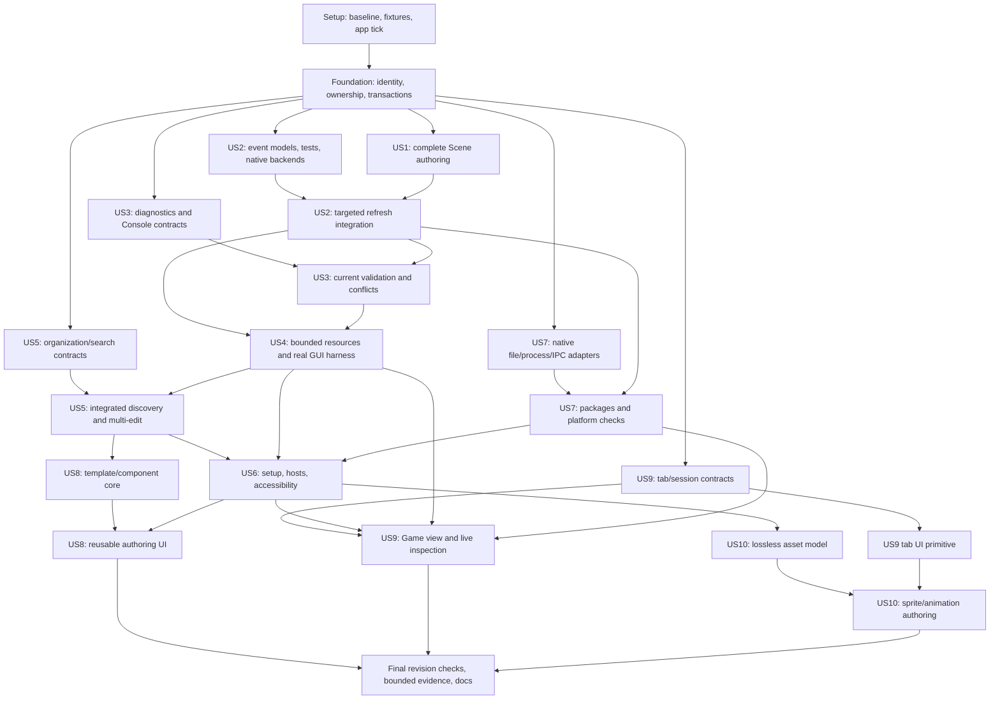

# Tasks: GUI Cleanup

**Input**: [spec.md](spec.md), [plan.md](plan.md), [research.md](research.md), [data-model.md](data-model.md), [contracts/](contracts/) and [quickstart.md](quickstart.md).
**Feature directory**: `specs/012-gui-cleanup` · **Branch**: `branch-without-bvh` · **Generated**: 2026-11-05.
**Tests**: Required by FR-049–051 and the specification’s acceptance scenarios. Write failure-first contract/regression cases before the corresponding production change; use independent oracles and actual UI integration rather than implementation-mirroring assertions.
**Organization**: Setup, blocking foundations, ten story phases in priority order, then final integration/evidence. US7 precedes US6 because both are P2 and native platforms support the native host/accessibility work. P3 stories remain required; the MVP checkpoint does not waive them.
**Current state**: Setup, Foundation, and US1 tasks T001–T029 are complete. US2 is in progress. T045 Console raw-output and derived-row coverage is implemented and passes in the existing Linux Debug build; T044 and the remaining diagnostics/validation integration stay open. Windows/macOS watcher root-lifecycle and bounded FSEvents callback corrections are present, but T035–T036/T162/T205 remain open pending native compilation/lifetime checks. Independent tasks T054 and T202–T203 and critical canonical-property/shared-animation convergence corrections T200–T201 are complete with focused headless validation. The T204 retry path has focused preview coverage, while application-frame watcher verification remains open. T243 canonical-to-logical Project alias invalidation is complete; its focused real-frame Project and watcher integration checks pass. T244 directory-symlink retarget invalidation now handles `directory=false` events and passes focused Project-frame checks for atomic replacement, broken-link retention and repair. T245 Scene resource alias invalidation is complete with ResourceIndex and application-dispatch preview checks for atomic retarget, unlink, broken-link retention and repair. T246 transitive contained-symlink invalidation is complete; focused ResourceIndex, Project-frame, and application-dispatch regressions build and pass in the existing Linux Debug build. T247 intermediate-hop parent-directory invalidation and prepared animation frame alias fan-out are complete; the focused ResourceIndex, Project-frame, and Scene dispatch suites pass in the existing Linux Debug build. T248 first-demand unresolved contained-link target tracking is complete; its focused ResourceIndex, Project-frame, and Scene dispatch regressions build and pass in the existing Linux Debug build. T249 first-demand cyclic/escaping alias dependency tracking is complete; its ResourceIndex and Scene-dispatch regressions build and pass in the existing Linux Debug build. T250 first-demand unreadable contained-alias dependency retention and Scene-dispatch repair are complete with focused permission-enforced ResourceIndex and real-preview validation in the existing Linux Debug build. Native platform evidence and the remaining implementation tasks stay open. No capture campaign has been run and no cross-platform support is certified.

**Implementation update (2026-11-09)**: T264–T267 are implemented and marked complete. Focused Linux Debug builds and headless coverage passed for Run validation continuations, animation runtime schema/save protection, canonical Save As ownership, and revision-driven recovery validation; commands and limits are recorded in `evidence/REGRESSIONS.md`. The latest native/manual exclusions and unavailable matched GUI baseline remain open.

## User-directed execution exclusions (2026-11-08)

The user explicitly excludes work requiring Windows/macOS access and manual native application walkthroughs performed by the model. This execution policy takes precedence over earlier task dependencies, phase gates, completion instructions and convergence acceptance text in this file.

- `[DO-NOT-COMPLETE: WIN/MAC]`: do not execute work requiring a Windows or macOS machine, native toolchain, packaging environment or platform verification.
- `[DO-NOT-COMPLETE: MANUAL-NATIVE]`: do not perform manual native GUI walkthroughs, physical monitor/IME/keyboard flows, desktop assistive-tool inspection or visual game-session acceptance as the model.
- Leave marked tasks unchecked and report them as **user-excluded**, not completed, passed or unexpectedly blocked. Do not repeatedly attempt their excluded work, request access to complete it, or recreate it as new convergence tasks. Resume excluded work only on an explicit user request.
- For mixed tasks, automated tests, source/configuration changes, Linux/headless checks and documentation work that do not require excluded actions remain eligible. Complete those portions as useful, but keep the parent task unchecked while excluded acceptance remains. Authoring cross-platform code or CI configuration does not itself require native machine access.
- Excluded portions of prerequisites and phase gates do not block otherwise eligible implementation, automated verification, cleanup or bounded automated performance work. Still satisfy applicable correctness and ownership prerequisites; do not treat the exclusion as evidence that native/platform acceptance passed.
- Automated ImGui interactions and actual application-frame tests are eligible; they are distinct from manual native walkthroughs. Record excluded acceptance honestly in evidence and completion reports. Existing checked tasks retain their historical status; these markers apply to remaining work and do not certify earlier native checks.

## Format and path conventions

- Each task is `- [ ] Tnnn [P?] [USn?] Description` with exact repository-relative file paths, direct prerequisites and requirement references.
- `[P]` permits concurrent work only after named prerequisites are complete and file ownership is disjoint. Unmarked integration/build tasks serialize shared app/CMake/header changes. Files explicitly shared by multiple tasks must not be edited concurrently.
- Task IDs form a valid topological order; readiness follows explicit dependencies rather than requiring every earlier unrelated story task. All story tasks also require the completed Foundation checkpoint. Narrative phase position does not authorize skipping dependencies.
- New source/test/evidence paths below are proposed implementation outputs. Keep builds/fixtures under `bin/` or `build/`; evidence retains compact reports, identities, commands and raw timings only.
- Preserve limits/nullable/default/enum constraints quoted below and their full owner contract. Safety limits are not measured optimal tuning; capture budgets cannot be enlarged or full campaigns enabled without explicit authorization.
- A task is complete only when its described work and applicable verification pass. Unavailable native machines or evidence remain open acceptance items; do not mark a suite/platform passed because code exists.

## Phase 1: Setup (Shared Infrastructure)

**Goal**: Preserve a reproducible starting point and establish fixtures, build labels and a behavior-neutral actual-application measurement seam. No application cleanup is claimed by this phase.

- [X] T001 Record current source/dirty/build/renderer identities and the audited 6/8 result in `specs/012-gui-cleanup/evidence/BASELINE.md`; distinguish observed current checks from historical observations, diagnose existing failures, retain only compact reports/commands, and leave unavailable evidence open. (Depends: none; FR-049, FR-051, FR-052.)
- [X] T002 [P] Add deterministic reusable fixtures in `editor/tests/gui_fixtures.h` and `editor/tests/gui_fixtures.cpp` for every object/component kind, unknown/missing/null data, overlaps, references, 10,000 objects and depth 128; generate any image assets only in bounded test scratch/build paths. (Depends: T001; FR-001, FR-006, FR-050.)
- [X] T003 [P] Add native test-registration helpers and isolated preference/filesystem environments in `editor/tests/CMakeLists.txt` and `editor/tests/test_support.h`; keep headless `editor` and real `editor-desktop` labels separate and register later suites only when their sources exist. (Depends: T001; FR-049, FR-050.)
- [X] T004 [P] Add compile-time-disabled-by-default editor work counters in `editor/src/editorwork.h` for submissions, changed records, decoding/uploads, validity queries, writes and captures; keep correctness probes out of timing runs and avoid normal-runtime/public-export dependencies. (Depends: T001; FR-018, FR-051.)
- [X] T005 Extract the behavior-neutral application tick/environment seam in `editor/src/editorapp.h` and `editor/src/editorapp.cpp`, add `editor/benchmark/gui_probe.cpp`, and wire `platformator_editor_gui_probe` in `editor/CMakeLists.txt`; isolate probe preferences and exercise the real event/panel/preview/present path without cleanup optimizations. (Depends: T002, T003, T004; FR-051, FR-052.)
- [X] T006 Freeze the behavior-neutral GUI probe source/build/workload identity in `specs/012-gui-cleanup/evidence/BASELINE.md` before behavior/performance changes; keep reusable builds under `bin/` or `build/`, record known baseline defects and comparable unaffected cases, and do not run the historical 011 campaign. (Depends: T005; FR-049, FR-051.)

**Checkpoint**: T006 records the applicable independent results; pending/failed checks remain visible and block the claimed acceptance, not unrelated preparatory coding.

---

## Phase 2: Foundational (Blocking Prerequisites)

**Goal**: Establish stable project/document identities, shared ownership, typed change notifications, command atomicity and native interface seams. Complete this phase before story implementation.

**Phase gate**: T006. Story-specific dependencies below additionally control when integration can complete.

- [X] T007 Define `ProjectGeneration`, `TabId`, document/path revisions, persistent `HostLayoutId`, ephemeral `WindowHostGeneration`/`RendererGeneration`, and play identities in `editor/src/sessionids.h`; preserve "Never-reused open-tab instance ID" and "Document replacement incarnation within a tab", and distinguish restart-stable layout identity from native incarnations. (Depends: T006; FR-006, FR-013, FR-034, FR-044.)
- [X] T008 [P] Add failure-first identity/tab-aggregate/lifetime tests in `editor/tests/session_context_test.cpp` for identical document generations in different tabs, stale addresses, history-binding lifetime and one active Runtime; require "Every async result carries the narrowest complete identity tuple." (Depends: T007; FR-006, FR-013, FR-044, FR-050.)
- [X] T009 [P] Add failure-first atomic command/gesture cases in `editor/tests/batchcommand_cases.cpp` for missing/null/zero/empty, prevalidation failure, rollback, saved-token branches and selection restoration; verify "A transaction either commits all operations once or restores the exact prior state." (Depends: T007; FR-005, FR-006, FR-027.)
- [X] T010 Introduce heap-stable tab aggregates and the single-active-tab core in `editor/src/documentmanager.h` and `editor/src/documentmanager.cpp`; own history before binding it, retain kind "Scene", "Animation", unique IDs, independent saved state/view/selection, and activate an already-open canonical path instead of duplicating writable state. Preserve "canonical optional source path/identity" and require history ownership before borrowed binding. (Depends: T008; FR-006, FR-044.)
- [X] T011 Introduce `ProjectSession` ownership in `editor/src/projectsession.h` and `editor/src/projectsession.cpp` and compose it through `editor/src/editorapp.cpp`; preserve existing single-tab workflows and the invariant "It has at most one authoring Runtime and one `PlaySession` child." (Depends: T010; FR-006, FR-013, FR-044.)
- [X] T012 Extend commands, dialogs and selection results in `editor/src/editcommands.h`, `editor/src/async_requests.h`, `editor/src/filedialogs.cpp` and `editor/src/selection.cpp` to carry "{projectGeneration, tabId, documentGeneration, objectId?, componentId?, behaviorOrdinal?, fieldPath}" as applicable; tab switching must not retarget a pending dialog and closing/replacing its tab must reject its result. Enforce "IDs/type discriminators are not ordinary editable fields." (Depends: T011; FR-006, FR-013, FR-017, FR-044.)
- [X] T013 Add typed local document deltas in `editor/src/document.h` and `editor/src/editcommands.cpp` with categories "Label", "Pose", "Active", "Sprite", "Collider", "Camera", "BehaviorReference", "Structure"; emit deduplicated affected IDs and never give workers mutable DOM pointers. (Depends: T012; FR-006, FR-020, FR-023.)
- [X] T014 Extend targeted history/gestures to atomic property and structural transactions in `editor/src/editcommands.h` and `editor/src/editcommands.cpp`; enforce "Property values distinguish absent, null, zero and empty.", preallocate/validate before mutation, reverse operation order on Undo and preserve saved-token pruning semantics. (Depends: T009, T013; FR-005, FR-006, FR-027.)
- [X] T015 Extract OS-neutral file/process/IPC boundary declarations in `editor/src/platform/nativefile.h`, `editor/src/platform/nativeprocess.h`, `editor/src/platform/sessionchannel.h`, `editor/src/process_internal.h` and `editor/src/documentio.cpp`; keep current Linux behavior through existing adapters without exposing POSIX-only types to future Windows translation units. (Depends: T012; FR-037, FR-039, FR-040.)
- [X] T016 Add lossless v1→v2 preference migration in `editor/src/preferences.h` and `editor/src/preferences.cpp`; retain "panel→HostLayoutId assignments, per-host geometry and a distinct ImGui docking/settings blob per HostLayoutId", per-tab view, hidden/locked state, snap and duplication choices; enforce "Preferences never enter scene files or scene history. Session history is not serialized." (Depends: T010, T007; FR-022, FR-028, FR-033, FR-034, FR-035, FR-043, FR-044.)
- [X] T017 Wire generation invalidation and ordered cancellation/join/release barriers in `editor/src/projectsession.cpp`, `editor/src/documentmanager.cpp` and `editor/src/editorapp.cpp`; stop owned operations, reject old callbacks, release proxies/semantic providers/backends before renderer/Runtime destruction, and handle failed project replacement without losing current work. (Depends: T011, T012, T015, T016, T014; FR-006, FR-013, FR-017, FR-040.)
- [X] T018 Register/run the new context/batch regressions and affected existing suites through `editor/tests/CMakeLists.txt`; require new foundational checks and formerly passing suites to pass, record any unchanged audited hierarchy/projection failures as explicit open US1 defects (not passes), and block on any new failure in `specs/012-gui-cleanup/evidence/FOUNDATION.md`. Do not make Foundation depend on US1 fixes it gates. (Depends: T017, T003; FR-049, FR-050, FR-052.)

**Checkpoint**: T018 records the applicable independent results; pending/failed checks remain visible and block the claimed acceptance, not unrelated preparatory coding.

---

## Phase 3: User Story 1 — Edit every scene object accurately (Priority: P1) — MVP

**Goal**: Make every authored object/component discoverable, correctly framed and safely editable with explicit tools and one-interaction history.

**Phase gate**: T018. Story-specific dependencies below additionally control when integration can complete.

**Independent test**: Use the all-category/legacy-camera/overlap/nested fixture; pick and frame each object/component, transform with W/E/R and snapping, use off-center zoom, then Undo/Redo and save/reopen without unrelated changes.

- [X] T019 [P] [US1] Add failure-first all-object/camera/geometry regressions in `editor/tests/authoringindex_test.cpp` for empty/collider-only/camera/missing/inactive objects, legacy-only and conflicting camera dimensions, component identity and translation-only parents; compare independently constructed expected bounds. (Depends: T018; FR-001, FR-002.)
- [X] T020 [P] [US1] Extend `editor/tests/viewport_cases.cpp` with the full-panel `(100,50,360,250)`→`720×750` independent-ratio oracle, reversible coordinates, anchored zoom, captured text, tools, snapping and rectangle gestures; retain later existing cases and do not merely replace old expected values with observed outputs. (Depends: T018; FR-002, FR-003, FR-004, FR-049.)
- [X] T021 [US1] Implement all-object `AuthoringIndex` in `editor/src/authoringindex.h` and `editor/src/authoringindex.cpp`; store only local descriptors/component IDs/accumulated translation/bounds and require "It covers all objects; it never stores a recursive child JSON value." (Depends: T019; FR-001, FR-002, FR-023.)
- [X] T022 [US1] Share canonical/legacy camera interpretation across `editor/src/validation.cpp`, `editor/src/panels/inspector.cpp` and `editor/src/viewport.cpp`; implement full-panel world-aspect-preserving mapping and independent physical ratios while keeping a separate authored camera boundary. (Depends: T021, T020; FR-002, FR-049.)
- [X] T023 [US1] Separate authoring representations/picking/framing from sprite Runtime proxies in `editor/src/preview.h`, `editor/src/preview.cpp` and `editor/src/viewport.cpp`; include deterministic object/component overlap cycling, empty markers and correct selected/all bounds without instantiating scripts/audio/physics. (Depends: T022; FR-001, FR-006.)
- [X] T024 [US1] Implement mutually selected Move/Rotate/Scale and explicit rectangle mode in `editor/src/viewport.h`, `editor/src/viewport.cpp`, `editor/src/actions.cpp` and `editor/src/toolbar.cpp`; route W/E/R through capture rules, label degree display while preserving serialized radians and show applicable local/world axes. (Depends: T023; FR-003, FR-004.)
- [X] T025 [US1] Implement positive finite grid/snap preferences and object/collider world snapping→local conversion, pointer-anchored zoom and retained per-tab view in `editor/src/viewport.cpp` and `editor/src/preferences.cpp`; preserve "Rotation/scale remain local under current engine inheritance." (Depends: T024; FR-002, FR-004.)
- [X] T026 [US1] Use tab/address-scoped drafts or the transaction gesture kernel for numeric and declared behavior fields in `editor/src/panels/inspector.cpp` and `editor/src/panels/behaviorfields.cpp`; enforce "Editing → Committed | Cancelled", reject invalid intermediate drafts, restore missing fields on cancel and commit one completed interaction once. (Depends: T014, T025; FR-005, FR-006.)
- [X] T027 [US1] Implement visual sprite/collider rectangle sizing in `editor/src/viewport.cpp` and `editor/src/editcommands.cpp` with one reversible batch, correct local geometry/offsets, finite supported dimensions and no authored-value replacement on failure. (Depends: T026; FR-004, FR-005, FR-006.)
- [X] T028 [US1] Resolve the audited hierarchy-row failure in `editor/src/panels/hierarchy.cpp` and `editor/tests/document_test.cpp` using independent expected owner/kind/parent/order and label checks; verify expanded components/children and structural edits rather than accepting a new hard-coded observed ID sequence. (Depends: T027; FR-001, FR-049.)
- [X] T029 [US1] Register/run `editor/tests/authoringindex_test.cpp`, complete existing preview/document/history suites, exercise the independent US1 walkthrough and save/game-consumer compatibility, and record current evidence in `specs/012-gui-cleanup/evidence/US1.md`; previously unreached assertions must execute. (Depends: T028; FR-001, FR-002, FR-003, FR-004, FR-005, FR-006, FR-049, FR-052.)

**Checkpoint**: T029 records the applicable independent results; pending/failed checks remain visible and block the claimed acceptance, not unrelated preparatory coding.

---

## Phase 4: User Story 2 — See asset changes without interrupting editing (Priority: P1)

**Goal**: Detect external asset/source changes through native notifications and bounded recovery while refreshing only affected state.

**Phase gate**: T018. Story-specific dependencies below additionally control when integration can complete.

**Independent test**: Add/edit/delete/rename assets in an already-open folder; exercise startup overlap, populated moved directories, same-metadata writes, partial writes, overflow, symlinks and stale project events; assert discovery within three seconds on the supported local fixture and zero unrelated reload/history/selection changes.

- [X] T030 [P] [US2] Write deterministic failure-first event/recovery cases in `editor/tests/changes_test.cpp` for initial scan replay, old/new listing completion order, rename halves, root/subtree moves, same-metadata writes plus overflow, retry failure and stale project generations. (Depends: T018; FR-007, FR-008, FR-010, FR-011, FR-012, FR-013, FR-050.)
- [X] T031 [P] [US2] Write small real-tree cached-folder addition and symlink cases in `editor/tests/asset_watch_integration_test.cpp`; include contained alias fan-out, broken/escaping/cyclic links, root replacement and selected-entry rename/delete without silently repairing numeric/path references. (Depends: T018; FR-008, FR-009, FR-013, FR-014, FR-050.)
- [X] T032 [US2] Implement normalized change batches, directory request/revision tokens, uncertainty epochs and coverage states in `editor/src/projectchanges.h` and `editor/src/projectchanges.cpp`; enforce "Starting → Reconciling → Current", "Degraded/RootUnavailable → Reconciling" and "Stopped", "4,096 watches" and "8,192 coalesced paths/2 MiB"; loss becomes RootDirty rather than false Current. (Depends: T030; FR-007, FR-008, FR-010, FR-012.)
- [X] T033 [US2] Implement logical/canonical resource versions, reverse consumers, directory revisions and contained-alias/cycle validation in `editor/src/resourceindex.h` and `editor/src/resourceindex.cpp`; reject stale snapshots by both request ID and invalidation revision, lazily invalidate uncertain subtree epochs, and preserve selected paths that still exist. (Depends: T032, T031; FR-009, FR-010, FR-012, FR-014, FR-021.)
- [X] T034 [P] [US2] Implement cancellable Linux inotify/root-parent monitoring in `editor/src/platform/watch_linux.cpp` against the frozen change interface; install directory watches before enumeration, handle moved-in populated subtrees/root replacement/overflow and enqueue only immutable records. (Depends: T032; FR-007, FR-008, FR-012, FR-037.)
- [X] T035 [P] [US2] Implement Windows overlapped ReadDirectoryChangesW/root-parent monitoring in `editor/src/platform/watch_windows.cpp`; handle subtree coverage, rename uncertainty, zero-record overflow, unsupported filesystems and cancellation without UI/Runtime calls. (Depends: T032; FR-007, FR-008, FR-012, FR-037.)
- [X] T036 [P] [US2] Implement macOS FSEvents/root-parent monitoring in `editor/src/platform/watch_macos.mm`; normalize coalesced/drop/root-change signals to reconciliation and bound callback work with no SDL/document access. (Depends: T032; FR-007, FR-008, FR-012, FR-037.)
- [X] T037 [US2] Extend `editor/src/project.h` and `editor/src/project.cpp` with watch-before-snapshot/event replay and newest-request adoption; retain "original full-scan 50,000 files/100,000 entries" and "targeted listing 10,000 files/2,000 directories/20,000 entries", never adopting a truncated prefix as complete. (Depends: T033, T034, T035, T036; FR-008, FR-012, FR-050.)
- [X] T038 [US2] Implement native I/O wakeup plus bounded oneTBB scan/recovery scheduling in `editor/src/projectchanges.cpp`; enforce "one recovery scan per root/two pending targeted scans", "256 path commits or 2 ms per frame", "at most 512 fallback reference path-stat units per two-second interval", 200 ms quiet/1 second maximum batch, 60-second consistency and ≤30-second bounded retries. (Depends: T037; FR-007, FR-011, FR-012.)
- [X] T039 [US2] Add staged version-aware asset adoption/reload through `editor/src/resourceindex.cpp`, `editor/src/preview.cpp`, `src/gamemanager.cpp` and the narrow `src/runtimeaccess.h` bridge; atomically rebind only affected proxies/clips at idle boundaries, retain last-good state on decode/version failure, and prevent old wrapper deletion from erasing a newer canonical entry. Model "Ready → Dirty → Preparing → AwaitingOwnerCommit → Ready" and "Preparing → RetryPending → Preparing", with explicit Failed after exhaustion. (Depends: T038, T029; FR-009, FR-010, FR-011, FR-023.)
- [X] T040 [US2] Replace global asset refresh in `editor/src/editorapp.cpp` and `editor/src/panels/project.cpp` with affected parent-listing/resource invalidation, explicit manual Refresh/coverage status and valid-entry preservation; never rebuild the whole preview or clear selection for an unused addition. (Depends: T039; FR-008, FR-009, FR-012, FR-013.)
- [X] T041 [US2] Integrate event/uncertainty revisions and "requires-forced-rebuild flag" into `editor/src/project.cpp`, `editor/src/behaviorcatalog.cpp`, `editor/src/process.cpp` and `editor/src/editorapp.cpp`; revalidate configured source freshness before Build/Run and make same-metadata/uncertain inputs require one disclosed forced explicit rebuild, never watcher-triggered builds or timestamp mutation. (Depends: T040; FR-007, FR-010, FR-012, FR-013, FR-032.)
- [X] T042 [US2] Connect monitor stop/join, queued result rejection and tab/project consumer teardown in `editor/src/projectsession.cpp`, `editor/src/resourceindex.cpp` and `editor/src/projectchanges.cpp`; require "A failed/truncated snapshot cannot replace a complete snapshot or silently become Current." and preserve unresolved external references until explicit repair. (Depends: T041; FR-011, FR-012, FR-013, FR-014.)
- [X] T043 [US2] Register suites/native source selection in `editor/CMakeLists.txt` and `editor/tests/CMakeLists.txt`, run injected plus available real native watcher checks and ordinary cached-folder add tests, and record zero-unrelated-work/fallback/platform limitations in `specs/012-gui-cleanup/evidence/US2.md`; final three-platform evidence remains US7 acceptance. (Depends: T042; FR-007, FR-008, FR-009, FR-010, FR-011, FR-012, FR-013, FR-014, FR-050, FR-052.)

**Checkpoint**: T043 records the applicable independent results; pending/failed checks remain visible and block the claimed acceptance, not unrelated preparatory coding.

---

## Phase 5: User Story 3 — Diagnose problems and trust undo and saved state (Priority: P1)

**Goal**: Make validation current/actionable, preserve safe history/conflicts and provide usable bounded build/runtime diagnostics.

**Phase gate**: T018. Story-specific dependencies below additionally control when integration can complete.

**Independent test**: Repair/reintroduce validation and asset errors, click issues, commit/cancel numeric edits, exercise save conflicts and copy/filter/collapse source-linked Console output; stale results must never permit Run.

- [X] T044 [P] [US3] Add failure-first latest-revision validation/navigation/conflict tests in `editor/tests/diagnostics_test.cpp`; cover stale async results, deleted fields/targets, explicit F6/Run barriers, three-second settled updates and dirty external scene changes. (Depends: T018; FR-015, FR-017, FR-050.)
- [X] T045 [P] [US3] Add failure-first raw-output/derived-row tests in `editor/tests/console_test.cpp` for exact Copy All retained bytes, selection/search/severity/repeats, older retained output, truncation, Clear/auto-follow and safe source-location parsing. (Depends: T018; FR-016, FR-050.)
- [X] T046 [US3] Implement stable diagnostics and typed tab/generation/field/source targets in `editor/src/diagnostics.h` and `editor/src/diagnostics.cpp`; preserve "severity, message, repeat count, time, optional typed document address, optional source path/line/column, and blocksRun" and separate exact bounded raw Console bytes from filtered/collapsed rows. (Depends: T044, T045; FR-015, FR-016.)
- [X] T047 [US3] Implement affected-local immutable validation inputs, reverse-reference invalidation and current-revision publication in `editor/src/validation.cpp` and `editor/src/diagnostics.cpp`; use bounded oneTBB preparation plus owner-thread commit, not recursive snapshots per edit, and service UI/cancel during explicit Validate/Run barriers. (Depends: T046, T033; FR-015, FR-021, FR-023.)
- [X] T048 [US3] Wire Validate/F6, pending/current status, actionable issue selection/reveal and latest-result Run authorization through `editor/src/actions.cpp`, `editor/src/editorapp.cpp` and `editor/src/panels/inspector.cpp`; validate target generation before selecting or focusing a field. (Depends: T047, T043; FR-015, FR-033.)
- [X] T049 [US3] Implement selectable Console rows/detail text, Copy All, search/severity/collapse, Clear and optional auto-follow in `editor/src/panels/console.h` and `editor/src/panels/console.cpp`; retain ≤1 MiB raw output, expose all retained earlier text and explain both retention and display limits. (Depends: T046; FR-016.)
- [X] T050 [US3] Route parsed compiler locations to configured editor/OS associations via argv in `editor/src/diagnostics.cpp`, `editor/src/process.cpp` and `editor/src/panels/console.cpp`; preserve copyable unparsed output and do not shell-interpolate diagnostic paths. (Depends: T049, T048; FR-016, FR-039.)
- [X] T051 [US3] Connect watcher external-scene notifications to tab-scoped Reload/keep work/overwrite/Save As and close/run decisions in `editor/src/workspace.cpp`, `editor/src/documentmanager.cpp` and `editor/src/editorapp.cpp`; dirty tabs never auto-reload and failed/cancelled writes never continue the pending action. (Depends: T050; FR-005, FR-006, FR-017, FR-040, FR-044.)
- [ ] T052 [DO-NOT-COMPLETE: MANUAL-NATIVE] [US3] Run diagnostics/Console plus existing command/history/save regressions, verify one Undo per committed numeric draft and current validation before Run, and record independent walkthrough outcomes in `specs/012-gui-cleanup/evidence/US3.md` through `editor/tests/CMakeLists.txt`. (Depends: T051; FR-005, FR-006, FR-015, FR-016, FR-017, FR-049, FR-050, FR-052.)

**Checkpoint**: T052 records the applicable independent results; pending/failed checks remain visible and block the claimed acceptance, not unrelated preparatory coding.

---

## Phase 6: User Story 4 — Work responsively with large scenes and asset libraries (Priority: P1)

**Goal**: Remove recurring idle work and make image/resource preparation, caches, invalidation and evidence capture explicitly bounded.

**Phase gate**: T018. Story-specific dependencies below additionally control when integration can complete.

**Independent test**: Use work counters and controlled 10,000-object/depth-128/large-image fixtures to verify static image reuse, local changes, memory admission/LRU, worker cancellation, failed reload and responsiveness; use the actual GUI probe for matched focused measurements at the final evidence gate.

- [X] T053 [P] [US4] Add failure-first resource/preflight/LRU/version/pin cases in `editor/tests/resources_test.cpp`; cover oversized/invalid headers before allocation, last-good replacement, retained clip references, stale workers, missing-result caching, zero unrelated reloads and a depth-128 sprite chain without recursive cache growth. (Depends: T043; FR-018, FR-019, FR-021, FR-023, FR-050.)
- [X] T054 [P] [US4] Add failure-first capture guard/schema cases in `editor/tests/gui_capture_budget_test.py` for mismatched identities, time/byte exhaustion, partial/malformed samples, child termination and no automatic retry/new session; preserve the repository default caps. (Depends: T018; FR-051.)
- [X] T055 [US4] Replace recursive proxy equality/copies with local pose/sprite/animator/collider descriptors in `editor/src/preview.h` and `editor/src/preview.cpp`; use document dirty categories and required descendants/reverse dependencies only, preserving "Descriptors retain only their own inputs." (Depends: T053; FR-020, FR-023.)
- [X] T056 [US4] Implement revision/view/target/renderer keyed image reuse and conservative ordered dirty-view rejection in `editor/src/preview.cpp` and `editor/src/viewport.cpp`; selection/hover repaints overlays without resubmitting sprites, unchanged static content submits zero sprites, and retain a local `EFFICIENCY:` cost/rationale/follow-up for any O(N) dirty-view pass. (Depends: T055; FR-018, FR-024.)
- [X] T057 [US4] Implement checked metadata and bounded allocation/decode wrappers in `editor/src/imagepreflight.h` and `editor/src/imagepreflight.cpp` over narrowly attributed vendored codec code; enforce "admitted image ≤64 MiB encoded, ≤8,192 per dimension and ≤16,777,216 pixels with an inclusive 128 MiB decoder working set (≤64 MiB decoded + ≤64 MiB scratch/input staging)"; unsupported/unbounded formats including initial SVG use explained icon fallback. (Depends: T053; FR-019.)
- [X] T058 [US4] Implement versioned oneTBB image/animation preparation in `editor/src/thumbnailcache.h` and `editor/src/thumbnailcache.cpp`; enforce "one decode/64 pending paths/8 MiB completed thumbnails", visible-first demand, cancellation/backpressure and immutable results; animations retain "1 MiB/512-frame animation previews" without truncating authoring data. (Depends: T057; FR-019, FR-023.)
- [X] T059 [US4] Implement owner-thread upload, frame pins, negative-version caching and eviction in `editor/src/thumbnailcache.cpp` and `editor/src/uitextures.h`; enforce "256px/64 MiB/256-entry thumbnail cache" including retained output pixels and every renderer replica, and require "A frame pin outlives draw submission/present." (Depends: T058; FR-019.)
- [X] T060 [US4] Adopt prepared Scene textures/clips through `editor/src/preview.cpp`, `editor/src/resourceindex.cpp` and the narrow engine asset bridge in `src/gamemanager.cpp`; enforce "256 MiB of retained proxy texture versions and a 64 MiB main Scene target before allocation", preserve original source dimensions/rectangle geometry at reduced preview resolution, and eliminate synchronous per-frame Runtime file decoding. (Depends: T059, T056, T039; FR-009, FR-018, FR-019, FR-023.)
- [X] T061 [US4] Connect nonblocking prepared results/placeholders and pinned textures to `editor/src/panels/project.cpp`; remove draw-path texture/file/animation parsing, retain grid virtualization and display explicit over-budget/stale/unsupported preview state without changing authored references. (Depends: T060; FR-019, FR-020.)
- [X] T062 [US4] Cache topology/labels/child connector ranges by the correct structure/value/expansion revisions in `editor/src/panels/hierarchy.h` and `editor/src/panels/hierarchy.cpp`; submit only visible connector segments/rows and avoid per-frame row-sized allocations or full label refresh. (Depends: T055; FR-020.)
- [X] T063 [US4] Cache displayed asset-reference validity by project/path/type/content and uncertainty generations in `editor/src/panels/referencefields.cpp` and `editor/src/resourceindex.cpp`; asset changes invalidate affected entries, while authoritative assignment/save/run validation remains current. (Depends: T060; FR-021.)
- [X] T064 [US4] Consolidate preference writes and title updates in `editor/src/preferences.cpp`, `editor/src/panels/runsettings.cpp` and `editor/src/editorapp.cpp`; flush committed/deferred dirty preference sections only, preserve shutdown flush and exact durability outcomes, and avoid fsync/layout writes per typed character. (Depends: T016, T063; FR-022, FR-033.)
- [X] T065 [US4] Replace the 1 ms loop with input/completion wakeups and earliest-deadline waiting in `editor/src/editorapp.cpp` and `editor/src/projectsession.cpp`; throttle minimized/unfocused presentation while servicing processes, dialogs, animation deadlines, validation, change batches and cancellation. (Depends: T064, T061, T062, T048; FR-018, FR-019, FR-022.)
- [X] T066 [US4] Complete actual app-loop workloads and separate cold preparation, event-to-present latency, active/wait-inclusive frame time and bounded idle CPU metrics in `editor/benchmark/gui_probe.cpp`; use isolated preferences, real displayed panels/preview and compact identities, not the old selection-only measurement. (Depends: T065, T005; FR-051.)
- [X] T067 [US4] Implement `benchmark/capture_gui.py` with existing `benchmark/capture_budget.py`, one selected baseline/candidate workload, "3 repetitions, 5 warmups, 30 measured frames", cumulative "50 MiB and 600 seconds", raw samples/identity checks and stop-on-budget/failure; renderer comparisons delegate only to `benchmark/capture_linear_render.py` with remaining shared bounds. (Depends: T066, T054; FR-051.)
- [X] T068 [US4] Register/run resource and capture-budget regressions in `editor/tests/CMakeLists.txt`, verify static/local/unrelated/eviction/teardown counters and 10,000-object/depth-128 correctness, and record outcomes in `specs/012-gui-cleanup/evidence/US4.md`; keep timing/physical-platform benefits unclaimed until final current-build captures. (Depends: T067; FR-018, FR-019, FR-020, FR-021, FR-022, FR-023, FR-024, FR-049, FR-050, FR-051, FR-052.)

**Checkpoint**: T068 records the applicable independent results; pending/failed checks remain visible and block the claimed acceptance, not unrelated preparatory coding.

---

## Phase 7: User Story 5 — Find and organize content efficiently (Priority: P2)

**Goal**: Add searchable content/reference discovery, undoable hierarchy organization, real multi-edit and direct asset assignment without changing unrelated scene state.

**Phase gate**: T018. Story-specific dependencies below additionally control when integration can complete.

**Independent test**: Search duplicate names, move a multi-root selection across parents/sibling positions, group-transform/edit mixed fields, hide/lock a background and assign assets by every supported route; verify cycle rejection, world placement and exact Undo/Redo.

- [X] T069 [P] [US5] Add failure-first parent/index/cycle/block-order/identity tests in `editor/tests/hierarchy_move_test.cpp` for root↔nested and same-parent moves, selected ancestor/descendant normalization and exact Undo/Redo under translation-only inheritance. (Depends: T018; FR-026, FR-027.)
- [X] T070 [P] [US5] Add failure-first search/mixed-selection/assignment tests in `editor/tests/discovery_test.cpp` for duplicate names, range/additive selection, incompatible common fields, contained paths, ambiguity and preservation of valid previous assignments. (Depends: T018; FR-025, FR-027, FR-028, FR-029, FR-030.)
- [X] T071 [US5] Extend `editor/src/selection.h` and `editor/src/selection.cpp` to "ordered unique selected object IDs" with primary object/component/behavior and focused host/panel; repair deleted members/ownership and use selected top-level roots for group transformations. (Depends: T070; FR-027, FR-029.)
- [X] T072 [US5] Implement transactional MoveOperation in `editor/src/editcommands.h` and `editor/src/editcommands.cpp`; enforce "Validate no cycle or duplicate placement; normalize same-parent indexes after removal." and "New local position = old world translation − destination parent world translation.", storing exact before/after locations/values for rollback and redo. (Depends: T071, T069; FR-026, FR-027.)
- [X] T073 [US5] Wire hierarchy drag-to-reparent/sibling reorder, additive/range selection, F2/Delete/Ctrl+D and reveal/scroll behavior in `editor/src/panels/hierarchy.cpp` and `editor/src/actions.cpp`; preserve selected block order and route every mutation through validated transactions. (Depends: T072; FR-025, FR-026, FR-027, FR-029.)
- [X] T074 [US5] Implement common compatible field intersection, Mixed state and atomic multi-property edits in `editor/src/panels/inspector.cpp` and `editor/src/panels/behaviorfields.cpp`; do not materialize destructive defaults for missing/incompatible fields. (Depends: T073; FR-005, FR-006, FR-027.)
- [X] T075 [US5] Extend group Scene transforms/rectangle gestures in `editor/src/viewport.cpp` using the primary-object pivot and top-level-root selection; preserve local scales/rotations and one-transaction Undo without double-moving a descendant. (Depends: T074; FR-004, FR-027.)
- [X] T076 [US5] Implement revision-cached name/type/path search and duplicate-name identity context in `editor/src/panels/hierarchy.cpp`, `editor/src/panels/project.cpp`, `editor/src/panels/inspector.cpp`, `editor/src/panels/behaviorfields.cpp` and `editor/src/panels/referencefields.cpp`; results must reveal targets without reordering saved content. (Depends: T075; FR-025.)
- [X] T077 [US5] Add document-scoped editor-only hidden/locked preferences and Hierarchy/Scene controls in `editor/src/preferences.cpp`, `editor/src/panels/hierarchy.cpp` and `editor/src/viewport.cpp`; prune stale IDs on replacement/deletion and never change runtime Active or scene history. (Depends: T076; FR-028.)
- [X] T078 [US5] Unify inline path edit/copy, picker, drag/drop, double-click/Assign and explicit unresolved-path repair in `editor/src/panels/referencefields.cpp` and `editor/src/panels/project.cpp`; use one validator and an explicit target choice when primary selection is ambiguous, preserving the old value on type/root failure. (Depends: T077, T068; FR-013, FR-014, FR-030.)
- [ ] T079 [DO-NOT-COMPLETE: MANUAL-NATIVE] [US5] Register/run move/discovery regressions plus affected history/viewport/reference suites through `editor/tests/CMakeLists.txt`, complete the US5 walkthrough and record evidence in `specs/012-gui-cleanup/evidence/US5.md` with mixed-property, cycle, duplicate-name and no-scene-dirty editor-visibility results. (Depends: T078; FR-025, FR-026, FR-027, FR-028, FR-029, FR-030, FR-050, FR-052.)

**Checkpoint**: T079 records the applicable independent results; pending/failed checks remain visible and block the claimed acceptance, not unrelated preparatory coding.

---

## Phase 8: User Story 7 — Use the editor on supported desktop platforms (Priority: P2)

**Goal**: Provide native process/file/IPC boundaries, packaging and supported-platform checks before native-window/accessibility integration in US6. This P2 ordering follows dependency requirements.

**Phase gate**: T018. Story-specific dependencies below additionally control when integration can complete.

**Independent test**: Install/relocate the editor on Linux, Windows and macOS, launch from an unrelated directory, open/save Unicode/space paths, use dialogs/notifications and build/run/stop a foreground process tree while preserving unrelated processes and failed-save data.

- [X] T080 [P] [US7] Add failure-first atomic-write/native-identity cases in `editor/tests/nativefile_test.cpp` for staging/flush/replace failures, late observed conflicts, create-if-present races, modes/attributes, Unicode paths and committed durability warnings. (Depends: T018; FR-037, FR-039, FR-040.)
- [X] T081 [P] [US7] Add failure-first native ownership/handle cases in `editor/tests/nativeprocess_test.cpp` and `editor/tests/process_fixture.cpp` for foreground grandchildren, unrelated same-name process, restricted Job assignment, failed inheritance and reported unsupported POSIX daemon escape with safe fixture cleanup. (Depends: T018; FR-037, FR-039, FR-040.)
- [X] T082 [P] [US7] Implement Linux/macOS native identity and staged atomic file operations in `editor/src/platform/file_posix.cpp`; preserve platform timestamp/mode rules, create-new staging, late checks, directory durability reporting and result distinctions "Committed", "Conflict", "FailedBeforeCommit", "CommittedWithDurabilityWarning". (Depends: T080, T015; FR-037, FR-039, FR-040.)
- [X] T083 [P] [US7] Implement wide Windows native identity/CreateFileW/FlushFileBuffers/ReplaceFileW and create-if-absent persistence in `editor/src/platform/file_windows.cpp`; preserve attributes/recovery and the same observed-conflict/result contract without claiming filesystem compare-and-swap. (Depends: T080, T015; FR-037, FR-039, FR-040.)
- [X] T084 [P] [US7] Implement `editor/src/platform/process_windows.cpp` with correct wide argv quoting, explicit handle whitelist, suspended create→Job assignment→resume and kill-on-close ownership; failed assignment/inheritance must terminate/reap without resuming, and stop may not rely on unconfigured CTRL_BREAK delivery. (Depends: T081, T015; FR-037, FR-039, FR-040.)
- [X] T085 [P] [US7] Adapt `editor/src/process_posix.cpp` for Linux/macOS configured spawn/chdir features, nonblocking group cancellation and the existing two-second force-stop bound; explicitly report unsupported daemon escape/required lifecycle registration rather than claiming sandbox containment. (Depends: T081, T015; FR-037, FR-039, FR-040.)
- [X] T086 [P] [US7] Implement cancellable local inherited pipe/shared-memory primitives in `editor/src/platform/sessionchannel_posix.cpp`; reserve child descriptors 3/4/5 without collisions, unlink anonymous shared objects, close unused ends and prevent inherited endpoints leaking into later game subprocesses. (Depends: T085; FR-037, FR-040, FR-045.)
- [X] T087 [P] [US7] Implement overlapped private pipe endpoints and unnamed mapping inheritance in `editor/src/platform/sessionchannel_windows.cpp`; use the restricted launch handle list, cancellation and exactly-once close/unmap semantics without exposing a network service. (Depends: T084; FR-037, FR-040, FR-045.)
- [ ] T088 [DO-NOT-COMPLETE: WIN/MAC] [US7] Select native sources/libraries in `CMakeLists.txt` and `editor/CMakeLists.txt`, enable OBJCXX conditionally on Apple, remove the Linux-only guard only when the new adapters compile, and update `editor/src/process.cpp` and `editor/src/documentio.cpp` to the neutral interfaces; preserve editor-OFF exports. (Depends: T082, T083, T085, T084, T086, T087, T034, T035, T036, T043; FR-037, FR-039, FR-040.)
- [ ] T089 [DO-NOT-COMPLETE: WIN/MAC] [US7] Embed the default layout through `editor/CMakeLists.txt` and `editor/src/editorapp.cpp`, and add executable-relative optional-resource lookup and editor install/bundle/private-dependency rules in `CMakeLists.txt` and `cmake/PlatformatorEditorInstall.cmake`; stage DLLs/dylibs/rpaths and license provenance without requiring original source paths. (Depends: T088; FR-038.)
- [ ] T090 [US7] Add focused build/install/headless/native jobs or locally runnable lane scripts in `.github/workflows/editor-desktop.yml` and `cmake/PlatformatorEditorValidation.cmake` for Ubuntu 24.04 x86_64/GCC 13+ X11+Wayland, Windows 11 x64/MSVC 2022 v143 and macOS 14 arm64/Xcode 15+ AppleClang 15+, using CMake 3.28+ without inventing broader support claims. (Depends: T089; FR-037, FR-038, FR-049, FR-050.)
- [ ] T091 [DO-NOT-COMPLETE: WIN/MAC] [DO-NOT-COMPLETE: MANUAL-NATIVE] [US7] Register/run native suites and the installed/relocated launch/dialog/watcher/path/save/foreground-descendant checks via `editor/tests/CMakeLists.txt`; record exact supported/untested lanes in `specs/012-gui-cleanup/evidence/US7.md`; later two-host/accessibility checks remain explicit final acceptance dependencies on US6. (Depends: T090; FR-037, FR-038, FR-039, FR-040, FR-049, FR-050, FR-052.)

**Checkpoint**: T091 records the applicable independent results; pending/failed checks remain visible and block the claimed acceptance, not unrelated preparatory coding.

---

## Phase 9: User Story 6 — Set up and customize a clear workspace (Priority: P2)

**Goal**: Deliver projectless onboarding, discoverable run setup, native host windows, reliable focus/scaling and actual native accessibility.

**Phase gate**: T018. Story-specific dependencies below additionally control when integration can complete.

**Independent test**: Launch without a valid project, discover/build/run a target, detach two hosts and restore/redock across monitors, then complete primary flows at 100/150/200% using keyboard and platform accessibility inspectors/readers.

- [X] T092 [P] [US6] Write failure-first host/context/panel-transfer/layout/input tests in `editor/tests/windowhost_test.cpp` for independent contexts, persistent vs ephemeral host IDs, removed monitors, renderer failure, correct focused-host shortcuts/IME and per-context docking blobs. (Depends: T091; FR-033, FR-034, FR-035.)
- [X] T093 [P] [US6] Write failure-first semantic snapshot/provider-action cases in `editor/tests/accessibility_test.cpp` for "enabled/selected/expanded/focused/error states", meaningful names/roles/values, shared snapshot lifetime, stale incarnation rejection and virtualized target reveal. (Depends: T091; FR-036.)
- [X] T094 [US6] Implement recoverable projectless welcome/open-project bootstrap and safe Runtime adoption in `editor/src/editorapp.cpp`, `editor/src/main.cpp` and `editor/src/projectsession.cpp`; missing restoration/invalid project selection must not require an existing asset root merely to show a usable chooser or lose current work. (Depends: T092; FR-031.)
- [X] T095 [US6] Add bounded preset/File API target discovery and executable browsing to `editor/src/project.cpp` and `editor/src/panels/runsettings.cpp`; keep manual overrides advanced and compiled catalog/protocol capability authoritative, with clear Build/Refresh/integration status instead of routine protocol setup. (Depends: T094; FR-032.)
- [X] T096 [US6] Implement host ownership/registry/panel Detach-Dock-Move actions in `editor/src/windowhost.h` and `editor/src/windowhost.cpp`; preserve persistent `HostLayoutId` vs native generations, one main authoring Runtime, per-context fonts/renderers and the initial at-most-eight-host limit with safe redocking on close/failure. (Depends: T095, T092; FR-034.)
- [X] T097 [US6] Add narrowly attributed multi-context SDL3 backend adaptation in `editor/src/backends/imgui_impl_sdl3_editor.cpp` and `editor/src/backends/imgui_impl_sdl3_editor.h`; centralize shared cursor/gamepad/text/IME ownership, filter/route by window ID and activate the correct context for each backend call without altering vendored upstream files. (Depends: T096; FR-034, FR-036.)
- [X] T098 [US6] Implement renderer-local logical image replicas and dirty-only capped Scene transfers in `editor/src/uitextures.cpp` and `editor/src/windowhost.cpp`; precompute/render into a fitting transfer target before readback, account the additional 64 MiB transfer/staging/replica budget, preserve frame pins and never share an SDL_Texture across renderers. (Depends: T097, T059, T060; FR-019, FR-034.)
- [X] T099 [US6] Persist/restore one docking blob per persistent host in `editor/src/preferences.cpp` and `editor/src/windowhost.cpp`; keep IniFilename disabled, serialize both layouts on panel moves, redock missing-monitor/failed hosts, preserve Wayland best-effort placement and reset without changing document history. (Depends: T098, T016; FR-034.)
- [X] T100 [US6] Enable named keyboard navigation, meaningful row/control labels, focus and non-color tool/status cues in `editor/src/actions.cpp`, `editor/src/style.cpp`, `editor/src/toolbar.cpp`, `editor/src/panels/hierarchy.cpp` and `editor/src/editorapp.cpp`; add Ctrl+, and an action reference while honoring text/modal/gesture/host capture. (Depends: T099; FR-003, FR-029, FR-033, FR-036.)
- [X] T101 [US6] Add in-app scale controls and consistently scaled font/icon/hit geometry/spacing in `editor/src/style.cpp`, `editor/src/preferences.cpp`, `editor/src/viewport.cpp` and `editor/src/panels/project.cpp`; make 100%, 150% and 200% and narrow/long-label overflow usable across host monitor changes. (Depends: T100; FR-035.)
- [X] T102 [US6] Implement stable visible/focused semantic snapshots and validated owner-thread action dispatch in `editor/src/accessibility.h` and `editor/src/accessibility.cpp`; require "Native providers acquire shared/ref-counted immutable per-host snapshots, tagged with HostLayoutId and WindowHostGeneration" and unregister/drain before destroying contexts/windows. (Depends: T093, T101; FR-036.)
- [X] T103 [P] [US6] Implement AT-SPI names/roles/values/selection/focus/actions over editor-private libdbus-1 in `editor/src/platform/accessibility_linux.cpp`; native callbacks retain immutable snapshots and enqueue generation-checked actions without touching SDL/Runtime/DOM. (Depends: T102; FR-036, FR-037.)
- [X] T104 [P] [US6] Implement UI Automation provider nodes/actions in `editor/src/platform/accessibility_windows.cpp` using shared semantic snapshots and incarnation checks; retain snapshots across COM callbacks and marshal validated actions to the UI owner thread. (Depends: T102; FR-036, FR-037.)
- [X] T105 [P] [US6] Implement NSAccessibility elements/actions in `editor/src/platform/accessibility_macos.mm` with semantic lifetime/focus/value contracts and orderly provider retirement; do not infer screen-reader support from ImGui keyboard navigation alone. (Depends: T102; FR-036, FR-037.)
- [x] T106 [US6] Publish semantic nodes/reveal actions for welcome, menus/tools/tabs, Hierarchy, Inspector/references, Project, Console, Validation and Run controls through `editor/src/accessibility.cpp`, `editor/src/editorapp.cpp`, `editor/src/panels/hierarchy.cpp`, `editor/src/panels/inspector.cpp`, `editor/src/panels/referencefields.cpp`, `editor/src/panels/project.cpp`, `editor/src/panels/console.cpp` and `editor/src/panels/runsettings.cpp`; expose visible nodes plus focused reveal paths rather than rebuilding the whole scene each frame. (Depends: T103, T104, T105; FR-031, FR-032, FR-033, FR-036.)
- [ ] T107 [DO-NOT-COMPLETE: WIN/MAC] [DO-NOT-COMPLETE: MANUAL-NATIVE] [US6] Wire host/backend/provider libraries privately through `editor/CMakeLists.txt`, run logical tests and real two-host X11/Wayland/Windows/macOS keyboard/IME/clipboard/monitor/scale/accessibility checks, and record successful primary flows plus concrete limitations in `specs/012-gui-cleanup/evidence/US6.md`. (Depends: T106; FR-031, FR-032, FR-033, FR-034, FR-035, FR-036, FR-037, FR-049, FR-050, FR-052.)

**Checkpoint**: T107 records the applicable independent results; pending/failed checks remain visible and block the claimed acceptance, not unrelated preparatory coding.

---

## Phase 10: User Story 8 — Reuse objects and component settings safely (Priority: P3)

**Goal**: Provide declared-field copy/reset, safe subtree templates and an explicit compatibility-preserving duplication-reference policy.

**Phase gate**: T018. Story-specific dependencies below additionally control when integration can complete.

**Independent test**: Copy/reset components without losing IDs/unknown fields; save and instantiate an assembly with internal/component/external/opaque references; test cross-scene same-kind ID collisions, both duplicate policies and exact one-step Undo/Redo.

- [X] T108 [P] [US8] Write failure-first template/binding/duplicate cases in `editor/tests/templates_test.cpp` for self/descendant/component/cross-root/external/opaque sites, unavailable schema, source-scene identity, destination ID collision, unique allocation and exact redo IDs. (Depends: T079; FR-042, FR-043.)
- [X] T109 [P] [US8] Write failure-first copy/reset/group history cases in `editor/tests/component_operations_test.cpp` for type/identity exclusion, unknown target data, supported defaults, missing script overrides and all-or-nothing rollback. (Depends: T079; FR-006, FR-041.)
- [X] T110 [US8] Implement supported-field copy/paste/reset in `editor/src/editcommands.cpp` and `editor/src/panels/inspector.cpp`; never copy identity/kind discriminators, preserve unrelated unknown fields and remove supported script overrides where constructor defaults are unknown instead of instantiating behaviors or inventing zeros. (Depends: T109; FR-041.)
- [X] T111 [US8] Implement lossless version-1 `.pttemplate` envelopes and binding validation in `editor/src/templates.h` and `editor/src/templates.cpp`; quote "IDs inside the template are local source identities." and require declared typed paths/kinds plus source-scene identity/original target ID for externals, never generic integer inference. (Depends: T108; FR-042.)
- [X] T112 [US8] Collect typed internal/external sites from compiled metadata and explicit author declarations in `editor/src/templates.cpp` and `editor/src/panels/referencefields.cpp`; request missing opaque-schema declarations and block assured self-contained remap/instantiation until externals are explicitly assigned in a different scene. (Depends: T111; FR-030, FR-042, FR-043.)
- [X] T113 [US8] Allocate the complete old→new object/component map and insert templates through one retained structural transaction in `editor/src/templates.cpp` and `editor/src/editcommands.cpp`; remap declared internals, preserve/validate intended externals and exact redo payloads, with no source-instance propagation. (Depends: T112, T110; FR-006, FR-042.)
- [X] T114 [US8] Implement `PreserveExistingTargets` default migration and explicit `RemapInternalTargets` multi-root mapping in `editor/src/editcommands.cpp`, `editor/src/preferences.cpp` and `editor/src/panels/hierarchy.cpp`; show/explain the active policy and leave undeclared opaque values lossless. (Depends: T113; FR-043.)
- [X] T115 [US8] Add template save/browse/instantiate and copy/reset controls in `editor/src/panels/project.cpp` and `editor/src/panels/inspector.cpp`; use atomic/conflict-safe saves, direct compatible assignment, search and semantic provider registration without changing engine scene format. (Depends: T114, T107; FR-036, FR-041, FR-042, FR-043.)
- [X] T116 [US8] Register/run component/template/game-scene roundtrip cases through `editor/tests/CMakeLists.txt`, verify one Undo and cross-scene external identity protection, and record current outcomes in `specs/012-gui-cleanup/evidence/US8.md`. (Depends: T115; FR-041, FR-042, FR-043, FR-049, FR-050, FR-052.)

**Checkpoint**: T116 records the applicable independent results; pending/failed checks remain visible and block the claimed acceptance, not unrelated preparatory coding.

---

## Phase 11: User Story 9 — Work across scenes and inspect play sessions (Priority: P3)

**Goal**: Complete scene-tab UI and optional separate-process Game viewing, pause/step and read-only live inspection with bounded local transport and explicit restart/fallback.

**Phase gate**: T018. Story-specific dependencies below additionally control when integration can complete.

**Independent test**: Keep two dirty scenes open, run the intended one, view the bounded Game stream, pause/step/inspect destroyed/recreated objects, hide the view, stop/crash/switch tabs/projects and verify no authoring mutation, stale event or leaked owned process.

- [X] T117 [P] [US9] Add failure-first independent tab/dialog/dirty/close/Run targeting cases in `editor/tests/tabs_test.cpp`; capture same-path reopened tab versus immutable launch TabId/DocumentGeneration/saved token/file identity and preserve each view/selection/history. (Depends: T018; FR-044.)
- [X] T118 [P] [US9] Add failure-first framing/capability/queue/stale-handle/pause/step/slot/EOF/backpressure cases in `editor/tests/playsession_test.cpp` and `editor/tests/session_process_fixture.cpp`; assert hidden zero-readback, no authoring saves, no torn/reused slot and exactly one completion per accepted Step. (Depends: T018; FR-045, FR-046, FR-047, FR-050.)
- [X] T119 [US9] Complete scene tab bar/open/activate/Save All/close flows in `editor/src/documentmanager.cpp`, `editor/src/editorapp.cpp` and `editor/src/preferences.cpp`; retain independent history/dirty/view/selection and protect every dirty tab, preserving one active authoring preview and the original tab of every async result. (Depends: T117; FR-044.)
- [X] T120 [US9] Define optional protocol/capability/message/frame schemas in `src/editorprotocol.h` and `src/editorprotocol.cpp`; require 32-bit little-endian lengths, requests ≤64 KiB/events ≤256 KiB, 64 requests/1 MiB, 64 events/1 MiB with 16 KiB reliable reserve, one inspection page in flight, monotonic IDs and v1 input_forwarding=false. (Depends: T118; FR-045, FR-046.)
- [X] T121 [US9] Extend capability export/validation in `src/scriptregistration.cpp`, `src/runner.cpp` and `editor/src/behaviorcatalog.cpp`; keep schema v1 and exclusive side-effect-free catalog command, missing capability→unsupported and project/source/binary binding, never source inference. (Depends: T120; FR-032, FR-045.)
- [X] T122 [US9] Add `PLATFORMATOR_ENABLE_EDITOR_SESSION` default-OFF conditional sources in `CMakeLists.txt`, `editor/CMakeLists.txt` and development runner configuration in `editor/src/editorapp.cpp`; build compatible shared runners without game-source edits and keep runtime-only installs/exports free of GUI dependencies. (Depends: T121, T088; FR-037, FR-045, FR-052.)
- [X] T123 [US9] Implement `PlaySession` in `editor/src/playsession.h` and `editor/src/playsession.cpp` over native channel primitives; enforce "Idle → Configuring → Building → CatalogCheck → Starting → Running ↔ Paused → Stopping → Idle", immutable launch identity, nonce/sequence/queue validation and nonblocking reliable control/backpressure. (Depends: T122, T086, T087, T119; FR-044, FR-045, FR-046.)
- [X] T124 [US9] Implement opt-in child session entry and bounded owner-thread command/event servicing in `src/editorsession.h`, `src/editorsession.cpp` and `src/runner.cpp`; retain exactly one child Runtime and independent stdout/stderr logs, validate inherited descriptors before startup and reject corrupt sessions without modifying source scenes. (Depends: T123; FR-045, FR-046.)
- [X] T125 [US9] Implement session-enabled pause/resume/Step in `src/gamemanager.cpp`, `src/sdlwindow.h` and `src/sdlwindow.cpp` independently of debug-only hotkeys, including Release; Step runs exactly one existing 1/120-second fixed simulation step, emits a reliable completion once, and Resume resets paused clock debt. (Depends: T124; FR-046.)
- [X] T126 [US9] Implement hidden 640×360 output admission/query and visibility-gated ≤15-Hz RGBA8 readback in `src/editorsession.cpp` and `src/sdlwindow.cpp`; enforce "Two 640×360 RGBA8 slots have 1,843,200 payload bytes total.", 2,560-byte stride, "Free → ChildWriting → ParentReady → ParentCopying → Free", release acknowledgements and skipped capture when slots/optional queues are full. (Depends: T125; FR-045, FR-046.)
- [X] T127 [P] [US9] Add on-demand allowlisted generated read-only accessor providers to `include/platformator/scriptmetadata.h` and `include/platformator/scriptregistration.h`; enumerate built-in/declared scalar/vector/enum/reference values without arbitrary behavior serialization, expose unavailable custom fields and convert references to handle/identity summaries without retaining objects. (Depends: T122; FR-046.)
- [X] T128 [US9] Implement paged hierarchy and selected-object snapshots in `src/editorsession.cpp`; use RuntimeSerial + handle slot/generation + kind, snapshot-revision continuations and bounded field output rather than file ID/pointers/full scene dumps, and execute getters only at safe owner-thread boundaries. (Depends: T126, T127; FR-046.)
- [X] T129 [US9] Implement Game image upload, capture-visible requests, aspect-preserving resolution status and Pause/Resume/Step/read-only inspection controls in `editor/src/panels/game.h` and `editor/src/panels/game.cpp`; use renderer-local textures and semantic nodes, and clearly separate runtime values from authoring data/history. (Depends: T128, T098, T102; FR-036, FR-045, FR-046.)
- [X] T130 [US9] Connect Game/external-window choice, capability errors and source-tab-close Stop/keep-running decisions through `editor/src/playsession.cpp`, `editor/src/process.cpp` and `editor/src/editorapp.cpp`; external mode retains native gameplay input/resolution and embedded v1 must not imply arbitrary input injection. (Depends: T129; FR-044, FR-045, FR-046.)
- [X] T131 [US9] Integrate asset/source stale notifications and advertised reload versus explicit Restart/Build & Restart in `editor/src/playsession.cpp`, `editor/src/resourceindex.cpp` and `editor/src/panels/game.cpp`; preserve save/validation decisions and never advertise arbitrary code hot reload or an unimplemented live reload capability. (Depends: T130, T041; FR-047.)
- [X] T132 [US9] Complete owner stop/reap→cancel I/O→unmap→destroy Game texture ordering in `editor/src/playsession.cpp`, `editor/src/projectsession.cpp` and native session adapters; close unused/inheritable ends so game subprocesses cannot suppress EOF, and reject stale events after tab/project/session/renderer replacement. (Depends: T131; FR-013, FR-040, FR-044, FR-045, FR-046.)
- [ ] T133 [DO-NOT-COMPLETE: MANUAL-NATIVE] [US9] Register/run Debug and Release session fixtures and actual compatible/capability-absent Game/external walkthroughs through `editor/tests/CMakeLists.txt`; record exact-step, no-authoring-change, slot/backpressure and owned-tree cleanup results in `specs/012-gui-cleanup/evidence/US9.md`. (Depends: T132; FR-044, FR-045, FR-046, FR-047, FR-049, FR-050, FR-052.)

**Checkpoint**: T133 records the applicable independent results; pending/failed checks remain visible and block the claimed acceptance, not unrelated preparatory coding.

---

## Phase 12: User Story 10 — Author sprites and animations visually (Priority: P3)

**Goal**: Deliver a lossless undoable animation asset document and visual source-region/frame/timing editing using the existing engine formats.

**Phase gate**: T018. Story-specific dependencies below additionally control when integration can complete.

**Independent test**: Select a sprite sheet, commit/reject source regions, create/edit/reorder mixed-duration animation frames, scrub/play without dirtying, save/reopen/conflict/undo and verify the ordinary game consumes equivalent regions/order/timing/loop.

- [X] T134 [US10] Add failure-first lossless asset/history/conflict/frame-order/timing cases in `editor/tests/animation_test.cpp` plus sprite-region regressions in `editor/tests/sprite_region_test.cpp`; cover unknown/missing fields, invalid/out-of-image bounds, oversize preview status, positive duration versus zero/FPS fallback and game consumption. (Depends: T107; FR-006, FR-017, FR-048.)
- [X] T135 [US10] Implement independent JSON-object asset documents and path-addressed transactions in `editor/src/assetdocument.h` and `editor/src/assetdocument.cpp`; retain source identity/history/saved token and unknown members, use native atomic conflict saves, and do not pass `.animset` objects through scene-array `parse_document`. (Depends: T134, T010; FR-006, FR-017, FR-044, FR-048.)
- [X] T136 [US10] Implement frame/clip validation and shared duration interpretation in `editor/src/animationeditor.h`, `editor/src/animationeditor.cpp` and `src/animationclipserializer.cpp`; quote "Positive duration overrides FPS; zero means the existing FPS fallback.", reject nonfinite/negative duration or invalid fallback FPS and preserve existing asset semantics. (Depends: T135; FR-048.)
- [X] T137 [P] [US10] Implement image-pixel region drawing/numeric edits in `editor/src/panels/spriteeditor.h` and `editor/src/panels/spriteeditor.cpp` with explicit Sprite/animation-frame destination, positive finite in-image bounds, original source dimensions and one completed transaction; do not silently resize world geometry or invent a new runtime sprite format. (Depends: T136, T027; FR-004, FR-005, FR-048.)
- [X] T138 [P] [US10] Implement frame add/remove/reorder, duration/FPS/loop/size, scrub/play and compatible texture assignment in `editor/src/panels/animation.h` and `editor/src/panels/animation.cpp`; quote "Scrubbing/playback changes view state only." and use prepared resources instead of authoring simulation/audio. (Depends: T136; FR-048.)
- [X] T139 [US10] Integrate animation open/save/close/dirty conflict flows and semantic controls through `editor/src/documentmanager.cpp`, `editor/src/editorapp.cpp`, `editor/src/panels/project.cpp` and `editor/src/accessibility.cpp`; protect unsaved asset tabs and route self-write notifications without overwriting newer drafts. (Depends: T138, T119, T137; FR-017, FR-036, FR-044, FR-048.)
- [X] T140 [US10] Connect saved/draft asset versions to dependent preview refresh in `editor/src/animationeditor.cpp` and `editor/src/resourceindex.cpp`; keep "1 MiB/512-frame animation previews" as preview limits only, never silently truncate saved content, and preserve unrelated resources/history. (Depends: T139; FR-009, FR-019, FR-048.)
- [X] T141 [US10] Register/run region/animation/engine-roundtrip cases through `editor/tests/CMakeLists.txt`, complete source-sheet/frame strip/scrub/save/reopen/game validation and record current evidence in `specs/012-gui-cleanup/evidence/US10.md`. (Depends: T140; FR-048, FR-049, FR-050, FR-052.)

**Checkpoint**: T141 records the applicable independent results; pending/failed checks remain visible and block the claimed acceptance, not unrelated preparatory coding.

---

## Phase 13: Polish & Cross-Cutting Acceptance

**Goal**: Validate the final integrated revision across all stories, supported platforms and focused comparable GUI evidence; finish documentation without claiming unexecuted checks.

**Phase gate**: T029, T043, T052, T068, T079, T107, T091, T116, T133, T141. Story-specific dependencies below additionally control when integration can complete.

- [ ] T142 Remove superseded app-global state, global refresh paths, duplicated format interpretation and dead UI/protocol branches from `editor/src/editorapp.cpp`, `editor/src/preview.cpp`, `editor/src/panels/project.cpp` and `src/editorsession.cpp`; preserve narrow ownership and required `EFFICIENCY:` notes, then rerun affected checks and invalidate superseded measurements if executable behavior changes. (Depends: T029, T043, T052, T068, T079, T107, T091, T116, T133, T141; FR-018, FR-020, FR-023, FR-024, FR-052.)
- [x] T143 Run complete affected editor/engine reference/asset/scene/fixed-step/render regressions and appropriate lifetime sanitizer checks using `editor/tests/CMakeLists.txt` and `tests/`; require both audited failed suites to finish all assertions, and record current source/build identities and diagnosed failures in `specs/012-gui-cleanup/evidence/REGRESSIONS.md`. (Depends: T142; FR-049, FR-050, FR-052.)
- [X] T144 Build/install and test editor-OFF/session-OFF public consumers with `cmake/PlatformatorEditorValidation.cmake` and `tests/consumer/CMakeLists.txt`; verify no ImGui/accessibility/editor dependency leaks or normal runtime step/render changes and record compact results in `specs/012-gui-cleanup/evidence/RUNTIME.md`. (Depends: T143; FR-037, FR-038, FR-040, FR-052.)
- [ ] T145 [DO-NOT-COMPLETE: WIN/MAC] [DO-NOT-COMPLETE: MANUAL-NATIVE] Complete final installed/relocated three-lane X11/Wayland/Windows/macOS checks with two hosts, real providers/readers, Unicode paths/dialogs, monitor removal, 100/150/200% scale, owned foreground process descendants and save faults; update `specs/012-gui-cleanup/evidence/DESKTOP.md` with exact passes/failures/limitations and no certification of absent lanes. (Depends: T144, T107, T091; FR-031, FR-034, FR-035, FR-036, FR-037, FR-038, FR-039, FR-040, FR-052.)
- [ ] T146 After correctness passes, run one matched focused GUI workload through `benchmark/capture_gui.py` using existing `bin/` baseline/candidate builds; collect separately applicable cold/idle/input phases under the same workload identity and default 3/5/30 + cumulative 50 MiB/600-second bounds, record raw variation/tails and work/memory observations in `specs/012-gui-cleanup/evidence/GUI-PILOT.md`, and stop/diagnose on failure without expanding scenarios or replacing failed sessions. (Depends: T145, T067, T006; FR-018, FR-019, FR-020, FR-021, FR-022, FR-023, FR-024, FR-051.)
- [ ] T147 Compare matched observations against SC-003–009 and document measured benefits, regressions, noise and unmet evidence in `specs/012-gui-cleanup/evidence/RESULTS.md`; assess oneTBB scheduling/owner-thread serial costs and run one-/small-multiworker preparation comparison only for a newly identified relevant concern within existing capture guards; render comparisons use `benchmark/capture_linear_render.py`, never automatic historical acceptance. (Depends: T146; FR-051.)
- [X] T148 Update actual shortcuts/platforms/detached-window workflow, foreground ownership, embedded-view limitations, resource/monitoring bounds and assistive support in `editor/README.md`, `README.md`, `specs/011-add-imgui-editor/parity.md` and `docs/GUI_AUDIT.md`; preserve historical audit observations and distinguish delivered fixes from remaining limitations. (Depends: T147; FR-052.)
- [X] T149 Update implemented command/target names and evidence links in `specs/012-gui-cleanup/quickstart.md` and `benchmark/README.md`; preserve current retention/time rules over legacy full-campaign text and do not imply that deleted historical samples/checksums were reverified. (Depends: T148; FR-051, FR-052.)
- [X] T150 Complete the FR-001–052/SC-001–017 audit-to-task-to-current-evidence ledger in `specs/012-gui-cleanup/evidence/RESULTS.md`; keep unavailable platform, budget failure, unmeasured benefit and unfinished P3 acceptance open rather than marking feature complete, and record final constitution/ownership/parallelism review. (Depends: T149; FR-001, FR-002, FR-003, FR-004, FR-005, FR-006, FR-007, FR-008, FR-009, FR-010, FR-011, FR-012, FR-013, FR-014, FR-015, FR-016, FR-017, FR-018, FR-019, FR-020, FR-021, FR-022, FR-023, FR-024, FR-025, FR-026, FR-027, FR-028, FR-029, FR-030, FR-031, FR-032, FR-033, FR-034, FR-035, FR-036, FR-037, FR-038, FR-039, FR-040, FR-041, FR-042, FR-043, FR-044, FR-045, FR-046, FR-047, FR-048, FR-049, FR-050, FR-051, FR-052.)

**Checkpoint**: T150 records the applicable independent results; pending/failed checks remain visible and block the claimed acceptance, not unrelated preparatory coding.

---

## Dependencies & Execution Order

### Shared gates and story completion order

The graph is a story-level integration summary; exact task dependencies are authoritative. US2 event tests/backends, US3 diagnostic/Console contracts, US5 organization tests, US7 native adapters, and US9 protocol/tab contracts can begin independently after Foundation. Shared UI/CMake integrations are serialized. US10 requires US9’s tab UI primitive, not the complete play-session implementation.

### Contract and entity ownership

| Contract/entity | Earliest implementation owner | Later integration |
| --- | --- | --- |
| Stable identities, tab/history ownership, atomic transactions, typed deltas | Foundation | Every story |
| All-object geometry, tools, full-panel mapping and numeric gestures | US1 | US4, US5, US10 |
| Change batches, directory revisions, uncertainty/coverage, resource dependencies | US2 | US3, US4, US7, US9, US10 |
| Diagnostics, current validation and exact retained Console | US3 | US6 native semantics, US9 game logs |
| Local preview descriptors, prepared textures/LRU, actual GUI harness | US4 | US6 per-renderer replicas, US9 Game image |
| Ordered selection, move operations, search and assignment | US5 | US8 reusable operations |
| Native files/process/IPC, packaging/platform lanes | US7 | US6, US9, final platform evidence |
| Native hosts/layouts, semantic snapshots/providers, focused input | US6 | US8/US9/US10 register their new controls |
| Template asset/binding and duplication policy | US8 | Existing scene format stays unchanged |
| Play identity/state, frame slots and read-only snapshots; visible scene tabs | US9 | US10 reuses document tab UI |
| Animation asset document and source-region editor | US10 | Existing .animset and Sprite fields remain authoritative |

### Parallel execution examples per story

Only start a pair after its shared prerequisites; these pairs edit different files. CMake/app integration stays with one owner.

| Story | Concurrent task examples | Common prerequisite |
| --- | --- | --- |
| US1 | T019 + T020 | T018; plus each task’s named prerequisites |
| US2 | T034 + T035 | T032; plus each task’s named prerequisites |
| US3 | T044 + T045 | T018; plus each task’s named prerequisites |
| US4 | T053 + T054 | T018; plus each task’s named prerequisites |
| US5 | T069 + T070 | T018; plus each task’s named prerequisites |
| US6 | T103 + T104 | T102; plus each task’s named prerequisites |
| US7 | T082 + T083 | T015, T080; plus each task’s named prerequisites |
| US8 | T108 + T109 | T079; plus each task’s named prerequisites |
| US9 | T117 + T118 | T018; plus each task’s named prerequisites |
| US10 | T137 + T138 | T136; plus each task’s named prerequisites |

## Requirement and acceptance coverage

Every requirement has concrete implementation/test tasks below; the final ledger alone does not count as implementation coverage.

| Requirement | Implementation / focused verification tasks |
| --- | --- |
| FR-001 | T002, T019, T021, T023, T028, T029 |
| FR-002 | T019, T020, T021, T022, T025, T029 |
| FR-003 | T020, T024, T029, T100 |
| FR-004 | T020, T024, T025, T027, T029, T075, T137 |
| FR-005 | T009, T014, T026, T027, T029, T051, T052, T074, T137 |
| FR-006 | T002, T007, T008, T009, T010, T011, T012, T013, T014, T017, T023, T026, T027, T029, T051, T052, T074, T109, T113, T134, T135 |
| FR-007 | T030, T032, T034, T035, T036, T038, T041, T043 |
| FR-008 | T030, T031, T032, T034, T035, T036, T037, T040, T043 |
| FR-009 | T031, T033, T039, T040, T043, T060, T140 |
| FR-010 | T030, T032, T033, T039, T041, T043 |
| FR-011 | T030, T038, T039, T042, T043 |
| FR-012 | T030, T032, T033, T034, T035, T036, T037, T038, T040, T041, T042, T043 |
| FR-013 | T007, T008, T011, T012, T017, T030, T031, T040, T041, T042, T043, T078, T132 |
| FR-014 | T031, T033, T042, T043, T078 |
| FR-015 | T044, T046, T047, T048, T052 |
| FR-016 | T045, T046, T049, T050, T052 |
| FR-017 | T012, T017, T044, T051, T052, T134, T135, T139 |
| FR-018 | T004, T053, T056, T060, T065, T068, T142, T146 |
| FR-019 | T053, T057, T058, T059, T060, T061, T065, T068, T098, T140, T146 |
| FR-020 | T013, T055, T061, T062, T068, T142, T146 |
| FR-021 | T033, T047, T053, T063, T068, T146 |
| FR-022 | T016, T064, T065, T068, T146 |
| FR-023 | T013, T021, T039, T047, T053, T055, T058, T060, T068, T142, T146 |
| FR-024 | T056, T068, T142, T146 |
| FR-025 | T070, T073, T076, T079 |
| FR-026 | T069, T072, T073, T079 |
| FR-027 | T009, T014, T069, T070, T071, T072, T073, T074, T075, T079 |
| FR-028 | T016, T070, T077, T079 |
| FR-029 | T070, T071, T073, T079, T100 |
| FR-030 | T070, T078, T079, T112 |
| FR-031 | T094, T106, T107, T145 |
| FR-032 | T041, T095, T106, T107, T121 |
| FR-033 | T016, T048, T064, T092, T100, T106, T107 |
| FR-034 | T007, T016, T092, T096, T097, T098, T099, T107, T145 |
| FR-035 | T016, T092, T101, T107, T145 |
| FR-036 | T093, T097, T100, T102, T103, T104, T105, T106, T107, T115, T129, T139, T145 |
| FR-037 | T015, T034, T035, T036, T080, T081, T082, T083, T084, T085, T086, T087, T088, T090, T091, T103, T104, T105, T107, T122, T144, T145 |
| FR-038 | T089, T090, T091, T144, T145 |
| FR-039 | T015, T050, T080, T081, T082, T083, T084, T085, T088, T091, T145 |
| FR-040 | T015, T017, T051, T080, T081, T082, T083, T084, T085, T086, T087, T088, T091, T132, T144, T145 |
| FR-041 | T109, T110, T115, T116 |
| FR-042 | T108, T111, T112, T113, T115, T116 |
| FR-043 | T016, T108, T112, T114, T115, T116 |
| FR-044 | T007, T008, T010, T011, T012, T016, T051, T117, T119, T123, T130, T132, T133, T135, T139 |
| FR-045 | T086, T087, T118, T120, T121, T122, T123, T124, T126, T129, T130, T132, T133 |
| FR-046 | T118, T120, T123, T124, T125, T126, T127, T128, T129, T130, T132, T133 |
| FR-047 | T118, T131, T133 |
| FR-048 | T134, T135, T136, T137, T138, T139, T140, T141 |
| FR-049 | T001, T003, T006, T018, T020, T022, T028, T029, T052, T068, T090, T091, T107, T116, T133, T141, T143 |
| FR-050 | T002, T003, T008, T018, T030, T031, T037, T043, T044, T045, T052, T053, T068, T079, T090, T091, T107, T116, T118, T133, T141, T143 |
| FR-051 | T001, T004, T005, T006, T054, T066, T067, T068, T146, T147, T149 |
| FR-052 | T001, T005, T018, T029, T043, T052, T068, T079, T091, T107, T116, T122, T133, T141, T142, T143, T144, T145, T148, T149 |

| Success criteria | Required evidence/checkpoints |
| --- | --- |
| SC-001–002 | US1 / US5 / US8 / US10 independent authoring, transaction and game-consumer checks |
| SC-003–005 | US2 native cached-folder/recovery/same-metadata/stale-project checks; US4 zero-unrelated-work/resource counters |
| SC-006 | US3 current-validation, issue navigation and Run barrier checks |
| SC-007–009 | US4 deterministic work/memory checks plus matched actual-GUI final capture/review; no selection-only substitute |
| SC-010–012 | US7 installed lanes + US6 hosts/accessibility + US5 discovery/organization walkthroughs |
| SC-013 | US8 component/template/cross-scene reference and exact-Undo checks |
| SC-014 | US9 independent tabs, exact Step, runtime-only snapshots and Game/external fallback |
| SC-015 | US10 source region / variable-duration animation save/game consumption |
| SC-016–017 | Final full affected regressions, source identity/evidence ledger, guard tests and bounded captures |

## Implementation Strategy

### MVP first

1. Complete Setup (T001–T006) and Foundation (T007–T018).
2. Complete US1 (T019–T029): all-object visual authoring, camera agreement, tools/snapping/zoom and trustworthy numeric history.
3. Validate and demonstrate that slice independently. This is the suggested MVP, not acceptance of the entire cleanup; proceed to all remaining required stories.

### Incremental delivery and safe parallel work

Complete story integrations according to the dependency graph, keeping earlier scene/history/render/runtime contracts passing. Native adapter implementation and isolated failure-first suites can run alongside independent editing work after Foundation. Use the explicit per-task prerequisite list and exclusive ownership of shared app, headers and CMake files rather than assuming every [P] task can run simultaneously.
New functionality must pass its focused contract/regression checks before its checkpoint. US2’s native backend implementations are wired early, while full three-platform installed behavior is verified in US7 and host/accessibility integration in US6/final acceptance. Never convert unavailable native machines into a passing platform result.

### Performance and final acceptance

Finish executable cleanup before final correctness/build identities and performance captures. Default to one focused matched workload/experiment addressing the actual changed behavior; collect separate cold/idle/input measurements without a size/worker/scenario Cartesian product. Use the existing rendering driver for rendering comparisons. All subprocess output/time counts against the shared 50 MiB/600-second session budget, with 3 repetitions/5 warmups/30 measured frames for frame sampling; idle CPU uses its separately bounded wall interval.
Stop on benchmark failure/budget and diagnose retained partial results. Do not automatically retry, raise limits, enable full campaigns, or create replacement artifact directories. Keep all builds under bin/ or build/ and retain compact identities/commands/raw timing samples only. Any later executable change reopens affected checks/evidence rather than inheriting old results.

Final completion requires every story, all FR/SC evidence and the constitution review, including the later P3 scope. Unknown-data preservation, one Runtime per process, owner-thread commits, native callback draining, reference identity and normal runtime-only independence are continuing invariants.

## Task Inventory

**Total**: 150 pending tasks. **Parallel-marked**: 38.

| Group | Tasks | Independent acceptance |
| --- | --- | --- |
| Setup | 6 | Behavior-neutral baseline and reproducible fixture/build seam |
| Foundation | 12 | Identity, rollback and ordered lifecycle regressions |
| US1 | 11 | Use the all-category/legacy-camera/overlap/nested fixture; pick and frame each object/component, transform with W/E/R and snapping, use off-center zoom, then Undo/Redo and save/reopen without unrelated changes. |
| US2 | 14 | Add/edit/delete/rename assets in an already-open folder; exercise startup overlap, populated moved directories, same-metadata writes, partial writes, overflow, symlinks and stale project events; assert discovery within three seconds on the supported local fixture and zero unrelated reload/history/selection changes. |
| US3 | 9 | Repair/reintroduce validation and asset errors, click issues, commit/cancel numeric edits, exercise save conflicts and copy/filter/collapse source-linked Console output; stale results must never permit Run. |
| US4 | 16 | Use work counters and controlled 10,000-object/depth-128/large-image fixtures to verify static image reuse, local changes, memory admission/LRU, worker cancellation, failed reload and responsiveness; use the actual GUI probe for matched focused measurements at the final evidence gate. |
| US5 | 11 | Search duplicate names, move a multi-root selection across parents/sibling positions, group-transform/edit mixed fields, hide/lock a background and assign assets by every supported route; verify cycle rejection, world placement and exact Undo/Redo. |
| US7 | 12 | Install/relocate the editor on Linux, Windows and macOS, launch from an unrelated directory, open/save Unicode/space paths, use dialogs/notifications and build/run/stop a foreground process tree while preserving unrelated processes and failed-save data. |
| US6 | 16 | Launch without a valid project, discover/build/run a target, detach two hosts and restore/redock across monitors, then complete primary flows at 100/150/200% using keyboard and platform accessibility inspectors/readers. |
| US8 | 9 | Copy/reset components without losing IDs/unknown fields; save and instantiate an assembly with internal/component/external/opaque references; test cross-scene same-kind ID collisions, both duplicate policies and exact one-step Undo/Redo. |
| US9 | 17 | Keep two dirty scenes open, run the intended one, view the bounded Game stream, pause/step/inspect destroyed/recreated objects, hide the view, stop/crash/switch tabs/projects and verify no authoring mutation, stale event or leaked owned process. |
| US10 | 8 | Select a sprite sheet, commit/reject source regions, create/edit/reorder mixed-duration animation frames, scrub/play without dirtying, save/reopen/conflict/undo and verify the ordinary game consumes equivalent regions/order/timing/loop. |
| Polish | 9 | Final current-revision platform, runtime-only, GUI and requirements evidence |

**Generation validation**: sequential unique IDs; all checkboxes pending; correct US labels only in story phases; exact file paths; all dependency references point backwards; disjoint-file parallel examples for all ten stories; 52/52 FRs mapped to concrete non-ledger work. No implementation completion is inferred from this validation.

## Phase 14: Convergence

**Assessment date**: 2026-11-05. **Outcome**: tasks_appended — 49 findings (6 CRITICAL, 42 HIGH, 1 MEDIUM; 14 missing, 29 partial, 6 contradicts, 0 unrequested).

**Scope checked**: all 52 FRs, 17 SCs, 51 user-story acceptance scenarios, 9 edge cases, all 150 existing tasks regardless of checkbox, 20 plan decision areas, and all seven constitution principles (collision architecture unchanged). The 20 decision areas were ownership, identity tuples, transactions/history, preferences, authoring geometry/input, notification initialization, coverage/recovery bounds, symlink dependencies, staged adoption, diagnostics, event scheduling, decode/cache budgets, visible-row work, native files/processes, installation, native hosts/backend/replicas, accessibility, reusable/animation formats, child play transport, and GUI evidence.

**Evidence limits**: Source and existing test/evidence records were inspected; this convergence pass did not build, run application tests, execute a desktop walkthrough, or capture benchmarks. Existing headless results do not certify native desktop lanes or current integrated acceptance. Local proxy caches and corrected hierarchy/full-panel coordinate oracles already exist and must be preserved. The original inventory has 35 checked and 115 unchecked tasks; checkbox claims alone do not close the findings below.

**Execution**: Each item records its stable finding ID, severity, source intent and gap type. Resolve CRITICAL foundations before dependent pending integrations. Related original task IDs remain authoritative implementation context: finish or verify their remaining obligations once, rather than implementing the same feature twice. This phase adds residual scope and acceptance corrections without changing any earlier task, checkbox, phase or design artifact. Later P3 stories remain required.

- [X] T151 CRITICAL F001: Make property, structural and gesture commits failure-atomic in `editor/src/editcommands.cpp` and `editor/src/editcommands.h`: reserve/retain Undo before committing authored state, report retention failure, and preserve exact DOM/revisions/history/saved token on failure; never silently clear gesture dirty tracking after failed history retention. Add injected allocation/retention-failure and cancellation tests in `editor/tests/batchcommand_cases.cpp` and `editor/tests/history_test.cpp`, including missing/null fields and one-step Undo. per Constitution VII; FR-005–006; T014/T026/T027 (contradicts).

- [X] T152 CRITICAL F002: Replace full `DocumentSession` cloning/reindexing in property-batch update/replay and the complete retained-history copy in every `append_history` with prevalidated targeted patches, reserved rollback/history storage and correct redo pruning in `editor/src/editcommands.cpp`. Preserve failure atomicity and exact selection/saved tokens; assess oneTBB versus serial owner-thread mutation explicitly and prove affected-work/allocation bounds for one-/few-field edits and depth-128 rectangle drags in `editor/tests/batchcommand_cases.cpp`, without timing claims or a new pool. per Constitution I/II; plan: O(changed targets); T014 (contradicts).

- [X] T153 CRITICAL F003: Preserve usable Undo/Redo across successful project/asset-root replacement in `editor/src/documentmanager.cpp`, `editor/src/workspace.cpp` and `editor/src/editcommands.cpp`: migrate retained authoring command identities under a validated owner transition while rejecting genuinely stale external callbacks, or implement the specified protected document lifecycle without silently orphaning history. Extend `editor/tests/session_context_test.cpp` to execute Undo/Redo of property, structural and batch edits after replacement, not merely compare history tokens; failed replacement must still preserve all state. per Constitution VII; FR-006/013/044; T011/T017 (contradicts).

- [X] T154 CRITICAL F004: Validate malformed collider subtype/dimension data before typed extraction in `editor/src/authoringindex.cpp` and its preview consumers; a structurally loadable collider with null/string `colliderType` must remain editable with a diagnostic/placeholder rather than throw through editor startup or reconciliation. Add independent malformed-field and finite-bounds cases in `editor/tests/authoringindex_test.cpp` and `editor/tests/preview_test.cpp`, preserving unknown payload and saved content. per Constitution IV/VII; FR-001/006/015; US3/AC1; T021 (contradicts).

- [X] T155 CRITICAL F005: Repair event coalescing/replay in `editor/src/projectchanges.cpp`: refresh the retained event sequence on Added→Modified so snapshot completion cannot erase a later write, and retain both affected paths/parents through Rename→Modify, rename chains and add/remove/recreate sequences. Extend `editor/tests/changes_test.cpp` with snapshot-overlap and cross-directory chained-rename oracles that assert every required consumer/listing invalidation survives coalescing. per Constitution VII; FR-008/010/012; T030/T032 (contradicts).

- [X] T156 CRITICAL F006: Complete recovery adoption in `editor/src/editorapp.cpp`, `editor/src/projectchanges.cpp`, `editor/src/resourceindex.cpp` and `editor/src/preview.cpp`: reconcile complete scan contents against the accepted inventory, propagate uncertainty to visible/referenced resources even when metadata is equal, replay in-flight events, and refresh lazy consumers before declaring their state current. A successful scan must actually repair missed additions/deletions/content invalidations, while partial snapshots retain the last complete baseline. Add end-to-end overflow/healthy-consistency/root-replacement tests in `editor/tests/asset_watch_integration_test.cpp`. per Constitution VII; FR-008–012; SC-003/005; T037/T042 (contradicts).

- [X] T157 HIGH F007: Make recovery edge/revision driven in `editor/src/editorapp.cpp` and `editor/src/panels/project.cpp`: honor retry deadlines instead of resetting them to now on every dirty frame, invalidate each uncertainty generation once, and retain last-good thumbnail/animation resources while replacement is prepared. Enforce one recovery/two pending targeted scans, 256-path-or-2-ms commits, bounded retries with explicit Failed/Retry and native completion wakeups; test persistent failure without cancellation/redecode/fsync storms or UI starvation. per FR-011/012/018; T038/T040 (partial).

- [X] T158 HIGH F008: Integrate directory request plus invalidation revision acceptance through `editor/src/project.cpp`, `editor/src/projectchanges.cpp` and `editor/src/panels/project.cpp`; track skipped/unreadable entries as incomplete coverage rather than silently adopting a successful prefix. Preserve 50,000-file/100,000-entry full scans and 10,000-file/2,000-directory/20,000-entry targeted listings, last complete results, and manual/visible-folder fallback. Test old/new completions, permission recovery, truncation and more-than-512-reference round-robin progress in `editor/tests/changes_test.cpp` and `editor/tests/asset_watch_integration_test.cpp`. per FR-008/012/050; T030/T037/T038 (partial).

- [X] T159 HIGH F009: Finish contained-link browsing/monitoring in `editor/src/project.cpp`, `editor/src/resourceindex.cpp`, `editor/src/panels/project.cpp` and `editor/src/platform/watch_linux.cpp`: expose logical aliases, monitor their contained canonical targets and fan changes back to every alias consumer/listing, report broken links, and reject escapes/cycles without unbounded traversal. Add real cached-folder alias-directory, retarget, broken-link repair and canonical subtree-change cases to `editor/tests/asset_watch_integration_test.cpp`; preserve serialized references. per FR-014; US2/AC8; T031/T033/T034/T037 (partial).

- [X] T160 HIGH F010: Use configured source-root notifications and uncertainty/content revisions in `editor/src/projectsession.cpp`, `editor/src/project.cpp` and `editor/src/editorapp.cpp`, retaining bounded low-frequency/degraded consistency checks instead of unconditional five-second full-content hashing. Keep the disclosed next-explicit-Build force-rebuild flag, latest-source Run barrier and stale-build rejection; test same-metadata edits, notification loss and changes during Build in `editor/tests/project_test.cpp` and `editor/tests/process_test.cpp`, including no watcher-triggered build. per FR-007/010/012/032; plan: source notifications; T041 (partial).

- [X] T161 HIGH F011: Finish version-aware staged adoption in `editor/src/resourceindex.cpp`, `editor/src/preview.cpp` and `src/gamemanager.cpp`: reschedule still-needed results rejected by newer versions or unrelated sibling-directory invalidation, stage all required clip textures before owner commit, preserve last-good bindings, and expose exhausted error/explicit Retry without changing authored paths. Test texture→clip→proxy fan-out, two sibling changes during decode, deleted/recreated assets and old-wrapper retirement in `editor/tests/preview_test.cpp`; preserve pointer/version-checked canonical cache removal. per FR-009–011/023; T039/T042/T060 (partial).

- [ ] T162 [DO-NOT-COMPLETE: WIN/MAC] HIGH F012: Complete the existing native watcher adapters in `editor/src/platform/watch_linux.cpp`, `editor/src/platform/watch_windows.cpp` and `editor/src/platform/watch_macos.mm`: make startup/subtree discovery cancellable and bounded, preserve parent/root recovery, distinguish FSEvents root metadata/loss from real unavailability and rearm restored roots, serialize Windows arm/cancel/drain without a post-cancel outstanding read, and bound rename/callback bookkeeping. Add backend-focused native lifetime/root/overflow checks; compile and run on native platforms before claiming support. per FR-007/008/012/037; T034–036 (partial).

- [X] T163 HIGH F013: Complete US2 application-level verification through `editor/tests/asset_watch_integration_test.cpp`, `editor/tests/changes_test.cpp` and `editor/tests/CMakeLists.txt`: drive a cached Project folder and referenced Scene through startup overlap, add/edit/delete/rename/atomic replace, partial writes, equal-metadata notifications, overflow/caps/fallback and stale-project teardown. Assert settled discovery within three seconds and zero unrelated reload/history/valid-selection changes using enabled counters; record current source/build commands and native limitations in `specs/012-gui-cleanup/evidence/US2.md`. per FR-007–014/050/052; T030/T031/T043 (partial).

- [X] T164 HIGH F014: Complete address-scoped numeric/declared-field draft transactions in `editor/src/panels/inspector.cpp` and `editor/src/panels/behaviorfields.cpp`, including held integer step buttons, precision-preserving unchanged focus/Enter, invalid intermediate text, Escape and selection/tab/host changes. Add actual ImGui interaction tests in `editor/tests/preview_test.cpp` or a registered focused panel suite: one completed interaction yields one Undo, cancelled/unchanged edits yield none, and absent/null/unknown values remain exact; retain the working W/E/R, anchored zoom and rectangle behavior. per FR-005/006; SC-002; US3/AC3; T026/T052 (partial).

- [X] T165 HIGH F015: Complete current revision-tagged local diagnostics and bounded immutable oneTBB validation preparation in `editor/src/diagnostics.h`, `editor/src/diagnostics.cpp` and `editor/src/validation.cpp`; connect commit/asset invalidations, Validate/F6, pending/current state, typed issue selection/field reveal and a responsive latest-result Run barrier in `editor/src/actions.cpp` and `editor/src/editorapp.cpp`. Add stale-generation/navigation/deleted-target/three-second refresh regressions in `editor/tests/diagnostics_test.cpp`; stale results must never authorize Run. per FR-015/021/033; SC-006; T044/T046–048/T052 (partial).

- [X] T166 HIGH F016: Complete exact ≤1-MiB retained raw output plus indexed selectable Console rows/details in `editor/src/panels/console.cpp` and `editor/src/diagnostics.cpp`: Copy All, selection/search/severity/repeat collapse, Clear, optional follow and accessible older retained bytes with explained limits. Parse source locations and open via configured argv/OS association without shell interpolation. Add independent exact-byte, truncation, filtering and source-path cases in `editor/tests/console_test.cpp`, including Unicode/spaces. per FR-016/039; US3/AC4; T045/T046/T049/T050 (partial).

- [X] T167 HIGH F017: Connect source-file identity/change events to every open document in `editor/src/workspace.cpp`, `editor/src/documentmanager.cpp` and `editor/src/editorapp.cpp`, including scenes outside the asset root. Provide explicit Reload/keep work/overwrite/Save As decisions, recognize self-writes safely, and preserve dirty drafts/history on conflict or cancelled/failed writes. Add external-change/tab/close/Run continuation tests in `editor/tests/diagnostics_test.cpp` and `editor/tests/tabs_test.cpp` before recording US3 acceptance. per FR-017/040/044; US3/AC5; T044/T051 (partial).

- [X] T168 HIGH F018: Finish category-aware local preview reconciliation in `editor/src/preview.h`, `editor/src/preview.cpp` and `editor/src/authoringindex.cpp`, preserving the already-implemented local sprite/animator caches and absence of recursive object copies. Route Label/Pose/Active/Sprite/Collider/Camera/BehaviorReference/Structure through the app subscription; update local descriptors and only visit descendants/reverse consumers when inherited effects require them, retaining topology rebuilds for structure changes. Add 10,000-object/depth-128 sprite-chain work/allocation regressions to `editor/tests/resources_test.cpp`, with the constitution's local rationale for retained linear work. per FR-020/023; plan: local descriptors/deltas; T055 (partial).

- [X] T169 HIGH F019: Implement revision/view/target/renderer-keyed Scene image reuse, separate overlays and conservative document-ordered dirty-view rejection in `editor/src/preview.cpp` and `editor/src/viewport.cpp`; replace the 1-ms loop in `editor/src/editorapp.cpp` with native input/completion wakeups and earliest deadlines. Service dialogs/processes/recovery/validation/animations while throttling hidden/minimized/unfocused hosts. Add zero-static-submission, correct overlap/picking, offscreen and wakeup/teardown counter tests in `editor/tests/resources_test.cpp`; retain the required `EFFICIENCY:` rationale for dirty-view O(N) work. per FR-018/024; SC-007/009; T056/T065 (partial).

- [X] T170 HIGH F020: Implement bounded image metadata/allocation admission, oneTBB preparation, owner uploads, frame pins, negative-version caching and LRU in `editor/src/imagepreflight.cpp`, `editor/src/thumbnailcache.cpp`, `editor/src/uitextures.h`, `editor/src/preview.cpp` and `editor/src/panels/project.cpp`. Enforce all plan caps: 64-MiB encoded, 8,192 dimensions/16,777,216 pixels, inclusive 128-MiB decoder working set, one decode/64 pending/8-MiB completed, 256px/64-MiB/256-entry thumbnails, 1-MiB/512-frame preview, 256-MiB proxy textures and 64-MiB Scene target. Use explained icons for unbounded formats; test preallocation rejection, eviction/reload, pins, stale workers and original geometry in `editor/tests/resources_test.cpp`. per FR-009/019/023; SC-008; T053/T057–061/T068 (partial).

- [X] T171 HIGH F021: Cache hierarchy topology/labels/connector ranges and Project entry/filter layout by relevant structure/value/expansion/listing revisions in `editor/src/panels/hierarchy.h`, `editor/src/panels/hierarchy.cpp` and `editor/src/panels/project.cpp`. Submit only visible rows/connectors/tiles and avoid row-sized per-frame allocations or offscreen label refresh while retaining order and existing virtualization. Add large expanded hierarchy/folder work counters and scrolling/rename/structural invalidation regressions in `editor/tests/resources_test.cpp`. per FR-020; US4/AC3; T062/T061 (partial).

- [X] T172 HIGH F022: Cache displayed reference validity by complete project/logical-path/type/content/uncertainty versions in `editor/src/panels/referencefields.cpp` and `editor/src/resourceindex.cpp`, invalidate only affected entries on events, and retain authoritative assignment/save/Run checks. Add unchanged-frame zero-filesystem-query and changed/deleted/alias-reference invalidation cases to `editor/tests/resources_test.cpp` and `editor/tests/discovery_test.cpp`; owner-thread reads must not repeat full path resolution each frame. per FR-021; US4/AC4; T063 (partial).

- [X] T173 HIGH F023: Consolidate committed/deferred dirty preference sections in `editor/src/preferences.cpp`, `editor/src/panels/runsettings.cpp` and `editor/src/editorapp.cpp`: keep draft text local, flush at appropriate commit/deadline/shutdown boundaries and preserve durability outcomes without fsync/layout/last-workspace writes per character. Update titles only on identity/dirty-state changes. Add write-count and failure/shutdown-flush tests in `editor/tests/startup_test.cpp` or a focused preference suite; preferences remain outside scene/history. per FR-022/033; US4/AC5; T064 (partial).

- [X] T174 HIGH F024: Wire compile-time opt-in work counters at actual submission/decode/upload/validity/write/capture/change sites in `editor/src/editorwork.h`, `editor/src/preview.cpp`, `editor/src/panels/project.cpp`, `editor/src/panels/referencefields.cpp` and `editor/src/preferences.cpp`, with matching build definitions and default-off timing builds in `editor/CMakeLists.txt`. Extend `editor/tests/gui_fixtures.cpp` with usable textured/mixed scenes and a depth-128 sprite chain; exercise real panels and transactions so bounded-resource/zero-unrelated-work assertions cannot pass on empty counters or empty proxies. per FR-049–051; T002/T004/T053/T068 (partial).

- [X] T175 HIGH F025: Complete the actual GUI probe workloads/identity schema in `editor/benchmark/gui_probe.cpp` and implement `benchmark/capture_gui.py` using existing `CaptureBudget`. Replace old-driver-only assertions in `editor/tests/gui_capture_budget_test.py` with direct new-driver guard/schema/identity/partial-output/child-stop/no-retry coverage. Separate cold preparation, event-to-present, active/wait-inclusive and bounded idle CPU metrics; choose one workload per experiment, keep 3/5/30 and cumulative 50-MiB/600-second limits, and delegate rendering comparisons only to `benchmark/capture_linear_render.py` with the remaining shared budget. per FR-051; T054/T066/T067 (partial).

- [ ] T176 HIGH F026: Establish an actually reproducible behavior-neutral GUI baseline and candidate identity before performance acceptance; the historical checksum of the overwritten executable in `specs/012-gui-cleanup/evidence/BASELINE.md` is not retained executable evidence. After correctness, use `benchmark/capture_gui.py` for one focused matched comparison from builds under `bin/` or `build/`, retaining compact identities/commands/raw samples/variation/tails in `specs/012-gui-cleanup/evidence/GUI-PILOT.md` and `specs/012-gui-cleanup/evidence/RESULTS.md`. If the baseline cannot be reproduced equivalently, leave the comparative criteria explicitly unmet; stop on failure/budget without retries or larger campaigns. per FR-051; SC-007–009/017; T006/T146/T147 (partial).

- [X] T177 HIGH F027: Complete revision-cached name/type/path search across Hierarchy, Project, component/behavior and reference targets in `editor/src/panels/hierarchy.cpp`, `editor/src/panels/project.cpp`, `editor/src/panels/inspector.cpp`, `editor/src/panels/behaviorfields.cpp` and `editor/src/panels/referencefields.cpp`; show duplicate-name identity/location and reveal selected results. Route F2/Delete/Ctrl+D through focused-panel/input capture in `editor/src/actions.cpp`; add search/reveal/keyboard regressions in `editor/tests/discovery_test.cpp` without reordering authored data. per FR-025/029; US5/AC1/AC6; T070/T073/T076 (partial).

- [X] T178 HIGH F028: Implement validated transactional hierarchy moves and drag-to-parent/sibling reorder in `editor/src/editcommands.h`, `editor/src/editcommands.cpp` and `editor/src/panels/hierarchy.cpp`. Normalize selected top-level blocks and same-parent indexes, reject cycles, preserve world translation using destination-parent subtraction, and retain exact before/after ordering/local values for rollback and one Undo/Redo. Add independent root/nested/ancestor/block/draw-order cases in `editor/tests/hierarchy_move_test.cpp` and register them. per FR-026; US5/AC2; T069/T072/T073 (missing).

- [X] T179 HIGH F029: Implement ordered additive/range multi-selection and repaired primary component/behavior/focus in `editor/src/selection.cpp`, `editor/src/panels/hierarchy.cpp`, `editor/src/panels/inspector.cpp`, `editor/src/panels/behaviorfields.cpp` and `editor/src/viewport.cpp`. Show compatible common fields/Mixed values and apply group edits/transforms through one atomic transaction around the primary pivot, excluding selected descendants from double transforms. Add mixed/missing/incompatible fields, deletion repair, capture and exact group Undo tests in `editor/tests/discovery_test.cpp` and viewport/history suites. per FR-027; US5/AC3; T070/T071/T074/T075 (missing).

- [X] T180 HIGH F030: Connect per-document editor-only hide/pick-lock controls and persisted ID sets in `editor/src/preferences.cpp`, `editor/src/panels/hierarchy.cpp` and `editor/src/viewport.cpp`; prune stale IDs on replacement/deletion and keep runtime Active, authored JSON and history untouched. Add pick/render exclusion, saved-state, document-switch and restore tests in `editor/tests/discovery_test.cpp`. per FR-028; US5/AC4; T077 (missing).

- [X] T181 HIGH F031: Unify compatible inline path editing/paste/copy, browse, drag/drop, Project double-click/Assign and unresolved-path repair through one authoritative validator in `editor/src/panels/referencefields.cpp` and `editor/src/panels/project.cpp`. Explain root/type failures and ambiguous primary targets while preserving the prior value and serialized unresolved references. Add every assignment route and contained/broken/escaping path plus ambiguity cases in `editor/tests/discovery_test.cpp`. per FR-030/013/014; US5/AC5; T078 (partial).

- [X] T182 HIGH F032: Complete portable native identity/staged saves in `editor/src/platform/file_posix.cpp` and `editor/src/platform/file_windows.cpp`: platform timestamps/modes/attributes, wide Windows paths, staged flush/late identity checks, atomic create/replace, recoverable prior content and committed durability warnings. Keep optimistic conflict semantics explicit. Add real injected write/flush/replace/conflict/create-race/Unicode tests in `editor/tests/nativefile_test.cpp`; cancelled/failed writes cannot mark saved or continue pending actions. per FR-037/039/040; US7/AC2/AC4; T080/T082/T083 (partial).

- [X] T183 HIGH F033: Complete native process ownership in `editor/src/process_posix.cpp` and `editor/src/platform/process_windows.cpp` and wire `editor/src/process.cpp` to the neutral seam. Use wide correct argv, restricted inherited handles, suspended create→Job assignment→resume and kill-on-close on Windows; failed setup must reap without resume. Preserve bounded foreground POSIX group shutdown, report unsupported daemon escape/registration and protect unrelated processes. Test grandchildren, spaces/Unicode, cancellation/setup failures and two-second force stop in `editor/tests/nativeprocess_test.cpp` and `editor/tests/process_fixture.cpp`. per FR-037/039/040; US7/AC3; T081/T084/T085 (partial).

- [X] T184 HIGH F034: Implement local inherited channel/mapping adapters in `editor/src/platform/sessionchannel_posix.cpp` and `editor/src/platform/sessionchannel_windows.cpp`: collision-safe fd 3/4/5 mapping and close-on-exec unused ends on POSIX; overlapped private pipes, unnamed mapping and handle whitelist on Windows. Specify exact ownership/cancel/drain/unmap boundaries and test setup failure, EOF, subprocess inheritance and repeated shutdown through `editor/tests/nativeprocess_test.cpp` and `editor/tests/playsession_test.cpp`; add no network service. per FR-037/040/045; plan: inherited channels; T086/T087 (missing).

- [ ] T185 [DO-NOT-COMPLETE: WIN/MAC] HIGH F035: Finish platform-selected sources/private libraries in `CMakeLists.txt` and `editor/CMakeLists.txt`, then remove the Linux-only guard when adapters compile. Embed the default layout and install relocatable executable/bundle dependencies/licenses via `cmake/PlatformatorEditorInstall.cmake`; add runnable Ubuntu X11/Wayland, Windows and macOS build/install/headless lane checks in `cmake/PlatformatorEditorValidation.cmake` and `.github/workflows/editor-desktop.yml`. Verify arbitrary-cwd/source-absent Unicode-path installation and editor-OFF/session-OFF public consumers; record actual native passes/limitations in `specs/012-gui-cleanup/evidence/US7.md` and `evidence/RUNTIME.md`. per FR-037/038/052; SC-010; T088–091/T144 (partial).

- [ ] T186 [DO-NOT-COMPLETE: MANUAL-NATIVE] HIGH F036: Implement projectless welcome/open-project bootstrap and safe Runtime adoption in `editor/src/editorapp.cpp`, `editor/src/main.cpp` and `editor/src/projectsession.cpp`; cancelled/invalid/missing restoration remains usable and preserves current work. Add bounded preset/CMake File API target discovery, executable browsing and actionable compiled-catalog integration status in `editor/src/project.cpp` and `editor/src/panels/runsettings.cpp`, with manual advanced overrides. Add onboarding/run-choice/cancel tests and independent walkthrough evidence in `editor/tests/startup_test.cpp` and `specs/012-gui-cleanup/evidence/US6.md`. per FR-031/032; US6/AC1/AC2; T094/T095 (partial).

- [ ] T187 [DO-NOT-COMPLETE: MANUAL-NATIVE] HIGH F037: Implement owned SDL window/renderer/ImGui hosts (maximum eight), Detach/Dock/Move controls, persistent HostLayoutId plus ephemeral generations and one docking blob per host in `editor/src/windowhost.cpp`, `editor/src/uitextures.cpp` and `editor/src/preferences.cpp`. Add the narrowly attributed editor-private SDL3 multi-context backend adaptation with routed focus/IME/cursor/gamepad handling; never exchange renderer-local SDL textures. Bound dirty-only fitted Scene readback/staging/replicas to 64 MiB, preserve frame pins and recover missing monitors/redock failures. Add independent host/renderer/layout/lifetime tests in `editor/tests/windowhost_test.cpp` and real native walkthroughs. per FR-019/034/035; US6/AC4; T092/T096–099 (missing).

- [ ] T188 [DO-NOT-COMPLETE: WIN/MAC] [DO-NOT-COMPLETE: MANUAL-NATIVE] HIGH F038: Implement stable named semantic nodes, immutable ref-counted per-host incarnation snapshots, validated owner-thread actions/reveal and unregister/drain teardown in `editor/src/accessibility.cpp`; add editor-private native providers in `editor/src/platform/accessibility_linux.cpp`, `editor/src/platform/accessibility_windows.cpp` and `editor/src/platform/accessibility_macos.mm`. Publish meaningful roles/names/values/focus/selection/error states for all primary panels and later tabs/asset/Game controls. Add snapshot/action/lifetime regressions in `editor/tests/accessibility_test.cpp` and actual inspector/reader evidence in `specs/012-gui-cleanup/evidence/US6.md`; keyboard navigation alone is insufficient. per FR-036/037; US6/AC5; T093/T102–107 (missing).

- [X] T189 HIGH F039: Implement supported-field component copy/paste/reset through targeted transactions in `editor/src/editcommands.cpp` and `editor/src/panels/inspector.cpp`, excluding IDs/type, retaining unknown target fields and removing declared script overrides when constructor defaults are unknown without instantiating behavior. Add compatible/incompatible, missing override, rollback and one-Undo/group tests in `editor/tests/component_operations_test.cpp` and register the suite. per FR-041; US8/AC1; T109/T110 (missing).

- [X] T190 HIGH F040: Implement version-1 lossless `.pttemplate` envelopes and typed schema/explicit-author bindings in `editor/src/templates.h` and `editor/src/templates.cpp`, plus Project/Inspector save/browse/instantiate controls. Allocate the complete object/component ID map before one retained structural transaction; remap declared internals, preserve unknown values, and require explicit cross-scene external assignments even with colliding numeric IDs. Use conflict-safe saves, no integer inference or prefab propagation. Add unique-ID, external/opaque/schema/cross-root and exact-redo tests in `editor/tests/templates_test.cpp`, game consumption and US8 evidence. per FR-042; US8/AC2; T108/T111–113/T115/T116 (missing).

- [X] T191 HIGH F041: Implement explicit `PreserveExistingTargets` and `RemapInternalTargets` duplication policies in `editor/src/editcommands.cpp`, `editor/src/preferences.cpp` and `editor/src/panels/hierarchy.cpp`, preserving the existing default until changed and explaining it in the UI. Use a complete multi-root map for declared internal object/component references, retain external/opaque data, and preserve exact one-step Undo/Redo identities. Add self/descendant/cross-root/external/default-migration cases in `editor/tests/templates_test.cpp`. per FR-043; US8/AC3; T108/T114 (missing).

- [X] T192 HIGH F042: Integrate scene tab UI/open/activate/Save All/protected close/Run routing in `editor/src/documentmanager.cpp`, `editor/src/editorapp.cpp` and `editor/src/preferences.cpp`, replacing fixed initial-tab references with stable-ID resolution and one active authoring preview. Retain each document's independent history/saved state/view/expansion/selection/diagnostics; route pending dialogs to their original still-open tab. Add two dirty scenes, canonical reopen, close Save/Discard/Cancel, inactive dialog and immutable launch-target tests in `editor/tests/tabs_test.cpp`. per FR-044; US9/AC1; T117/T119 (partial).

- [X] T193 HIGH F043: Implement bounded optional capability/message/frame schemas in `src/editorprotocol.h`, `src/editorprotocol.cpp`, `src/scriptregistration.cpp`, `src/runner.cpp` and editor catalog validation, with default-OFF `PLATFORMATOR_ENABLE_EDITOR_SESSION` CMake integration. Preserve side-effect-free exclusive schema-v1 catalog query, project/source/binary identities, absent-capability fallback and stock-runner integration without game-source edits. Enforce plan length/queue/control-reserve/page limits and v1 input_forwarding=false; add malformed/framing/capability/backpressure and runtime-only consumer tests in `editor/tests/playsession_test.cpp`. per FR-032/045/046/052; T118/T120–122 (missing).

- [x] T194 HIGH F044: Implement separate-child `PlaySession` state/immutable launch identity in `editor/src/playsession.cpp`, child servicing in `src/editorsession.cpp` and renderer-local Game viewing/external choice in `editor/src/panels/game.cpp`. Admit two 640×360 RGBA8 slots (1,843,200 bytes; stride 2,560), visibility-gated ≤15-Hz capture, explicit slot release/no overwrite and skipped hidden/full capture. Keep control/output nonblocking and stop/reap before I/O drain/unmap/texture destruction. Test crashes/EOF/stale generations/full slots/close/project switches and external native-input fallback in `editor/tests/playsession_test.cpp`. per FR-013/040/044/045; US9/AC2; T123/T124/T126/T129/T130/T132 (missing).

- [X] T195 HIGH F045: Implement session Pause/Resume and exactly one existing 1/120-second fixed Step in Debug and Release through `src/gamemanager.cpp`, `src/sdlwindow.cpp` and `src/editorsession.cpp`, including reliable once-only acknowledgements and no resumed clock debt. Add bounded paged built-in/allowlisted generated property inspection with RuntimeSerial plus handle slot/generation/kind, unavailable custom values and no arbitrary behavior serialization. Connect distinct read-only controls in `editor/src/panels/game.cpp`; test destroyed/recreated handles, responsiveness and zero authored mutations/saves in `editor/tests/playsession_test.cpp` and record US9 evidence. per FR-046; US9/AC3/AC4; T125/T127/T128/T129/T133 (missing).

- [X] T196 HIGH F046: Connect source/asset changes to explicit play-session stale/capability status and controlled Restart/Build & Restart in `editor/src/playsession.cpp`, `editor/src/resourceindex.cpp`, `editor/src/process.cpp` and `editor/src/panels/game.cpp`. Apply live changes only if a genuinely implemented safe capability is advertised; preserve save/validation decisions, immutable launched scene context and authoring history, otherwise offer explained restart. Add supported/unsupported/crash/build-failure/session-switch tests in `editor/tests/playsession_test.cpp`. per FR-047; US9/AC5; T131/T133 (missing).

- [X] T197 HIGH F047: Implement lossless independent JSON-object asset documents/history/conflict saves in `editor/src/assetdocument.cpp`, shared positive-duration/zero-FPS fallback interpretation in `editor/src/animationeditor.cpp` and `src/animationclipserializer.cpp`, visual/numeric source regions in `editor/src/panels/spriteeditor.cpp`, and frame order/timing/loop/scrub/play in `editor/src/panels/animation.cpp`. Integrate protected asset tabs, prepared bounded previews and targeted dependent refresh; view playback never dirties authored data. Add invalid/out-of-image/unknown-field/exact-Undo/save-reopen/game-consumer tests in `editor/tests/animation_test.cpp` and `editor/tests/sprite_region_test.cpp`, plus US10 evidence. per FR-006/017/019/048; US10/AC1–3; T134–141 (missing).

- [ ] T198 [DO-NOT-COMPLETE: WIN/MAC] [DO-NOT-COMPLETE: MANUAL-NATIVE] HIGH F048: Complete remaining story walkthroughs and current integrated acceptance after removing superseded app-global/refresh branches in `editor/src/editorapp.cpp` and affected modules. Run full affected editor/engine/scene/reference/resource/fixed-step checks and appropriate sanitizers, editor-OFF/session-OFF install/consumer checks, and actual relocated X11/Wayland/Windows/macOS two-host/scale/dialog/owned-process/accessibility checks. Record exact identities, commands, failures and unavailable evidence in `specs/012-gui-cleanup/evidence/REGRESSIONS.md`, `evidence/DESKTOP.md` and `evidence/RESULTS.md`; update `editor/README.md`, `README.md`, `specs/011-add-imgui-editor/parity.md`, `docs/GUI_AUDIT.md`, quickstart and benchmark methodology without replacing historical observations or claiming unfinished P3/platform/performance acceptance. per FR-049–052; SC-001–017; T029/T052/T068/T079/T107/T116/T133/T141–150 (partial).

- [X] T199 MEDIUM F049: Complete document/project/dirty/operation identity, Ctrl+, settings, supported action reference, keyboard focus and non-color status cues in `editor/src/actions.cpp`, `editor/src/editorapp.cpp`, `editor/src/style.cpp` and `editor/src/toolbar.cpp`. Scale fonts/icons/hit geometry/spacing and reachable overflow consistently in `editor/src/viewport.cpp` and `editor/src/panels/project.cpp`, honoring text/modal/gesture/focused-host capture. Verify primary flows at 100/150/200% with long labels, narrow hosts and monitor changes; record concrete keyboard/scale limitations in `specs/012-gui-cleanup/evidence/US6.md`. per FR-003/029/033/035/036; US6/AC3/AC5; T100/T101 (partial).

## Phase 15: Convergence

**Assessment date**: 2026-11-06. **Outcome**: tasks_appended — 43 findings (2 CRITICAL, 40 HIGH, 1 MEDIUM; 14 missing, 27 partial, 2 contradicts, 0 unrequested).

**Scope checked**: all 52 functional requirements, 17 success criteria, 51 acceptance scenarios, nine edge cases, all 199 existing tasks regardless of checkbox, the 20 plan decision areas listed in Phase 14, and all seven constitution principles. Collision architecture is unchanged. This is assessment of current implementation against the artifacts, not a branch/history comparison.

**Current implementation**: Ordinary property batches/history no longer clone the whole document/history; retained history identities migrate on root changes; malformed collider records have placeholders; notification replay retains later writes and rename paths; source notifications, cached Project entries/idle hierarchy labels, reference validity caching, deferred Run Settings and actual work-counter sites exist. Prior findings F001–F005, F007, F008 and F010 are addressed at the inspected source level and are not re-emitted. Existing tests/evidence were inspected; this pass did not build, run application tests, perform desktop checks or capture benchmarks. Fresh integrated verification remains required by F048.

**Remaining scope**: 34 previously unfinished areas, residual obligations in seven checked convergence tasks (T156, T159, T161, T171–T174), and two new critical findings F050/F051. Previous finding IDs are retained for traceability; severity reflects the current residual, so F006 is now partial/HIGH. The existing inventory has 50 checked and 149 unchecked tasks. Those checkboxes are preserved and are not acceptance evidence by themselves.

**Execution**: Resolve T200–T201 before dependent integrations. Treat related earlier tasks as context and satisfy each remaining obligation once; do not repeat delivered work merely because multiple tasks trace the same requirement. Preserve working local proxy caches, corrected hierarchy/full-panel coordinate oracles, native wake/rearm improvements, targeted property/history storage and the new counters/fixtures. All later P3 scope remains required. Only this section is appended; earlier tasks/design/code remain unchanged.

- [X] T200 CRITICAL F050: Enforce canonical property boundaries in `editor/src/editcommands.cpp` and `editor/src/editcommands.h`: ordinary property paths must not change object/component/behavior identity or replace structural collections through nested owner paths. Normalize targets sufficiently to detect the same JSON field or ancestor reached through object, component and behavior addresses before preparing patches; otherwise aliased writes can silently lose edits and make Undo reject its own history. Preserve opaque user fields named id/type where they are not discriminators, use bounded overlap validation, and add independent nested-ID, collection/descendant overlap and same-field alias rollback/Undo cases in `editor/tests/batchcommand_cases.cpp`. per Constitution IV/VII; FR-006; T012/T014/T151/T152 (contradicts).

- [X] T201 CRITICAL F051: Prevent shared animation dependency starvation in `editor/src/preview.cpp` and `editor/src/resourceindex.cpp`: deduplicate preparations by logical/canonical content version and let multiple clips/proxies await the same valid request/result instead of calling begin_request again and invalidating each other's tokens. Bound deferred animation count/bytes, retries and per-frame processing; obsolete clips must cancel/release their demand. Add a deterministic two-clips/one-shared-texture simultaneous reload test, shared sprite/clip demand, queue-full recovery and stale-generation cases in `editor/tests/preview_test.cpp`; require completion or explicit bounded Failed state with last-good content, not perpetual Preparing/redecode. per Constitution VII; FR-009/011/019; T039/T161 (contradicts).

- [X] T202 HIGH F006: Finish recovery inventory reconciliation in `editor/src/project.cpp`, `editor/src/projectchanges.cpp` and `editor/src/editorapp.cpp`: include empty directories and relevant alias identities, preserve complete snapshots, and emit path/subtree deltas for healthy consistency differences instead of invalidating the entire root after an ordinary already-notified asset addition. Retain conservative uncertainty invalidation after actual loss. Add independent empty-folder missed-event/recovery, rename/delete and unused-asset-after-consistency-cycle tests in `editor/tests/changes_test.cpp` and `editor/tests/asset_watch_integration_test.cpp`, checking zero unrelated reload/history/valid-selection changes. per FR-008/009/012; SC-004/005; plan: targeted reconciliation; T156 (partial).

- [X] T203 HIGH F009: Complete canonical-subtree alias fan-out in `editor/src/resourceindex.cpp`, `editor/src/project.cpp` and `editor/src/panels/project.cpp`, preserving the working contained-link browsing and exact-file fan-out. Directory move/removal/replacement/retarget must invalidate every logical descendant consumer/listing even when the old canonical directory no longer resolves; unreadable aliases must leave coverage incomplete rather than silently disappear. Add referenced alias-child and cached alias-folder tests for canonical parent rename/delete/recreate, broken repair, containment and cycle rejection in `editor/tests/asset_watch_integration_test.cpp`. per FR-014; US2/AC8; T031/T033/T034/T037; T159 (partial).

- [X] T204 HIGH F011: Connect explicit failed-resource Retry/Refresh through `editor/src/editorapp.cpp`, `editor/src/panels/project.cpp`, `editor/src/resourceindex.cpp` and `editor/src/preview.cpp`. The Project Refresh button currently clears only browser resources; it must also be possible to retry exhausted referenced Scene textures/clips without an unrelated filesystem edit or whole-scene rebuild. Preserve prepared texture adoption, stale-result rescheduling and last-good state already implemented; expose current failure/retry status and test repair after exhaustion with zero unrelated reloads in `editor/tests/preview_test.cpp` and full application watcher tests. per FR-009–011/023; T039/T042/T060; T161 (partial).

- [ ] T205 [DO-NOT-COMPLETE: WIN/MAC] HIGH F012: Finish native watcher integration in `editor/src/platform/watch_linux.cpp`, `editor/src/platform/watch_windows.cpp`, `editor/src/platform/watch_macos.mm` and `editor/src/projectsession.cpp`, preserving the implemented Windows arm/cancel locking and macOS root rearm. Move recursive watch discovery off the UI startup/replacement path, share the planned native I/O owner and project-wide 4,096-watch budget across asset/source monitoring, bound rename/callback state, and publish actual source/asset degraded status. Compile/run native cancellation/root/subtree/overflow/Unicode checks before claiming Windows/macOS support; add focused coverage in `editor/tests/asset_watch_integration_test.cpp`. per FR-007/008/012/037; T034–036; T162 (partial).

- [X] T206 HIGH F013: Complete application-frame watcher verification through `editor/tests/asset_watch_integration_test.cpp`, `editor/tests/changes_test.cpp`, `editor/tests/CMakeLists.txt` and the actual `editor/src/editorapp.cpp` test seam. Drive cached Project plus referenced Scene through startup overlap, add/edit/delete/rename/atomic replace, partial/equal-metadata writes, overflow/caps/fallback and stale-project shutdown, including at least one large affected batch that verifies the owner commit budget rather than just inbox normalization. Assert three-second settled discovery and zero unrelated work/history/selection changes; record current commands/build identity and platform limits in `specs/012-gui-cleanup/evidence/US2.md`. per FR-007–014/050/052; T030/T031/T043; T163 (partial).

- [X] T207 HIGH F014: Finish per-address numeric drafts in `editor/src/panels/inspector.h`, `editor/src/panels/inspector.cpp` and `editor/src/panels/behaviorfields.cpp`: the new single integer draft slot must not be reset by drawing another integer field. Preserve held-step accumulation, original precision on unchanged focus/Enter, invalid intermediate text, Escape and selection/tab/host changes across all declared numeric/vector fields. Add actual ImGui tests with two or more integer fields, held +/- and float/behavior edits; one completed interaction yields one Undo and cancelled/unchanged drafts yield none, retaining absent/null/unknown payloads. per FR-005/006; SC-002; US3/AC3; T026/T052; T164 (partial).

- [X] T208 HIGH F015: Complete current revision-tagged local diagnostics and bounded immutable oneTBB validation preparation in `editor/src/diagnostics.h`, `editor/src/diagnostics.cpp` and `editor/src/validation.cpp`; connect commit/asset invalidations, Validate/F6, pending/current state, typed issue selection/field reveal and a responsive latest-result Run barrier in `editor/src/actions.cpp` and `editor/src/editorapp.cpp`. Add stale-generation/navigation/deleted-target/three-second refresh regressions in `editor/tests/diagnostics_test.cpp`; stale results must never authorize Run. per FR-015/021/033; SC-006; T044/T046–048/T052; T165 (partial).

- [X] T209 HIGH F016: Complete exact ≤1-MiB retained raw output plus indexed selectable Console rows/details in `editor/src/panels/console.cpp` and `editor/src/diagnostics.cpp`: Copy All, selection/search/severity/repeat collapse, Clear, optional follow and accessible older retained bytes with explained limits. Parse source locations and open via configured argv/OS association without shell interpolation. Add independent exact-byte, truncation, filtering and source-path cases in `editor/tests/console_test.cpp`, including Unicode/spaces. per FR-016/039; US3/AC4; T045/T046/T049/T050; T166 (partial).

- [X] T210 HIGH F017: Connect source-file identity/change events to every open document in `editor/src/workspace.cpp`, `editor/src/documentmanager.cpp` and `editor/src/editorapp.cpp`, including scenes outside the asset root. Provide explicit Reload/keep work/overwrite/Save As decisions, recognize self-writes safely, and preserve dirty drafts/history on conflict or cancelled/failed writes. Add external-change/tab/close/Run continuation tests in `editor/tests/diagnostics_test.cpp` and `editor/tests/tabs_test.cpp` before recording US3 acceptance. per FR-017/040/044; US3/AC5; T044/T051; T167 (partial).

- [X] T211 HIGH F018: Finish category-aware local preview reconciliation in `editor/src/preview.h`, `editor/src/preview.cpp` and `editor/src/authoringindex.cpp`, preserving the already-implemented local sprite/animator caches and absence of recursive object copies. Route Label/Pose/Active/Sprite/Collider/Camera/BehaviorReference/Structure through the app subscription; update local descriptors and only visit descendants/reverse consumers when inherited effects require them, retaining topology rebuilds for structure changes. Add 10,000-object/depth-128 sprite-chain work/allocation regressions to `editor/tests/resources_test.cpp`, with the constitution's local rationale for retained linear work. per FR-020/023; plan: local descriptors/deltas; T055; T168 (partial).

- [X] T212 HIGH F019: Complete revision/view/target/renderer-keyed Scene reuse, independent overlays and ordered conservative offscreen rejection in `editor/src/preview.cpp` and `editor/src/viewport.cpp`. Replace the current fixed 8-ms wait/full-frame redraw in `editor/src/editorapp.cpp` with dirty-visible-host scheduling and earliest-deadline waiting, preserving the new native wake event. Coalesce outstanding wakeups and service bounded resource commits, processes, dialogs, validation, retries and animation deadlines while minimizing hidden/unfocused work. Test zero static submissions, real wake responsiveness, overlap/picking order and teardown; retain the required local `EFFICIENCY:` rationale for dirty-view population work. per FR-018/024; SC-007/009; T056/T065; T169 (partial).

- [X] T213 HIGH F020: Implement bounded image metadata/allocation admission, oneTBB preparation, owner uploads, frame pins, negative-version caching and LRU in `editor/src/imagepreflight.cpp`, `editor/src/thumbnailcache.cpp`, `editor/src/uitextures.h`, `editor/src/preview.cpp` and `editor/src/panels/project.cpp`. Enforce all plan caps: 64-MiB encoded, 8,192 dimensions/16,777,216 pixels, inclusive 128-MiB decoder working set, one decode/64 pending/8-MiB completed, 256px/64-MiB/256-entry thumbnails, 1-MiB/512-frame preview, 256-MiB proxy textures and 64-MiB Scene target. Use explained icons for unbounded formats; test preallocation rejection, eviction/reload, pins, stale workers and original geometry in `editor/tests/resources_test.cpp`. per FR-009/019/023; SC-008; T053/T057–061/T068; T170 (partial).

- [X] T214 HIGH F021: Finish local label/visible-connector work in `editor/src/panels/hierarchy.h` and `editor/src/panels/hierarchy.cpp`, preserving the new idle revision cache, cached connector endpoints and cached Project entries. Consume typed deltas so pose/reference edits do not refresh every label and a rename updates only affected rows; derive vertical connector work from visible rows/ancestors rather than scanning all parents each frame. Add visited-row/allocation counters and independent 10,000-object/depth-128 scroll/rename/pose checks, not only counts of submitted lines, in the registered editor presentation tests. per FR-020; US4/AC3; T062/T061; T171 (partial).

- [X] T215 HIGH F022: Complete demand ownership for cached reference validity in `editor/src/panels/referencefields.cpp`, `editor/src/panels/inspector.cpp`, `editor/src/panels/behaviorfields.cpp` and `editor/src/resourceindex.cpp`. Register visible/reference-only paths for bounded degraded fallback even when no sprite/clip proxy consumes them, retire demand on selection/tab close and invalidate canonical aliases/uncertainty correctly. Preserve zero filesystem queries on unchanged healthy frames and fresh assignment/save/Run checks. Test a displayed audio or behavior asset deleted/restored without notifications, plus more than 512 demanded paths, so the cache cannot stay stale merely because its consumer list is empty. per FR-021; US4/AC4; T063; T172 (partial).

- [X] T216 HIGH F023: Finish preference consolidation in `editor/src/editorapp.cpp`, `editor/src/preferences.cpp` and `editor/src/viewport.cpp`, preserving deferred Run Settings and cached title updates. Snap DragFloat changes and wheel/view updates must not invoke full fsync/layout/last-workspace persistence each frame; route them through committed interactions or a bounded deferred deadline and write only changed sections/files. Keep dirty preference state on failed flush for explicit retry/final orderly shutdown. Add actual snap/zoom/typing/continuous-update write-count and injected-failure checks, rather than only testing the deferred timer helper. per FR-022/033; US4/AC5; T064; T173 (partial).

- [X] T217 HIGH F024: Complete work-probe coverage in `editor/src/editorwork.h`, `editor/src/editcommands.cpp`, `editor/src/panels/project.cpp`, `editor/src/preferences.cpp`, `editor/src/preview.cpp` and the narrow engine asset bridge. Include batch changes, cold and refreshed thumbnail/Scene decode/upload, durable preference writes, visited hierarchy rows and overlap-validation work; keep probes compile-time OFF for timing. Preserve the new deep sprite fixture and existing counter tests, but add independent workload/allocation oracles so an uninstrumented path or quadratic all-pairs batch-overlap check cannot appear to do zero work. Record what each counter counts. per FR-049–051; T002/T004/T053/T068; T174 (partial).

- [X] T218 HIGH F025: Complete the actual GUI probe workloads/identity schema in `editor/benchmark/gui_probe.cpp` and implement `benchmark/capture_gui.py` using existing `CaptureBudget`. Replace old-driver-only assertions in `editor/tests/gui_capture_budget_test.py` with direct new-driver guard/schema/identity/partial-output/child-stop/no-retry coverage. Separate cold preparation, event-to-present, active/wait-inclusive and bounded idle CPU metrics; choose one workload per experiment, keep 3/5/30 and cumulative 50-MiB/600-second limits, and delegate rendering comparisons only to `benchmark/capture_linear_render.py` with the remaining shared budget. per FR-051; T054/T066/T067; T175 (partial).

- [ ] T219 HIGH F026: Establish an actually reproducible behavior-neutral GUI baseline and candidate identity before performance acceptance; the historical checksum of the overwritten executable in `specs/012-gui-cleanup/evidence/BASELINE.md` is not retained executable evidence. After correctness, use `benchmark/capture_gui.py` for one focused matched comparison from builds under `bin/` or `build/`, retaining compact identities/commands/raw samples/variation/tails in `specs/012-gui-cleanup/evidence/GUI-PILOT.md` and `specs/012-gui-cleanup/evidence/RESULTS.md`. If the baseline cannot be reproduced equivalently, leave the comparative criteria explicitly unmet; stop on failure/budget without retries or larger campaigns. per FR-051; SC-007–009/017; T006/T146/T147; T176 (partial).

- [X] T220 HIGH F027: Complete revision-cached name/type/path search across Hierarchy, Project, component/behavior and reference targets in `editor/src/panels/hierarchy.cpp`, `editor/src/panels/project.cpp`, `editor/src/panels/inspector.cpp`, `editor/src/panels/behaviorfields.cpp` and `editor/src/panels/referencefields.cpp`; show duplicate-name identity/location and reveal selected results. Route F2/Delete/Ctrl+D through focused-panel/input capture in `editor/src/actions.cpp`; add search/reveal/keyboard regressions in `editor/tests/discovery_test.cpp` without reordering authored data. per FR-025/029; US5/AC1/AC6; T070/T073/T076; T177 (partial).

- [X] T221 HIGH F028: Implement validated transactional hierarchy moves and drag-to-parent/sibling reorder in `editor/src/editcommands.h`, `editor/src/editcommands.cpp` and `editor/src/panels/hierarchy.cpp`. Normalize selected top-level blocks and same-parent indexes, reject cycles, preserve world translation using destination-parent subtraction, and retain exact before/after ordering/local values for rollback and one Undo/Redo. Add independent root/nested/ancestor/block/draw-order cases in `editor/tests/hierarchy_move_test.cpp` and register them. per FR-026; US5/AC2; T069/T072/T073; T178 (missing).

- [X] T222 HIGH F029: Implement ordered additive/range multi-selection and repaired primary component/behavior/focus in `editor/src/selection.cpp`, `editor/src/panels/hierarchy.cpp`, `editor/src/panels/inspector.cpp`, `editor/src/panels/behaviorfields.cpp` and `editor/src/viewport.cpp`. Show compatible common fields/Mixed values and apply group edits/transforms through one atomic transaction around the primary pivot, excluding selected descendants from double transforms. Add mixed/missing/incompatible fields, deletion repair, capture and exact group Undo tests in `editor/tests/discovery_test.cpp` and viewport/history suites. per FR-027; US5/AC3; T070/T071/T074/T075; T179 (missing).

- [X] T223 HIGH F030: Connect per-document editor-only hide/pick-lock controls and persisted ID sets in `editor/src/preferences.cpp`, `editor/src/panels/hierarchy.cpp` and `editor/src/viewport.cpp`; prune stale IDs on replacement/deletion and keep runtime Active, authored JSON and history untouched. Add pick/render exclusion, saved-state, document-switch and restore tests in `editor/tests/discovery_test.cpp`. per FR-028; US5/AC4; T077; T180 (missing).

- [X] T224 HIGH F031: Unify compatible inline path editing/paste/copy, browse, drag/drop, Project double-click/Assign and unresolved-path repair through one authoritative validator in `editor/src/panels/referencefields.cpp` and `editor/src/panels/project.cpp`. Explain root/type failures and ambiguous primary targets while preserving the prior value and serialized unresolved references. Add every assignment route and contained/broken/escaping path plus ambiguity cases in `editor/tests/discovery_test.cpp`. per FR-030/013/014; US5/AC5; T078; T181 (partial).

- [X] T225 HIGH F032: Complete portable native identity/staged saves in `editor/src/platform/file_posix.cpp` and `editor/src/platform/file_windows.cpp`: platform timestamps/modes/attributes, wide Windows paths, staged flush/late identity checks, atomic create/replace, recoverable prior content and committed durability warnings. Keep optimistic conflict semantics explicit. Add real injected write/flush/replace/conflict/create-race/Unicode tests in `editor/tests/nativefile_test.cpp`; cancelled/failed writes cannot mark saved or continue pending actions. per FR-037/039/040; US7/AC2/AC4; T080/T082/T083; T182 (partial).

- [X] T226 HIGH F033: Complete native process ownership in `editor/src/process_posix.cpp` and `editor/src/platform/process_windows.cpp` and wire `editor/src/process.cpp` to the neutral seam. Use wide correct argv, restricted inherited handles, suspended create→Job assignment→resume and kill-on-close on Windows; failed setup must reap without resume. Preserve bounded foreground POSIX group shutdown, report unsupported daemon escape/registration and protect unrelated processes. Test grandchildren, spaces/Unicode, cancellation/setup failures and two-second force stop in `editor/tests/nativeprocess_test.cpp` and `editor/tests/process_fixture.cpp`. per FR-037/039/040; US7/AC3; T081/T084/T085; T183 (partial).

- [X] T227 HIGH F034: Implement local inherited channel/mapping adapters in `editor/src/platform/sessionchannel_posix.cpp` and `editor/src/platform/sessionchannel_windows.cpp`: collision-safe fd 3/4/5 mapping and close-on-exec unused ends on POSIX; overlapped private pipes, unnamed mapping and handle whitelist on Windows. Specify exact ownership/cancel/drain/unmap boundaries and test setup failure, EOF, subprocess inheritance and repeated shutdown through `editor/tests/nativeprocess_test.cpp` and `editor/tests/playsession_test.cpp`; add no network service. per FR-037/040/045; plan: inherited channels; T086/T087; T184 (missing).

- [ ] T228 [DO-NOT-COMPLETE: WIN/MAC] HIGH F035: Finish platform-selected sources/private libraries in `CMakeLists.txt` and `editor/CMakeLists.txt`, then remove the Linux-only guard when adapters compile. Embed the default layout and install relocatable executable/bundle dependencies/licenses via `cmake/PlatformatorEditorInstall.cmake`; add runnable Ubuntu X11/Wayland, Windows and macOS build/install/headless lane checks in `cmake/PlatformatorEditorValidation.cmake` and `.github/workflows/editor-desktop.yml`. Verify arbitrary-cwd/source-absent Unicode-path installation and editor-OFF/session-OFF public consumers; record actual native passes/limitations in `specs/012-gui-cleanup/evidence/US7.md` and `evidence/RUNTIME.md`. per FR-037/038/052; SC-010; T088–091/T144; T185 (partial).

- [ ] T229 [DO-NOT-COMPLETE: MANUAL-NATIVE] HIGH F036: Implement projectless welcome/open-project bootstrap and safe Runtime adoption in `editor/src/editorapp.cpp`, `editor/src/main.cpp` and `editor/src/projectsession.cpp`; cancelled/invalid/missing restoration remains usable and preserves current work. Add bounded preset/CMake File API target discovery, executable browsing and actionable compiled-catalog integration status in `editor/src/project.cpp` and `editor/src/panels/runsettings.cpp`, with manual advanced overrides. Add onboarding/run-choice/cancel tests and independent walkthrough evidence in `editor/tests/startup_test.cpp` and `specs/012-gui-cleanup/evidence/US6.md`. per FR-031/032; US6/AC1/AC2; T094/T095; T186 (partial).

- [ ] T230 [DO-NOT-COMPLETE: MANUAL-NATIVE] HIGH F037: Implement owned SDL window/renderer/ImGui hosts (maximum eight), Detach/Dock/Move controls, persistent HostLayoutId plus ephemeral generations and one docking blob per host in `editor/src/windowhost.cpp`, `editor/src/uitextures.cpp` and `editor/src/preferences.cpp`. Add the narrowly attributed editor-private SDL3 multi-context backend adaptation with routed focus/IME/cursor/gamepad handling; never exchange renderer-local SDL textures. Bound dirty-only fitted Scene readback/staging/replicas to 64 MiB, preserve frame pins and recover missing monitors/redock failures. Add independent host/renderer/layout/lifetime tests in `editor/tests/windowhost_test.cpp` and real native walkthroughs. per FR-019/034/035; US6/AC4; T092/T096–099; T187 (missing).

- [ ] T231 [DO-NOT-COMPLETE: WIN/MAC] [DO-NOT-COMPLETE: MANUAL-NATIVE] HIGH F038: Implement stable named semantic nodes, immutable ref-counted per-host incarnation snapshots, validated owner-thread actions/reveal and unregister/drain teardown in `editor/src/accessibility.cpp`; add editor-private native providers in `editor/src/platform/accessibility_linux.cpp`, `editor/src/platform/accessibility_windows.cpp` and `editor/src/platform/accessibility_macos.mm`. Publish meaningful roles/names/values/focus/selection/error states for all primary panels and later tabs/asset/Game controls. Add snapshot/action/lifetime regressions in `editor/tests/accessibility_test.cpp` and actual inspector/reader evidence in `specs/012-gui-cleanup/evidence/US6.md`; keyboard navigation alone is insufficient. per FR-036/037; US6/AC5; T093/T102–107; T188 (missing).

- [X] T232 HIGH F039: Implement supported-field component copy/paste/reset through targeted transactions in `editor/src/editcommands.cpp` and `editor/src/panels/inspector.cpp`, excluding IDs/type, retaining unknown target fields and removing declared script overrides when constructor defaults are unknown without instantiating behavior. Add compatible/incompatible, missing override, rollback and one-Undo/group tests in `editor/tests/component_operations_test.cpp` and register the suite. per FR-041; US8/AC1; T109/T110; T189 (missing).

- [X] T233 HIGH F040: Implement version-1 lossless `.pttemplate` envelopes and typed schema/explicit-author bindings in `editor/src/templates.h` and `editor/src/templates.cpp`, plus Project/Inspector save/browse/instantiate controls. Allocate the complete object/component ID map before one retained structural transaction; remap declared internals, preserve unknown values, and require explicit cross-scene external assignments even with colliding numeric IDs. Use conflict-safe saves, no integer inference or prefab propagation. Add unique-ID, external/opaque/schema/cross-root and exact-redo tests in `editor/tests/templates_test.cpp`, game consumption and US8 evidence. per FR-042; US8/AC2; T108/T111–113/T115/T116; T190 (missing).

- [X] T234 HIGH F041: Implement explicit `PreserveExistingTargets` and `RemapInternalTargets` duplication policies in `editor/src/editcommands.cpp`, `editor/src/preferences.cpp` and `editor/src/panels/hierarchy.cpp`, preserving the existing default until changed and explaining it in the UI. Use a complete multi-root map for declared internal object/component references, retain external/opaque data, and preserve exact one-step Undo/Redo identities. Add self/descendant/cross-root/external/default-migration cases in `editor/tests/templates_test.cpp`. per FR-043; US8/AC3; T108/T114; T191 (missing).

- [X] T235 HIGH F042: Integrate scene tab UI/open/activate/Save All/protected close/Run routing in `editor/src/documentmanager.cpp`, `editor/src/editorapp.cpp` and `editor/src/preferences.cpp`, replacing fixed initial-tab references with stable-ID resolution and one active authoring preview. Retain each document's independent history/saved state/view/expansion/selection/diagnostics; route pending dialogs to their original still-open tab. Add two dirty scenes, canonical reopen, close Save/Discard/Cancel, inactive dialog and immutable launch-target tests in `editor/tests/tabs_test.cpp`. per FR-044; US9/AC1; T117/T119; T192 (partial).

- [X] T236 HIGH F043: Implement bounded optional capability/message/frame schemas in `src/editorprotocol.h`, `src/editorprotocol.cpp`, `src/scriptregistration.cpp`, `src/runner.cpp` and editor catalog validation, with default-OFF `PLATFORMATOR_ENABLE_EDITOR_SESSION` CMake integration. Preserve side-effect-free exclusive schema-v1 catalog query, project/source/binary identities, absent-capability fallback and stock-runner integration without game-source edits. Enforce plan length/queue/control-reserve/page limits and v1 input_forwarding=false; add malformed/framing/capability/backpressure and runtime-only consumer tests in `editor/tests/playsession_test.cpp`. per FR-032/045/046/052; T118/T120–122; T193 (missing).

- [x] T237 HIGH F044: Implement separate-child `PlaySession` state/immutable launch identity in `editor/src/playsession.cpp`, child servicing in `src/editorsession.cpp` and renderer-local Game viewing/external choice in `editor/src/panels/game.cpp`. Admit two 640×360 RGBA8 slots (1,843,200 bytes; stride 2,560), visibility-gated ≤15-Hz capture, explicit slot release/no overwrite and skipped hidden/full capture. Keep control/output nonblocking and stop/reap before I/O drain/unmap/texture destruction. Test crashes/EOF/stale generations/full slots/close/project switches and external native-input fallback in `editor/tests/playsession_test.cpp`. per FR-013/040/044/045; US9/AC2; T123/T124/T126/T129/T130/T132; T194 (missing).

- [X] T238 HIGH F045: Implement session Pause/Resume and exactly one existing 1/120-second fixed Step in Debug and Release through `src/gamemanager.cpp`, `src/sdlwindow.cpp` and `src/editorsession.cpp`, including reliable once-only acknowledgements and no resumed clock debt. Add bounded paged built-in/allowlisted generated property inspection with RuntimeSerial plus handle slot/generation/kind, unavailable custom values and no arbitrary behavior serialization. Connect distinct read-only controls in `editor/src/panels/game.cpp`; test destroyed/recreated handles, responsiveness and zero authored mutations/saves in `editor/tests/playsession_test.cpp` and record US9 evidence. per FR-046; US9/AC3/AC4; T125/T127/T128/T129/T133; T195 (missing).

- [X] T239 HIGH F046: Connect source/asset changes to explicit play-session stale/capability status and controlled Restart/Build & Restart in `editor/src/playsession.cpp`, `editor/src/resourceindex.cpp`, `editor/src/process.cpp` and `editor/src/panels/game.cpp`. Apply live changes only if a genuinely implemented safe capability is advertised; preserve save/validation decisions, immutable launched scene context and authoring history, otherwise offer explained restart. Add supported/unsupported/crash/build-failure/session-switch tests in `editor/tests/playsession_test.cpp`. per FR-047; US9/AC5; T131/T133; T196 (missing).

- [X] T240 HIGH F047: Implement lossless independent JSON-object asset documents/history/conflict saves in `editor/src/assetdocument.cpp`, shared positive-duration/zero-FPS fallback interpretation in `editor/src/animationeditor.cpp` and `src/animationclipserializer.cpp`, visual/numeric source regions in `editor/src/panels/spriteeditor.cpp`, and frame order/timing/loop/scrub/play in `editor/src/panels/animation.cpp`. Integrate protected asset tabs, prepared bounded previews and targeted dependent refresh; view playback never dirties authored data. Add invalid/out-of-image/unknown-field/exact-Undo/save-reopen/game-consumer tests in `editor/tests/animation_test.cpp` and `editor/tests/sprite_region_test.cpp`, plus US10 evidence. per FR-006/017/019/048; US10/AC1–3; T134–141; T197 (missing).

- [ ] T241 [DO-NOT-COMPLETE: WIN/MAC] [DO-NOT-COMPLETE: MANUAL-NATIVE] HIGH F048: Complete remaining story walkthroughs and current integrated acceptance after removing superseded app-global/refresh branches in `editor/src/editorapp.cpp` and affected modules. Run full affected editor/engine/scene/reference/resource/fixed-step checks and appropriate sanitizers, editor-OFF/session-OFF install/consumer checks, and actual relocated X11/Wayland/Windows/macOS two-host/scale/dialog/owned-process/accessibility checks. Record exact identities, commands, failures and unavailable evidence in `specs/012-gui-cleanup/evidence/REGRESSIONS.md`, `evidence/DESKTOP.md` and `evidence/RESULTS.md`; update `editor/README.md`, `README.md`, `specs/011-add-imgui-editor/parity.md`, `docs/GUI_AUDIT.md`, quickstart and benchmark methodology without replacing historical observations or claiming unfinished P3/platform/performance acceptance. per FR-049–052; SC-001–017; T029/T052/T068/T079/T107/T116/T133/T141–150; T198 (partial).

- [X] T242 MEDIUM F049: Complete document/project/dirty/operation identity, Ctrl+, settings, supported action reference, keyboard focus and non-color status cues in `editor/src/actions.cpp`, `editor/src/editorapp.cpp`, `editor/src/style.cpp` and `editor/src/toolbar.cpp`. Scale fonts/icons/hit geometry/spacing and reachable overflow consistently in `editor/src/viewport.cpp` and `editor/src/panels/project.cpp`, honoring text/modal/gesture/focused-host capture. Verify primary flows at 100/150/200% with long labels, narrow hosts and monitor changes; record concrete keyboard/scale limitations in `specs/012-gui-cleanup/evidence/US6.md`. per FR-003/029/033/035/036; US6/AC3/AC5; T100/T101; T199 (partial).

## Phase 16: Convergence

**Assessment date**: 2026-11-06. **Outcome**: tasks_appended — one newly recorded residual finding, F052 (HIGH, partial). Assessed all 52 FRs, 17 SCs, 51 acceptance scenarios, nine edge cases, all 242 existing tasks regardless of checkbox, the 20 plan decision areas enumerated in Phase 14, and all seven constitution principles; collision architecture remains unchanged. Corrective chains were assessed by their resulting behavior. No application/design/constitution changes or history inspection were performed.

**Existing unfinished scope**: F011–F049 remains covered by unchecked T204–T242 and the related original/prior convergence tasks. These 39 areas are not appended again: retry/application watcher integration; native watcher ownership and acceptance; numeric drafts; diagnostics/Console/external conflicts; local preview reconciliation; static rendering/scheduling; image/cache budgets; presentation/reference caches; preference consolidation; work probes; GUI capture/baseline evidence; discovery/moves/multi-edit/editor visibility/assignment; portable file/process/IPC/install support; onboarding/native hosts/accessibility; component/template/duplication operations; scene tabs/play sessions; sprite/animation authoring; integrated acceptance/docs; and keyboard/scale/state clarity. Across these areas plus F052, the assessment records 40 remaining findings (14 missing, 26 partial; 39 HIGH, one MEDIUM). Existing checkbox text is preserved, including tasks whose residuals already have open successors. Missing native/physical-desktop, matched GUI performance and later-story evidence remains unmet.

**Verification limits and results**: Reused existing `bin/editor-debug/platformator_editor_{document,history,batchcommand,session_context,authoringindex,workspace,changes,asset_watch_integration,preview}_test` executables, invoking each directly from `/tmp` with `SDL_VIDEODRIVER=dummy SDL_AUDIODRIVER=dummy SDL_RENDER_DRIVER=software`, a 45-second per-process timeout and stop on failure. All nine exited zero; tests use temporary scratch and no CTest report was written. No build or benchmark was run, and these existing-binary results do not establish a fresh source build, native desktop acceptance or performance. Source inspection supports the canonical-property/shared-animation fixes and the recovery/resource-alias corrections; F052 isolates the remaining Project presentation gap rather than reopening their working portions.

- [X] T243 HIGH F052: Finish Project presentation alias invalidation in `editor/src/panels/project.cpp` and `editor/src/panels/project.h` per FR-009/010/014; US2/AC3/AC8; T159/T203 (partial). In `ProjectPanel::apply_changes`, canonical events currently mark preview keys only by lexical path, while alias fan-out invalidates listings only; `thumbnail_for` and `animation_for` therefore keep returning cached logical-alias previews after their canonical content changes. The cached-folder test also checks only whether the changed path is inside `DirectoryState::canonicalRoot`, missing removal/rename/replacement of a canonical ancestor of that folder. Retain bounded logical-to-canonical presentation dependencies, translate affected canonical paths/subtrees to every logical listing/thumbnail/animation-frame consumer, and invalidate overlapping cached canonical subtrees in both ancestor directions while preserving last-known identities when targets disappear. Cover contained file aliases, directory aliases and nested cached alias folders through modify/equal-metadata replacement, ancestor rename/delete/recreate, retarget and broken-link repair using real Project panel frames in the existing project/watcher suites; assert updated preview content/listings and zero unrelated reload/history/valid-selection changes. Preserve containment/cycle rejection, serialized references, existing ResourceIndex fan-out and last-good failure behavior. T206 supplies broader application-frame watcher acceptance and T213 supplies resource preparation/budgets; neither substitutes for this residual canonical-to-logical Project cache correction.

## Phase 17: Convergence

**Assessment date**: 2026-11-06. **Outcome**: tasks_appended — one newly recorded residual finding, F053 (HIGH, partial), in checked T243. Assessed all 52 FRs, 17 SCs, 51 user-story acceptance scenarios, nine edge cases, all 243 existing tasks regardless of checkbox, the 20 plan decision areas enumerated in Phase 14, and all seven constitution principles. Corrective chains were assessed by their resulting behavior; collision architecture remains outside the change. Existing bytes, task states, application code and authoritative design artifacts are preserved; no history was inspected.

**Existing unfinished scope**: F011–F049 remains covered by unchecked T204–T242 and related earlier tasks, so no duplicate tasks are appended for those 39 areas. Including F053, this assessment has 40 remaining findings (14 missing, 26 partial; 39 HIGH, one MEDIUM; zero new contradicts/unrequested classifications). Native platform compilation/lifetime checks, physical desktop/assistive-tool walkthroughs, matched GUI performance and later-story acceptance remain unmet. The pre-append inventory contains 55 checked and 188 unchecked tasks; neither checked status nor existing-binary success establishes full acceptance.

**Verification**: Reused the existing `bin/editor-debug/platformator_editor_{document,history,batchcommand,session_context,authoringindex,workspace,changes,asset_watch_integration,preview}_test` executables directly from `/tmp` with `SDL_VIDEODRIVER=dummy SDL_AUDIODRIVER=dummy SDL_RENDER_DRIVER=software`, a 45-second per-process timeout and stop on failure. All nine exited zero, including the Project panel cases linked into the workspace suite. No build, benchmark or CTest report was produced. These results do not establish a fresh source build or native desktop acceptance. A bounded temporary-tree inotify diagnostic replaced a directory symlink and observed `IN_DELETE` (0x200) and `IN_CREATE` (0x100), both without `IN_ISDIR`; `watch_linux.cpp` derives `event.directory` solely from that bit. Source inspection then identifies the downstream stale-preview path below. The present Project retarget regressions inject `directory=true` and use scene-file listings, so their passing result does not cover cached image/animation descendants under native link events. No extension hooks are registered.

- [X] T244 HIGH F053: Complete directory-symlink retarget invalidation for cached Project descendant previews in `editor/src/panels/project.cpp` and `editor/src/panels/project.h` per FR-009/010/014; US2/AC3/AC8; T159/T203/T243 (partial). `ProjectPanel::apply_changes` invalidates logical preview descendants and rebinds their presentation dependencies only when `event.directory` is true. Native Linux unlink/recreate or atomic replacement of a directory symlink reports that link with `directory=false`; the new canonical directory does not match descendant dependencies retained under the old target. Listings are invalidated, but `thumbnail_for`/`animation_for` can keep returning cached content from the old target. Determine affected subtrees from retained logical directory/presentation dependencies as well as notification hints, invalidate every cached thumbnail/animation/frame beneath a changed alias, and preserve last-known canonical mappings through broken targets until a valid retarget is adopted. Add real Project-frame regressions with image and animation descendants under a cached directory alias, driven by native link replacement events or independently asserted `directory=false` batches, covering unlink/recreate, atomic retarget and broken-link repair without a later child write. Verify actual new preview content, refreshed nested listings and zero unrelated reload/history/valid-selection changes; retain containment/cycle rejection and last-good failure behavior. Preserve the working canonical-file and canonical-ancestor invalidation from T243. T206 covers broader application watcher acceptance and T213 covers preparation/budgets; neither records this residual native-link-kind versus logical-subtree correction.

## Phase 18: Convergence

**Assessment date**: 2026-11-06. **Outcome**: tasks_appended — one newly recorded residual finding, F054 (HIGH, partial). Assessed all 52 FRs, 17 SCs, 51 user-story acceptance scenarios, nine edge cases, all 244 existing tasks regardless of checkbox, the 20 plan decision areas enumerated in Phase 14, and all seven constitution principles. Corrective chains were assessed by their resulting behavior; collision architecture remains outside the change. No application/design/constitution edits or history inspection were performed.

**Existing unfinished scope**: The 39 remaining areas F011–F049 are already covered by unchecked T204–T242 and related earlier tasks; no duplicates are appended. Including F054, there are 40 remaining findings (14 missing, 26 partial; 39 HIGH, one MEDIUM; no additional contradicts/unrequested findings). The pre-append inventory contains 56 checked and 188 unchecked tasks. Native platform compilation/lifetime evidence, physical desktop/assistive-tool walkthroughs, matched GUI performance and later-story acceptance remain unmet. The Project-specific T244 correction now infers logical subtrees from cached listings/presentation dependencies and has image/animation/listing regressions with directory=false; the residual below concerns the separate Scene resource dispatch.

**Verification**: Reused existing `bin/editor-debug/platformator_editor_{document,history,batchcommand,session_context,authoringindex,workspace,changes,asset_watch_integration,preview}_test` executables directly from `/tmp` with `SDL_VIDEODRIVER=dummy SDL_AUDIODRIVER=dummy SDL_RENDER_DRIVER=software`, a 45-second per-process timeout and stop on failure. All nine exited zero, including Project panel cases linked into the workspace suite. No build, benchmark or CTest report was produced; these existing-binary results do not establish a fresh source build or native desktop acceptance. Source tracing establishes F054: Linux derives event.directory from IN_ISDIR; ProjectChanges retains that hint; the application's Scene dispatch uses it without the cached-subtree inference now present in ProjectPanel. Existing ResourceIndex alias-child removal coverage calls affected_consumers(aliasTree, true) and invalidate_subtree explicitly, so its passing result does not exercise the failing directory=false dispatch. No extension hooks are registered.

- [X] T245 HIGH F054: Complete directory-symlink replacement invalidation for referenced Scene descendants in `editor/src/editorapp.cpp`, `editor/src/resourceindex.h`, `editor/src/resourceindex.cpp` and the affected `editor/src/preview.cpp` integration per FR-009/010/014; US2/AC3/AC8; SC-003/004; T033/T159/T203/T244 (partial). Native Linux unlink/recreate or atomic directory-link replacement reports directory=false. The application calls `affected_consumers(path, event.directory)`, invalidates only the exact link, and invokes `invalidate_subtree` only for directory=true; ResourceIndex consequently omits registered texture/clip/frame consumers beneath the logical alias, retains their cached canonical resolutions and versions, and schedules no Scene reload. ProjectPanel's T244 subtree inference does not update this independent resource path. Infer affected logical subtrees from retained resource dependencies as well as notification hints, invalidate/re-resolve descendant versions before scheduling their consumers, and retain last-known mappings/last-good bindings through broken targets until valid repair. Add independent ResourceIndex and application-frame Scene regressions for directory=false atomic retarget, unlink/recreate and broken-link repair, with referenced sprite textures, clips and frame textures, no later child write or manual/global refresh, actual new rendered content within the settled three-second bound, and zero unrelated reload/history/valid-selection changes. Preserve canonical-ancestor/file fan-out, containment/cycle rejection, stale-result rejection and bounded owner commits. T206 records broader application watcher verification and T213 preparation/resource budgets; neither explicitly covers this residual consumer-discovery and version-invalidation defect in the alias correction claimed complete by T203.

## Phase 19: Convergence

**Assessment date**: 2026-11-06. **Outcome**: tasks_appended — one new residual finding, F055 (HIGH, partial). Reviewed all 52 FRs, 17 SCs, 51 acceptance scenarios, nine edge cases, all 245 existing tasks regardless of checkbox, the 20 plan decision areas enumerated in Phase 14, and seven constitution principles. Corrective chains were assessed by resulting behavior; collision architecture is unchanged. The 39 unfinished areas F011–F049 remain covered by unchecked T204–T242 and related earlier tasks; no duplicates are appended. Including F055, 40 findings remain: 14 missing and 26 partial, 39 HIGH and one MEDIUM, with no additional contradicts/unrequested findings. Native platform, physical desktop/assistive-tool and matched GUI performance acceptance remains unmet.

**Verification**: Reused existing `bin/editor-debug/platformator_editor_{document,history,batchcommand,session_context,authoringindex,workspace,changes,asset_watch_integration,preview}_test` executables directly from `/tmp`, with `SDL_VIDEODRIVER=dummy SDL_AUDIODRIVER=dummy SDL_RENDER_DRIVER=software`, a 45-second per-process timeout and stop on failure. All nine exited zero. These results do not establish a fresh source build or native desktop acceptance. No build, benchmark, CTest report, application/design edit or history inspection was performed. F055 is established by source tracing; no new reproducer was built. No extension hooks are registered.

- [X] T246 HIGH F055: Complete transitive contained-symlink invalidation in `editor/src/resourceindex.cpp`, `editor/src/resourceindex.h`, `editor/src/panels/project.cpp` and `editor/src/panels/project.h` per FR-009/010/014; US2/AC3/AC8; SC-003/004; T203/T243–T245 (partial). For a contained chain `outer -> middle -> targetA`, cached `outer/child` consumers retain the final canonical target and lexical symlink ancestors under `outer`; `ResourceIndex::track_logical_alias_ancestors` never records the intermediate `middle` hop. A native `directory=false` replacement of `middle` with a link to `targetB` therefore finds no `outer` consumers in `affected_consumers`, and `invalidate` leaves their cached resolutions/versions unchanged. Project presentation dependencies and cached listing canonical roots likewise retain only the final target, so the same event cannot invalidate the outer alias's previews/listings. Preserve bounded dependencies on intermediate resolution hops, or equivalent targeted reverse fan-out, across contained file and directory link chains; retain last-known dependencies through removal/broken targets and retire obsolete mappings safely after retarget. Invalidate and re-resolve every affected logical Scene/reference/Project consumer before scheduling adoption, without requiring a later child write, manual refresh or the 60-second consistency scan. Add independent ResourceIndex, real Project-frame and application-dispatch Scene regressions for intermediate atomic retarget, unlink/recreate and broken repair, including sprite textures, clips/frame textures and cached nested listings; assert new content within three seconds after settling, stale-token rejection, preserved authored references/history/valid selection and zero unrelated reloads. Keep containment/cycle rejection, last-good failure behavior and working direct-link/canonical-ancestor fixes. T206 covers broader application watcher acceptance and T213 preparation/budgets; neither records this residual transitive dependency defect in the alias corrections claimed complete.

## Phase 20: Convergence

**Assessment date**: 2026-11-06. **Outcome**: tasks_appended — one newly recorded residual finding, F056 (HIGH, partial). Assessed all 52 functional requirements, 17 success criteria, 51 acceptance scenarios, nine edge cases, all 246 existing tasks regardless of checkbox, the 20 plan decision areas enumerated in Phase 14, and all seven constitution principles. Corrective chains were assessed by resulting behavior; collision architecture remains outside the change. Existing unfinished findings F011–F049 remain covered by unchecked T204–T242 and related earlier tasks; no duplicates are appended. Including F056, 40 findings remain (14 missing, 26 partial; 39 HIGH, one MEDIUM), with no additional contradicts/unrequested findings. Native platform compilation/lifetime checks, physical desktop/assistive-tool walkthroughs, matched GUI performance and later-story acceptance remain unmet.

**Verification**: Reused existing `bin/editor-debug/platformator_editor_{document,history,batchcommand,session_context,authoringindex,workspace,changes,asset_watch_integration,preview}_test` executables directly from `/tmp`, with `SDL_VIDEODRIVER=dummy SDL_AUDIODRIVER=dummy SDL_RENDER_DRIVER=software`, a 45-second per-process timeout and stop on failure. All nine exited zero. These existing-binary results do not establish a fresh source build or native desktop acceptance. F056 is established by source tracing, not a newly built reproducer: the transitive tests exercise exact intermediate-link paths, while `affected_consumers`, `invalidate_subtree` and Project dependency matching omit a directory ancestor of an intermediate hop. No build, benchmark, CTest report, application/design/constitution edit or history inspection was performed. No extension hooks are registered.

- [X] T247 HIGH F056: Extend transitive contained-alias invalidation to directory ancestors of intermediate resolution hops in `editor/src/resourceindex.cpp`, `editor/src/resourceindex.h`, `editor/src/panels/project.cpp`, `editor/src/panels/project.h` and the `editor/src/editorapp.cpp` dispatch integration per FR-009/014; US2/AC8; SC-003/004; T203/T243–T246 (partial). For `outer -> links/middle -> target-a`, with the final target outside `links`, renaming/removing/replacing `links` emits a directory event for that ancestor, without requiring an event for `links/middle` itself. ResourceIndex looks up `logicalByAliasAncestor_` only by the exact event key; its subtree consumer/uncertainty fan-out checks logical paths and final canonical targets only. Project listing/presentation alias matches likewise require exact hop equality. Consequently cached `outer/child` consumers, versions, request tokens, previews and nested listings can stay current-looking after the chain becomes broken or redirects. Match affected intermediate hops under changed directory subtrees, or retain equivalent bounded ancestor dependencies, and propagate invalidation to every outer logical consumer before scheduling adoption. Preserve last-known hop dependencies through missing parents and retire obsolete dependencies after successful retarget; retain containment/cycle rejection, last-good previews, exact-hop fixes and zero unrelated invalidations. Add independent ResourceIndex, real Project-frame and application-dispatch Scene regressions for parent-directory rename, removal/recreation and replacement, including nested cached listings, sprite textures, clips/frame textures, stale-token rejection and actual refreshed content/status within three seconds after settling, with unchanged authored references/history/valid selection and no later child write, manual Refresh or consistency scan. T205/T206 cover native watcher ownership and broad application verification, and T213 resource budgets; they do not explicitly record this residual intermediate-hop ancestor defect in the alias corrections claimed complete.

## Phase 21: Convergence

**Assessment date**: 2026-11-06. **Outcome**: tasks_appended — one new residual finding F057 (HIGH, partial). Assessed all 52 FRs, 17 SCs, 51 acceptance scenarios, nine edge cases, all 247 existing tasks regardless of checkbox, the 20 plan decision areas enumerated in Phase 14, and all seven constitution principles. Corrective chains were assessed by resulting behavior. The 39 unfinished areas F011–F049 remain covered by unchecked T204–T242 and related earlier tasks; no duplicates are appended. Including F057, 40 findings remain: 14 missing, 26 partial; 39 HIGH, one MEDIUM. Native platform, physical desktop/assistive-tool, matched GUI performance and later-story acceptance remain unmet.

**Verification**: Reused existing `bin/editor-debug/platformator_editor_{document,history,batchcommand,session_context,authoringindex,workspace,changes,asset_watch_integration,preview}_test` executables directly from `/tmp` with `SDL_VIDEODRIVER=dummy SDL_AUDIODRIVER=dummy SDL_RENDER_DRIVER=software`, 45-second per-process timeouts and stop on failure. All nine exited zero. These results do not establish a fresh source build or desktop acceptance. F057 is established by source tracing; the existing alias regressions resolve their consumers successfully before breaking/repairing the chain. No build, benchmark, application/design/constitution edit or history inspection was performed. No extension hooks are registered.

- [X] T248 HIGH F057: Track unresolved contained-link target dependencies from first demand in `editor/src/resourceindex.cpp`, `editor/src/resourceindex.h`, `editor/src/panels/project.cpp` and `editor/src/panels/project.h` per FR-009/014; US2/AC8; SC-003; T203/T243–T247 (partial). For an initially broken `outer.png -> links/middle.png` with no `middle.png`, registering `outer.png` caches BrokenSymlink without any reverse target dependency: `resolve_impl` does not trace BrokenSymlink, and `track_logical_alias_ancestors` discards traces unless all links resolve. Project `remember_presentation_dependency` likewise rejects an initially unresolved path while `thumbnail_for` caches its failure in `unavailableThumbnails_`. Creating/replacing `links/middle.png` therefore discovers no outer Scene consumer and cannot clear the outer Project failure; healthy cached resolution remains stale until independent retry/reconciliation. The same risk applies when a previously valid alias is retargeted through a different missing intermediate path, because only the old successful dependencies survive. Retain bounded safe dependencies on observed links and unresolved in-root target paths/prefixes, fan repair events back to affected logical consumers/listings/previews, reject stale requests and retire obsolete dependencies after successful adoption. Preserve containment/cycle rejection, last-good state, authored references/history/valid selection and zero unrelated reloads. Add independent ResourceIndex, real Project-frame and Scene-dispatch regressions starting with broken file/directory chains before any successful resolution, then repair only the intermediate link, target file or target directory; verify current status/content within three seconds without manual Refresh, another child write or the consistency scan. Include retarget to a new missing intermediate and later repair. T204 covers explicit failed-resource Retry, T206 broad application watcher verification, and T215 reference demand ownership; none fully records this unresolved-target dependency gap in the completed alias corrections.

## Phase 22: Convergence

**Assessment date**: 2026-11-06. **Outcome**: tasks_appended — one new residual finding F058 (HIGH, partial). Assessed all 52 functional requirements, 17 success criteria, 51 acceptance scenarios, nine edge cases, all 248 existing tasks regardless of checkbox, the 20 plan decision areas enumerated in Phase 14, and all seven constitution principles. Corrective chains were assessed by resulting behavior. Existing unfinished areas F011–F049 remain covered by unchecked T204–T242 and related earlier tasks; no duplicates are appended. Including F058, 40 findings remain: 14 missing, 26 partial; 39 HIGH, one MEDIUM; no additional contradicts/unrequested findings. Native platform, physical desktop/assistive-tool, matched GUI performance and later-story acceptance remain unmet.

**Verification**: Reused existing `bin/editor-debug/platformator_editor_{document,history,batchcommand,session_context,authoringindex,workspace,changes,asset_watch_integration,preview,startup,catalog}_test` executables directly from `/tmp` with `SDL_VIDEODRIVER=dummy SDL_AUDIODRIVER=dummy SDL_RENDER_DRIVER=software`, 45-second per-process timeouts and stop on failure. All eleven exited zero. These existing-binary results do not establish a fresh source build, native desktop acceptance or performance. F058 is established by source tracing; the first-demand repair regressions cover Missing/BrokenSymlink, while the cycle/escape cases only verify rejection. No build, benchmark, CTest report, application/design/constitution edit or history inspection was performed. No extension hooks are registered.

- [X] T249 HIGH F058: Preserve safe in-root intermediate-link dependencies for initially cyclic or escaping resource paths in `editor/src/resourceindex.cpp` and `editor/src/resourceindex.h`, and verify repair through `editor/src/editorapp.cpp` Scene dispatch per FR-009/014; US2/AC8; SC-003; T033/T243–T248 (partial). For first demand of `outer.png -> links/middle.png`, where `middle.png -> ../outer.png` forms a cycle or points to an existing out-of-root file, `resolve_impl` caches SymlinkCycle/OutsideRoot without calling `track_logical_alias_ancestors`. After replacing only `links/middle.png` with a valid contained target, `affected_consumers(middle, false)` cannot find the outer consumer, `invalidate(middle)` does not invalidate its cached resolution/request, and Scene dispatch schedules no recovery. Retain bounded lexical dependencies on safely observed in-root links even when resolution is rejected, without decoding/exposing out-of-root content or following cycles indefinitely; rebind and retire obsolete dependencies after successful resolution. Add independent ResourceIndex and Scene-dispatch regressions starting with each rejected chain before any successful resolve, then repair only the intermediate link. Require current resolved status/rendered content within three seconds, stale-token rejection, preserved authored references/history/valid selection and zero unrelated reloads, without manual Refresh, another child write or the consistency scan. Preserve the completed Missing/BrokenSymlink repair and containment/cycle rejection. T204 records explicit retry, T206 broad application watcher acceptance and T215 display-demand ownership; none fully records this residual first-demand rejection-state dependency gap in the completed alias corrections.

## Phase 23: Convergence

**Assessment date**: 2026-11-06. **Outcome**: tasks_appended — one newly discovered residual finding F059 (HIGH, partial). Assessed all 52 functional requirements, 17 success criteria, 51 acceptance scenarios, nine edge cases, all 249 existing tasks regardless of checkbox, the 20 plan decision areas enumerated in Phase 14, and all seven constitution principles. Corrective chains were assessed by resulting behavior; collision architecture remains outside this change. Existing unfinished findings F011–F049 remain covered by unchecked T204–T242 and related earlier tasks, so no duplicate tasks are appended. Including F059, 40 findings remain (14 missing, 26 partial; 39 HIGH, one MEDIUM; no additional contradicts/unrequested findings). The pre-append inventory contains 61 checked and 188 unchecked tasks. Native platform compilation/lifetime evidence, physical desktop/assistive-tool walkthroughs, matched GUI performance and later-story acceptance remain unmet.

**Verification**: Reused existing `bin/editor-debug/platformator_editor_{document,history,batchcommand,session_context,authoringindex,workspace,changes,asset_watch_integration,preview,startup,catalog}_test` executables directly from `/tmp` with `SDL_VIDEODRIVER=dummy SDL_AUDIODRIVER=dummy SDL_RENDER_DRIVER=software`, 45-second per-process timeouts and stop on failure. All eleven exited zero. These existing-binary results do not establish a fresh source build, native desktop acceptance or performance. F059 is established by source tracing, not a newly built permission-failure reproducer: `resolve_impl` classifies canonical permission failures as Unreadable, omits that state from `track_logical_alias_ancestors`, clears the canonical reverse mapping, and caches the result. The recent first-demand repair tests cover Missing/BrokenSymlink and SymlinkCycle/OutsideRoot, but no permission-denied alias case. No build, benchmark, application/design/constitution edit or history inspection was performed. No extension hooks are registered. Only this section is appended, preserving all previous task bytes and checkbox states.

- [X] T250 HIGH F059: Retain safe observed in-root alias dependencies through initially unreadable resolution in `editor/src/resourceindex.cpp` and `editor/src/resourceindex.h`, and verify recovery through `editor/src/editorapp.cpp` Scene dispatch per FR-009/011/014; US2/AC4/AC8; SC-003; T033/T248/T249 (partial). With first demand of `outer -> links/middle -> restricted-target`, where the links are readable but canonical traversal into the target returns permission_denied/operation_not_permitted, `resolve_impl` caches Unreadable without tracing either observed link and removes its canonical reverse mapping. Replacing only the accessible `links/middle` with a readable contained target consequently gives `affected_consumers(middle, false)` no outer Scene consumers; `invalidate(middle)` leaves the outer resolution/request current-looking and application dispatch schedules no recovery. Trace and retain bounded safe link/target dependencies even when traversal encounters permissions, without bypassing access checks, exposing rejected content or repeatedly retrying inaccessible paths; preserve last-good content and rebind/retire obsolete dependencies after successful repair. Add independent ResourceIndex and Scene-dispatch cases starting unreadable before any successful resolution, then repairing only the intermediate file/directory link, covering sprite textures and clips/frame textures, stale-token rejection, current status/rendered content within three seconds, preserved authored references/history/valid selection and zero unrelated reloads without manual Refresh, another child write or consistency scan. Use a permission-enforcing fixture or an explicitly injected filesystem error with independent dispatch assertions; never count a privileged chmod fixture that remains readable as coverage. Preserve the completed missing/cyclic/escaping repair behavior. T204 covers explicit failed-resource Retry, T206 broader watcher acceptance and T213 preparation budgets; none fully records this automatic first-demand permission-state dependency gap.

## Phase 24: Convergence

**Assessment date**: 2026-11-08. **Outcome**: tasks_appended — 13 findings, F060–F072 (two CRITICAL, ten HIGH, one MEDIUM; two contradicts and eleven partial; zero missing/unrequested). Assessed 52 FRs, 17 SCs, 51 acceptance scenarios, nine edge cases, all 250 existing tasks regardless of checkbox, the 20 plan decision areas enumerated in Phase 14, and seven constitution principles. Collision-specific obligations are not applicable to this editor scope. Corrective chains were assessed by resulting behavior. The pre-append inventory has 224 checked and 26 unchecked tasks. Earlier statements that 39 broad implementation areas remain missing/partial are historical assessments: most now have production implementations and focused regressions. F069–F072 carry forward the remaining acceptance/cleanup obligations with current residual scope; do not reimplement working portions of their predecessor tasks.

**Verification**: Reused existing Linux Debug executables directly from `/tmp`, with `SDL_VIDEODRIVER=dummy SDL_AUDIODRIVER=dummy SDL_RENDER_DRIVER=software`, a 45-second per-process timeout, captured bounded console output and stop on failure. All 25 `bin/editor-debug/platformator_editor_{batchcommand,session_context,authoringindex,changes,asset_watch_integration,preview,inspector_interaction,diagnostics,console,resources,discovery,hierarchy_move,nativefile,nativeprocess,startup,windowhost,accessibility,component_operations,template,tabs,protocol,playsession,assetdocument,sprite_region,animation}_test` executables exited zero. These existing-binary results do not establish a fresh source build, desktop/platform acceptance or performance. F060–F068 are source-traced gaps; the passing suites do not exercise the identified application scheduling/publication interleavings, animation numeric interactions, alternate-root transitions, new-frame runtime consumption, or asset conflict decisions. No new reproducer, build, benchmark, application/design edit or history inspection was performed. No extension hooks are registered. Preserve all earlier task bytes and checkbox states; resolve each overlapping obligation once.

- [X] T251 CRITICAL F060: Replace whole-document and whole-history copying for ordinary asset property edits in `editor/src/assetdocument.cpp` and `editor/src/assetdocument.h` per Constitution I/IV; plan: ordinary properties retain only before/after field values and cost O(changed targets); FR-006/019; T135/T197/T240 (contradicts). `apply_edit` copies `root_` and every retained `PathEdit` before each scalar change, while Undo/Redo also copy the entire root. This repeats work proportional to unrelated asset payload and retained history, including previously retained frame arrays. Use prevalidated targeted changes, reserved history/rollback storage and amortized append with exact redo pruning; preserve missing/null/array semantics, unknown data, saved tokens and failure atomicity. Add independent allocation/affected-work checks with large unrelated payloads and long histories plus injected retention failure and exact Undo/Redo. Document the owner-thread sequential strategy; make no unmeasured speedup claim or automatic benchmark campaign.

- [X] T252 CRITICAL F061: Bind Run authorization to the exact current validation completion in `editor/src/validation.h`, `editor/src/validation.cpp` and every Run/continuation path in `editor/src/editorapp.cpp` per Constitution VII; FR-015; SC-006; T048/T165/T208 (contradicts). Worker completion updates `published` before the UI consumes `ready`, but `validation_allows_run` combines `service.is_current(document)` with an independently supplied, untagged `ValidationResult`. Completion between the frame's `take_current` and a Run check can therefore authorize an invalid scene using the previous valid result, including the default empty result after tab binding. Acquire and validate one coherent result/request/document/revision identity, or require exact owner adoption before authorization. Add a deterministic publication-before-consumption regression, including asset-only revalidation with unchanged authored revisions, tab replacement, queued Run and build/launch continuation; current blocking results must never launch and stale blocking results must not reject a newer valid result.

- [X] T253 HIGH F062: Maintain validation dependencies independently of rendered proxies and currently visible reference controls in `editor/src/validation.cpp`, `editor/src/resourceindex.cpp` and `editor/src/editorapp.cpp` per FR-009/015/021; SC-006; T047/T063/T165/T208/T215 (partial). Normal event dispatch derives changed validation objects only from `ResourceIndex::affected_consumers`; persistent preview consumers cover sprite/clip/frame paths, while Audio demands are registered only while their reference field is drawn. Deleting an unselected Audio dependency can consequently leave validation current-looking. The degraded fallback path refreshes previews/browser entries without requesting validation. Track every asset dependency actually checked by validation, update it on local/structural edits, and invalidate on native, alias and fallback changes without per-frame whole-document scans or audio loading. Add application-dispatch cases for unselected/hidden Audio references, deletion/restoration and degraded fallback; require current diagnostics within three seconds, correct Run blocking/recovery, unchanged history and zero unrelated reloads.

- [X] T254 HIGH F063: Make animation authoring use the configured asset root and participate in project-root transitions in `editor/src/documentmanager.h`, `editor/src/documentmanager.cpp`, `editor/src/panels/animation.cpp`, `editor/src/panels/spriteeditor.cpp` and `editor/src/editorapp.cpp` per FR-006/013/014/044/048; plan: project/tab ownership and existing asset-path semantics; T017/T135/T137/T139/T240 (partial). `animation_texture_is_compatible` and prepared-image requests hardcode `projectRoot/assets`, despite `open_animation` accepting the configured asset root; `set_project_roots` updates only scene tabs while surviving animation tabs keep old roots and register demands using the new project generation. Resolve serialized `assets/...` against the configured root consistently for assignment, regions, previews and semantic actions. Apply the protected document lifecycle to animation tabs during replacement, preserving dirty work/history/source identity while rejecting old demands/results. Test a disjoint asset root, contained/escaping links, two-project replacement and failed replacement with an open dirty animation; assert correct content, root containment, preserved Undo and no cross-project adoption.

- [X] T255 HIGH F064: Add address-scoped numeric draft transactions to `editor/src/panels/animation.h`, `editor/src/panels/animation.cpp` and the animation source-region controls in `editor/src/panels/spriteeditor.cpp` per FR-005/006/048; SC-002; US10/AC1–2; T134/T137/T138/T141/T240 (partial). FPS, dimensions and duration currently call `AssetDocument::set` on each `InputDouble` change, including typed characters and held step repeats; negative duration/dimensions can enter authored state before a warning. Preserve original precision, incomplete drafts and missing/unknown values; validate timing/dimension/region semantics at commit, commit one completed interaction once, and make Escape/unchanged/invalid drafts add zero history. Define safe frame/tab/project/focus transitions and retain positive-duration versus zero/FPS compatibility. Add real ImGui typing, held-step, cancellation, focus and selection-transition tests, including source-region numeric controls; helper-only `document.set` tests do not establish interaction grouping.

- [X] T256 HIGH F065: Service animation resources and playback independently of Project panel drawing in `editor/src/editorapp.cpp`, `editor/src/panels/project.h`, `editor/src/panels/project.cpp` and `editor/src/panels/animation.cpp` per FR-018/019/048; US4/AC1; US10/AC2; T065/T138/T139/T212/T240 (partial). `ThumbnailCache::poll_uploads` is reached only through `ProjectPanel::draw`, so an Animation Assets window requesting a cold texture while Project is hidden/collapsed cannot adopt completed pixels. The idle wait includes Project tile animation deadlines but no active AnimationPanel playback deadline, allowing playback to stall until unrelated maintenance/input when its tile is not visible. Move bounded owner commits into the application service phase, retain correct renderer ownership/frame pins, and schedule visible playing asset documents by their timing without resuming full-rate idle work. Add actual frame-path cases with Project hidden/collapsed and with its folder switched away: cold preview/region dimensions must settle, Play must advance while idle, and Pause/hide/close must retire animation work without dirtying authored content.

- [X] T257 HIGH F066: Preserve distinct content invalidations during thumbnail preparation in `editor/src/thumbnailcache.h`, `editor/src/thumbnailcache.cpp` and `editor/src/panels/project.cpp` per FR-009/010/011/019; US2/AC3–4; T058/T059/T061/T213 (partial). `invalidate` skips the revision increment whenever `entry.stale && !entry.failed`; a second real write after an in-flight decode has read its input can therefore leave the first result eligible for adoption, including during first demand. Deduplicate multiple alias deliveries of the same event using an event/content revision or equivalent bounded identity, while ensuring a later distinct write supersedes every old result and reschedules still-needed demand. Retain last-good textures, queue/memory bounds and owner-thread uploads. Add deterministic paused-preparation tests for first-load and refresh interleavings, two same-metadata writes, duplicate alias fan-out, stale-result rejection and final pixel correctness without another event/manual refresh; assert zero unrelated reloads.

- [X] T258 HIGH F067: Create runtime-compatible animation frames and verify the real Add Frame workflow in `editor/src/panels/animation.cpp`, `editor/src/animationeditor.cpp` and `editor/tests/animation_test.cpp` per FR-048; SC-015; US10/AC2–3; T134/T136/T138/T141/T240 (partial). Both the UI and semantic Add Frame actions create only `duration` and `textureWrapperFilePath`, whereas `src/animationclipserializer.cpp::deserialize(AnimationFrame&)` also requires `hasSourceRect` and `sourceRect`. Saving a newly added uncropped frame can therefore pass current timing-only editor checks and fail ordinary game loading. Supply valid defaults for newly authored required fields and surface malformed frame schema before committing incompatible output, preserving existing unknown fields and declared runtime semantics. Test Add Frame through the actual UI/semantic construction path, save/reopen and ordinary Runtime/scene consumption without first editing a source region; verify frame order/timing, empty/assigned texture behavior and exact one-step Undo/Redo.

- [X] T259 HIGH F068: Complete external-change and conflict decisions for animation asset tabs in `editor/src/documentmanager.cpp`, `editor/src/assetdocument.cpp` and `editor/src/editorapp.cpp` per FR-017/044/048; plan: protected scene/asset documents and conflict-safe saves; T135/T139/T197/T240 (partial). `source_file_statuses` examines scene tabs only, and Animation Save/close-Save only reports a failed conflict; the app's Reload/keep work/Overwrite/Save As flow targets scenes. Externally changed animation drafts therefore lack proactive status and an in-app path to resolve the conflict while retaining work. Carry tab/source identities through detection and explicit reload, keep-work, observed-version overwrite and Save As decisions; do not silently rebase the expected identity or continue close/exit after failure/cancellation. Add dirty and clean asset-tab, inactive-tab, self-write, later-external-edit, failed-write and cancelled-dialog cases, verifying recoverable disk content, independent history/saved state and generation-safe continuation.

- [ ] T260 [DO-NOT-COMPLETE: WIN/MAC] HIGH F069: Finish the residual native desktop integration and verification in `CMakeLists.txt`, `editor/CMakeLists.txt`, `cmake/PlatformatorEditorInstall.cmake`, `cmake/PlatformatorEditorValidation.cmake`, `.github/workflows/editor-desktop.yml` and the existing platform adapters per FR-007/012/037–040; SC-010; T088–091/T104/T105/T162/T185/T205/T228 (partial). Linux adapters, shared watch budget, embedded resources and relocation checks now exist; preserve them. Root build/install guards still reject non-Linux editors, the runnable lane covers Ubuntu only, and authored Windows/macOS file/process/watch/channel/accessibility providers lack native acceptance. Compile and diagnose those adapters on the specified native lanes before lifting guards, finish their private dependency/bundle/license integration, and verify notification lifetime/root recovery, Unicode/argv, atomic save faults and owned-descendant cancellation. Record exact passes/failures/unavailable checks; authored sources or Linux headless success do not certify Windows/macOS support.

- [ ] T261 [DO-NOT-COMPLETE: WIN/MAC] [DO-NOT-COMPLETE: MANUAL-NATIVE] HIGH F070: Complete the remaining native application walkthroughs in `specs/012-gui-cleanup/evidence/US3.md`, `evidence/US5.md`, `evidence/US6.md`, `evidence/US7.md`, `evidence/US9.md` and `evidence/DESKTOP.md` per US3/AC1–5; US5/AC1–6; US6/AC1–5; US7/AC1–4; US9/AC1–5; SC-010–014/016; T052/T079/T107/T133/T145/T186–188/T229–231/T241 (partial). Most portable implementations and logical tests now exist; do not rebuild them merely because predecessor acceptance tasks remain unchecked. On available specified desktops, verify F6/issue reveal/Run and conflict dialogs, discovery/group editing, welcome/build choices, two-host docking/monitor/IME/clipboard, 100/150/200% keyboard flows and real assistive tools, plus compatible/capability-absent embedded/external Game play and exact Step. Preserve and explicitly report unavailable lanes and concrete limitations until exercised; dummy rendering/fake D-Bus and model tests do not replace these walkthroughs.

- [ ] T262 HIGH F071: Complete reproducible matched GUI performance acceptance in `specs/012-gui-cleanup/evidence/BASELINE.md`, `evidence/GUI-PILOT.md` and `evidence/RESULTS.md` per FR-051; SC-007–009/017; T006/T146/T147/T176/T219 (partial). Capture tooling now exists, but the historical overwritten baseline executable is unavailable and no equivalent baseline/candidate GUI comparison has been retained. After applicable correctness fixes, establish reproducible behavior-equivalent identities or explicitly leave comparative criteria unmet. Use one focused displayed-GUI workload with default 3 repetitions/5 warmups/30 measured frames and one shared 50 MiB/600-second budget; retain compact identities, commands, raw samples, variation/tails and resource observations only. Rendering comparisons use `benchmark/capture_linear_render.py`. Keep builds outside reports, stop/diagnose on failure or budget, and never expand/retry historical campaigns or claim deleted samples/checksums were verified.

- [X] T263 MEDIUM F072: Finish the remaining cleanup and reconcile current acceptance documentation in `editor/src/editorapp.cpp`, the affected preview/Project/session modules, `editor/README.md`, `README.md`, `specs/011-add-imgui-editor/parity.md`, `docs/GUI_AUDIT.md`, `specs/012-gui-cleanup/quickstart.md` and `specs/012-gui-cleanup/evidence/RESULTS.md` per FR-049/050/052; plan: ownership and final evidence; T142/T143/T148–150/T198/T241 (partial). Preserve completed removals and current successful Linux regression/consumer records; audit the residual superseded state/branches without unrelated rewrites. After the new fixes, rerun affected correctness/lifetime/consumer checks and invalidate superseded executable evidence as appropriate. Reconcile stale task counts/status summaries, claims that native providers are absent versus authored-but-unverified, and usable evidence links while preserving dated historical observations. Keep unavailable native/desktop checks and unmeasured comparative benefits open; do not mark the feature complete solely from checked implementation tasks or existing-binary results.

## Phase 25: Convergence

**Assessment date**: 2026-11-09. **Outcome**: tasks_appended — four newly identified residual findings, F073–F076 (four HIGH/partial; zero new missing, contradicts, unrequested or CRITICAL findings). Reviewed 52 FRs, 17 SCs, 51 acceptance scenarios, nine edge cases, all 263 existing tasks regardless of checkbox, the 20 plan decision areas enumerated in Phase 14 and seven constitution principles. Collision-specific work is not applicable. The inventory contains 234 checked and 29 unchecked tasks; 22 unchecked tasks carry user exclusions. Preserve the user-directed Windows/macOS-access and manual-native-flow exclusions, do not recreate those obligations, and do not let their excluded prerequisites block eligible automated work. Source inspection confirms the principal T251–T259 corrections: targeted asset history, identified validation results/dependencies, animation root migration, numeric drafts, independent resource/playback service, thumbnail event revisions, complete new-frame defaults and animation conflict decisions. The residual findings below assess resulting behavior rather than requiring those fixes to be repeated.

**Existing open obligations**: Eligible CI/source-configuration work remains recorded in T090; final cleanup/affected automated verification remains in T142 and the eligible portions of T198/T241; matched performance acceptance remains in T146/T147/T176/T219/T262. The cleanup audit in `evidence/RESULTS.md` reports no additional safe deletion, and integrated Linux verification predates T259. `evidence/GUI-PILOT.md` explicitly records the unavailable reproducible baseline and absence of matched samples. These obligations are not duplicated below. Excluded native support and manual walkthroughs remain unverified, not passed; this assessment does not claim full feature convergence.

**Verification**: Invoked existing Linux Debug executables directly from `/tmp`, with `SDL_VIDEODRIVER=dummy SDL_AUDIODRIVER=dummy SDL_RENDER_DRIVER=software`, 45-second per-process timeouts and a 120-second aggregate bound. The document, history, workspace, batchcommand, session_context, authoringindex, changes, asset_watch_integration, preview and inspector_interaction suites exited zero. Verification then stopped because `bin/editor-debug/platformator_editor_numericdraft_interaction_test` does not exist. Its source and target registration are present in `editor/tests/numericdraft_interaction_test.cpp` and `editor/tests/CMakeLists.txt`; no matching executable was found under `bin/`. This is an unavailable current-build check, not a demonstrated test assertion failure. No remaining selected suites were run, no retry or rebuild was performed, and existing-binary results do not prove current-source compatibility. F073–F076 are source-traced, not newly built reproductions. No benchmark, native walkthrough, application/design edit or history inspection was performed. No extension hooks are registered. Only this section is appended; every previous byte, checkbox and exclusion marker is preserved.

- [X] T264 HIGH F073: Bind validation-gated Run and Build & Restart continuations to their originating document in `editor/src/editorapp.cpp` and the existing document/pipeline identity helpers per FR-015/040/044; US9/AC1; plan: complete async identity tuples and immutable launch-tab ownership; T117/T119/T123/T252 (partial). `waitingForRunValidation` is a boolean rather than an identified request; `bind_active_document` changes the active workspace without cancelling it, the tab-action locks omit this wait, and the continuation invokes `request_build_and_run` against whichever document is active when validation completes. An F5 on scene A can therefore launch scene B after a tab switch. The Stop availability/handler also omits this wait. Capture the originating project/tab/document identity and explicit request lifetime before waiting; continue only for that still-valid target or visibly cancel on context replacement, never silently retarget. Make Stop cancel the pending launch, including after a validation wake. Add deterministic headless application/action regressions for switch, close/reopen, project replacement, Stop and a newer Run superseding an older wait; assert the launched scene identity and zero unintended launches or authoring changes. Preserve the coherent validation-result gate fixed by T252 and the already working immutable identity after pipeline launch.

- [X] T265 HIGH F074: Complete root-level animation runtime-compatibility validation in `editor/src/animationeditor.cpp`, its panel commit callers and `editor/src/documentmanager.cpp` save paths per FR-006/048; US10/AC3; SC-015; T136/T141/T258 (partial). `validate_animation_clip_document` now validates required frame members, but still omits root `loop`, `width`, `height`, `name` and `filePath`, which `src/animationclipserializer.cpp::deserialize(AnimationClip&)` reads with `at/get_to`. A loadable JSON-object asset lacking those fields can consequently pass the editor save gate and fail ordinary game consumption; finite editor doubles for dimensions can also exceed runtime float representation. Validate the complete required runtime root schema and applicable numeric representation/semantic boundaries before accepting incompatible output, retaining malformed documents as editable with field-addressed diagnostics rather than silently manufacturing or discarding unknown content. Preserve the declared positive-duration versus zero/FPS fallback rules and valid existing asset semantics. Add save/reopen plus ordinary Runtime consumption cases for missing/wrong-kind root members, out-of-range dimensions and valid roots, alongside the completed Add Frame tests; failed saves/invalid drafts must preserve disk content, history and saved state. These are automated contract tests, not excluded manual walkthroughs.

- [X] T266 HIGH F075: Enforce one writable tab per canonical source during Scene and animation Save As in `editor/src/documentmanager.h`, `editor/src/documentmanager.cpp` and `editor/src/editorapp.cpp`, using the existing workspace/native-file seams per FR-006/017/044/048; plan: canonical source identity; T010/T119/T135/T139/T259 (partial). Open operations activate an already-open canonical path, but the scene Save As route writes directly through `workspace->save_as`, and `save_animation_tab_as` writes/adopts its destination without checking the other open tabs. Saving A over an already-open B can therefore leave two independent writable documents claiming B, undermining subsequent open/save/conflict routing. Resolve and check destination ownership before any write or overwrite continuation, including normalized paths and contained aliases; reject/reveal the owning tab or provide a protected explicit resolution that preserves both drafts and histories. Allow a tab to save to its own canonical source and retain the observed-version conflict checks added by T259. Add independent automated two-dirty-tab Scene and animation cases, alias destinations, late overwrite callbacks and close/reopen races; assert no duplicate ownership, no writes before resolution, unchanged unrelated data/selection/history and correct source identities after a permitted Save As.

- [X] T267 HIGH F076: Make validation during asset-monitor recovery revision-driven in `editor/src/editorapp.cpp`, `editor/src/projectchanges.cpp` and `editor/src/validation.cpp` per FR-011/012/015/018; SC-005/006; US2/AC5; T157/T165/T208/T253 (partial). `ProjectChanges::take_batch` returns persistent `rootDirty_` until a complete snapshot is accepted. The app unconditionally calls `validationService.cancel()` and requests a full document validation on every such frame, despite resource uncertainty already being applied once per epoch. During a missing root, persistent scan failure or over-limit tree this repeatedly copies the full validation input, discards completed/pending results and can starve publication while UI/worker events continue. Request recovery validation once for each relevant uncertainty/document revision, coalesce subsequent affected-object changes and allow the current request to publish while coverage stays visibly incomplete; preserve explicit Validate and genuinely newer event invalidation. Add deterministic application/service tests with a held worker and repeated frames under unchanged dirty coverage, plus changed epochs, local edits, fallback changes and eventual recovery. Assert bounded snapshot/request counts, current blocking diagnostics and responsive Run gating without per-frame cancellation/rebuild loops, preserving the T252 result identity and T253 dependency fan-out fixes.
