# Tasks: Unity-Inspired Editor Ergonomics (Phase 1)

**Input**: Design documents from `/specs/013-editor-unity-ergonomics/`  
**Prerequisites**: [plan.md](plan.md), [spec.md](spec.md), [research.md](research.md), [data-model.md](data-model.md), [contracts/](contracts/)  

## Format: `[ID] [P?] [Story] Description with file path`

- **[P]**: Parallelizable task (independent file / no dependencies on incomplete tasks)
- **[Story]**: User story mapping (`[US1]`, `[US2]`, `[US3]`)

---

## Phase 1: Setup (Baseline & Infrastructure)

**Purpose**: Verify the build environment and establish baseline test pass status.

- [X] T001 Verify baseline build and CTest execution via `cmake --preset editor-debug && ctest --preset editor-debug -R "editor_"` in CMake root
- [X] T002 [P] Review existing test coverage in `editor/tests/hierarchy_move_test.cpp`, `editor/tests/inspector_interaction_test.cpp`, and `editor/tests/viewport_cases.cpp`

---

## Phase 2: Foundational (Enums & Action Types)

**Purpose**: Core action descriptors and tool enums required across User Stories 1, 2, and 3.

- [X] T003 Add `SelectHandTool` to `enum class EditorAction` and `Q` to `enum class EditorKey` in `editor/src/actions.h`
- [X] T004 [P] Add `Hand` to `enum class SceneTool` in `editor/src/viewport.h`

**Checkpoint**: Foundation ready - User Story tasks can now proceed.

---

## Phase 3: User Story 1 - Clean GameObject-Only Hierarchy Navigation (Priority: P1) 🎯 MVP

**Goal**: Streamline the Hierarchy tree by eliminating component child rows, ensuring the tree displays GameObjects exclusively and reparenting works without ambiguous component targets.

**Independent Test**: Open any multi-component scene. Verify Hierarchy displays only GameObjects. Clicking any object populates all attached components in the Inspector. Dragging an object reparents it cleanly.

- [X] T005 [US1] Remove `ComponentsNode` and `Component` from `enum class HierarchyRowKind` and remove component-specific fields from `struct HierarchyRow` in `editor/src/panels/hierarchy.h`
- [X] T006 [US1] Refactor `HierarchyPanel::rebuild()` to emit exclusively `HierarchyRowKind::Object` rows, removing component traversal and `collapsedComponentGroups_` in `editor/src/panels/hierarchy.cpp`
- [X] T007 [US1] Remove component row drawing and component context popups from `HierarchyPanel::draw()` in `editor/src/panels/hierarchy.cpp`
- [X] T008 [US1] Clean up drag-and-drop targets in `HierarchyPanel::draw()` so only GameObject rows and window background accept drops in `editor/src/panels/hierarchy.cpp`
- [X] T009 [US1] Update hierarchy row counts and selection assertions in `editor/tests/hierarchy_move_test.cpp` and `editor/tests/selection_test.cpp`

**Checkpoint**: User Story 1 complete and independently testable. Hierarchy displays GameObjects exclusively.

---

## Phase 4: User Story 2 - Compact Transform and Streamlined Component Headers (Priority: P1)

**Goal**: Redesign the Inspector to provide a standard top GameObject header (Active, Name, Tag), compact horizontal X/Y rows for Transform properties, numeric label scrubbing with `Shift`/`Alt`/`Ctrl` modifiers, and a header `⋮` context menu (*Reset*, *Copy*, *Paste*, *Remove Component*) while removing in-body duplicate buttons.

**Independent Test**: Select a GameObject. Verify Active, Name, and Tag appear in the top header. Verify Position and Scale X/Y are side-by-side. Drag X/Y labels to scrub values with modifiers. Open the header `⋮` menu to reset, copy, paste, or remove components. Press `Ctrl+Z` to undo any operation in one step.

- [X] T010 [US2] Declare compact vector row drawing helpers and header context menu state in `editor/src/panels/inspector.h`
- [X] T011 [US2] Implement unified top header with Active checkbox `{ "active" }`, GameObject icon, and Name input `{ "name" }` on row 1, and Tag input `{ "tag" }` on row 2 in `editor/src/panels/inspector.cpp`
- [X] T012 [US2] Implement compact dual-column layout for `Position` (X and Y side-by-side with colored axis tags) and `Scale` (X and Y side-by-side), and single-row `Rotation` in degrees in `editor/src/panels/inspector.cpp`
- [X] T013 [US2] Implement horizontal numeric label drag-scrubbing on axis labels supporting `Shift` (10× speed), `Alt` (0.1× precision), and `Ctrl` (snap increments) with single atomic undo commits on mouse release in `editor/src/panels/inspector.cpp`
- [X] T014 [US2] Implement multi-selection Transform support displaying `" — "` dash placeholders when values differ across selection and assigning absolute values to all selected objects on edit in `editor/src/panels/inspector.cpp`
- [X] T015 [US2] Implement trailing `⋮` button and header right-click context menu on each component collapsible header with *Reset*, *Copy Settings*, *Paste Settings*, and *Remove Component* in `editor/src/panels/inspector.cpp`
- [X] T016 [US2] Remove redundant in-body buttons `[Copy Settings]`, `[Paste Settings]`, and `[Reset Settings]` from all component drawing routines in `editor/src/panels/inspector.cpp`
- [X] T017 [US2] Add unit and integration tests for compact Transform editing, label scrubbing undo consolidation, and header menu component removal in `editor/tests/inspector_interaction_test.cpp`

**Checkpoint**: User Story 2 complete and independently testable. Inspector layout is compact and streamlined.

---

## Phase 5: User Story 3 - Familiar Navigation & Framing Shortcuts (Priority: P1)

**Goal**: Align viewport navigation with Unity standards: `F` frames the selection (with automatic fallback to framing all if selection is empty), `Shift+F` frames all, and `Q` activates the Hand/Pan tool allowing left-click drag panning.

**Independent Test**: Press `F` with an object selected: camera centers on object. Press `F` with nothing selected: camera frames the scene. Press `Shift+F`: camera frames all. Press `Q`: Hand tool activates and left-click drag pans the camera.

- [X] T018 [US3] Remap `F` to `EditorAction::FrameSelected`, `Shift+F` to `EditorAction::FrameAll`, and map `Q` to `EditorAction::SelectHandTool` in `editor/src/actions.cpp`
- [X] T019 [US3] Implement `SceneTool::Hand` left-click drag panning in `SceneViewportPanel::draw()` in `editor/src/viewport.cpp`
- [X] T020 [US3] Implement `request_frame_selected()` fallback to `request_frame_all()` when `selection.current().objectId` is empty in `editor/src/viewport.cpp`
- [X] T021 [US3] Wire `EditorAction::SelectHandTool` in the key dispatch and menu routing loop in `editor/src/editorapp.cpp`
- [X] T022 [US3] Add automated tests for `F` framing selection, empty selection fallback to scene bounds, and `Q` Hand tool left-click drag panning in `editor/tests/viewport_cases.cpp`

**Checkpoint**: User Story 3 complete and independently testable. Keyboard shortcuts match Unity conventions.

---

## Phase 6: Polish & Cross-Cutting Concerns

**Purpose**: Documentation updates, final regressions pass, and manual verification walkthrough.

- [X] T023 [P] Update `editor/README.md` to document GameObject-only Hierarchy, compact Transform layout, component header `⋮` menus, and updated shortcuts (`F`, `Shift+F`, `Q`)
- [X] T024 Execute complete automated test suites via `ctest --preset editor-debug -R "editor_"` ensuring zero test regressions across all suites
- [X] T025 Execute end-to-end manual validation scenarios following `specs/013-editor-unity-ergonomics/quickstart.md`

---

## Dependencies & Execution Order

```mermaid
graph TD
    classDef setup fill:#2c3e50,stroke:#7f8c8d,stroke-width:2px;
    classDef foundation fill:#16a085,stroke:#1abc9c,stroke-width:2px;
    classDef us1 fill:#27ae60,stroke:#2ecc71,stroke-width:2px;
    classDef us2 fill:#2980b9,stroke:#3498db,stroke-width:2px;
    classDef us3 fill:#8e44ad,stroke:#9b59b6,stroke-width:2px;
    classDef polish fill:#d35400,stroke:#e67e22,stroke-width:2px;

    T001["T001 Baseline build"]:::setup --> T003["T003 actions.h enums"]:::foundation
    T002["T002 Test review"]:::setup --> T004["T004 viewport.h SceneTool::Hand"]:::foundation

    T003 --> T005["T005-T009 US1: Hierarchy Cleanup"]:::us1
    T004 --> T005

    T005 --> T010["T010-T017 US2: Inspector Compact & Header ⋮"]:::us2
    T003 --> T018["T018-T022 US3: Viewport Shortcuts & Hand Tool"]:::us3
    T004 --> T018

    T010 --> T023["T023-T025 Polish & Verification"]:::polish
    T018 --> T023
```

### Parallel Opportunities

- **Phase 1 & Phase 2**: T001, T002, T003, T004 can be evaluated in parallel.
- **Between Stories**: Once Foundational (T003, T004) completes, **User Story 1** (Hierarchy in `hierarchy.cpp`), **User Story 2** (Inspector in `inspector.cpp`), and **User Story 3** (Viewport in `viewport.cpp` / `actions.cpp`) operate in largely orthogonal source files and can be executed independently.
- **Within Stories**:
  - T003 and T004 touch separate header files.
  - T010, T018, and T023 are parallelizable.
