---

description: "Task list for Complete Editor Performance, Focus, Playability & Unity Ergonomics Audit Remediation"
---

# Tasks: Complete Editor Performance, Focus, Playability & Unity Ergonomics Audit Remediation

**Input**: Design documents from `/specs/014-editor-audit-remediation/`

**Prerequisites**: [plan.md](file:///home/user/Projects/Platformator/specs/014-editor-audit-remediation/plan.md), [spec.md](file:///home/user/Projects/Platformator/specs/014-editor-audit-remediation/spec.md), [research.md](file:///home/user/Projects/Platformator/specs/014-editor-audit-remediation/research.md), [data-model.md](file:///home/user/Projects/Platformator/specs/014-editor-audit-remediation/data-model.md), [contracts/](file:///home/user/Projects/Platformator/specs/014-editor-audit-remediation/contracts/)

**Tests**: Automated regression updates and targeted verification tasks are included for each user story to preserve headless CTest coverage in `editor/tests/`.

**Organization**: Tasks are grouped by user story (`US1`–`US7`) in priority order (`P1` $\rightarrow$ `P2` $\rightarrow$ `P3`) to enable independent implementation and testing of each increment.

## Format: `[ID] [P?] [Story] Description`

- **[P]**: Can run in parallel (different files, no dependencies on incomplete tasks)
- **[Story]**: Which user story this task belongs to (`[US1]` through `[US7]`)
- Exact repository-relative file paths are included in every task description

---

## Phase 1: Setup (Baseline Verification & Test Inspection)

**Purpose**: Verify the current build, test suite, and compact GUI probe baseline in `bin/editor-debug`.

- [X] T001 Verify baseline build and headless test suite via `cmake --preset editor-debug && cmake --build --preset editor-debug --parallel 4 && ctest --preset editor-debug -R "editor_"` from `CMakeLists.txt`
- [X] T002 [P] Record compact 15-frame baseline probe output using `bin/editor-debug/platformator_editor_gui_probe` on `examples/mario/level1.scene` in accordance with `AGENTS.md`

---

## Phase 2: Foundational (Shared Shortcut Context, Session Protocol Types & Vector Icons)

**Purpose**: Core shared data structures, enums, and procedural icon primitives needed across multiple user stories.

**⚠️ CRITICAL**: Complete these header/primitive additions before starting the dependent user story phases.

- [X] T003 [P] Extend `ShortcutCaptureState` in `editor/src/actions.h` to add `bool hierarchyFocused = false` and `bool embeddedGameFocused = false` for cross-panel and Play Mode shortcut routing
- [X] T004 [P] Declare `EmbeddedInputKind` (`KeyDown`, `KeyUp`, `MouseMove`, `MouseButtonDown`, `MouseButtonUp`, `ReleaseAll`) and `EmbeddedInputEvent` in `src/editorsession.h` and `editor/src/playsession.h`
- [X] T005 [P] Add procedural vector icons (`MoreVertical`, `EyeOpen`, `EyeClosed`, `LockClosed`, `LockOpen`, `HandTool`, `Pause`, `StepForward`, `Plus`) to `enum class EditorIcon` in `editor/src/style.h` and `draw_icon` in `editor/src/style.cpp`

**Checkpoint**: Foundational types and procedural icons ready — User Story phases can now begin.

---

## Phase 3: User Story 1 - Quiet Idle Operation & Responsive Authoring Performance (Priority: P1) 🎯 MVP

**Goal**: Eliminate the 0 ms `idleWait()` busy-spin, prevent `inotify` watcher exhaustion (`ENOSPC`) and 5-second full-repo hashing by excluding non-project directories, cache per-frame metadata/template bindings/semantic snapshots, enable VSync, and remove per-frame debug logging.

**Independent Test**: Run `bin/editor-debug/platformator_editor_gui_probe --frames 15 --warmup-frames 2 --project-root . --scene examples/mario/level1.scene` and verify `GUI_ACTIVE_FRAME_US` median is $< 16,600\text{ \mu s}$, idle wait duration (`GUI_WAIT_INCLUSIVE_US - GUI_ACTIVE_FRAME_US`) when idle exceeds $50,000\text{ \mu s}$ (up to the `250 ms` `idleHeartbeat`), and zero `ENOSPC` watcher overflow fallback scans occur.

### Implementation for User Story 1

- [X] T006 [P] [US1] Remove the leftover per-frame `printf("Hand tool pan check: ...")` debug statement from `SceneViewport::handle_canvas_navigation` in `editor/src/viewport.cpp`
- [X] T007 [P] [US1] Enable vertical refresh synchronization (`SDL_SetRenderVSync(renderer, 1)`) upon renderer creation in `src/sdlwindow.cpp` and `editor/src/windowhost.cpp`
- [X] T008 [P] [US1] Update `should_skip_watched_directory` in `editor/src/platform/watch_linux.cpp` to skip all hidden dot-directories (`name.starts_with('.')`) and `"bin"`, `"build"`, `"dist"`, `"vendored"`, `"vendor"`, `"node_modules"`, `"specs"`, `"benchmark"`, `"diplomski"`, `"paper"`, and `"docs"`
- [X] T009 [P] [US1] Update `should_skip_directory` in `editor/src/project.cpp` and `should_skip_project_directory` in `editor/src/projectsession.cpp` with the identical directory exclusion rules and cache source file FNV-1a hashes by `(canonical_path, file_size, last_write_time)` in `editor/src/project.cpp`
- [X] T010 [US1] Fix `idleWait` in `editor/src/editorapp.cpp` so `include_deadline(nextReferenceFallbackCheck)` is only called when `projectSession.project_changes().coverage() != ProjectCoverageState::Current && !assetWatchScan`, and `include_deadline(assetWatchSchedule.deadline())` is only called when `!assetWatchScan && assetWatchSchedule.pending()`, preserving up to `250 ms` `idleHeartbeat` wait
- [X] T011 [US1] Cache `executable_identity(selectedExecutable)` / `behaviorCatalog.configure(...)`, `inspectorPanel.template_author_bindings` / `template_author_schemas` (keyed by `TemplateAuthorCacheKey`: `projectGeneration`, `tabId`, `documentGeneration`, `catalogRevision`), and `SemanticSnapshot` publishing (keyed by `SemanticSnapshotCacheKey`: `projectGeneration`, `documentGeneration`, `selectionRevision`, `consoleRevision`, `focusedPanel`, `operationActive`) across unchanged frames in `editor/src/editorapp.cpp`
- [X] T012 [US1] Add regression assertions for non-zero idle wait scheduling and non-project directory exclusion in `editor/tests/project_watch_test.cpp`

**Checkpoint**: User Story 1 complete — idle CPU busy-spin is eliminated, directory watcher stays well under the 4,096 limit, and active frame time is under 16.6 ms.

---

## Phase 4: User Story 2 - Seamless Cross-Panel Focus & Scene Navigation (Priority: P1)

**Goal**: Enable immediate middle-click, right-click, and Hand-tool left-click camera panning on the Scene viewport even when the Hierarchy panel previously held focus; allow `F`, `Shift+F`, and `Q`/`W`/`E`/`R` shortcuts when either `Scene` or `Hierarchy` holds focus; and frame a GameObject in the Scene view when double-clicking its Hierarchy row.

**Independent Test**: Click a GameObject in the Hierarchy panel. Without left-clicking in the Scene view first, press `F` (camera frames object), press `Q`/`W`/`E`/`R` (tool switches immediately), and middle-click or right-click drag on the Scene canvas (camera pans on the first drag and focuses Scene). Double-click a GameObject row in the Hierarchy and verify the Scene camera frames it.

### Implementation for User Story 2

- [X] T013 [P] [US2] Update `shortcut_action` in `editor/src/actions.cpp` so `SelectHandTool` (`Q`), `SelectMoveTool` (`W`), `SelectRotateTool` (`E`), `SelectScaleTool` (`R`), `FrameSelected` (`F`), and `FrameAll` (`Shift+F`) are permitted when `(capture.sceneFocused || capture.hierarchyFocused) && !capture.wantTextInput && !capture.anyPopupOpen && !capture.embeddedGameFocused`
- [X] T014 [P] [US2] Update `SceneViewport::draw` and `SceneViewport::handle_canvas_navigation` in `editor/src/viewport.cpp` so middle-click, right-click, and Hand-tool left-click presses on the hovered canvas immediately set `panning_ = true`, call `ImGui::SetWindowFocus()`, set `selection.focusedPanel = FocusedPanel::Scene`, and do not reset `panning_ = false` on `!focused` while the pan button remains held
- [X] T015 [P] [US2] Add double-click detection on GameObject rows in `HierarchyPanel::draw` (`editor/src/panels/hierarchy.h` and `editor/src/panels/hierarchy.cpp`) to invoke a frame-selected request callback
- [X] T016 [US2] Unify `ShortcutCaptureState` population and shortcut dispatch in `editor/src/editorapp.cpp` and wire `HierarchyPanel`'s double-click frame request to `sceneViewport.request_frame_selected()`
- [X] T017 [US2] Add automated test cases in `editor/tests/viewport_cases.cpp` verifying middle/right-click Scene panning, `F`/`Shift+F`/`Q`/`W`/`E`/`R` shortcuts while `Hierarchy` is focused, and Hierarchy double-click framing

**Checkpoint**: User Story 2 complete — navigating the Scene view after clicking in the Hierarchy works seamlessly on the first mouse drag or keypress.

---

## Phase 5: User Story 3 - Interactive Embedded Game Play Mode & Centered Playback Controls (Priority: P1)

**Goal**: Make the embedded Game view playable by forwarding keyboard and mouse input from a focused `GamePanel` to the running child process (`SDL_PushEvent`), releasing held keys on focus loss, suppressing single-key editor shortcuts while playing in the focused Game view, raising embedded frame capture to 60 FPS (`16,667 µs`), centering Play/Pause/Step in the main toolbar with a Play Mode tint, and adding aspect ratio / zoom controls to the Game view.

**Independent Test**: Launch an embedded game session via the centered Play button. Click inside the Game panel and press movement/jump keys; verify inputs register in the running game within 1 frame, editor shortcuts (`Q`/`W`/`E`/`R`/`F`/`Delete`) are suppressed while focused, `Escape` releases input capture and clears held keys, and frames update at up to 60 FPS.

### Implementation for User Story 3

- [x] T018 [P] [US3] Update `EditorSessionClient` in `src/editorsession.cpp` to set `MinimumCaptureInterval = std::chrono::microseconds(16667)` (60 FPS), advertise `"input_forwarding": true` in the session handshake, and parse `key_down`, `key_up`, `mouse_move`, `mouse_button`, and `release_all_inputs` in `poll_control()` to inject `SDL_Event` records via `SDL_PushEvent`
- [x] T019 [P] [US3] Update `PlaySession` in `editor/src/playsession.h` and `editor/src/playsession.cpp` to accept `capabilities.inputForwarding` and implement `send_input(const EmbeddedInputEvent &)` and `release_all_inputs()` over the non-blocking control pipe
- [x] T020 [US3] Update `GamePanel` in `editor/src/panels/game.h` and `editor/src/panels/game.cpp` to add `GameAspectPreset` (`FreeAspect`, `Aspect16x9`, `Aspect4x3`, `Native640x360`), `zoomScale` clamped to `[0.5f, 4.0f]`, gameplay input focus capture on Game image click (releasing on `Escape` or focus loss via `release_all_inputs()`), keyboard/mouse forwarding to `PlaySession`, and accurate input status text
- [x] T021 [P] [US3] Update `EditorToolbarState`, `EditorToolbarActions`, and `draw_editor_toolbar` in `editor/src/toolbar.h` and `editor/src/toolbar.cpp` to left-align file/build buttons (`Open Scene`, `Save`, `Build`), center playback controls (`Play / Build and Run`, `Pause / Resume`, `Step`, `Stop`), and right-align project/scene identity and status
- [x] T022 [US3] Wire `GamePanel` input forwarding, `capture.embeddedGameFocused` shortcut suppression, centered toolbar Pause/Step callbacks, and Play Mode visual tint in `editor/src/editorapp.cpp` and `editor/src/style.cpp`
- [x] T023 [US3] Add automated tests in `editor/tests/play_session_test.cpp` verifying `input_forwarding` handshake, `key_down`/`key_up`/`mouse_button`/`release_all_inputs` control pipe serialization, and 60 FPS capture interval

**Checkpoint**: User Story 3 complete — the embedded game is fully playable at 60 FPS with keyboard/mouse input and centered Play/Pause/Step toolbar controls.

---

## Phase 6: User Story 4 - Clean, Glitch-Free Inspector & Component Authoring (Priority: P1)

**Goal**: Fix all Inspector UI bugs from Phase 1 (`⋮` rendering as `?`, clicking the header menu button toggling `CollapsingHeader` open/closed, collapsed header cursor overlap, duplicate `SeparatorText` component titles, `Object Template` placed above the GameObject identity header, and vertical Collider/Rigidbody 2D vectors) and add universal numeric label drag-scrubbing.

**Independent Test**: Select a GameObject with Transform, Sprite, Collider, and Rigidbody components. Verify the GameObject identity header is at the very top, component titles appear once with a clean 3-dot icon button that opens the popup without collapsing the section, Collider `Offset` and Rigidbody `Velocity`/`Force` render on single horizontal `X`/`Y` rows, and dragging any numeric property label scrubs its value smoothly with single-step Undo.

### Implementation for User Story 4

- [x] T024 [US4] Reorder the top of `InspectorPanel::draw` in `editor/src/panels/inspector.cpp` so the GameObject identity header (`[☑ Active] [Icon] [Name]` and `Tag`) renders at the very top of the Inspector above `Object Template` and `Transform`
- [x] T025 [US4] Fix component collapsible headers in `InspectorPanel::draw` (`editor/src/panels/inspector.cpp`) by adding `ImGuiTreeNodeFlags_AllowOverlap` to `ImGui::CollapsingHeader`, placing the trailing context menu button with `ImGui::SameLine`, drawing `EditorIcon::MoreVertical` (3 vertical dots) instead of UTF-8 `"⋮"`, preserving cursor vertical spacing when collapsed, and removing redundant in-body `ImGui::SeparatorText` component titles
- [x] T026 [US4] Convert Collider `Offset` (`{"offset"}`) and Rigidbody `Velocity` (`{"velocity"}`) and `Force` (`{"force"}`) in `InspectorPanel::draw` (`editor/src/panels/inspector.cpp`) from vertical `draw_number` pairs to single-row horizontal `draw_compact_vector2` calls
- [x] T027 [US4] Extend horizontal label drag-scrubbing (`Shift` = `10.0×` multiplier, `Alt` = `0.1×` multiplier, `Ctrl` = snap increment, single atomic undo commit on release) to standard numeric fields (`draw_number` and `draw_integer`) in `editor/src/panels/inspector.h` and `editor/src/panels/inspector.cpp`
- [x] T028 [US4] Update Inspector interaction tests in `editor/tests/inspector_interaction_test.cpp` to verify non-collapsing header menu button clicks, Collider/Rigidbody compact `Vector2` editing, and numeric label scrubbing undo consolidation

**Checkpoint**: User Story 4 complete — Inspector headers, menus, 2D vectors, and label scrubbing are visually clean and bug-free.

---

## Phase 7: User Story 5 - Scene Viewport Overlay Controls, Marquee Selection & Asset Drag-Instantiation (Priority: P2)

**Goal**: Replace the multi-row wrapping Scene text strip with a compact single-row/overlay toolbar, implement marquee box-selection when left-dragging on empty canvas space in Move/Rotate/Scale mode, and support dragging assets from the Project panel into the Scene view or Hierarchy to instantiate GameObjects.

**Independent Test**: In the Scene view, verify tools and view controls sit in a single compact bar/overlay. Left-click and drag across empty space in Move mode to draw a marquee box and select multiple objects. Drag a sprite texture or `.pttemplate` from the Project panel onto the Scene canvas and onto the Hierarchy panel to instantiate configured GameObjects.

### Implementation for User Story 5

- [x] T029 [P] [US5] Emit a `"PLATFORMATOR_ASSET_PATH"` drag-and-drop payload carrying relative asset path and `EditorAssetKind` when dragging asset items in `ProjectPanel::draw` (`editor/src/panels/project.cpp`)
- [x] T030 [US5] Replace the multi-line wrapping `Selectable` tool rows in `SceneViewport::draw` (`editor/src/viewport.cpp`) with a compact single-row/overlay toolbar using procedural tool icons (`Hand`, `Move`, `Rotate`, `Scale`, `Rect`) on the left and compact view controls (`Grid`, `Snap`, `Step`, `Zoom`, `Frame`) on the right
- [x] T031 [US5] Implement `MarqueeSelectionState` (`active`, `additive`, `startScreen`, `currentScreen`) in `editor/src/viewport.h` and `editor/src/viewport.cpp` so left-dragging on empty canvas space when `tool_ != SceneTool::Hand` renders a marquee box and selects all intersecting visible, unlocked GameObjects on mouse release (`Shift`/`Ctrl` for additive selection)
- [x] T032 [US5] Accept `"PLATFORMATOR_ASSET_PATH"` drops on the Scene canvas in `SceneViewport::draw` (`editor/src/viewport.cpp`) and on the Hierarchy tree in `HierarchyPanel::draw` (`editor/src/panels/hierarchy.cpp`) to instantiate Sprite, Audio, or Template GameObjects (or attach Behavior scripts) via `EditCommandService`
- [x] T033 [US5] Add unit/integration test cases in `editor/tests/viewport_cases.cpp` and `editor/tests/hierarchy_move_test.cpp` covering marquee multi-object selection (excluding hidden/locked objects) and asset drop GameObject instantiation

**Checkpoint**: User Story 5 complete — Scene viewport has a compact toolbar, marquee box-selection, and direct drag-to-Scene / drag-to-Hierarchy asset instantiation.

---

## Phase 8: User Story 6 - Project Browser Context Menus, Two-Column Navigation & Hierarchy Quick-Controls (Priority: P2)

**Goal**: Provide right-click context menus (*Create*, *Open*, *Reveal*, *Rename*, *Duplicate*, *Delete*) and a two-column layout (folder tree, breadcrumbs, thumbnail scale slider) in the Project panel, plus a `+` creation preset menu and inline row visibility/lock gutter icons in the Hierarchy panel.

**Independent Test**: Right-click in the Project panel to create a folder or template, rename, duplicate, and delete an asset; navigate folders using the left tree, top breadcrumbs, and bottom thumbnail scale slider. In the Hierarchy panel, click `+` to create a 2D Sprite or Camera preset, and click the inline eye/lock gutter icons on a row to toggle visibility and pick-locking.

### Implementation for User Story 6

- [x] T034 [P] [US6] Add `ProjectBrowserViewState` (`folderTreeWidth = 190.0f`, `thumbnailScale` in `[0.0f, 1.0f]`, `contextTargetPath`, `renameBuffer`) and implement right-click context menus (*Create* $\rightarrow$ *Folder / Behavior Script / Scene / Object Template*, *Open*, *Reveal in File Manager*, *Rename* `F2`, *Duplicate* `Ctrl+D`, *Delete* `Delete`) in `editor/src/panels/project.h` and `editor/src/panels/project.cpp`
- [x] T035 [US6] Implement the two-column Project browser layout (left folder tree pane, top clickable path breadcrumbs, and bottom-right thumbnail scale slider switching between compact list view at `0.0f` and scalable grid tiles in `(0.0f, 1.0f]`) in `editor/src/panels/project.cpp`
- [x] T036 [P] [US6] Implement the Hierarchy header `+` creation dropdown (*Create Empty*, *Create Empty Child*, *2D Sprite*, *Camera*, *Audio Object*) and per-row right-aligned visibility (`EyeOpen`/`EyeClosed`) and pick-lock (`LockOpen`/`LockClosed`) gutter icon toggles in `editor/src/panels/hierarchy.h` and `editor/src/panels/hierarchy.cpp`
- [x] T037 [US6] Add automated test coverage for Hierarchy `+` preset object creation and visibility/lock toggling in `editor/tests/hierarchy_move_test.cpp` and Project context menu operations in `editor/tests/project_panel_test.cpp`

**Checkpoint**: User Story 6 complete — Project browser and Hierarchy support complete context menus, two-column asset browsing, creation presets, and inline visibility/lock toggles.

---

## Phase 9: User Story 7 - Console Severity Badges, Standard Menu Bar & Neutral Charcoal Theme (Priority: P3)

**Goal**: Replace the Console severity dropdown with three independent Info/Warning/Error count badge toggles and double-click file opening, standardize top-level menus (`File | Edit | Assets | GameObject | Component | Window | Help`), and apply a neutral dark charcoal palette with 1px input frame borders and crisp scalable TrueType typography.

**Independent Test**: Emit Info, Warning, and Error lines to the Console; verify the three count badges toggle independently and selecting a row shows full details in the lower pane. Check the top menu bar (`File | Edit | Assets | GameObject | Component | Window | Help`) and inspect the neutral dark charcoal theme and crisp font rendering.

### Implementation for User Story 7

- [x] T038 [P] [US7] Replace the single severity combo box in `ConsolePanel` (`editor/src/panels/console.h` and `editor/src/panels/console.cpp`) with `ConsoleFilterState` (`showInfo`, `showWarnings`, `showErrors`, `infoCount`, `warningCount`, `errorCount`), rendering three right-aligned toggle badge buttons with live counts and wiring double-click on source-mapped rows to open the target file
- [x] T039 [P] [US7] Update `make_base_style()` and `apply_editor_style()` in `editor/src/style.h` and `editor/src/style.cpp` to apply a neutral dark charcoal palette (`WindowBg = #282828`, `ChildBg = #222222`, `TitleBg = #1E1E1E`, `FrameBg = #1A1A1A`, `Header = #383838`, `FrameBorderSize = 1.0f`) and load a proportional TrueType system/bundled UI font at physical DPI scale with fallback to ImGui default font
- [x] T040 [US7] Reorganize the main menu bar in `editor/src/editorapp.cpp` into `File | Edit | Assets | GameObject | Component | Window | Help` and expose the corresponding asset, GameObject preset, component attachment, and window layout actions
- [x] T041 [US7] Add unit/integration assertions for independent Console severity badge filtering in `editor/tests/console_panel_test.cpp`

**Checkpoint**: User Story 7 complete — Console badges, standardized Unity menu bar, neutral charcoal theme, and scalable typography are in place.

---

## Phase 10: Polish & Cross-Cutting Concerns

**Purpose**: Documentation updates, full test suite verification, and compact performance probe sign-off.

- [x] T042 [P] Update `editor/README.md` and `docs/UNITY_STYLE_AND_USABILITY_REVIEW.md` to reflect completed architecture, shortcuts, embedded game input capture, and UI workflows
- [x] T043 Run the full automated editor test suite via `ctest --preset editor-debug -R "editor_" --output-on-failure` and verify 100% pass rate
- [x] T044 Run the compact 15-frame GUI probe validation (`bin/editor-debug/platformator_editor_gui_probe --frames 15 --warmup-frames 2 --project-root . --scene examples/mario/level1.scene`) per `specs/014-editor-audit-remediation/quickstart.md` and verify `SC-001` through `SC-008`

---

## Dependencies & Execution Order

### Phase Dependencies

- **Setup (Phase 1)**: No dependencies — can start immediately.
- **Foundational (Phase 2)**: Depends on Setup — adds shared enum values and structs (`T003`–`T005`) used by User Stories 2–7.
- **User Stories (Phases 3–9)**:
  - **US1 (Phase 3, P1 — Performance & Idle Wait)**: Can start immediately after Phase 1 (or in parallel with Phase 2).
  - **US2 (Phase 4, P1 — Focus & Scene Navigation)**: Depends on `T003` (`ShortcutCaptureState`).
  - **US3 (Phase 5, P1 — Embedded Game Playability & Toolbar)**: Depends on `T003`, `T004`, `T005`.
  - **US4 (Phase 6, P1 — Inspector Header & Vector2 Fixes)**: Depends on `T005` (`EditorIcon::MoreVertical`).
  - **US5 (Phase 7, P2 — Scene Overlay, Marquee & Asset Drops)**: Depends on US2 (`viewport.cpp` navigation changes) and `T005`.
  - **US6 (Phase 8, P2 — Project Context Menus, Two-Column Browser & Hierarchy Gutter)**: Depends on `T005` and US5 (`T029` `"PLATFORMATOR_ASSET_PATH"` payload).
  - **US7 (Phase 9, P3 — Console Badges, Menu Bar & Theme)**: Depends on `T005`.
- **Polish (Phase 10)**: Depends on completion of User Stories 1–7.

```mermaid
graph TD
    classDef p1 fill:#1f3d2e,stroke:#2ecc71,stroke-width:2px;
    classDef p2 fill:#2a394a,stroke:#3498db,stroke-width:2px;
    classDef p3 fill:#3a2948,stroke:#9b59b6,stroke-width:2px;

    P1["Phase 1: Setup (T001-T002)"] --> P2["Phase 2: Foundational (T003-T005)"]
    P1 --> US1["Phase 3: US1 Performance & Idle Wait (T006-T012)"]:::p1
    P2 --> US2["Phase 4: US2 Cross-Panel Focus & Navigation (T013-T017)"]:::p1
    P2 --> US3["Phase 5: US3 Embedded Game Input & Toolbar (T018-T023)"]:::p1
    P2 --> US4["Phase 6: US4 Inspector Headers & Vector2s (T024-T028)"]:::p1
    US2 --> US5["Phase 7: US5 Scene Overlay, Marquee & Drops (T029-T033)"]:::p2
    US5 --> US6["Phase 8: US6 Project Browser & Hierarchy Gutter (T034-T037)"]:::p2
    P2 --> US7["Phase 9: US7 Console Badges, Menus & Theme (T038-T041)"]:::p3
    US1 & US3 & US4 & US6 & US7 --> P10["Phase 10: Polish & Validation (T042-T044)"]
```



### Parallel Opportunities

- **Within Phase 2 (Foundational)**: `T003` (`actions.h`), `T004` (`editorsession.h`/`playsession.h`), and `T005` (`style.h`/`style.cpp`) modify distinct files and can run in parallel.
- **Within Phase 3 (US1)**: `T006` (`viewport.cpp`), `T007` (`sdlwindow.cpp`/`windowhost.cpp`), `T008` (`watch_linux.cpp`), and `T009` (`project.cpp`/`projectsession.cpp`) modify distinct files and can run in parallel before `T010`–`T011` (`editorapp.cpp`).
- **Across P1 User Stories**: Once `T003`–`T005` complete, `US2` (`actions.cpp`/`viewport.cpp`/`hierarchy.cpp`), `US3` (`editorsession.cpp`/`playsession.cpp`/`game.cpp`/`toolbar.cpp`), and `US4` (`inspector.cpp`) touch mostly orthogonal panel implementations and can be developed in parallel before merging `editorapp.cpp` wiring (`T016`, `T022`).

---

## Parallel Example: User Story 1 (Performance & Idle Fix)

```bash
# Execute independent file fixes for US1 in parallel:
Task T006: "Remove leftover per-frame printf in editor/src/viewport.cpp"
Task T007: "Enable SDL_SetRenderVSync in src/sdlwindow.cpp and editor/src/windowhost.cpp"
Task T008: "Update should_skip_watched_directory in editor/src/platform/watch_linux.cpp"
Task T009: "Update directory skip list and source file hash cache in editor/src/project.cpp and editor/src/projectsession.cpp"
```

---

## Implementation Strategy

### MVP First (P1 Core Remediation: US1 + US2 + US3 + US4)

1. Complete **Phase 1 (Setup)** and **Phase 2 (Foundational)**.
2. Complete **Phase 3 (US1 — Performance & Idle Wait)** $\rightarrow$ Validate with `platformator_editor_gui_probe` that the fan/CPU spin is gone and active frames are fast.
3. Complete **Phase 4 (US2 — Focus & Scene Navigation)** $\rightarrow$ Validate clicking in Hierarchy and immediately panning or pressing `F`/`Q`/`W`/`E`/`R` in Scene.
4. Complete **Phase 5 (US3 — Embedded Game Input & Centered Toolbar)** $\rightarrow$ Validate playing the embedded game with keyboard/mouse at 60 FPS.
5. Complete **Phase 6 (US4 — Inspector Header & Vector2 Fixes)** $\rightarrow$ Validate clean component headers, menus, and horizontal `Vector2` rows.

### Incremental Delivery (P2 & P3 Ergonomics & Visual Polish: US5 + US6 + US7)

6. Complete **Phase 7 (US5 — Scene Overlay, Marquee & Asset Drops)**.
7. Complete **Phase 8 (US6 — Project Context Menus, Two-Column Browser & Hierarchy Gutter)**.
8. Complete **Phase 9 (US7 — Console Severity Badges, Standard Menu Bar & Neutral Charcoal Theme)**.
9. Complete **Phase 10 (Polish & Full Validation)**.


## Phase 11: Convergence

- [x] T045 Add `(canonical_path, file_size, last_write_time)` FNV-1a hash caching for unchanged source files and skip excluded directories before canonicalizing or recording entries in `editor/src/project.cpp` and `editor/tests/project_watch_test.cpp` per FR-004, T009 (partial)
- [x] T046 Release `GamePanel` input capture when `PlaySession` stops, changes generation, or becomes hidden, focus the Game window on click capture, and update semantic/frame status strings for `input_forwarding` in `editor/src/panels/game.cpp` and `editor/tests/playsession_test.cpp` per FR-009, FR-010, FR-011, US3/AC3, T020 (contradicts)
- [x] T047 Implement `Alt`+Left-Mouse camera panning, hand mouse cursor feedback (`ImGuiMouseCursor_Hand`), and cursor-centered mouse wheel zooming in `editor/src/viewport.cpp` and `editor/tests/viewport_cases.cpp` per FR-013, US2/AC4, T014 (partial)
- [x] T048 Fix `Component -> Animation -> Animator` type ID (`0` instead of `7`), make GameObject preset creation atomic in undo history, and synchronize the semantic menu bar tree with `File | Edit | Assets | GameObject | Component | Window | Help` in `editor/src/editorapp.cpp` and `editor/src/panels/hierarchy.cpp` per FR-023, FR-028, US6/AC4, US7/AC2, T036, T040 (contradicts)
- [x] T049 Implement `"Reveal in File Manager"` in `ProjectPanel` (`draw_asset_tile`, `draw_asset_list_row`, and folder context menu) using `SDL_OpenURL` with a `file://` directory URL in `editor/src/panels/project.cpp` and `editor/tests/project_test.cpp` per FR-025, US6/AC2, T035 (missing)
- [x] T050 Add the `Layer` field to Row 2 of the Inspector top GameObject header and render a component icon and applicable enable/active toggle in each Inspector component header bar in `editor/src/panels/inspector.cpp` and `editor/tests/inspector_interaction_test.cpp` per FR-015, FR-017, US4/AC1, US4/AC3, T024, T027 (partial)
- [x] T051 Render severity icons and severity-specific color coding on log rows in `ConsolePanel::draw` in `editor/src/panels/console.cpp` and verify in `editor/tests/console_test.cpp` per FR-027, US6/AC5, T038 (partial)


## Phase 12: Convergence

- [x] T052 [US1] Fix SDL event-wait queue reordering and multi-frame input settling in `editor/src/editorapp.cpp` (`lines 3117-3156`, `lines 6695-6710`) by preserving FIFO event order when waking from `SDL_WaitEventTimeout` (instead of popping the oldest event and calling `SDL_PushEvent` to append it to the tail of the queue after newer motion/button events) and rendering 2 immediate settle frames (`timeout = 0`) after any mouse, keyboard, or window event per FR-001, FR-002, US1/AC2, T006 (contradicts)
- [x] T053 [P] [US1] Update mouse button event handling and High-DPI display/input coordinate mapping in `editor/src/backends/imgui_impl_sdl3_editor.cpp` (`lines 471-515`, `lines 864-881`, `lines 1070-1091`) so `SDL_EVENT_MOUSE_BUTTON_DOWN` and `SDL_EVENT_MOUSE_BUTTON_UP` submit `io.AddMousePosEvent(event->button.x, event->button.y)` before `io.AddMouseButtonEvent`, and mouse coordinates / `io.DisplaySize` stay aligned with `resolve_editor_ui_scale` when `SDL_WINDOW_HIGH_PIXEL_DENSITY` is active per FR-001, US1/AC2 (partial)
- [x] T054 [P] [US6] Add `ImGuiTreeNodeFlags_FramePadding` to object rows in `HierarchyPanel::draw` in `editor/src/panels/hierarchy.cpp` (`lines 1038-1172`) so each `ImGui::TreeNodeEx` row's rendered height and hit-box match `rowHeight = ImGui::GetFrameHeight()` (`FontSize + FramePadding.y * 2`), eliminating per-row vertical drift between `ImGuiListClipper`, hover hit-boxes, scroll-to-selection offsets, and tree connector lines per FR-024, US6/AC3, T037 (partial)
- [x] T055 [US3] Fix `layout_needs_recovery()` in `editor/src/preferences.cpp` (`lines 697-770`) to accept Dear ImGui's column-aligned `DockSpace       ID=0x...` serialization format (where `DockSettingsHandler_WriteAll` pads `"DockSpace"` with multiple spaces before `ID=0x` and may emit `Window=0x...` before `Pos=`/`Size=`) and skip offscreen floating-window rejection for docked `[Window][...]` sections that contain `DockId=0x...`, preventing valid user-modified layouts saved by `ImGui::SaveIniSettingsToMemory()` from being reset to `defaultLayout` on startup per FR-008, US3 (contradicts)
- [x] T056 [US3] Poll `io->WantSaveIniSettings` (and detached host contexts' `WantSaveIniSettings`) in the main frame loop and inside `persist_preferences()` in `editor/src/editorapp.cpp` (`lines 1475-1525`, `lines 6620-6660`) to capture `ImGui::SaveIniSettingsToMemory()` into `savedLayout`, clear `io->WantSaveIniSettings`, and schedule a debounced preference save via `schedule_preference_save()` so window docking, splitting, and tab-order changes persist between sessions per FR-008, US3 (missing)
- [x] T057 [P] [US3] Dock the `Game` panel (`Game###panel.game`) into the central dock node (`0x00003000`, `CentralNode=1`) alongside `Scene###panel.scene` by default in `editor/resources/default-layout.ini`, add `{"panel.game", main_host_layout_id}` to default `WorkspacePreferences::panelHostAssignments` in `editor/src/preferences.h`, migrate existing saved layouts lacking `[Window][panel.game]` in `migrate_scene_window_identity()` in `editor/src/preferences.cpp`, and fallback-dock `Game###panel.game` into the `Scene###panel.scene` dock node on first use in `editor/src/editorapp.cpp` (`lines 5910-5945`) per FR-008, FR-009, US3 (missing)
- [x] T058 [US3] Add regression tests in `editor/tests/workspace_lifecycle_test.cpp` verifying that (1) `layout_needs_recovery()` accepts multi-space `DockSpace       ID=0x... Window=0x... Pos=... Size=...` layouts emitted by `ImGui::SaveIniSettingsToMemory()`, (2) `default-layout.ini` and `migrate_scene_window_identity()` dock `[Window][panel.game]` into the central dock node (`DockId=0x00003000`) alongside `[Window][panel.scene]`, and (3) docking modifications round-trip across preference save/load without resetting to `defaultLayout` per FR-008, US3 (missing)
